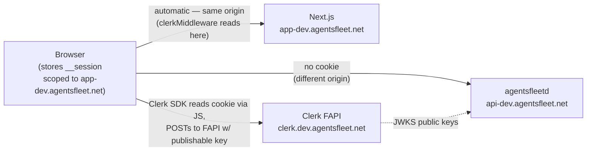
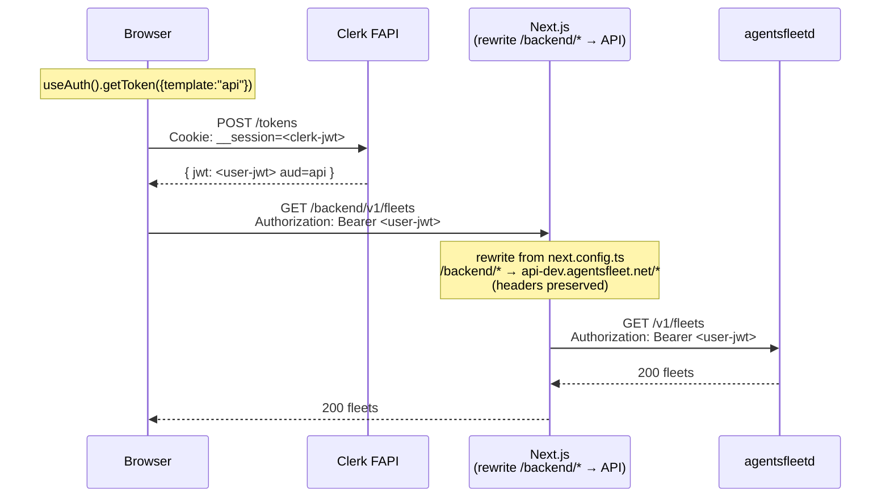
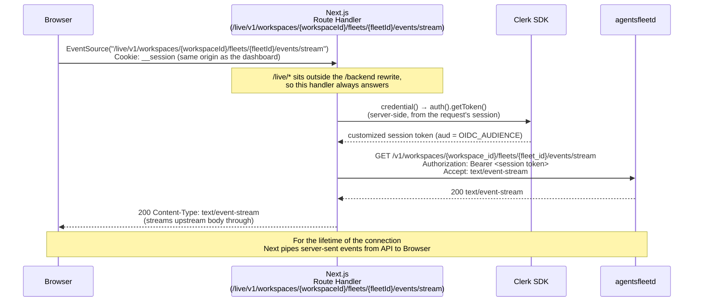
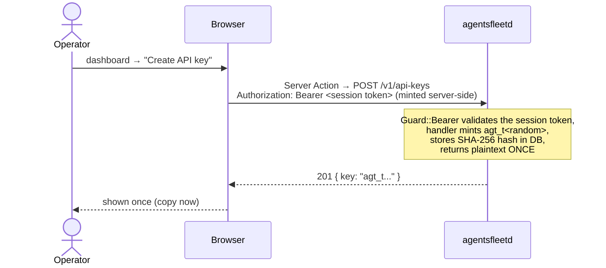
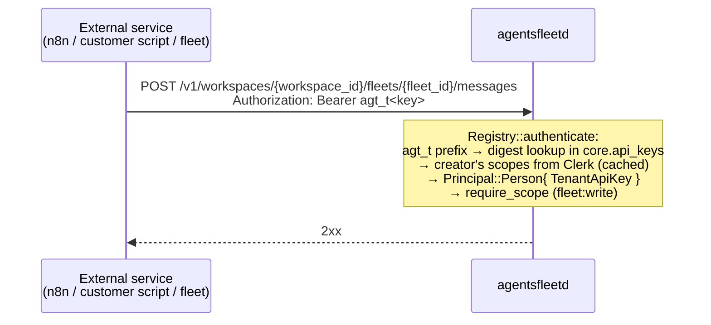
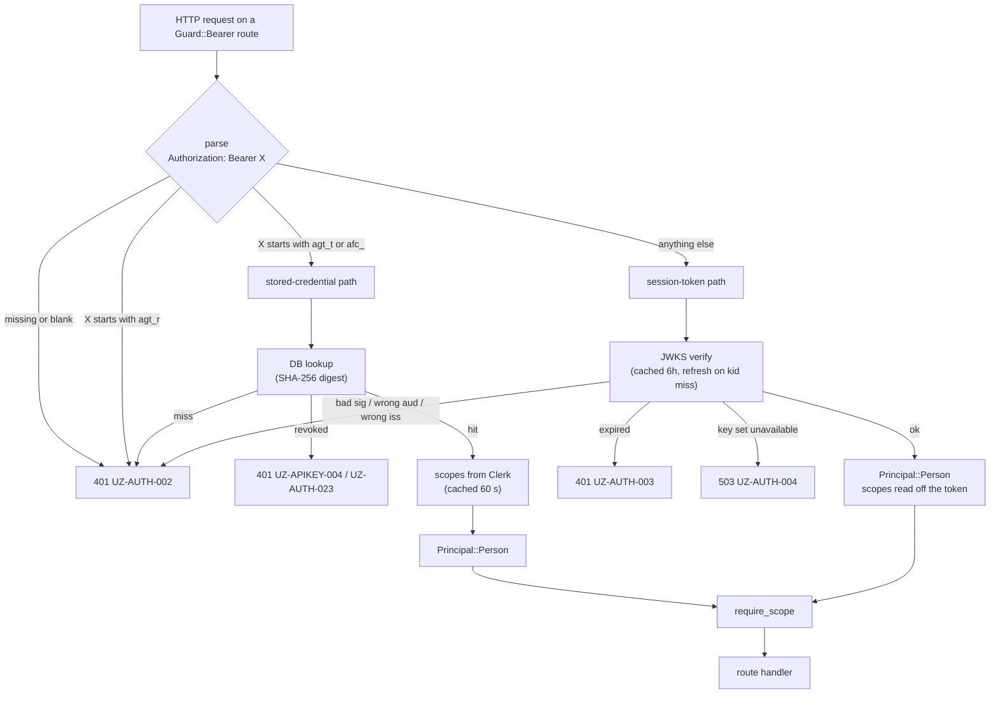

# Authentication

Five principal surfaces reach the Rust backend. The three credential flows for people and services converge on a single shape at the wire:

```
Authorization: Bearer <…>
```

Acronyms used throughout: command-line interface (CLI), JSON Web Token (JWT), JSON Web Key Set (JWKS, the identity provider's published signing keys), OpenID Connect (OIDC), Hash-based Message Authentication Code (HMAC), Server-Sent Events (SSE), Clerk's Frontend API (FAPI), time-to-live (TTL).

## Question → anchor index

Find the question, jump to the one §-section that answers it. Do not read the whole file to answer one question. (User-facing auth usage — logging in, creating an API key — is published at [docs.agentsfleet.net](https://docs.agentsfleet.net); this file is the contributor-facing model.)

| Question | Where |
|---|---|
| Which validator handles my route's credential? | §Auth model in one screen |
| What scope does a route require? | `afd_http`'s route table (declaration) + §"Scope catalogue" (meaning) |
| Where do a principal's scopes come from, per credential? | §"Scope catalogue" → §"CLI credential — resolved, not granted" |
| How does `agentsfleet login` work, and its threat model? | §"Flow 1 — CLI device flow (`agentsfleet login`)" + [`AUTH_DEVICE_LOGIN.md`](./AUTH_DEVICE_LOGIN.md) |
| Why does the dashboard send Bearer, never the cookie? | §"Flow 2 — UI (browser dashboard)" → §"Where the cookie lives" |
| Why does the dashboard carry one token and not two? | §Why the dashboard rides one token |
| How is the SSE stream authenticated? | §SSE stream — Next Route Handler injects Bearer |
| How is an `agt_t` tenant key checked? | §"Flow 3 — Tenant API key (service-to-service)" |
| What can a runner token reach — and never reach? | §"Runner token (`agt_r`) — the machine principal" → §"Least privilege" |
| Who can mint Token B, and where do secrets live? | §"Security model — who can mint Token B and where the secrets live" |
| Where may `CLERK_SECRET_KEY` be *sent*? | §Where the secret is sent — `CLERK_API_BASE` |
| How do I rotate `CLERK_SECRET_KEY`? | §Rotation procedure |
| Signed in, but nothing loads (`503 UZ-AUTH-004`)? | §"How the key set is fetched (`rustd/crates/afd_identity/src/jwks/http.rs`)" |
| May field X appear in a log / metric / error body? | §Sensitive-data classification |
| What does a signup write, and in what order? | §"Signup — what `user.created` writes" |
| Who can open a workspace, and why is a member refused (`403 UZ-AUTH-026`)? | §Who opens a workspace |
| How does an invite become a membership? | §Invites |
| How is an operator's cross-tenant access recorded? | §Platform crossing |
| How is a manual fleet webhook authenticated? | §"Manual fleet-webhook auth (separate surface)" |
| How does an OAuth connector mint and refresh? | §"OAuth connectors (separate surface — M106, generalized by the M108 registry)" |
| Which inbound surfaces are signature-verified? | §The three signed inbound surfaces |

## The three flows at a glance

```
            ┌──────────────────────────────────────────────────────────────┐
            │                                                              │
            │  WHO IS THE ACTOR?                                           │
            │                                                              │
            │   ┌─────────────┐  ┌─────────────┐  ┌─────────────┐          │
            │   │A human at a │  │A human in a │  │A machine    │          │
            │   │terminal     │  │browser tab  │  │(script/bot) │          │
            │   └──────┬──────┘  └──────┬──────┘  └──────┬──────┘          │
            │          │                │                │                 │
            │          ▼                ▼                ▼                 │
            │   ┌─────────────┐  ┌─────────────┐  ┌─────────────┐          │
            │   │   FLOW 1    │  │   FLOW 2    │  │   FLOW 3    │          │
            │   │             │  │             │  │             │          │
            │   │ agentsfleet │  │  Dashboard  │  │ Tenant API  │          │
            │   │ login       │  │  sign-in    │  │ key agt_t…  │          │
            │   │             │  │             │  │             │          │
            │   │ verification│  │ Clerk       │  │ static hash │          │
            │   │ code + ECDH │  │ __session   │  │ in DB       │          │
            │   │ 5-min       │  │ cookie →    │  │             │          │
            │   │ HANDSHAKE   │  │ getToken    │  │ long-lived  │          │
            │   │   ↓ mints   │  │ ()          │  │ revocable   │          │
            │   │ afc_… cred  │  │ ~60s, auto- │  │             │          │
            │   │ NO EXPIRY   │  │ refreshed   │  │             │          │
            │   └──────┬──────┘  └──────┬──────┘  └──────┬──────┘          │
            │          │                │                │                 │
            │          └────────────────┴────────────────┘                 │
            │                           │                                  │
            │                           ▼                                  │
            │              Authorization: Bearer <…>                       │
            │                           │                                  │
            │                           ▼                                  │
            │        afd_auth::Registry — routes by prefix:                │
            │          afc_*  → DB lookup + live scope resolve  (a person) │
            │          agt_t* → DB lookup + creator's scopes    (a tenant) │
            │          agt_r* → runner plane only               (a machine)│
            │          else   → Clerk JWKS verify               (dashboard)│
            │                                                              │
            └──────────────────────────────────────────────────────────────┘
```

| When to use which | Flow 1 | Flow 2 | Flow 3 |
|---|---|---|---|
| Human present at the keyboard? | ✅ required (5-min interactive flow) | ✅ required | ❌ |
| Long-lived credential? | ✅ the `afc_` credential has no expiry — it ends by explicit revoke (M160_002 §3 wires `logout` to it) | ❌ minted per request | ✅ until explicitly revoked |
| Provisioned via | `agentsfleet login` | Clerk sign-in form | dashboard "Create API Key" surface |
| Right answer for | a developer on a workstation; Cursor/Claude Code running locally with the developer present | someone using `app.agentsfleet.net` in a browser | n8n / Zapier / cron jobs / CI runners / Kubernetes / scheduled background work |
| Wrong answer for | unattended CI / cron / K8s / hosted-fleet platforms — see [`AUTH_DEVICE_LOGIN.md`](./AUTH_DEVICE_LOGIN.md) *Human-led-only invariant* | none — this is the only browser path | interactive humans (`agt_t` long-lived keys carry too much standing privilege for a workstation) |

A fourth surface — **inbound webhooks** — does not use Bearer at all (HMAC-signed by the provider). See §"Manual fleet-webhook auth (separate surface)".

A fifth surface — the **runner token** (`agt_r`) — is the first *machine* principal: a host-resident `agentsfleet-runner` that holds no tenant identity at all. Same Bearer wire shape and DB-hash lookup, but its own trust plane (`Plane::Runner`), so the same guard layer refuses it on every tenant route. See *Runner token* below.

Cookies **never reach the Rust backend**. The Clerk `__session` cookie lives on the dashboard's own host (`app.agentsfleet.net`) — written by the Clerk SDK on the page after sign-in. Same-origin policy means it only attaches on requests back to the dashboard, never to `api-dev.agentsfleet.net`. See *Flow 2 — UI* below for the cookie-vs-Bearer picture.

Every route declares a guard in `afd_http`'s route table (`Guard`, `rustd/crates/afd_http/src/route/mod.rs`). A `Guard::Bearer` or `Guard::RunnerBearer` route passes through one layer, `prove` (`rustd/crates/afd_http/src/auth/guard.rs`). It hands the header to the plane's `afd_auth::Registry` (`authenticate_header`, which parses the Bearer value and calls `authenticate`, `rustd/crates/afd_auth/src/authenticate.rs`), which reads the credential's prefix (`CredentialKind::of`) and picks one of two paths:

- `agt_t`, `afc_`, `agt_r` → a **stored credential**: SHA-256 digest, one row lookup, a revocation check.
- anything else → a **session token**: verified against the identity provider's cached JSON Web Key Set (JWKS) — RS256 signature, `iss`, `aud`, `exp` — with the `scopes` claim read off the token.

Every path ends in one `Principal` (`rustd/crates/afd_auth/src/principal.rs`): a `Person` for the three human credentials, a `Runner` for `agt_r`. Most handlers take a `PersonIdentity` and never learn which credential class was used; the few that must narrow by class take `DashboardIdentity`, `FreshSession` or `HumanIdentity` instead (`rustd/crates/afd_http/src/auth/person.rs`). Minting a CLI credential, for one, takes `FreshSession`, a browser session alone.

---

## Auth model in one screen

Five principal surfaces, one wire shape (`Authorization: Bearer …`), and a prefix that routes to the right validator.

| Principal | Credential | Issuer | Validation | Route guard → path |
|---|---|---|---|---|
| Human at a terminal (CLI) | `afc_<hex>` CLI credential | backend (`POST /v1/cli-credentials`, paid for with a Clerk api-template JWT) | SHA-256 hash lookup + revocation check; scopes resolved live from Clerk on `oidc_subject` | `Guard::Bearer` → stored credential |
| Human in a browser (dashboard) | Clerk session token | Clerk | JWKS verify + `aud` | `Guard::Bearer` → session token |
| Service / automation | `agt_t<hex>` tenant api key | backend | SHA-256 hash lookup; scopes resolved live from Clerk for the key's creator (`created_by`) | `Guard::Bearer` → stored credential |
| Host runner (machine) | `agt_r<hex>` runner token | backend (`POST /v1/runners`) | SHA-256 hash lookup in `fleet.runners` | `Guard::RunnerBearer` on `/v1/runners/me/*` |
| Inbound webhook (provider) | HMAC signature (no Bearer) | provider | per-provider HMAC | `Guard::WebhookSignature` / `WebhookHmac` / `Svix` / `PayloadSigned` → verified in the handler |

The prefix decides the path before anything is looked up, so `agt_t` and `afc_` never reach the session-token verifier. Each group of routes is a `Plane` (`rustd/crates/afd_auth/src/plane.rs`): `Plane::Tenant` accepts the session token, `agt_t` and `afc_`; `Plane::Runner` accepts only `agt_r`. A class the plane does not accept is refused before any datastore read, so a runner token cannot satisfy a tenant route and the reverse.

Authorization is **scope-based** (M104_001). Every capability is an explicit `resource:action` scope carried on the verified token's `scopes` claim and surfaced as `principal.scopes` (a bitset). Two independent axes decide a request:

1. **Capability** — `require_scope` (`rustd/crates/afd_auth/src/gate.rs`) checks the route's required scopes (declared per route + HTTP method in `afd_http`'s route table) against `principal.scopes`, any-of, hierarchy-expanded. Absent/insufficient ⇒ `403 UZ-AUTH-022`, whose detail names the whole requirement (`Requires scope a or b`), because any one of them would pass.
2. **Ownership** — the ownership layer checks the principal owns the workspace's account or holds a membership in it, independent of scopes. A `member` is then withheld two owner-grade capabilities (§Memberships and roles). The two compose: holding `fleet:write` does not let you touch a workspace outside your accounts.

Capabilities have no role ladder and no capability bool. A role that grants is an undocumented bundle, and "what may this principal do" needs an enumerable answer. The two account roles grant nothing; they only withhold. See the **Scope catalogue** below for the full vocabulary, the `read < write < admin` hierarchy, and the default provisioning grants.

Everything below is per-surface detail. For the CLI device-flow threat model + crypto, see [`AUTH_DEVICE_LOGIN.md`](./AUTH_DEVICE_LOGIN.md).

---

## Scope catalogue

The complete capability vocabulary. The enum in `rustd/crates/afd_auth/src/scope.rs` is canon; this table restates it for reading, and drift between the two is a bug. The user-mintable subset (what a tenant API key can carry) is published separately at [docs.agentsfleet.net/api-reference/scopes](https://docs.agentsfleet.net/api-reference/scopes) — operator and platform scopes stay out of that page on purpose. Scope strings are the JWT `scopes` claim values — matched **verbatim** in the Clerk session-token template (RULE UFS). The `read < write < admin` ladder is stored as data: holding a higher scope satisfies a lower requirement (a `fleet:admin` holder passes a `fleet:read` gate), expanded at parse time.

**Laddered resources** (`read < write < admin`):

| Scope | Grants |
|---|---|
| `fleet:read` / `fleet:write` / `fleet:admin` | view fleets+events+memories / create+update+message fleets / delete a fleet |
| `schedule:read` / `schedule:write` | view hosted schedules / create, update, delete, and explicitly sync hosted schedules |
| `secret:read` / `secret:write` | list workspace secrets / store, rotate, delete them (+ tenant LLM provider config) |
| `apikey:read` / `apikey:write` / `apikey:admin` | list tenant api-keys / create, and revoke (`PATCH /v1/api-keys/{id}`) / delete a revoked key (`DELETE /v1/api-keys/{id}`) |
| `grant:read` / `grant:write` | list integration grants / revoke them |
| `connector:read` / `connector:write` | read connector status and the catalogue / start, complete, or disconnect a connector — gates the generic `{provider}` connector routes (every registry provider: Slack OAuth, GitHub App install, …); see §"OAuth connectors (separate surface — M106, generalized by the M108 registry)" |
| `model:read` / `model:admin` | read the priced model catalogue / create+update+delete catalogue rows |
| `platform-key:read` / `platform-key:admin` | read the platform default key/model / set+delete it |
| `runner:read` / `runner:write` | list and read runners, their events and their leases (operator plane) / `PATCH /v1/fleets/runners/{runner_id}` (cordon, drain, revoke, rotate the credential, self-test, reassign policy, replace its placement labels) and `DELETE` (retire a revoked runner's record) |

**Discrete verbs** (no ladder — a distinct action):

| Scope | Grants |
|---|---|
| `runner:enroll` | create a trusted runner (mint a `agt_r`) — uniquely dangerous (the host then receives every tenant's inline secrets); held independently of `runner:read`/`runner:write` so it is separately grantable/revocable |
| `stream:read` | reserved for an operator diagnostic of the live SSE streams open on an instance. No route in `rustd/crates/afd_http/src/route/` requires it today, so holding it reaches nothing |
| `approval:read` / `approval:resolve` | view the approval inbox / decide (approve or deny) an approval gate. The one pair here with a ladder: `approval:resolve` includes `approval:read` (`HIERARCHY`, `scope.rs`) |
| `billing:read` | read the tenant billing balance and its charges (`/v1/tenants/me/billing`, `/v1/tenants/me/billing/charges`) |
| `workspace:admin` | create workspaces; list the tenant's workspaces; manage the account's invites and members (§Invites) |
| `library:write` | mutate the Fleet library catalogue — tenant-tier onboarding, held by a workspace owner (consumed by M103) |
| `platform-library:write` | mutate the Fleet library catalogue — platform-tier onboarding (`POST /v1/admin/fleet-libraries`), held by a platform operator. Independent of `library:write` — no hierarchy between the two |

**Runner credential** (machine identity — minted onto the `agt_r` token, never granted to a human):

| Scope | Grants |
|---|---|
| `runner:self` | the runner's own plane: `/v1/runners/me/*` (heartbeat, lease and the per-lease routes under it, report, credential-mint, memory). Only the runner-token principal carries it, and it carries *only* this — so a runner cannot reach a tenant route and a user/api-key cannot reach a runner route |

**Cross-tenant override** (held by almost no one; every use audited):

| Scope | Grants |
|---|---|
| `workspace:any` | bypass the membership check to read and act on *any* tenant's workspace. Every crossing is logged once, with its method (§Platform crossing). Mirrors Sentry's `is_global`. |

### Provisioning grants

Capabilities reach a principal as an explicit `scopes` claim. The identity provider is the single authority for every credential that names a person; code carries exactly two scope constants (`scope.rs`), one written *to* the provider at signup and one read for the machine plane — and **neither is checked at a gate** (gates take `Scope` values). All other capability sets are provisioned **manually** at the identity provider.

**Two sources resolve rather than grant.** The CLI credential (`afc_`, Flow 1) and the tenant api-key (`agt_t`, Flow 3 — since M160_002 §6) carry no code-side grant. Each proves *identity* only; capabilities are fetched from the identity provider per request — keyed on the owning user's `oidc_subject` for `afc_`, and on the creator's subject in `created_by` for `agt_t` — through one shared resolver and one cache, parsed by the same `parse_claim` the session-token path uses. A key is exactly as capable as the person who minted it: narrowing that person at the provider narrows every key they created, on the next request past the cache window, with no deploy and no backfill. See *CLI credential — resolved, not granted* below for the resolver's failure modes; the `agt_t` path shares all of them.

**Code-side scope sets** — two remain, for opposite reasons:

| Constant | Scopes | Why it exists in code |
|---|---|---|
| `TENANT_OWNER_GRANT` | `fleet:admin`, `schedule:write`, `secret:write`, `apikey:admin`, `grant:write`, `connector:write`, `billing:read`, `workspace:admin`, `library:write`, `approval:resolve` | WRITTEN once into a new owner's `public_metadata.scopes` at signup, rendered space-delimited by `signup_owner_claim()` (`rustd/crates/afd_auth/src/scope.rs`). The writeback runs from the ingress plane's identity-events handler (`rustd/crates/afd_api_ingress/src/handler/webhook/identity_route.rs`), not the tenant one. A seed, not an authority: the provider owns the value from that instant, and an operator's edit wins permanently. No platform/cross-tenant scope, preserving "an admin cannot enroll a runner" |
| `RUNNER_SCOPES` | `runner:self` | DERIVED for every `agt_r` runner principal by `Principal::scopes` (`rustd/crates/afd_auth/src/principal.rs`), never stored on it — the one credential class with no identity at the provider to resolve against, because it names a machine, not a person |

**Approving follows the person, not the credential class (M160_002 §6, Indy's call, Aug 13, 2026).** An earlier revision authored a machine grant in code — the owner set minus `approval:resolve` — so that a Fleet holding an `agt_t` key could not approve the gate guarding its own next action. That subtraction is retired with the grant that carried it: a key inherits its creator's capabilities exactly, so a key minted by someone holding `approval:resolve` can resolve approvals, and a key minted by a narrowly-provisioned collaborator cannot do what its creator cannot. The gate is scoped to the person; keeping an automation out of the approval surface is done by narrowing the person (or minting the key as a narrower one), not by a credential-class carve-out. `test_narrowing_at_the_provider_reaches_the_next_request` (`rustd/crates/afd_identity/tests/capability_windows.rs`) pins the narrowing half.

**Manually-provisioned scope sets** — written by a human onto `public_metadata.scopes` in Clerk. There is **no code bundle**: these are recommended scope lists, not roles. Copy the exact strings (RULE UFS); each capability is enforced per-scope like any other.

| Recommended for | Scope set |
|---|---|
| platform operator (almost no one) | `runner:enroll`, `runner:write`, `stream:read`, `model:admin`, `platform-key:admin`, `platform-library:write`, `workspace:any` |
| read-only collaborator | `fleet:read`, `schedule:read`, `grant:read`, `connector:read`, `billing:read`, `approval:read` |

### CLI credential — resolved, not granted

> **Status: live, revocation included (M160_002 §3 and §4, done).** `POST /v1/cli-credentials` and `DELETE /v1/cli-credentials/{id}` are routed (`rustd/crates/afd_http/src/route/tenant.rs`). A mint revokes the same machine's live credential in the same transaction, and a partial unique index on `(user_id, machine_name)` keeps one live credential per machine (`rustd/crates/afd_tenant/src/cli_credential/mod.rs`). `agentsfleet logout` revokes the credential server-side (`cli/src/commands/auth-logout.ts`). The command-line interface stores the API URL it logged into beside the credential and refuses to guess a deployment for it (`guardCommand`, `cli/src/program/auth-guard.ts`). No Clerk JWT reaches disk.

The `afc_` credential minted by `agentsfleet login` proves identity and resolves capability, the model the `agt_t` key now shares. Its authenticate path is:

```
Bearer afc_… → SHA-256 → core.cli_credentials row (JOIN core.users)
             → tenant_id, oidc_subject, revoked_at
             → revoked?  → UZ-AUTH-023
             → scope resolver, keyed on oidc_subject (cached 60 s)
             → parse_claim(claim)           ← same parser the session-token path uses
             → Principal::Person{ CliCredential, scopes }
             → require_scope                ← same gate, same route table
```

**How `agt_t` relates (M160_002 §6).** A tenant key now takes the same path, keyed on the creator's subject in `created_by`. That reverses an earlier position on this page which held the two apart so a key would outlive the admin who minted it — superseded by Indy's Aug 13, 2026 decision: one authority, the key follows its person. The consequence is deliberate and fail-closed: erase a key's creator at the provider and the key resolves to no capability on its next uncached request — it authenticates and is refused at every gate, exactly as a deleted person's terminal credential is. A key that must survive personnel change belongs to a person-shaped service identity at the provider, not to a carve-out in code.

**What a fixed grant would have cost.** Start from what a normal account holds. A self-serve signup is written the full `TENANT_OWNER_GRANT` set at `user.created` (the ingress plane's `identity_route.rs`). So the ordinary command-line user is a tenant admin in the terminal for the same reason they are one in the dashboard: Clerk says so. A narrower person is not what signup produces. They exist only where an operator hand-wrote a smaller set onto `public_metadata.scopes` (see *Manually-provisioned scope sets*).

That is exactly who a code-applied grant would have harmed. A grant authored in code is keyed by *credential source*, not by person, so a CLI entry would have had to name one fixed set applied to every terminal — and the only sensible candidates are the tenant sets. A hand-narrowed collaborator would then have been widened back to that set on their next `login`, silently, by the credential change alone. Resolving the claim avoids authoring a grant at all: the terminal cannot disagree with the dashboard, and narrowing someone in Clerk reaches every terminal they hold within the cache window instead of requiring a hunt for credentials to revoke.

**Why the claim is not stored on the row.** Snapshotting it at mint would make `core.cli_credentials` a second store of a fact Clerk owns, and it would freeze at issuance; a Postgres projection fed by `user.updated` webhooks would add backfill, ordering, and reconciliation to operate. The resolver holds an in-memory TTL cache instead — a latency optimisation with no persistence, so there is nothing to reconcile and staleness self-heals toward Clerk within the TTL.

**Failure modes.** A fresh answer is served for 60 seconds without asking Clerk again. With Clerk unreachable, the last confirmed answer is served for up to 15 minutes (`DEFAULT_TTL_MS`, `DEFAULT_STALE_CEILING_MS`, `rustd/crates/afd_identity/src/capability.rs`). Past that, or with nothing cached: `503 UZ-AUTH-004`, the same answer a key-set fetch failure gives on the session-token path. No claim provisioned for the subject: empty set, fail closed.

**Subject unknown to Clerk (404) — empty set, and deliberately not cached.** This cannot arise at login: the device flow needs a live Clerk user to approve in the browser, so an unknown subject never reaches a mint. It arises *after* one, and only because the credential is durable — the row outlives the person. **This 404 branch is currently the only thing closing that window, and that is a known gap.** Account teardown on `user.deleted` is not ported. The Rust handler answers every event type other than `user.created` with `200 {"ignored":"<event type>"}` (`identity_route.rs`), because a destructive delete does not belong in the milestone that opens accounts; the gap is visible in the answer rather than hidden behind a 404. Until teardown lands there is no `DELETE FROM core.users`, so `250_cli_credentials.sql`'s `ON DELETE CASCADE` never fires and the credential row outlives the person indefinitely. The same branch also covers the cases a teardown webhook would miss anyway — a wiped Clerk development instance replays no per-user events, a delivery can be lost or rejected, and a database restored from a backup predating the deletion resurrects the row. In each case a live credential names someone Clerk no longer knows, so it resolves to no capabilities and every gate refuses it by scope. `UZ-AUTH-004` was the alternative and is wrong here: it tells a terminal to retry a credential that will never work again. The result is not cached, because a deletion is permanent and needs no cache while a transient 404 must not blank a live operator for a whole freshness window.

**Known gap.** Flow 1's credential is durable and shareable (accepted, see the M160 spec), so a shared credential carries the *sharer's* current scopes. Narrowing the sharer narrows every terminal holding it, which is the intended direction, but there is no per-credential ceiling below the person's own grant. Adding one is a row column and an intersection at `parse_claim`, not a redesign.

**Development provisioning.** To unlock the Runners page and Model rates page for a local/dev user, grant only the read scopes those views need — set this onto that user's Clerk Public metadata:

```json
{ "tenant_id": "<their-tenant-uuid>", "scopes": "runner:read model:read" }
```

This requires the Clerk **session-token claims** to project `public_metadata.scopes` into the top-level `scopes` claim, and `public_metadata.tenant_id` into `metadata.tenant_id` (`playbooks/founding/03_priming_infra/001_playbook.md`, step "Configure Clerk claims"). Setting Public metadata alone does nothing if the claims do not map it.

Grant the full platform-operator bundle only to a dev user who genuinely needs write and admin actions. The bundle is `runner:enroll runner:write stream:read model:admin platform-key:admin platform-library:write workspace:any`, shown in the table above. It carries `platform-key:admin`, which can rotate the platform language-model key, and `workspace:any`, which reaches across tenants. Neither belongs in a "just let me see the page" default.

---

## Signup — what `user.created` writes

An account opens on one Svix-signed `user.created` delivery from Clerk. The
route is `POST /v1/auth/identity-events/clerk`. Its path sits in the auth family,
but it is served by the **ingress** plane, not the tenant one, because nothing
about it is bearer-proven: the caller is a vendor presenting a signature over a
body (`rustd/crates/afd_api_ingress/src/handler/webhook/identity_route.rs`;
`afd_api_tenant/src/lib.rs` returns `None` for this verb).

```
Clerk user.created
  │
  ├─► Svix signature verify        (bad signature or absent secret → 401;
  │                                 UZ-WH-010 vs UZ-WH-020 in the body)
  │
  ├─► primary address, verified    (none → 400 UZ-REQ-001, metric reason missing_email;
  │                                 unproven → 400 UZ-REQ-001, reason unverified_email)
  │
  ├─► ONE Postgres transaction     (rustd/crates/afd_tenant/src/signup/mod.rs)
  │     1. core.tenants            one per person
  │     2. core.users              the OIDC subject, unique
  │     3. core.memberships        owner, linking the two
  │     4. core.workspaces         a default, name generated
  │     5. billing.tenant_wallet   the starter grant
  │   commit — four of five is not an account
  │
  └─► best-effort Clerk writeback  PATCH {CLERK_API_BASE}/users/{subject}/metadata
        {tenant_id, scopes}        scopes = signup_owner_claim()
        failure is logged, never answered with
```

**Five rows, one transaction.** A tenant with no wallet answers 500 on every
billing read with no path back. The transaction is the reason a partial account
cannot exist.

**Only a verified primary address opens an account.** Accepting an invite matches
the invite's address against this one. An address nobody proved would hand its
invites to whoever typed it. So the delivery's primary address must carry Clerk's
`verified` status, or the delivery is refused with 400 and counted under
`agentsfleet_signup_failed_total{reason="unverified_email"}`. Clerk verifies the
address at sign-up with an emailed code, so this check is a backstop: it holds if
a sign-up method that admits unverified addresses is ever enabled.

**Idempotent on `oidc_subject`.** An identity provider retries, and a second
delivery for a subject already opened must answer exactly as the first did. The
handler reads before it writes and reports the replay. That pre-read is an
optimisation, not the arbiter: two concurrent deliveries can both pass it, so the
second trips `uq_users_oidc_subject` (`schema/220_users.sql`), re-reads what the
winner committed, and answers as a replay. An index holds under concurrency and a
read never can.

**The writeback cannot fail the delivery.** The tenant row is already committed,
so refusing the delivery would reject an account that exists and invite a retry
that can only duplicate work. A failed writeback is logged with the tenant and the
reason (the subject stays out of the log line), because what it costs is a person whose next token carries no tenant
— which an operator repairs from the provider's dashboard, and only if the log
gave them something to repair from.

**Signup writes nothing to Dragonfly.** No key, no stream, no queue. The account
is five Postgres rows and one outbound call to the identity provider; the
datastore learns about a tenant when that tenant's first fleet is installed.

## Memberships and roles

A person opens a workspace when they own its account or hold a membership in
it. Two roles exist, `owner` and `member`, stored in `core.memberships.role`
(`rustd/crates/afd_tenant/src/workspace/access.rs`).

A role grants no capability. A `member` loses two inside the owner's account:
writing a secret and connecting an integration. Each is refused with
`403 UZ-AUTH-026`.

### Who opens a workspace

| Caller | Reaches | Refused |
|---|---|---|
| `owner` of the account | every workspace route, plus the account's invites and members | nothing by role |
| `member` of the account | every workspace in the account: fleets, steering, streams, schedules, approvals, secret names, and every stored secret through the fleets they write | routes needing `secret:write` or `connector:write`, with `403 UZ-AUTH-026` |
| platform operator holding `workspace:any` | any account's workspace, with every method | nothing by role; each crossing is logged (§Platform crossing) |
| anyone else | nothing | `403 UZ-AUTH-001`, `Workspace access denied` |

```
request on /v1/workspaces/{workspace_id}/…
  │
  ├─► capability gate, on the caller's own scopes
  │     a required scope missing                    → 403 UZ-AUTH-022
  │
  ├─► ownership layer, one statement (AUTHORIZE_WORKSPACE)
  │     owner of the account                        → handler
  │     member, route needs secret:write
  │       or connector:write                        → 403 UZ-AUTH-026
  │     member, any other route                     → handler
  │     neither, holds workspace:any                → audit event, then handler
  │     neither                                     → 403 UZ-AUTH-001
  │     Postgres unreachable                        → 503, never 403
  │
  └─► handler
```

**Scopes first, role second.** The capability gate passes a member on the
scopes signup wrote for their own account, and those include `secret:write`.
The role then withholds it inside somebody else's account
(`rustd/crates/afd_http/src/auth/ownership/role.rs`).

**The withheld list names capabilities.** `OWNER_ONLY` holds `secret:write` and
`connector:write`. A route mounted later that needs either is withheld from
members with no change to the route.

**A member uses every secret, through fleets.** The role withholds writing a
secret, not using one. A member who installs or edits a fleet can declare any
secret stored in the workspace, and the runner receives its value at lease
(`rustd/crates/afd_credential/src/secrets/mod.rs`). An invited member is
trusted with the workspace's secrets (Indy, Oct 01, 2026). To keep a secret
from a person, keep that person out of the account.

**The platform admin account invites like any other.** A member of the account
that holds the platform admin workspace reaches that workspace, and through
its fleets the platform bags in its vault: `smtp-relay`, the `<provider>-app`
secrets and the platform model key. Accepted as is (Indy, Oct 01, 2026); invite
into the operator's account only people trusted with the deployment.

**One statement decides.** `AUTHORIZE_WORKSPACE`
(`rustd/crates/afd_tenant/src/sql/workspace.rs`) joins the workspace, the
caller's user row and their membership. It admits a membership row, or the
caller's own account from their user row or token claim. Each probe returns at
most one row, so the plan is three index lookups at any table size.

**An outage is a 503.** When the check cannot reach Postgres, the answer is
`503`. A `403` would tell a person their workspace had vanished during a blip
(`test_access_check_outage_is_not_denial`).

**Open streams re-check.** A fleet's event stream re-checks access on each
15-second heartbeat, and the workspace wall on each 10-second refresh. A
removed member's streams send `event: access_revoked` and close. A re-check
that errs or runs past 500 ms is deferred and logged; four deferrals in a
row close the stream without that frame, and reconnecting re-authorises at
open. The dashboard's stream proxy turns a 403 `UZ-AUTH-001` at open into
the same `access_revoked` frame, so a member removed while a tab slept stops
too.

### Invites

| Caller | Route | Scope | Effect |
|---|---|---|---|
| owner | `POST /v1/tenants/me/invites` | `workspace:admin` | invites an email address |
| owner | `GET /v1/tenants/me/invites` | `workspace:admin` | lists pending invites |
| owner | `DELETE /v1/tenants/me/invites/{invite_id}` | `workspace:admin` | revokes an invite |
| owner | `POST /v1/tenants/me/invites/{invite_id}/send` | `workspace:admin` | sends the invite email again |
| owner | `GET /v1/tenants/me/members` | `workspace:admin` | lists the account's people |
| owner | `DELETE /v1/tenants/me/members/{user_id}` | `workspace:admin` | removes a member |
| invitee | `GET /v1/users/me/invites` | none | lists invites waiting for the signed-in address |
| invitee | `POST /v1/users/me/invites/{invite_id}/accept` | none | joins the account as a `member` |

**`/v1/tenants/me` is always the caller's own account.** Owning it is a fact of
the path: the `OwnTenant` extractor resolves the caller's own account before the handler runs (`rustd/crates/afd_api_tenant/src/handler/tenant/own.rs`). A member
calling these routes manages their own account, never the one they joined.

**Accepting takes no scope.** The signed-in person's email must match the
invite's address. Accepting twice leaves one membership and returns the same
body.

**An invite address must be one the mailer can send to.** Creating an invite
runs the address through the parser the invite email uses
(`afd_mail::deliverable`), so the route answers `400` rather than storing an
invite whose every send would fail. The dashboard's form checks first, for
instant feedback.

**A tenant API key acts as its creator here too.** Every route in this table
admits a session, a CLI credential or a tenant API key (`PersonIdentity`). A
key can invite an address and remove a member, so a leaked key can add a member
who outlasts the key: revoke the key, then remove that member. Kept as is
(Indy, Oct 01, 2026).

| Code | Status | Cause | Fix |
|---|---|---|---|
| `UZ-INV-001` | 404 | No acceptable invite has that identifier: never issued, expired, revoked, or accepted by someone else | Ask the owner for a new invite |
| `UZ-INV-002` | 403 | The invite went to another address | Sign in with the address the invite was sent to |
| `UZ-INV-003` | 409 | The address has a pending invite, or already belongs to the account | Use the pending invite, or skip a person already in |
| `UZ-INV-004` | 409 | Removing this person would leave the account without an owner | Keep one owner in the account |
| `UZ-INV-005` | 503 | Send-again found no mail relay, or the relay refused or did not answer | Copy the invite link, or send again later |
| `UZ-AUTH-026` | 403 | A member reached a route that writes a secret or connects an integration | Ask the account owner to make the change |

### Invite email

Creating an invite sends one email to the invited address. It names the
inviter and the account, and it carries the accept link. `afd_mail` renders it
from `rustd/crates/afd_mail/templates/invite.{html,txt}`.

The names appear as the inviter's profile spells them, in the subject and the
body. The templates escape them and the subject header is encoded, so a name
cannot add markup or a header. Names are not shortened or filtered (Indy,
Oct 01, 2026).

The email goes through the Simple Mail Transfer Protocol (SMTP) relay named by
the `smtp-relay` platform bag. That bag lives in the admin workspace's vault,
with `host`, `port`, `username`, `password` and `from_address`. The daemon reads
it on every send, so a rotated password needs no restart.

The relay password never leaves the vault read. It is not logged, returned, or
written to configuration. Port 465 uses implicit Transport Layer Security (TLS),
and any other port must upgrade with STARTTLS.

Plaintext SMTP goes only to a loopback host such as Mailpit on a developer's
machine. `playbooks/operations/smtp_relay_registration/001_playbook.md` sets the
bag up for each deployment.

The invite is saved before the email is sent, so email never loses an invite.
Each invite records the outcome of its latest send as `email_status`:

| `email_status` | Meaning | What the owner does |
|---|---|---|
| `sent` | The relay accepted the email | Nothing |
| `failed` | The relay refused it, did not answer, or the send never finished | Send again, or copy the link |
| `unconfigured` | This deployment has no `smtp-relay` bag | Copy the link; an operator runs the playbook |

Send-again is a new attempt with its own `Resend-Idempotency-Key`. A retry
inside one attempt reuses that key, so the relay delivers the email once.
Logs carry the invite identifier, the attempt and the reply code. They never
carry the address or the email body.

### Platform crossing

A platform operator holding `workspace:any` reaches any account's workspace
with every method. The ownership layer logs each crossing once, before the
handler runs (`rustd/crates/afd_tenant/src/workspace/crossing.rs`). The
connector callback authorizes outside that layer and calls the same audit.

The `warn` event is `cross_tenant_workspace_override`, with `subject`,
`acting_tenant`, `target_tenant`, `target_workspace` and `method`. The method
tells a reviewer a look from an act. Access from inside the account logs
nothing.

A steer the operator sends records `steer:<subject>` as its actor, so the
fleet's thread names the operator (`test_platform_write_acts_attributed`).

## Flow 1 — CLI device flow (`agentsfleet login`)

A browser-mediated device flow. The person approves in a browser, a
verification code ties them to the person typing in the terminal, and the minted
token rides back to the command-line interface encrypted. The flow produces a
durable `afc_` credential, the thing this page cares about. How that credential
resolves capability is [§CLI credential — resolved, not granted](#cli-credential--resolved-not-granted).
Unattended callers use `AGENTSFLEET_API_KEY`, which carries an `agt_t` tenant key;
`login` has no non-interactive path.

The sequence, session storage, threat model, pinned crypto primitives, deploy
rules and the human-led-only invariant live in **[`AUTH_DEVICE_LOGIN.md`](./AUTH_DEVICE_LOGIN.md)**.

---

## Flow 2 — UI (browser dashboard)

> **Post-Stage-1 reconciliation (M74_002 §9 shipped).** The Token A / Token B description in this section is the **historical pre-Stage-1 shape**, kept for context on *why* the split existed. **Current shape:** the dashboard rides **one** token — the customized session token (`auth().getToken()`, no template arg). The browser holds no token value of its own: reads run in React Server Components, mutations in Server Actions (both server-side), and the Server-Sent Events (SSE) route handler mints server-side. `AuthSessionKeeper` calls Clerk's `user.reload()` while a signed-in dashboard is active and when the browser resumes; this refreshes the `__session` cookie without returning token bytes to application code. For where this is headed, see [`architecture/web_app.md`](./architecture/web_app.md).

The root layout (`ui/packages/app/app/layout.tsx`) keeps `ClerkProvider` and
`AuthSessionKeeper`. `ShellFrame` owns persistent markup on the server.
`ShellControls` owns only route-aware controls and analytics context in the
browser. Loading mobile,
workspace, account, or route-tool code later does not remount the authentication
provider or create a second session-refresh lifecycle.

### Shape — browser dashboard

```
Browser tab on app.agentsfleet.net                            Rust backend (api.agentsfleet.net)
─────────────────────────────────                            ─────────────────────────────────
__session cookie  ──┐                                                    ▲
   (Token A)        │                                                    │
                    ▼                                                    │
    clerkMiddleware()                                                    │
    (Next.js page render)                                                │
                                                                         │
    useAuth().getToken({template:"api"})                                 │
        │  POST /tokens   + __session cookie                             │
        ▼                                                                │
    Clerk FAPI ───────────► <user-jwt>                                   │
                            (Token B, aud=api)                           │
                            │                                            │
                            ▼                                            │
    fetch("/backend/v1/…", { Authorization: Bearer Token B })            │
                            │                                            │
                            └─► /backend/:path* rewrite ──────────────────┘
                                (same-origin; preserved Bearer header)
```

The browser holds the Clerk `__session` cookie. It uses Clerk's SDK to convert that cookie into a short-lived API-audience JWT, then sends the JWT to the Rust backend. Two sub-flows:

- **Normal API calls** — the browser fetches `getToken()` directly via Clerk's React hook and sends the JWT as `Authorization: Bearer …` to `/backend/...` (same-origin proxy → Rust API).
- **SSE stream** — `EventSource` cannot set headers, so a Next.js Route Handler shadows the rewrite and injects the Bearer server-side.

### Where the cookie lives



The Rust backend never sees the cookie. It validates the bearer the dashboard's server sends: today the customized session token, signed by Clerk and verified against the key set Clerk publishes.

### Normal API call



### SSE stream — Next Route Handler injects Bearer

The seven token-minting proxy routes (per-fleet and workspace `events` + `events/stream`, the per-fleet event detail `events/{eventId}`, one tool call in full `events/{eventId}/tool-calls/{callId}`, and the steer `POST messages`) live under `/live/*`, deliberately OUTSIDE the `/backend/:path*` rewrite: on Vercel the edge router let the rewrite shadow same-prefix filesystem route handlers, sending EventSource requests cookie-only to the API (401 `UZ-AUTH-002`). A prefix the rewrite cannot match makes the routing unambiguous on every platform. `tests/stream-proxy-routing.test.ts` checks that no proxy URL starts with a rewrite prefix and that each has a handler on disk.

Each route mints through `credential()` (`ui/packages/app/lib/auth/credential.ts`), the one place the dashboard resolves a bearer, the same way a Server Action does. The four JSON reads share `lib/api/live-json-proxy.ts`, so their dot-segment guard, bearer minting and error passthrough live once. The two streams share the upstream fetch and response helpers in `lib/api/event-stream-proxy.ts`; each stream route still checks the session before opening its upstream connection. All three stream proxies, including private setup, bound the handshake to 30 seconds and rotate the body at 240 seconds from request start. Rotation ends cleanly and aborts upstream; the existing clients reconnect and refresh durable data. Cancellation, failure and ordinary completion release readers and timers. The chat's steer and detail read moved here from Server Actions because Next runs a tab's actions one at a time, so a hung steer held every later read and steer behind it; a `fetch` to a route runs concurrently and aborts. The steer route is the one `POST`, and a Route Handler has no origin check of its own, so it refuses (403) an `Origin` that is absent, `null` or not this app's host (first `X-Forwarded-Host`, else `Host`, else the request URL's host) — the rule Next applies to Server Actions. It also refuses a non-JSON content type (415) and a body past the longest legal steer (413), and answers a request with no session 401 `UZ-AUTH-401`. The browser's `postSteer` fetches with `redirect: "manual"` and reads the middleware's signed-out redirect as that same 401, so the notice offers Sign in.




The browser never holds the bearer in this flow. It only ever exists between Next and the Rust backend.

> **Cookie clarification:** `clerkMiddleware` in `proxy.ts` is what makes the Route Handler's `auth()` call work. It runs on every request to Next.js and reads the `__session` cookie, which exists on the dashboard's app domain because the Clerk SDK in the browser writes it there after sign-in. The middleware verifies the cookie's token, decodes `sub`, and gates the page render. For the bearer sent to `agentsfleetd`, `credential()` then calls `getToken()` for that session. The cookie is the input; the bearer is the output.

---

## Flow 3 — Tenant API key (service-to-service)

Static, long-lived, with no expiry: a key lives until it is revoked. Provisioned in the dashboard, used directly by external services (n8n, Zapier, custom scripts, customer fleets).

### Shape — tenant API key

```
Provisioning (one-time, via dashboard)            Usage (every subsequent call)
──────────────────────────────────────            ─────────────────────────────
Operator                                          External service (n8n/Zapier/…)
   │                                                │
   │ click "Create API key"                         │ Authorization: Bearer agt_t<hex>
   ▼                                                ▼
Dashboard ─► POST /v1/api-keys ─► Rust backend    Rust backend
              Authorization:        │                 │
              Bearer <session token>│                 │ afd_auth::Registry:
              (Flow 2 mint)         │                 │ detects "agt_t" prefix
                                    │                 │ → stored-credential path
                                    │                 │ → SHA-256 digest lookup in DB
                                    │                 │ → creator's scopes from Clerk
                                    │                 ▼
                                    │             Principal::Person{ TenantApiKey,
                                    │                                subject, scopes }
                                    ▼
                            core.api_keys row
                            { key_hash: sha256(agt_t<hex>),
                              tenant_id, key_name, created_by, … }
                            (raw agt_t<hex> shown to
                             operator ONCE — never stored)
```

A tenant API key carries the same standing privilege as a long-lived JWT for the tenant — anyone who holds the raw `agt_t<hex>` value can act for that tenant until the key is revoked. Treat it as a credential equivalent to a database password: rotate on suspected exposure, and prefer an interactive credential (Flow 1 or Flow 2) wherever a human is actually present.

**Resolved (M160_002 §6): a key's power comes from Clerk, keyed on its creator.** `core.api_keys` still has no scopes column and never will — the row-column alternative was rejected as a second store of a fact Clerk owns, the same reasoning §CLI credential — resolved, not granted applies to `core.cli_credentials`. The tenant-api-key class resolves the claim Clerk holds for the subject in `created_by`, through the same resolver and cache as `afc_`, so narrowing a person narrows every key they minted with no deploy. Two keys in one tenant now differ exactly when their creators do: minting a read-only key means minting it as a read-only person.

**Still open — a ceiling below the person.** Inheritance is exact, so a key cannot be narrower than its creator without a narrower creator. A per-key ceiling (a key that holds a subset of a wide person's grant) is the remaining design question, and its sibling for `afc_` is the *Known gap* under §CLI credential — resolved, not granted; if either lands, both should, and by the same mechanism.

`agt_t` authentication is one read-only lookup (`SELECT_TENANT_API_KEY`, `rustd/crates/afd_state/src/sql.rs`); nothing is written on the request path. The backend stores and compares only the SHA-256 digest. The raw key is returned once at creation and never persisted: the minted value lives in a `SecretString`, wiped once the response that revealed it is written (`Minted`, `rustd/crates/afd_auth/src/minted.rs`). Runner tokens and command-line credentials are minted by the same type.

### Provisioning



### Every subsequent service call



API key **authentication** never touches Clerk: the raw key lives only in the backend DB, hashed at rest, and arrives via the same `Authorization: Bearer …` header that JWTs use — the `agt_t` prefix sends it down the stored-credential path instead of the key-set verify path. The key's **capabilities** do touch Clerk (resolved above): after the lookup succeeds, the registry resolves the creator's claim through the shared scope resolver and its cache.

---

## Runner token (`agt_r`) — the machine principal

Flows 1–3 all act *on behalf of* a human or a tenant. The **runner token** is the first principal that represents infrastructure the platform runs — a host-resident `agentsfleet-runner` (see [`architecture/runner_fleet.md`](./architecture/runner_fleet.md)) — and carries **no tenant identity of its own**.

### Provisioning (register)

A runner has no credential until an **agentsfleet platform operator** mints one from the dashboard's **Add runner** action. That is a session-authed server action; M84_001 retired the `register --token` command, so no identity credential ever reaches a shell.

Enrollment is the trust decision. A runner that joins the shared fleet receives every tenant's inline `secrets_map` through the leases placed on it. So the endpoint that mints an `agt_r` (`POST /v1/runners`) requires the `runner:enroll` scope — a discrete capability held only by platform operators, revocable independently of `runner:read` and `runner:write`. A caller without it — session token or `agt_t` key alike, since a key holds exactly its creator's scopes — is refused `403 UZ-AUTH-022`. An empty scope set fails closed. There is no open enrollment token.

The operator plane has its own scopes (`rustd/crates/afd_http/src/route/runner_ops.rs`). `runner:read` fronts the list `GET /v1/fleets/runners`, one runner `GET /v1/fleets/runners/{runner_id}`, and its `/events` and `/leases`; `runner:write` fronts `PATCH` and `DELETE /v1/fleets/runners/{runner_id}`. Sending `{"action":"rotate"}` atomically replaces the stored runner-token digest and returns the replacement `runner_token` once. The old token fails the next authentication read; the response and audit log never expose the old token, and the audit event records the operator subject.

The host **never self-registers** (Option B, the GitLab-16 "create runner → authentication token" model): the operator pre-mints the `agt_r` and installs it on the host as `AGENTSFLEET_RUNNER_TOKEN`; `agentsfleet-runner` checks the `agt_r` prefix at boot (`rustd/crates/afr_supervisor/src/config/mod.rs`) and goes straight to the heartbeat/lease loop. No host ever holds an enrollment-grade credential.

```
Platform operator — dashboard "Add runner" (session JWT, scopes ∋ runner:enroll)  agentsfleetd
   │ server action → POST /v1/runners
   │   Authorization: Bearer <session-JWT>
   │   { host_id, assigned_policy{…}, labels[] }
   ▼
   Guard::Bearer + require_scope gate the route (runner:enroll);
   the handler mints agt_r<random>, stores ONLY sha256(agt_r) in fleet.runners,
   returns the raw token ONCE
   │
   ◄── 201 { runner_id, runner_token: "agt_r…", assigned_policy }   (no runner:enroll → 403)
   the operator installs agt_r on the host (env AGENTSFLEET_RUNNER_TOKEN); the host
   does NOT call register — it authenticates every later call with that agt_r
```

`fleet.runners` is a dedicated schema — runner identity must not share a trust boundary with tenant data in `core`. Rotation swaps `token_hash`; revocation sets `admin_state='revoked'`; cordon and drain use the same non-active runner gate.

### Validation — a separate middleware, on purpose

Every later call carries `Bearer agt_r`. Every `/v1/runners/me/*` route is `Guard::RunnerBearer` (`rustd/crates/afd_http/src/route/runner.rs`), which authenticates on `Plane::Runner` only:

```
parse Bearer → Plane::Runner admits only "agt_r"   (else 401 UZ-RUN-001 — no JWKS fall-through)
SELECT id, admin_state, degraded FROM fleet.runners WHERE token_hash = sha256(token)
  admin_state='active' → Principal::Runner{ runner_id, degraded }   (no tenant)
  miss                 → 401 UZ-RUN-001
  non-active           → 401 UZ-RUN-009
```

A runner token must never satisfy a tenant route, and a user or tenant token must never satisfy a runner route. The boundary is data: `Plane::accepts` lists each plane's credential classes (`rustd/crates/afd_auth/src/plane.rs`), and `test_planes_partition_the_catalogue` (`rustd/crates/afd_auth/tests/bearer_prefix_routing/classification.rs`) proves every class belongs to exactly one plane. No handler re-checks it. The lookup is read-only; liveness (`last_seen_at`) is written by the heartbeat handler, not on every call.

**Every call reads `fleet.runners`. There is no memoized verdict** (`rustd/crates/afd_state/src/credentials/`). An `agt_r` is opaque, so unlike the JWT plane it cannot be verified without going to look.

That lookup is where a cordon, drain, revoke or delete takes effect, because **admin-state transitions have no other delivery channel**. The heartbeat reply is unconditionally `.ok` (`rustd/crates/afd_api_runner/src/handler/runner/heartbeat.rs`), so auth rejection is the only way a runner learns it is out of service.

A per-process memo used to front this read, with entries living at most `HEARTBEAT_INTERVAL_MS`. It was removed in M143_001 because it made revocation deterministic only on the machine that served the operator's write: every *other* control-plane machine kept authenticating the runner until its own entry expired. Reading the row every time means a runner taken out of service authenticates **nowhere, immediately**, with no window to reason about and no per-machine state to reconcile.

What that costs: one indexed single-row read per runner request. The lease verb is not a blocking long poll — it returns 200 with `retry_after_ms` (`NO_WORK_RETRY_AFTER_MS` = 1 s) — so an idle runner authenticates about once a second per worker. At the ~100 runners the sizing assumes (`fleet.runners`, `schema/600_runners.sql`), that is a few hundred index probes a second against a table whose pages never leave cache. The `degraded` flag rides the same read onto the principal, so the lease gate never re-reads the row it just authenticated against.

It also means a Postgres outage fails runner auth immediately rather than being absorbed for up to one heartbeat. That surfaces as `503 UZ-AUTH-004`, which the runner treats as retryable (`Error::is_retryable`, `rustd/crates/afr_supervisor/src/error/mod.rs`) — **not** as a token refusal. Only a refused token stops the runner (`rustd/crates/afr_supervisor/src/halt/mod.rs`), so an outage cannot shut a healthy fleet down.

> **When this read rate stops being free**, the fix is not a cache — it is to stop the credential being opaque. Two-tier, as the human plane already works: keep `agt_r` as the long-lived provisioning credential, exchange it on the heartbeat for a short-lived signed token, and verify that locally with no database read. Any such design MUST re-check `admin_state` inside the lease-grant transaction, because a lease delivers the tenant's `secrets_map` and the resolved provider key inline (see *Least privilege* below) — a locally-verified token with no state check would let a revoked runner collect fresh secrets for its remaining lifetime. Trigger to revisit: runner count or poll rate making the per-request read measurable, not before.

### Least privilege

A runner principal reaches only `/v1/runners/me/*`, and every route there requires `runner:self` (`rustd/crates/afd_http/src/route/runner.rs`): heartbeats, leases and the per-lease routes under a held lease (activity, renew, tool calls, schedules, messages), reports, the credential mint, fleet memory, and a read-only **self** (`GET /v1/runners/me`, which reads without bumping liveness). Each acts for the one runner the token identifies (`me`), and a per-lease route answers 404 for a lease another runner holds (`UZ-RUN-006`). It cannot enumerate tenants, read tenant data, or reach any `/v1` data-plane route. It receives a tenant's `secrets_map` inline in a lease only because `agentsfleetd` *placed* that tenant's work on it — a trust decision made when an operator registered a trusted-fleet runner, not authority the token carries. **Secret delivery is placement, not a standing grant.** `Principal::Runner` carries no tenant at all, which is the signal that this credential holds no tenant authority.

The same placement model carries the resolved **LLM provider key** (M80_009): `agentsfleetd` resolves the saved model reference per lease (`Providers::resolve_reference`, fresh + reclaim) and delivers it inline on `ExecutionPolicy.provider` + `ExecutionPolicy.api_key` — the same envelope as `secrets_map`, never the `secrets_map` object itself, never the `fleet.runner_leases` row. A runner receives the billed provider key only because work was placed on it; inside `agentsfleetd` the key is a `SecretString`, wiped on drop (`rustd/crates/afd_credential/src/provider/resolved.rs`); the serialized lease body is outside that guarantee. Operator-assigned-trust gating of *which* runners may receive the shared platform key (`trust_class`) is deferred to M80_007.

### The token never enters the sandboxed child

`AGENTSFLEET_RUNNER_TOKEN` lives in the **supervisor's** environment: the trusted `agentsfleet-runner` process that speaks the control protocol and runs outside every sandbox ([`architecture/runner_execution.md`](./architecture/runner_execution.md) §"Process model"). A lease's tool calls run in a bubblewrap sandbox that starts with an empty environment. The `bwrap` command itself is spawned with `env_clear()` (`rustd/crates/afr_sandbox/src/bubblewrap_engine/parts.rs`), the entry inside gets `--clearenv` plus only the variables set by `--setenv` (`rustd/crates/afr_sandbox/src/bubblewrap/mod.rs`), and every process the in-sandbox executor starts gets `env_clear()` plus its plan's own variables (`rustd/crates/afr_executor/src/server/launch/mod.rs`). A prompt-injected fleet that reads `AGENTSFLEET_RUNNER_TOKEN` or its own `/proc/self/environ` finds nothing. Model keys and minted tokens stay in the supervisor too ([`architecture/runner_execution.md`](./architecture/runner_execution.md) §"Credentials").

---

## Fleet setup and credential boundary

A fleet's setup is a typed Definition authored in chat and stored as an
immutable revision ([fleet definitions](architecture/fleet_definitions.md)).
Its configuration names the credentials the fleet needs, by name only: a setup
cannot carry a secret value. The setup model never receives those runtime secrets.
Publishing a setup to the Library and saving a fleet from one are ordinary
`Guard::Bearer` routes. There is no upload or import route.

The setup review is where credential presence matters: it reports each named
credential and why the setup needs it (`rustd/crates/afd_authoring/src/review/credentials/`).
Named runtime secret values resolve at lease time inside `agentsfleetd` and
ride the runner lease envelope described above. Capability comes from the
server-built `ExecutionPolicy` and workspace credential grants.

The authoring model's inference credential has a separate path.
Before each scoped dispatch, `agentsfleetd` checks the selected model against
the admitted snapshot and opens only that model's vault credential.
The daemon commits dispatch intent before sending the provider request
(`afd_authoring/src/model/dispatch.rs`, `afd_credential/src/provider/registered/key.rs`).
The inference key stays in the daemon. The authoring runner receives a scoped
capability, and neither the browser nor sandbox receives the key.

## Backend validation (the common path)



### Configuration knobs (from `rustd/crates/agentsfleetd/src/preflight/mod.rs`)

| Knob              | Source                | Purpose                                                                         |
| ----------------- | --------------------- | ------------------------------------------------------------------------------- |
| `OIDC_ISSUER`     | environment           | **Required; boot refuses without it.** Single source of identity: the required value of the `iss` claim, *and* the base the JWKS URL is derived from (`<issuer>/.well-known/jwks.json`).   |
| `OIDC_JWKS_URL`   | environment           | **Optional override.** Where to fetch the signing keys; defaults to the value derived from `OIDC_ISSUER`. Set only for a non-standard JWKS path (e.g. a `custom` provider). Cached for 6 h, refreshed on `kid` miss (fetch attempts are limited to one per 30 s). If refresh fails, the last confirmed set remains usable for at most 15 additional minutes. Once it is older than 6 h 15 min, verification returns authentication unavailable until a successful refresh. Failed attempts never renew the age. RSA keys must declare `kty: RSA`; any `use`, `key_ops`, and `alg` restrictions must permit RS256 signature verification. Duplicate usable key IDs invalidate the fetched set.   |
| `OIDC_AUDIENCE`   | environment           | **Required.** The value the `aud` claim must equal. **Strict** — see audience-mismatch note below.   |

The knob names live in `rustd/crates/agentsfleetd/src/preflight/knobs.rs`. `CLERK_API_BASE` and `CLERK_SECRET_KEY` are required as well; see §Where the secret is sent — `CLERK_API_BASE`.

#### How the key set is fetched (`rustd/crates/afd_identity/src/jwks/http.rs`)

The fetch negotiates no content-encoding, so the bytes read off the wire are
the bytes the JSON parser is handed. A client that negotiates one and then
reads the body raw hands that parser encoded bytes; every session token then fails
verification and every session-token request answers `503 UZ-AUTH-004` while
sign-in itself still appears to work. That is the failure signature to
recognise: *signed in, but nothing loads.*

`MAX_RESPONSE_BYTES` (256 KiB, `rustd/crates/afd_identity/src/jwks/source.rs`) bounds the **decoded** stream, not a declared
`Content-Length`: the body is streamed and counted as it arrives, and refused
at the cap. A wire-byte cap taken on trust is not a bound at all here — a few
hundred bytes of deflated filler inflates past any such limit. A body sent in an
encoding the client never advertised is never decoded: it fails to parse and the fetch is refused.

The Rust backend requires `aud` to equal `OIDC_AUDIENCE` on every session token it accepts: `https://api.agentsfleet.net` in production, `https://api-dev.agentsfleet.net` in development. Clerk's default session token carries no `aud` and would be refused. The customized session-token claims add it (§Why the dashboard rides one token), and the dashboard's server sends that token as a bearer.

This is why the SSE path uses a Next Route Handler instead of forwarding the cookie raw.

### Per-microservice JWT templates

`api` is the only template today, but the model is intentionally extensible. Each future microservice gets its own template + its own audience claim:

| Template | `aud` | Verified by |
|---|---|---|
| `api` *(today)* | `https://api.agentsfleet.net` | agentsfleetd |
| `storage` *(future)* | `https://storage.agentsfleet.net` | hypothetical storage service |
| `fleets` *(future)* | `https://fleets.agentsfleet.net` | hypothetical fleet runtime |

Per-template audience isolation: a Token-B leak via agentsfleetd logs cannot be replayed against `storage-svc` because the `aud` doesn't match. Each microservice strict-checks only its own audience; cross-service replay is structurally prevented by the JWT verifier, not by application logic.

Templates can also be scope-gated (e.g. "only users whose `scopes` claim carries `library:write` can mint the `fleets` template") via Clerk dashboard configuration. Adding a new microservice = create a new JWT template in Clerk + add a new strict `OIDC_AUDIENCE` value on that service. No new auth code in `agentsfleetd` (or any sibling service); the existing session-token path serves every future Bearer-audience service with config alone.

---

## Why all three flows use Bearer

The wire shape is deliberately uniform: one credential header, one authentication layer, two paths (stored and verified). New **outbound** principal types plug in by issuing a JWT with the right `aud`, or by minting a new prefixed credential, which is one new `CredentialKind` variant, one `HashedClass` constant (`rustd/crates/afd_auth/src/authenticate.rs`) and its place in `Plane::accepts` (`rustd/crates/afd_auth/src/plane.rs`, held by `test_planes_partition_the_catalogue`).

**Inbound provider traffic is a separate story and never uses Bearer.** Fleet-trigger webhooks (§"Manual fleet-webhook auth (separate surface)") and OAuth connectors (§"OAuth connectors (separate surface — M106, generalized by the M108 registry)") authenticate by signature. That is a keyed hash over the raw body, or a signed single-use `state` on the callback. Either is verified against a vault-held secret, not against a token the caller presents.

Cookie handling stays inside Clerk and Next.js. The Rust backend is a stateless JWT/key validator.

---

## Security model — who can mint Token B and where the secrets live

Three paths mint a token `agentsfleetd` accepts, with different authorization surfaces:

| Mint path | Caller | Authorization | Used by |
|---|---|---|---|
| Browser Frontend API (FAPI) | React in `app.agentsfleet.net` | the signed-in person's `__session` cookie | the command-line approval page, which mints its own session token (`getToken()`, for the `/backend/` approve call) and the api-template token it encrypts for the terminal (`getToken({ template: "api" })`), in `ui/packages/app/app/cli-auth/[session_id]/page.tsx` |
| Server-side Clerk SDK | Next.js Route Handlers, Server Actions, React Server Components | Request cookie + `CLERK_SECRET_KEY` | `credential()` → `getToken()`: every dashboard read, write and stream |
| Backend admin API | Trusted servers / Continuous Integration (CI) | `CLERK_SECRET_KEY` only | e2e fixture mint, admin tooling |

**Browser-path mints don't touch the secret key.** The publishable key (`pk_test_…` / `pk_live_…`) IS sent — but it's an instance identifier, not a credential. It says "talk to Clerk instance X". Anyone with only the publishable key can do exactly one harmful thing: sign UP to the instance (creating themselves an account on it). They cannot impersonate existing users, mint tokens for other users, or read/modify metadata. Clerk's threat model treats the publishable key the same way Stripe treats `pk_…`: leaking it is non-incident, and it is intentionally inlined into the browser bundle (any `NEXT_PUBLIC_*` env var ships to the client).

**The credential that needs hard protection is `CLERK_SECRET_KEY`** (`sk_test_…` / `sk_live_…`):

| Surface | How it gets there | Exposure scope |
|---|---|---|
| 1Password | `op://ZMB_CD_DEV/clerk-dev/secret-key` (DEV) · `op://ZMB_CD_PROD/clerk-prod/secret-key` (PROD) | Operator devices + fleets acting on their behalf |
| Vercel | written from the vault through the Vercel REST API by `playbooks/founding/01_bootstrap/02_vercel_env.sh`, one value per environment | Vercel runtime only; never in browser bundle |
| Fly | `flyctl secrets set` from the vault on every deploy workflow run (`.github/workflows/deploy-dev-fly.yml`, `release.yml`) | Fly runtime only |
| Local dev | `~/Projects/agentsfleet/.env` (gitignored, symlinked into worktrees) | Operator's laptop only |
| CI | read from 1Password at job time by `1password/load-secrets-action`; the only repository secret is `OP_SERVICE_ACCOUNT_TOKEN` | CI workers only; not in build artifacts |

`NEXT_PUBLIC_CLERK_PUBLISHABLE_KEY` IS in the browser bundle by design (the `NEXT_PUBLIC_` prefix means "ship to client"). `CLERK_SECRET_KEY` is NOT — no `NEXT_PUBLIC_` prefix means Next.js never inlines it into client code. An accidental rename to `NEXT_PUBLIC_CLERK_SECRET_KEY` would be a catastrophic incident requiring immediate key rotation.

Compromise of `CLERK_SECRET_KEY` is total: anyone holding it can mint a token for any user, modify any user's `publicMetadata` (which controls `tenant_id` + the `scopes` claim), and impersonate the entire user base.

### Where the secret is sent — `CLERK_API_BASE`

`agentsfleetd` reads the Clerk Backend API root **once at boot** from `CLERK_API_BASE` and hands the same value to every backend call. The knob is **required**: boot refuses without it, `UZ-STARTUP-001` (`rustd/crates/agentsfleetd/src/preflight/read.rs`). There is no compiled-in default; each Fly deployment sets `https://api.clerk.com/v1` in its `fly.toml` (`deploy/fly/agentsfleetd-{dev,prod}/fly.toml`).

The daemon builds `{CLERK_API_BASE}/users/{subject}` and sends `CLERK_SECRET_KEY` there on every scope-cache miss and every signup writeback (`rustd/crates/afd_identity/src/users/mod.rs`). Because the secret travels to it, boot refuses the knob with `UZ-STARTUP-001` unless it parses as a URL and is `https`, or plain `http` on a loopback host (`127.0.0.1`, `::1` or `localhost`) for a local stand-in (`provider_api_base`, `rustd/crates/agentsfleetd/src/preflight/read.rs`). The rule is the one `SLACK_API_URL` follows, and the refusal never echoes the value. The host is otherwise not restricted, because Clerk supports custom domains, so review a change to this knob as a change to where the secret is sent.

### Rotation procedure

Rotation does NOT invalidate existing user JWTs (Clerk signs those with its own private key, fronted by JWKS — the secret key plays no part). It DOES revoke admin-API access for any holder of the old key. So normal-rotation order:

1. Generate the new key in Clerk dashboard. Keep the old key active until step 4.
2. Update vault — `op item edit ZMB_CD_DEV/clerk-dev secret-key=<new>` (DEV) and `ZMB_CD_PROD/clerk-prod` (PROD). One vault update per environment.
3. Redeploy consumers in this order.
   - **Vercel** first. Next.js Server Actions, Route Handlers and React Server Components call `getToken()` server-side.
   - **Fly** second. `agentsfleetd` presents the secret on two live backend paths: scope resolution (`rustd/crates/afd_identity/src/provider.rs`, on every `afc_` or `agt_t` request that misses the scope cache) and the signup metadata merge (`rustd/crates/afd_api_ingress/src/handler/webhook/identity_route.rs`).
   - **Continuous Integration** needs no redeploy: workflows read `clerk-{dev,prod}/secret-key` from 1Password at job time, and the Fly deploy workflows are what write the new key into Fly.
4. Revoke the old key in Clerk dashboard once all consumers report green.

If rotated under suspected compromise, skip the gradual revoke — invalidate the old key immediately at step 1. Browser users stay signed in (their JWTs remain valid until natural expiry). Admin tooling fails until step 3 completes, and so does the daemon: durable command-line credentials and tenant API keys keep working only while their scope-cache entries stay warm, then fail closed as "auth unavailable". Step 3 is the clock on that window, not a housekeeping step.

---

## Sensitive-data classification

Every named credential / token / identifier in the auth surface, with sensitivity class, acceptable surfaces, and forbidden surfaces. Reach for this table when designing a new audit-log event, a new metric label, a new error-response body, or a new diagnostic bundle — anything that copies data out of a process and into a place where humans or external systems can read it.

| Item | Class | Lifetime | Acceptable surfaces | Forbidden surfaces |
|---|---|---|---|---|
| `__session` cookie (Token A) | secret | session-bound (Clerk-managed) | dashboard origin (`app.agentsfleet.net`) only | any other origin · server logs · client logs · URLs |
| Clerk-signed JWT (Token B, `api` template) | secret | ~60s (current template setting) | `Authorization: Bearer …` header on `/v1/*` calls; the CLI's single mint call | logs · query strings · client-side storage beyond the React closure that minted it · **disk — no exception since M160_002, which spends this token on a mint instead of persisting it** |
| `afc_*` CLI credential (Flow 1) | secret | until revoked — no expiry | `Authorization: Bearer …` header on `/v1/*` calls; the CLI's `credentials.json` (mode 0o600) | logs · query strings · process lists · shell history · client-side storage · screenshots · any disk location other than that file |
| `agt_t*` tenant API key | secret | until explicitly revoked | `Authorization: Bearer …` header on `/v1/*` calls; vault items; operator's password manager | logs · process lists · shell history · client-side storage · disk except a secrets manager · screenshots |
| `CLERK_SECRET_KEY` | secret (catastrophic) | until rotated | Vercel runtime env · Fly runtime env · `~/Projects/agentsfleet/.env` (gitignored, operator laptop only) · CI runners (loaded from 1Password per job) · 1Password vaults | client bundle (a rename to `NEXT_PUBLIC_*` would be a P0 incident) · logs · error bodies |
| `session_id` and `verification_code` (device flow, M74_002) | secret ephemeral capabilities | 5 min (or terminal state) | see [`AUTH_DEVICE_LOGIN.md`](./AUTH_DEVICE_LOGIN.md) §"Log and audit redaction — `session_id` is sensitive" | see [`AUTH_DEVICE_LOGIN.md`](./AUTH_DEVICE_LOGIN.md) §"Log and audit redaction — `session_id` is sensitive" |
| `AUTH_SESSION_CODE_PEPPER` | secret (catastrophic if disclosed) | until rotated | 1Password (item path in [`AUTH_DEVICE_LOGIN.md`](./AUTH_DEVICE_LOGIN.md) §"Deployment requirements") · agentsfleetd process memory after Vault load · `~/.config/agentsfleet/agentsfleetd.env.local` (mode 0600, operator laptop only — see the note below) | disk anywhere but that one file, and in particular any path inside a repository checkout · logs · metrics · client bundles · environment-variable dumps · `op://` URI logged in any audit trail |
| Fleet-trigger webhook secrets (per-provider HMAC keys) | secret | until rotated | vault items (`<source>` in workspace vault, field `webhook_secret`) · the signature check in `agentsfleetd` (`afd_api_ingress`) | logs · error bodies · diagnostic bundles · operator screenshots |
| Connector per-install handle (`<provider>` in the **workspace** vault, M106/M108) — Slack: `{integration, bot_token (xoxb-…), …}`; GitHub: `{integration, installation_id}`; refresh connectors (Zoho/Jira/Linear): `{integration, refresh_token, access_token, expires_at_ms, …}`. (Datadog/Grafana/Fly are not connectors and write no per-install handle — their vendor keys are plain workspace secrets instead, governed by the standard workspace-vault write/read boundary above, not this connector-specific row.) | secret | until reconnected / revoked | workspace vault · agentsfleetd process memory (`afd_connector`'s `bot_token` for the outbound poster, `afd_vault`'s `Vault::load` for every handle read, the installation-token + oauth2-refresh broker mints) · outbound HTTPS `Authorization: Bearer` to the provider | logs · error bodies · client bundles · telemetry · the connector status + catalog reads (return only `{status}` / `{configured, connected}` flags, never key material) |
| Platform connector-app secret bag (admin-workspace `<provider>-app`, e.g. `slack-app` → `{client_id, client_secret, signing_secret}` and `github-app` → `{app_id, app_slug, private_key_pem, webhook_secret, client_id, client_secret}`) | secret except public identifiers (`app_id`, `app_slug`, `client_id`); catastrophic secrets are shared across every tenant | until rotated | admin-workspace vault (the workspace `PLATFORM_ADMIN_WORKSPACE_ID` names) · agentsfleetd process memory (connector exchange, token mint, inbound App-signature verify) | logs · error bodies · client bundles · any per-tenant surface · metrics labels |
| Connector OAuth `state` (signed, single-use, M106) | sensitive ephemeral capability | one callback round-trip (consumed on use) | the provider authorize URL · the callback query string it returns on | server-side persistence · reuse after consume · auth logs |
| Language Model (LLM) provider `api_key` (platform OR self-managed, M80_009) | secret | per-lease ephemeral (resolved at lease, held as `SecretString` and wiped on drop) | vault items (`platform_provider_defaults` pointer / tenant `secret_ref`) · `agentsfleetd` process memory (`Providers::resolve_reference`) · inline on the lease `ExecutionPolicy.api_key` over TLS to a *placed* trusted-fleet runner · the runner supervisor's in-process provider client (`rustd/crates/afr_providers/src/connect/mod.rs`, driven by the agent loop in `rustd/crates/afr_agent`) + outbound HTTPS to the provider in its authorization header | logs · activity/progress frames · the `fleet.runner_leases` row · `secrets_map` · telemetry · error bodies · `doctor --json` · any user-facing surface |
| `clerk-{dev,prod}` publishable key (`pk_test_…`/`pk_live_…`) | non-credential identifier | until Clerk instance is rotated | client bundle (intentionally shipped via `NEXT_PUBLIC_…`) | (none — this is the "non-secret" one) |

### The one place a pepper touches disk, and why

In production `AUTH_SESSION_CODE_PEPPER` is loaded from Vault into `agentsfleetd`
process memory and never written anywhere. That is unchanged.

For local development, `make up` starts a native `agentsfleetd` process.
The launcher loads the machine-owned file named by `AGENTSFLEET_RUSTD_ENV_FILE`
before starting the daemon. The single permitted secret file is
`~/.config/agentsfleet/agentsfleetd.env.local` at mode 0600; every worktree reads
that same file, without a worktree symlink. With `AGENTSFLEET_RUSTD_ENV_FILE`
unset, the launcher falls back to `.env.agentsfleetd.local` at the checkout root
(`scripts/local-dev.sh`), so keep the variable set.

A **real secret file** inside a checkout multiplies credential copies and
violates this rule. The `.env.*` ignore pattern is only a backstop: the secret
stays under `~/.config/agentsfleet/` and enters the native daemon's environment
through the launcher. Restart each daemon after rotating the shared file.

---

## Why the dashboard rides one token

The dashboard used to run two Clerk JSON Web Tokens (JWTs) side by side. Clerk's
default session token carries `sid` but no `aud`, so `agentsfleetd`'s strict
audience check rejects it. Clerk's custom JWT templates carry `aud` but cannot
include `sid`, so a template token cannot double as the token
`clerkMiddleware()` reads. Each token passed one check and failed the other.

Clerk's session-token claim customization ends the split. The session token now
carries `aud`, `metadata.tenant_id`, and a `scopes` claim, so one JWT satisfies
`clerkMiddleware()` and the audience check together. The dashboard mints it with
server-side `credential()` and no template argument. Server Components,
Server Actions and authenticated `/live/*` handlers attach it to backend calls.
Workspace setup requests carry the browser's same-origin cookie to the narrow
setup proxy; the proxy resolves the backend bearer on the server. The
command-line approval page has the separate handoff described below.

Operator setup for the Clerk configuration is in
`playbooks/founding/03_priming_infra/001_playbook.md`, step "Configure Clerk claims". The `aud` value must
match the environment's `OIDC_AUDIENCE` value.

**The `scopes` claim gates the operator surfaces, and it fails closed.** The
runners and admin-models pages check the top-level `scopes` claim through
`hasScope` in `lib/auth/platform.ts`. Until the environment's session-token
configuration projects `scopes` *and* the operator carries them on
`public_metadata.scopes`, those pages stay hidden. The dashboard mirrors the
backend's downward closure through `expandScopes` in `lib/auth/scopes.ts`, so an
operator holding `runner:write` and `model:admin` sees the read-gated pages
without needing the `:read` rungs spelled out. `require_scope`, fed
by `afd_http`'s route table, is the authoritative gate; the dashboard check is
defence in depth.

**One api-template mint survives**, at
`ui/packages/app/app/cli-auth/[session_id]/page.tsx`. The customized session
token cannot replace it:

| Why the session token cannot serve the command-line flow |
|---|
| The command-line interface has no `__session` cookie and no Clerk refresh path. It needs a token the dashboard can mint server-side at the moment the human approves. |
| Session tokens are refresh-coupled to the browser session. The handoff completes in a separate process that the browser knows nothing about. |
| The api template was built for this: a configurable lifetime, no session-introspection coupling, and a stable shape across sign-outs. |

Since M160_002 the command-line interface spends that JWT on one call, which
exchanges it for an `afc_` credential the backend can revoke
([`AUTH_DEVICE_LOGIN.md`](./AUTH_DEVICE_LOGIN.md) §"Sequence — one-time login").

The browser authorizes the approval request through `/backend/` with its
customized session token. The API-template token appears only inside the
encrypted handoff payload: it lacks the session ID required by Clerk middleware.
A redirected approval response never counts as confirmed approval.

**Reversing the claim customization.** In the Clerk dashboard, open **Sessions →
Customize session token** and reset to default. The next minted token has no
`aud`, and dashboard fetches fail with `401 UZ-AUTH-002` (the verifier's `AudienceMismatch`, redacted by `Registry::redact`) on the following
refresh. Re-apply the claims to restore. No `agentsfleetd` or schema state is
involved.

**Workspace setup uses a narrow Backend-for-Frontend.** The `/live/*` setup
handler authenticates allowed routes and checks write origins. Other dashboard
reads and mutations use Server Components and Server Actions. A common boundary
for every dashboard route remains future work alongside scoped capability
tokens; [`architecture/web_app.md`](./architecture/web_app.md) describes the
current boundary and the remaining browser protections.

## What's not in this doc (yet)

Each of these is a real concern, named here so future fleets and security-review passes can find them without re-discovering the design tension. Each entry names the owning future work item (or, where no future spec yet exists, that fact is stated explicitly).

| # | Concern | Owning future work |
|---|---|---|
| 1 | **Autonomous fleet identity** — persistent keypair, signed challenges, scoped credentials, server-side fleet inventory, revocation for non-human callers. | Fleet Identity spec, not yet authored (no milestone yet). |
| 2 | **Browser-session revocation from a terminal** — `agentsfleet logout` revokes the terminal's `afc_` credential server-side and aborts pending login sessions (M160_002 §3, done; `cli/src/commands/auth-logout.ts`). It deliberately leaves Clerk browser sessions alone. Revoking those would need a Clerk admin-API call (not free, rate-limited). | Separate Clerk-revocation spec, not yet authored (no milestone yet). |
| 3 | **Active key-substitution man-in-the-middle (MITM)** on the device flow. Described with its planned closure in [`AUTH_DEVICE_LOGIN.md`](./AUTH_DEVICE_LOGIN.md) *Threats this flow does NOT close* row 6. | **v2.1** (to be authored). |
| 4 | **Verification-code entropy uplift** — 6 digits → 8 alphanumeric characters in a segmented format (e.g. `X4K9-TQ`). Hygiene, not correctness: the 5-attempt cap and 5-minute time-to-live already bound brute force ([`AUTH_DEVICE_LOGIN.md`](./AUTH_DEVICE_LOGIN.md) *Cryptographic primitives (pinned)*). | Future follow-up spec (no milestone yet). |
| 5 | **Dashboard-JS-compromise hardening** — Sub-Resource Integrity (SRI) on the dashboard bundle, Content Security Policy (CSP) hardening, dependency-supply-chain pinning. Addresses [`AUTH_DEVICE_LOGIN.md`](./AUTH_DEVICE_LOGIN.md) *Threats this flow does NOT close* row 1. | Future spec (no milestone yet). |
| 6 | **API-minted access tokens** instead of a persisted Clerk JWT — **delivered by M160_002**, except two parts. The dashboard still brokers a Clerk JWT for the handoff rather than the API minting directly from the approval. And there are no *per-install* scopes: the credential resolves the person's own scopes with no ceiling below them (§CLI credential — resolved, not granted, *Known gap*). | Per-install scope ceilings: future spec (no milestone yet) — a row column plus an intersection at `parse_claim`. |
| 7 | **Pub/sub for sub-second session-state push** — *obsolete.* Would have replaced the 1-5s CLI poll with a Redis pub/sub channel on `auth:session:{id}:state`, but M74_003 dropped CLI polling entirely (the CLI prompts for the code immediately), so no CLI-side poll remains to optimize. | Closed — superseded by the M74_003 poll removal. |
| 8 | **Hardware-backed CLI key storage** (TPM / Secure Enclave / WebAuthn / passkey) — closes [`AUTH_DEVICE_LOGIN.md`](./AUTH_DEVICE_LOGIN.md) *Threats this flow does NOT close* row 2 (malware on the CLI host). | Future spec (no milestone yet). |

---

## Manual fleet-webhook auth (separate surface)

The three flows above (CLI, UI, API key) all converge on `Authorization: Bearer …`. **Inbound webhooks are a different surface entirely** — they never carry a Bearer token. The manual fleet-addressed HMAC routes, `/v1/webhooks/{fleet_id}/{source}` and `/v1/webhooks/{fleet_id}/github`, carry `Guard::WebhookSignature` in the route table (`rustd/crates/afd_http/src/route/webhook.rs`); the Svix route `/v1/webhooks/svix/{fleet_id}` carries `Guard::Svix`. The ingress handler reads the fleet's trigger binding and vault secret, then verifies the provider's signature before it parses the body (`verified`, `rustd/crates/afd_api_ingress/src/handler/webhook/verify.rs`); the HMAC itself is `Scheme::verify_at` (`rustd/crates/afd_webhook/src/scheme.rs`). GitHub App and Slack App ingress verify their platform App secrets inside their handlers because their payload routing fields identify the workspace and fleet only after authentication. No route falls back to Bearer auth.

This is industry standard for inbound webhooks: GitHub (`X-Hub-Signature-256`), Slack (`X-Slack-Signature`), Stripe (`Stripe-Signature`), Linear (`linear-signature`), and Svix-fronted providers (Clerk, AgentMail) all ship HMAC-SHA256 over the raw body. Bearer tokens are for *outbound* API calls (where the caller authenticates itself); HMAC is for *inbound* (where the receiver verifies the body wasn't tampered with).

### Manual-route provider scheme registry

The schemes are a closed enum, `afd_webhook::Scheme` (`rustd/crates/afd_webhook/src/scheme.rs`): `BodyHex` (GitHub), `BodyHexBare` (Linear) and `SlackV0` (Slack). Each names its signature header, prefix and timestamp policy. These are also the only sources a webhook trigger may declare unsigned: `afd_fleet_runtime` refuses any other source at parse time unless the trigger names a Svix `signature.secret_ref`, verified on `/v1/webhooks/svix/{fleet_id}` (`rustd/crates/afd_fleet_runtime/src/config/trigger/mod.rs`). A trigger cannot override a scheme's header, prefix or timestamp; the signature block carries `secret_ref` alone.

| Provider | `sig_header` | `prefix` | Includes timestamp? | Drift |
| --- | --- | --- | --- | --- |
| GitHub | `x-hub-signature-256` | `sha256=` | no | n/a |
| Slack | `x-slack-signature` | `v0=` | yes (`x-slack-request-timestamp`) | 5 min (`MAX_DRIFT_SECONDS`, `rustd/crates/afd_webhook/src/freshness.rs`) |
| Linear | `linear-signature` | (none) | no | n/a |

Adding a new manual-route provider is one new `Scheme` variant, which the parser and the model prompt pick up from the same table (`VERIFIED_WEBHOOK_SOURCES`). No new guard. App-level ingress uses the corresponding ingress descriptor and platform secret described under *OAuth connectors*.

### Manual-route workspace-credential resolver

The check itself is provider-agnostic. For the URL's `{fleet_id}` it takes two facts from the fleet's trigger binding (`rustd/crates/afd_ingress/src/binding/mod.rs`):

1. **The scheme** — `Binding::scheme()`, set whenever one of the fleet's `triggers[].source` entries names a known scheme, even if the vault credential is missing. This is what makes "credential not configured" fail closed instead of silently falling back to anything else.
2. **The secret** — `Ingress::signing_secret` (`rustd/crates/afd_ingress/src/secret.rs`) loads the workspace vault entry named by `credential_name()` and reads its `webhook_secret` field (`{ "webhook_secret": "<key>", ... }`). The name defaults to the matching trigger's `source` value but can be overridden by the fleet's `x-agentsfleet.triggers[].credential_name` frontmatter for the per-fleet credential-scoping case — two fleets subscribing to the same source within one workspace can each point at distinct vault rows (e.g. multi-org GitHub, multi-app Slack, multi-tenant B2B-on-agentsfleet).

The credential being workspace-scoped (not fleet-scoped) means rotating the secret once rotates it for every fleet in that workspace using the same source — single point of rotation, the property the architecture wants.

### Manual-route error taxonomy

The check answers with exactly three error codes for webhook auth failures, each with a distinct operator action (`afd_webhook::verdict`, `rustd/crates/afd_webhook/src/verdict.rs`):

| Code | When it fires | What the operator should do |
| --- | --- | --- |
| `UZ-WH-020 webhook_credential_not_configured` (401) | Provider not recognized OR `<source>` vault row missing OR row has no `webhook_secret` field OR field is empty | `agentsfleet secret create <source> --data='{"webhook_secret":"<key>"}'` in the workspace |
| `UZ-WH-010 invalid_signature` (401) | Provider + secret are both configured, but the signature header is missing OR the body's MAC doesn't match | The webhook secret stored in the workspace vault doesn't match what the provider has registered. Re-rotate. |
| `UZ-WH-011 stale_timestamp` (401) | Slack-style schemes only — the timestamp header is missing, or outside the 5-minute drift window | Clock skew or replay attempt. Investigate. |

The `UZ-WH-020` vs `UZ-WH-010` split matters: the first is a recoverable misconfiguration, the second is either an attack or a real drift between provider config and our vault. Operators should respond differently to each.

### What does NOT auth a webhook

- **Bearer tokens.** Sending `Authorization: Bearer …` to `/v1/webhooks/...`, `/v1/ingress/...`, or a provider App-events route contributes nothing — the header is not consulted. Generic Bearer auth applies only to the normal API surface listed above.
- **Session cookies.** Webhook URLs are not session-authed; cookies are ignored.
- **URL-embedded secrets** (legacy `/v1/webhooks/{fleet_id}/{secret}` form). Removed in M43. The two-segment form is now `/v1/webhooks/{fleet_id}/{source}`, and its second segment names the webhook trigger's `source`, a lowercase slug, never a credential: the signature header is still the only proof, and a segment no trigger declares resolves no binding (`UZ-WH-001`). Spans record the route template, not the segment.

### Cross-references — manual fleet webhooks

- Implementation: `rustd/crates/afd_http/src/route/webhook.rs` (route guards), `rustd/crates/afd_api_ingress/src/handler/webhook/verify.rs` (the check), `rustd/crates/afd_ingress/src/binding/mod.rs` and `secret.rs` (scheme and secret), `rustd/crates/afd_webhook/src/scheme.rs` (the schemes).
- Operator-facing data flow: [`architecture/data_flow.md`](./architecture/data_flow.md) §"B. TRIGGER  (steer / webhook / cron — three callers, ONE ingress)", [`architecture/user_flow.md`](./architecture/user_flow.md) §"§8.3 Triggering the Fleet".
- Error registry: codes in `rustd/crates/afd_core/src/error_code/request.rs`, HTTP status and hint per code in `rustd/crates/afd_core/src/problem/request.rs`.

---

## OAuth connectors (separate surface — M106, generalized by the M108 registry)

The dashboard's **connectors** (GitHub App, Slack, and every future registry provider) are distinct from both Bearer auth and fleet-trigger webhooks. agentsfleet is the OAuth **client**: connecting is a browser redirect round-trip that ends with a provider-issued handle vaulted server-side. Since M108 the routes are one generic `{provider}` set, and `afd_connector::Provider::parse` resolves the segment (`rustd/crates/afd_connector/src/provider.rs`; unknown provider → 404 `UZ-CONN-004`). The platform shape lives in [`architecture/connectors.md`](./architecture/connectors.md); this section stays the behavior and trust-anchor reference. Scopes: `connector:write` gates connection and authenticated callback completion; `connector:read` gates status.

### Connect + callback (the OAuth round-trip)

`POST /v1/workspaces/{ws}/connectors/{provider}/connect` (Bearer, `connector:write`) mints a **signed single-use `state`**. A Hash-based Message Authentication Code (HMAC) signs the workspace, a keyed tag of the starter identity, a nonce, and expiry. The provider receives the tag, never the raw identity-provider subject.

The provider returns to `GET https://<APP_HOST>/api/connectors/{provider}/callback`. The signed-in dashboard forwards its current Bearer token and the original query to `POST /v1/connectors/{provider}/callback`. That endpoint requires `connector:write`, the same identity that started the state, and current access to the state workspace. It checks those three conditions before consuming the nonce, exchanging a provider code, or writing a connector row. A copied provider URL therefore cannot bind the approving person's provider account to the starter's workspace. The API host serves no `GET` on that path, so a provider registration must name the dashboard URL.

A missing state is malformed (`UZ-REQ-001`). A forged, expired, replayed, or identity-mismatched state returns `UZ-CONN-002 connector_state_invalid`. Vendor exchanges and ownership probes run deadline-armed ([`architecture/connectors.md`](./architecture/connectors.md) §"Bounded outbound: every vendor call has a deadline"); a stalled vendor returns 502 `UZ-CONN-003` with no vault write. The authenticated callbacks endpoint then hands provider-specific persistence to the registry hook:

- **Slack** is a real OAuth-2.0 code exchange: the callback trades the `code` for a bot token using the platform app's `client_id`/`client_secret`, then writes **two** rows — the per-install vault handle and the `core.connector_installs` routing row.
- **GitHub** starts with GitHub user authorization. The callback exchanges the one-time `code` using platform client credentials. When GitHub supplies `installation_id`, the user token must access that claimed installation. When an external App installation survived an `agentsfleet` datastore rebuild, the callback lists installations accessible through this App and accepts exactly one. Zero installations return 403 `UZ-CONN-008` with the install-the-App-first sentence, and the person connects again after installing it: the daemon carries no App slug and so no redirect to GitHub's install page (recorded in M187_001). More than one returns 403 `UZ-CONN-008` instead of selecting an organisation silently. Only a verified installation writes the encrypted workspace vault handle and non-secret `core.connector_installs` route. The token never enters provider-visible state and is discarded after the probe.
- **Zoho Desk, Jira, Linear** (M108) are OAuth-2.0 code exchanges that issue a **refresh token**: the callback trades the `code` for `{access_token, refresh_token, expires_in}` and vaults a refresh handle. Jira's hook additionally resolves the Atlassian **cloud id** via the accessible-resources probe (bounded); Zoho captures its data-center label. The broker later mints fresh access tokens from the refresh handle (see *Broker refresh-mint* below) — the runner never sees the refresh token.
- **Datadog, Grafana, Fly are not connectors.** A registry shape for operator-pasted vendor keys was considered for these three and dropped (M108_002; no such archetype ships). A static vendor key is a workspace secret, not a connector: there is no registry entry, no connect/callback round-trip, and no platform app bag to protect. The operator adds the key as a plain workspace secret with `agentsfleet secret create <name>`, and the fleet's reviewed setup names it under `credentials`, so a tool call references it as `${secrets.<name>.<field>}` like any other tool secret. It never touches the connect/callback surface.

The rows themselves:

- **Per-install handle** `<provider>` in the **workspace** vault — Slack `{integration, bot_token, bot_user_id, team_id, team_name, scopes}`; GitHub `{integration, installation_id}`; the refresh providers `{integration, refresh_token, access_token, expires_at_ms, …provider-instance fields}` (Jira adds `cloud_id`/`site_url`, Zoho `accounts_base`). Datadog/Grafana/Fly write **no** per-install handle at all — not being connectors, their keys live as ordinary named workspace secrets instead. This is the credential the broker/worker mints or reads from. RULE VLT — the token lives only here. (The `integration` field names the connector; see the M108 refactor note on renaming it to `connector`.)
- **`core.connector_installs`** — the non-secret external-account routing map: Slack stores `team_id → workspace_id`; GitHub stores `installation_id → workspace_id`. Tokens and App secrets never live here.

Every authenticated callback completion and Disconnect first locks its workspace's row (`core.workspaces`, `FOR NO KEY UPDATE`), so the two take turns per workspace, even on a first connect, before any connector row exists. The transaction commits or rolls back every connector row together. A callback cannot restore a partial binding after Disconnect finishes.

### Disconnect and retry

`DELETE /v1/workspaces/{ws}/connectors/{provider}` requires `connector:write`. It takes the same workspace-row lock as authenticated callback completions, then deletes the workspace handle and reverse-routing rows in one database transaction. A missing handle or routing row still returns 204. A handle that a model registry entry still names is not deleted: the request answers 409 `UZ-VAULT-004` and the connection is left as it was.

Disconnect changes only `agentsfleet`. It does not revoke provider authorization, uninstall a GitHub App, or change repository access. The dashboard can therefore show **Not connected → Connect** and rerun provider authorization after internal state loss.

### Platform app secrets (`<provider>-app`, admin workspace)

The provider app is **one per connector, shared across every tenant**. Its secrets live in the **admin-workspace** vault under `<provider>-app` (`rustd/crates/afd_credential/src/credential/platform/mod.rs`, `APP_KEY_STEM = "-app"`), in the workspace the `PLATFORM_ADMIN_WORKSPACE_ID` knob names (`rustd/crates/agentsfleetd/src/preflight/knobs.rs`).

The bag is per-provider. `slack-app` holds `{client_id, client_secret, signing_secret}`. `github-app` holds `{app_id, private_key_pem, app_slug, webhook_secret, client_id, client_secret}`: the private key signs outbound App identity, the webhook secret verifies inbound deliveries, and the client credentials exchange the one-time user-authorization code. The Open Authorization 2.0 (OAuth 2.0) refresh connectors `zoho-app`, `jira-app` and `linear-app` hold `{client_id, client_secret}`.

Datadog, Grafana and Fly are not connectors and have no `<provider>-app` bag. Catastrophic fields never touch a per-tenant surface.

### Integration-grant gate on every mint (restores M102_001 Invariant 3)

A connected integration alone does not authorize a fleet to use it. Every `POST /v1/runners/me/credentials/mint` requires the lease's **fleet** to hold an `approved` row in `core.integration_grants` for the requested integration — read via the single enforcement module `rustd/crates/afd_gate/src/gate/grants.rs` **before** the vault handle is loaded (an ungranted request never touches handle bytes; refusal is 403 `UZ-GRANT-001`, no token, no upstream call). The same predicate gates lease-issue: the classifier emits an `ExecutionPolicy.mintable` entry only for approved integrations, and an ungranted connector credential is omitted from BOTH `mintable` and `secrets_map` (a static fallthrough would leak the raw handle to the child). A grant revoked mid-lease bites on the fleet's next mint; grant-read DB failures fail closed at mint (500, no token) and refuse the lease at issue (delivery stays leasable). The broker itself stays grant-free — it mints, the boundary authorizes. Static pasted secrets (no `integration` field) are not gated.

**The handle is held to what the workspace connected (`rustd/crates/afd_fleet/src/lease/mint/claim.rs`).** A handle is bytes the workspace wrote, and the generic secrets route accepts any name and any body, so after the vault read and before the exchange the mint checks two facts the workspace did not write. First, an on-demand handle must sit under its own connector's name, because the grant gate ran against the requested name, and a GitHub handle filed as `mything` would otherwise mint as a connector nobody granted (`UZ-CRED-001`). Second, a GitHub handle's `installation_id` must have a `core.connector_installs` row for **this** workspace. An installation id is a short integer, not a secret, and the platform App's key signs for every installation the App is on. The routing row is written only after the provider proves the connecting person's access. A miss answers `UZ-GH-001`, the same reconnect a handle naming no installation gets, so the refusal never reveals whether another workspace holds that installation. The connect flow stores installation ids unpadded, so the row and the mint spell one installation one way.

**A refresh handle posts only where its connect flow points it.** A refresh grant carries the deployment's `<provider>-app` client secret, and a Zoho handle's `accounts_base` names the server it is posted to. The SSRF guard admits any public `https` host, so it does not keep the secret with the provider. The exchange does: `steer::endpoint` (`rustd/crates/afd_credential/src/credential/oauth/steer.rs`) dials only the descriptor's own endpoint or one of `afd_core::credential::ZOHO_ACCOUNTS_SERVERS`, the list the connect flow writes from, and refuses anything else before a request is built. The mint admission reads the same predicate first, so a forged handle answers `UZ-CONN-006` and nothing is posted.

### Broker refresh-mint (M108 — Zoho, Jira, Linear)

The credential broker (`rustd/crates/afd_credential/`) resolves a workspace's `<provider>` refresh handle to a short-lived access token on demand. It posts a `grant_type=refresh_token` form to the provider's token endpoint using the `<provider>-app` client id and secret, then caches the result until expiry minus skew, mirroring the GitHub installation-token mint. A revoked token (`invalid_grant`) degrades to `reconnect_required` — never a crash, and never a raw refresh token reaching the runner.

The exchange is **deadline-armed** (`afd_credential`'s broker exchange, a per-call deadline watchdog), so a hung vendor endpoint fails closed rather than stalling the broker. The runner-facing mint response carries only the access token and its expiry.

### GitHub App events ingress (`POST /v1/ingress/github`)

GitHub posts App-level events here after the platform operator activates the one webhook on the shared App. The route template is `/v1/ingress/{provider}` with `Guard::PayloadSigned`, and only `github` is served (`rustd/crates/afd_api_ingress/src/handler/webhook/app_route.rs`). This is not the manual fleet-trigger route. The trust anchor is the platform `github-app.webhook_secret`; the App private key has no role in inbound verification.

Order is load-bearing:

1. Refuse any provider but `github` (404 `UZ-CONN-004`), hold the body to the size cap, require the `x-github-event` header (400 `UZ-WH-002`), then read the admin workspace's `github-app` webhook secret (missing → 401 `UZ-WH-020`).
2. Verify `x-hub-signature-256` over the untouched request body in constant time. A missing or bad signature returns the typed webhook refusal before any payload field or routing table is read.
3. Return `{"status":"pong"}` for a signed GitHub `ping`; otherwise parse the body with `octocrab`'s typed webhook parser and read `installation.id` and `repository.full_name`; a delivery missing either is acknowledged as `unsupported_event`. The delivery header is diagnostic only.
4. Resolve `(provider=github, external_account_id=installation.id) → workspace_id` through `core.connector_installs`. An unknown installation is acknowledged and dropped without revealing whether another workspace owns it.
5. Select only active fleets in that workspace with an approved GitHub integration grant and a GitHub trigger whose explicit `repositories` contains `repository.full_name` and whose `events` admits the incoming event. Missing `repositories` means no App delivery; it remains valid for the manual fleet-addressed route.
6. Hash the authenticated request body and admit one row per fleet in `core.fleet_admissions`, keyed by fleet and body digest. The ledger's unique `(producer, producer_key)` index turns a redelivery into a no-op (`rustd/crates/afd_ingress/src/deliver.rs`). After the row commits, the admission is appended to `fleet:{fleet_id}:events`. Changing the unsigned delivery header cannot bypass replay protection. More matches than `afd_ingress::MAX_FANOUT` are refused with `UZ-WH-022` rather than truncated.

Pull Request events and completed failed `workflow_run` events are normalized into the ordinary webhook event envelope. Receiving the event does not disclose credentials. A later GitHub API tool call still crosses the runner-token mint boundary and rechecks the fleet's approved integration grant.

Terminal `deployment_status` deliveries are acknowledged and dropped as
unsupported, recording nothing. Repair evidence has a reader
(`afd_runner::sweep::repair`) and no writer at this ingress, so the repair
sweeper waits rather than acting on evidence it never received. Until a writer
lands this is a documented gap (`rustd/crates/afd_api_ingress/src/handler/webhook/app_route.rs`
module docs; `a_deployment_status_delivery_is_acknowledged_and_records_nothing`,
`rustd/crates/afd_api/tests/app_ingress_route_dropped.rs`).

### Signed events ingress (`POST /v1/connectors/slack/events`)

Slack posts channel mentions here. This is **not** the fleet-trigger webhook path. The route template is `/v1/connectors/{provider}/events`, with `Guard::WebhookSignature` and no plane (`rustd/crates/afd_http/src/route/connector.rs`). It verifies **in the handler** (`verified_connector_events`, `rustd/crates/afd_api_ingress/src/handler/webhook/verify_platform.rs`), because the signing secret is the *platform-app* secret, not a per-fleet workspace credential. Order of operations:

1. Resolve `{provider}` to a connector with an event ingress (else 404 `UZ-CONN-004`) and hold the body to the size cap.
2. **Read `signing_secret`** from the admin workspace's `slack-app` entry on every request (`rustd/crates/afd_connector/src/app.rs`), so a rotated secret needs no restart. No admin workspace, no `slack-app` bag, or no `signing_secret` → 401 `UZ-WH-020`. The read precedes the verify because you cannot verify without the secret.
3. **Verify**: a missing `x-slack-signature` → 401 `UZ-WH-010`; a missing or stale `x-slack-request-timestamp` (5-min drift) → 401 `UZ-WH-011`; then a constant-time `v0=` HMAC over `v0:{ts}:{body}` (mismatch → 401 `UZ-WH-010`).
4. Resolve `team_id → workspace_id` via `core.connector_installs`. An **unknown team is acknowledged with 200 and dropped** — the body says so (`{"ignored":"team_not_mapped"}`) — so Slack never enters a retry loop against an uninstalled workspace.

### The three signed inbound surfaces

Keep the credential owner and routing key straight:

| | Manual fleet trigger | GitHub App events | Slack App events |
| --- | --- | --- | --- |
| Route | `/v1/webhooks/{fleet_id}/{source}` (`…/{fleet_id}/github` for GitHub; `/v1/webhooks/svix/{fleet_id}` for a Svix-signed source) | `/v1/ingress/github` | `/v1/connectors/slack/events` |
| Secret | workspace `<source>.webhook_secret` | admin `github-app.webhook_secret` | admin `slack-app.signing_secret` |
| Scope | one workspace/fleet URL | one platform App, every tenant | one platform App, every tenant |
| Routing | fleet identifier in URL | installation → workspace → repository/event/grant fleets | team → workspace → channel-resident fleet |

A workspace that connected the `@agentsfleet` Slack app stores a `slack` handle carrying `bot_token` — **not** a `webhook_secret`. The connector's inbound secret is the platform `slack-app` `signing_secret`, not that row.

### Error taxonomy

Slack's signature failures share the webhook codes (`UZ-WH-010`, `UZ-WH-011`, §Manual-route error taxonomy).

| Code | When | Surfaced as |
| --- | --- | --- |
| `UZ-CONN-001` (connector not configured) | platform app secrets missing at connect or at authenticated callback completion (the status read never emits it — it degrades to `not_connected`; the events ingress answers a missing signing secret with 401 `UZ-WH-020`) | **503** |
| `UZ-CONN-002` (invalid connect state) | callback `state` forged / expired / replayed, or completed by a different identity (a *missing* state is `UZ-REQ-001`) | 400 on authenticated callback completion |
| `UZ-CONN-003` (vendor deadline exceeded) | a connector vendor call hit its enforced deadline (vendor accepted, then stalled) or could not be deadline-armed and was refused — never runs unbounded (shape in [`architecture/connectors.md`](./architecture/connectors.md) §"Bounded outbound: every vendor call has a deadline") | **502** on the callback exchange; logged + retried on background paths |
| `UZ-CONN-004` (unknown connector provider) | the `{provider}` route segment resolves to no registry entry — connect, callback, and status answer identically, body names the id | 404 |
| `UZ-CONN-008` (installation ownership denied) | GitHub user token cannot access the claimed installation, or another workspace already owns its route | **403** on the callback; no vault or routing-row mutation |
| `UZ-CONN-006` (OAuth exchange failed) | the provider rejected the `code`→token exchange, or a forged refresh handle named a server outside the allowed list | **502** |
| `UZ-CONN-009` (installation listing failed) | GitHub refused the installation listing after a successful code exchange | **502** on the callback |
| — (`team_not_mapped`) | events-ingress `team_id` not in `connector_installs` | **200 ack**, body `{"ignored":"team_not_mapped"}`, event dropped |

### Cross-references — OAuth connectors

- Platform shape (registry, archetypes, bounded outbound, add-a-provider recipe, terminology): [`architecture/connectors.md`](./architecture/connectors.md).
- Implementation: `afd_connector` (`rustd/crates/afd_connector/src/provider.rs`, the route-side provider list) and `rustd/crates/afd_credential/src/secrets/connector/mod.rs` (the mint-side registry), plus the generic connect, callback and status routes in `rustd/crates/afd_http/src/route/connector.rs`; the signed connect state in `rustd/crates/afd_connector/src/state/mod.rs`; the mint-side `<provider>-app` credentials in `rustd/crates/afd_credential/src/credential/platform/mod.rs`, the refresh-token grant in `rustd/crates/afd_credential/src/credential/oauth/mod.rs`, the GitHub App exchange in `rustd/crates/afd_credential/src/credential/github/exchange.rs`, and the mint cache in `rustd/crates/afd_credential/src/credential/broker/mod.rs`; `afd_credential` owns the bounded outbound; the Slack and GitHub App ingress live in `afd_api_ingress`. Per-install/webhook handles are vaulted under their bare provider/source name — no storage-key prefix (M121).
- Scopes: `rustd/crates/afd_http/src/route/connector.rs` (`ConnectorRoute::Connect` and `Complete` → `connector:write`; `Status` GET → `connector:read`, DELETE → `connector:write`; `Catalog` → `connector:read`; the compatibility `Callback` and `Events` routes take no bearer by design).
- Error registry: `rustd/crates/afd_core/src/error_code/integration.rs`, statuses in `rustd/crates/afd_core/src/problem/integration.rs`.
