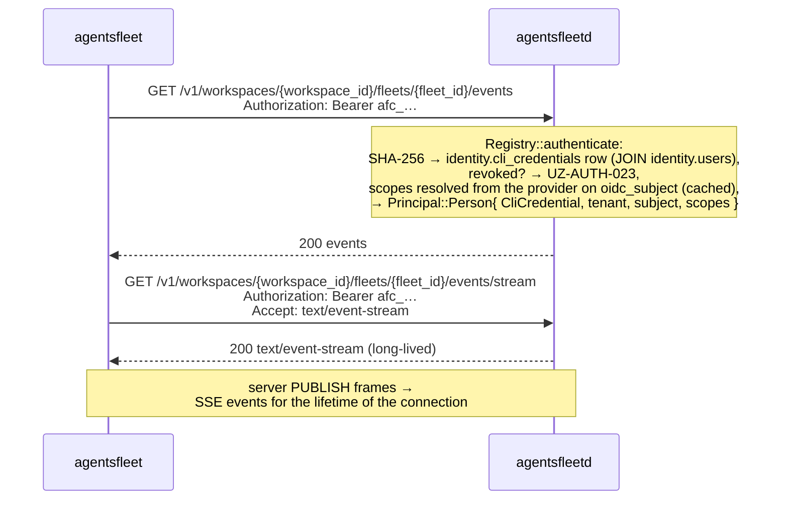

# CLI device login — security model (Flow 1)

> Relocated from [`AUTH.md`](./AUTH.md) so the canonical auth reference stays the *model*, not the depth. This is the M74_002 device-flow security design: data lifecycle, sequence, threat model, pinned crypto, the non-interactive token-seeding path, deploy rules, and the human-led invariant. For the auth model overview and the other principals, start at [`AUTH.md`](./AUTH.md) → *Flow 1*.

Acronyms used throughout: command-line interface (CLI), JSON Web Token (JWT), Hash-based Message Authentication Code (HMAC), HMAC-based Key Derivation Function (HKDF), Advanced Encryption Standard in Galois/Counter Mode (AES-GCM), Clerk's Frontend API (FAPI), Transport Layer Security (TLS), Web Application Firewall (WAF), man-in-the-middle (MITM), time-to-live (TTL), cryptographically secure random number generator (CSPRNG).

The one credential path humans use from a terminal: a browser-mediated device flow with a **verification code** binding the human approving in the browser to the human typing into the terminal, and **Elliptic-Curve Diffie-Hellman (ECDH) P-256 transport encryption** that keeps the minted JWT off every server-side surface but process memory. Bounded at five minutes; unfinished sessions expire. The recovered session token is spent immediately on `POST /v1/cli-credentials` and is never written to disk — what `credentials.json` (mode `0o600`) holds is the durable `afc_` credential that mint returns, and that is what the CLI carries on every subsequent request.

## Non-interactive token seeding (no device flow)

**Removed in M160_002 §3.** `agentsfleet login` used to accept an already-held bearer token directly — `--token <pat>`, falling back to piped stdin on a non-TTY — validate it against `/v1/me`, and write it to `credentials.json`. Both sources are gone, and `login` now has no non-interactive path at all.

The reason is that it never had a job of its own. `AGENTSFLEET_API_KEY` already carries an `agt_t` tenant key on every request and **outranks the stored credential**, so an unattended caller was always served by the environment variable; the flag only added a second way to reach the same place, by way of a file the caller then had to manage. It was also the one path that could write a value the credential loader would later refuse: the write checked only whether the token *authenticated*, while every subsequent read checks whether it is *well-formed* (`isPersistable`, `cli/src/services/credentials.ts`, accepting a well-formed `afc_` credential or an `agt_t` key, nothing else). Seeding a Clerk session token therefore reported success and then read back as logged-out on the next command — a failure that surfaced one command after the mistake.

What replaces it is one rule with no overlap: **interactive is the device flow, unattended is `AGENTSFLEET_API_KEY`.** A non-TTY `login` now fails and names that variable (`cli/src/commands/login.ts`), rather than announcing a session no human is present to approve. One check runs first: with a credential already stored and no `--force`, it fails on the overwrite refusal instead.

## Where the JWT lives in plaintext (data lifecycle)

This view points in the *opposite* direction from the temporal sequence below, because the JWT is *born* in the dashboard's browser process (immediately after Clerk mints it) and *consumed* in the `agentsfleet` process (after ECDH decryption). The CLI initiates the flow; the secret flows the other way.

```
┌────────────────────────────────────────────────────────────────────┐
│                                                                    │
│  Dashboard browser tab                                             │
│   ┌─────────────────────────────────────────────────────────────┐  │
│   │   Clerk mints user-JWT  ─►  AES-256-GCM encrypt(JWT)        │  │
│   │   (via FAPI /tokens)         under HKDF-SHA256-derived key  │  │
│   │                              from ECDH(dash_priv, cli_pub)  │  │
│   └─────────────────────────────────────────────────────────────┘  │
│                              │                                     │
│              PATCH /v1/auth/sessions/{id}/approve                  │
│              { dashboard_public_key, ciphertext, nonce,            │
│                verification_code }   (plaintext code over TLS;     │
│                                       API computes HMAC and        │
│                                       discards plaintext)          │
│                              │                                     │
│                              ▼                                     │
│  API process (agentsfleetd) + Dragonfly                            │
│   ┌─────────────────────────────────────────────────────────────┐  │
│   │   The session key stores:                                   │  │
│   │     status, cli_public_key, dashboard_public_key,           │  │
│   │     ciphertext, nonce,                                      │  │
│   │     verification_code_hmac_hex  ◄── HMAC-SHA256(            │  │
│   │     verification_attempts (≤5)        AUTH_SESSION_CODE_    │  │
│   │     created_at_ms, expires_at_ms      PEPPER,               │  │
│   │   ────────────────────────────         session_id ‖ code)   │  │
│   │   Nothing in this row decrypts the JWT.                     │  │
│   │   Pepper lives in agentsfleetd memory only — never disk.    │  │
│   └─────────────────────────────────────────────────────────────┘  │
│                              │                                     │
│              POST /v1/auth/sessions/{id}/verify { code }           │
│              (only after CLI presents the matching code; atomic    │
│               verification_pending → consumed in a single Lua-EVAL │
│               write that also returns the ciphertext payload)      │
│                              │                                     │
│                              ▼                                     │
│  CLI process (agentsfleet)                                         │
│   ┌─────────────────────────────────────────────────────────────┐  │
│   │   shared = ECDH(cli_priv, dashboard_public_key)             │  │
│   │   key    = HKDF-SHA256(shared, info="m74-002-v1")           │  │
│   │   JWT    = AES-256-GCM-decrypt(ciphertext, key, nonce)      │  │
│   │   POST /v1/cli-credentials (Bearer JWT) → afc_ credential   │  │
│   │   write { token, credential_id } → credentials.json (0o600) │  │
│   │      ↑ the afc_ credential, never the decrypted JWT         │  │
│   │   GET /v1/users/me (validation ping; clears it on failure)  │  │
│   └─────────────────────────────────────────────────────────────┘  │
│                                                                    │
└────────────────────────────────────────────────────────────────────┘
```

**Honest-server assumption.** An honest API server stores `cli_public_key` and `dashboard_public_key` as the CLI and dashboard sent them. Under that assumption the API never possesses decryption capability, and a Dragonfly dump alone does not yield the JWT — the attacker would need (a) `cli_priv` from the CLI process, and (b) the matching plaintext verification code. **An *active malicious* API server (or a TLS-terminating intermediary acting maliciously rather than passively) can swap `cli_public_key` and execute a textbook unauthenticated-Diffie-Hellman key-substitution MITM.** v2.0 explicitly does not close this; see *Threats this flow does NOT close*.

## Sequence — one-time login

```mermaid
sequenceDiagram
    actor User
    participant CLI as agentsfleet
    participant UI as Dashboard<br/>(app.agentsfleet.net)
    participant API as agentsfleetd<br/>(api.agentsfleet.net)
    participant Clerk

    User->>CLI: agentsfleet login [--token-name LABEL]
    Note over CLI: idempotencyCheck — with a credential already stored, ask<br/>before replacing it; --force skips the question and --no-input<br/>refuses. A non-TTY stdin counts as --no-input, so nothing piped<br/>is read as the replace-prompt answer.

    alt non-TTY shell (M160_002 §3)
        Note over CLI: no direct-token path exists any more — the verification<br/>code needs a human, so this cannot proceed
        CLI-->>User: error — exit ≠ 0, "set AGENTSFLEET_API_KEY for unattended use"<br/>credentials.json untouched
    else interactive device flow — TTY
        Note over CLI: generate (cli_priv, cli_pub) via crypto.subtle<br/>default token_name = platform family<br/>("macos-cli" / "linux-cli" / "windows-cli")

        CLI->>API: POST /v1/auth/sessions<br/>{ public_key: cli_pub, token_name }
        API-->>CLI: 201 { session_id, login_url }
        CLI-->>User: open login_url

        Note over CLI: prompt for the 6-digit code immediately — no polling.<br/>Possessing the code implies the dashboard approved.<br/>6-digit shape validated client-side (bad input re-prompts,<br/>no round-trip); SIGINT / EOF → exit 130, nothing persisted.

        User->>UI: open verify URL in browser
        Note over UI: Clerk session validates (__session cookie)
        UI->>API: GET /v1/auth/sessions/{id}
        API-->>UI: { status: pending, cli_public_key, token_name }
        UI-->>User: "Approve CLI login for {token_name}?"
        User->>UI: click Approve

        UI->>Clerk: POST /tokens (template: api)<br/>+ __session cookie
        Clerk-->>UI: { user-jwt }

        Note over UI: generate (dash_priv, dash_pub)<br/>shared = dash_priv × cli_pub<br/>key = HKDF-SHA256(shared, info="m74-002-v1")<br/>ciphertext = AES-256-GCM(jwt, key, nonce)<br/>verification_code = random 6 digits (CSPRNG)

        UI->>API: PATCH /v1/auth/sessions/{id}/approve<br/>{ dashboard_public_key, ciphertext, nonce, verification_code }<br/>Authorization: Bearer <customized session token>
        Note over API: server computes verification_code_hmac<br/>= HMAC-SHA256(AUTH_SESSION_CODE_PEPPER, sid ‖ code)<br/>persists ciphertext + nonce + dash_pub + HMAC<br/>discards plaintext code<br/>state: pending → verification_pending
        API-->>UI: 200
        UI-->>User: "Type {verification_code} into your CLI"

        User->>CLI: types verification_code into the waiting prompt
        CLI->>API: POST /v1/auth/sessions/{id}/verify<br/>{ verification_code }
        Note over API: Lua-EVAL atomic transition:<br/>compare HMAC (constant-time);<br/>match → verification_pending → consumed<br/>in the same write; return payload
        API-->>CLI: 200 { dashboard_public_key, ciphertext, nonce }

        Note over CLI: shared = cli_priv × dashboard_public_key<br/>key = HKDF-SHA256(shared, info="m74-002-v1")<br/>jwt = AES-256-GCM-decrypt(ciphertext, key, nonce)

        CLI->>API: POST /v1/cli-credentials<br/>Authorization: Bearer &lt;decrypted session JWT&gt;<br/>{ machine_name }
        Note over CLI,API: the session JWT is spent here and discarded.<br/>Its ~60s lifetime only has to cover this one call.
        API-->>CLI: 201 { id, credential }   (afc_…, no expiry)
        CLI->>CLI: write { token, credential_id } → credentials.json (0o600)<br/>token = the afc_ credential, never the JWT
        CLI->>API: GET /v1/users/me   (post-write validation ping)
        alt ping ok
            API-->>CLI: 200 { identity }
            CLI-->>User: "signed in as {name} — {tenant}"
        else refusal / server error / network error (a 404 keeps the credential)
            API-->>CLI: 4xx / 5xx
            CLI->>CLI: rollback — clear the stored credential
            CLI-->>User: error — exit ≠ 0
        end
    end
```

Two facts the diagram pins:
1. **The CLI is the initiator.** Every interaction with the UI, API, or Clerk is downstream of `agentsfleet login`. The user typing the verification code closes the loop back to the CLI.
2. **The dashboard asks Clerk for one extra token** (`getToken({ template: "api" })`, the `POST /tokens` step) beside the session token it already holds. While the session endpoints run, the API server reaches Clerk only for the cached key set it verifies those two tokens against. That changes at the post-write `GET /v1/users/me`: since M160_002 the command-line interface presents an `afc_` credential rather than the JWT, and the scope resolver fetches the owning user's capabilities from Clerk per request behind a short cache. Verification moved from "is this signature valid" to "who is this row, and what may they do right now."

## Session state machine

```
┌─────────┐     PATCH /approve    ┌───────────────────────┐    POST /verify (correct,    ┌──────────┐
│ pending ├──────────────────────►│ verification_pending  ├──── one atomic Lua script ──►│ consumed │
└────┬────┘                       └───────────┬───────────┘    write; payload returned)  └──────────┘
     │                                        │                                            (terminal,
     │  5 min TTL                              │  5 failed verify attempts                  60s same-
     │  (key evicted;                          │  OR explicit DELETE by                     fingerprint
     │   no state written)                     │     the approver                           replay
     ▼                                        ▼  (5 min TTL evicts it too)                  window)
┌─────────┐                       ┌───────────────────────┐
│ expired │                       │ aborted               │  (terminal)
└─────────┘                       └───────────────────────┘
```

| State | Enters from | Exits to |
|---|---|---|
| `pending` | initial (POST /sessions) | `verification_pending` · `expired` |
| `verification_pending` | `pending` | `consumed` · `expired` · `aborted` |
| `consumed` | `verification_pending` | (terminal — single-read, with 60s same-fingerprint idempotency window) |
| `expired` | `pending` · `verification_pending` | (terminal) |
| `aborted` | `verification_pending` | (terminal) |

**Invariants.** The state machine is monotonic — no backward transitions. There is no codepath from `pending` directly to `consumed`; verification code presentation is mandatory. `verified` is not a stored state; the successful POST /verify writes `consumed` atomically.

**`expired` is eviction, not a stored transition.** It is an enum variant with a
branch in `verify_consume.lua`, and nothing in the tree ever writes it. What
actually happens at the five-minute mark is that Dragonfly drops the key: the
next script run finds no blob and returns `{"missing"}`. Read the `expired` row
above as the shape the wire keeps room for, not as a state a session is ever
found in.

### How a session is stored

One key, one string, one time-to-live.

| Fact | Value | Source |
|---|---|---|
| Key | `auth:session:{session_id}` | `SESSION_KEY_PREFIX`, `rustd/crates/afd_dragonfly/src/session/mod.rs` |
| Value | the whole `SessionState` as one JSON blob | `put` serialises the struct |
| Write | `SET <key> <blob> EX 300` | same function |
| Time-to-live | five minutes, re-stamped on every transition | `SESSION_TTL`; `session/approve.lua` re-stamps `expires_at_ms` beside the `SET` |

The five-minute time-to-live is the garbage collection. Nothing sweeps, nothing
reaps, and an abandoned session is gone before anyone finds it. Every
transition rewrites the key with a fresh time-to-live. Only the approval also
re-stamps `expires_at_ms`, so the expiry a poll reports matches the key's reset
time-to-live; the redemption and the abort leave the field as it was.

### The three atomic transitions

Each state change is one Lua script over exactly one key, which is what keeps
them cluster-safe: a script that touched two keys could not route by slot. The
crate's only two-key script went when acceptance became a Postgres row.

| Script | Endpoint | Transition |
|---|---|---|
| `session/approve.lua` | `PATCH /v1/auth/sessions/{id}/approve` | `pending` → `verification_pending` |
| `session/verify_consume.lua` | `POST /v1/auth/sessions/{id}/verify` | `verification_pending` → `consumed` |
| `session/abort.lua` | `DELETE /v1/auth/sessions/{id}` and `DELETE /v1/auth/sessions` | `verification_pending` → `aborted`, for the approver only; a `pending` session has no owner yet, so it answers `not_owner` |

They dispatch through `redis::Script`, which sends the 40-byte digest with
`EVALSHA` and loads the body only when the server has never seen it — after the
first call of a deployment, never. Raw `EVAL` would ship the whole program on
every call, and these are the flow's hot path: one approval and one redemption
per attempt, per user.

## Endpoint trust boundaries

| Endpoint | Trusted actor | Auth |
|---|---|---|
| `POST /v1/auth/sessions` | unauthenticated CLI | rate-limited at edge — Cloudflare WAF, 10 / IP / min (L2) |
| `GET /v1/auth/sessions/{id}` | unauthenticated dashboard fetch (renders the approve page) | no CLI poll — M74_003 dropped CLI polling; the CLI prompts for the code immediately. The dashboard reads the session once to show `token_name` |
| `PATCH /v1/auth/sessions/{id}/approve` | dashboard JS process | Clerk customized session token (the `api`-template JWT travels only inside the encrypted payload) · per-Clerk-user backstop deferred post-launch — Clerk-edge per-IP on sign-in / sign-up (L1) bounds upstream identity supply |
| `POST /v1/auth/sessions/{id}/verify` | CLI with the verification code | the code IS the auth · ≤5 attempts per session (Lua-internal, L3) |
| `DELETE /v1/auth/sessions/{id}` | the person who approved it | Bearer, browser session token only (`DashboardIdentity`, `rustd/crates/afd_http/src/auth/person.rs`) · must match session's `clerk_user_id` |
| `DELETE /v1/auth/sessions` | the signed-in person, for their own sessions only | Bearer: a browser session token or the person's own `afc_` credential (`HumanIdentity`); a tenant `agt_t` key is refused with 403. `agentsfleet logout` calls it (`cli/src/commands/auth-logout.ts`) to abort the logins its person approved and never redeemed |

## Security properties by layer

The rules. Every line of code in Flow 1 must trace to one of these properties. Any claim of "auth hardening" in the abstract should be re-read against this table.

| Layer | Property | Out of scope |
|---|---|---|
| TLS | server authenticity (cert chain to a trusted CA) + transport encryption | endpoint compromise on either side |
| Clerk session | browser-user authentication (the human at the keyboard owns the Clerk identity) | hijacked browser session · shared workstation |
| **Verification code** | **browser ↔ terminal authorization binding** — proves the human approving in the browser is the same human typing into the local terminal | user pasting attacker-supplied commands |
| `HMAC-SHA256(AUTH_SESSION_CODE_PEPPER, session_id ‖ code)` | disclosure-resistance of the verification code against passive server-side compromise. The pepper lives in agentsfleetd process memory only (Vault-loaded at boot, never on disk) — a Dragonfly dump alone cannot recover the code via offline brute-force | compromise of the dashboard JS process where the code is displayed · compromise of the CLI process where it is typed · compromise of agentsfleetd process memory |
| ECDH P-256 | ciphertext-only session transport — no intermediate server, log, or DB row sees the JWT in plaintext | compromise of the dashboard or CLI endpoints |
| AES-256-GCM | tamper detection — any ciphertext modification produces a hard `DecryptError`, not silent corruption | — |
| Atomic `verification_pending → consumed` | single-read ciphertext — captured response cannot be replayed against the same session | replay using a fresh session (closed by `verification_code` + rate limits) |
| Verify-attempt rate limit (≤5/session, L3 — Lua-internal) | brute-force resistance on the 6-digit code | distributed brute force across many sessions (closed by L1 Clerk-edge per-IP on sign-in / sign-up + L2 Cloudflare WAF per-IP on session creation — see *Rate-limit layers* below) |
| `token_name` | auditability only — operator can list active sessions by label | trust signal of any kind |

## Rate-limit layers

Rate limiting decomposes across three layers. Only L3 lives inside agentsfleetd.

| Layer | Owner | Surface | Limit |
|---|---|---|---|
| **L1** | Clerk edge | Sign-in / sign-up | 3 attempts / 10 s, 5 creates / 10 s per IP — bounds upstream Clerk-identity supply |
| **L2** | Cloudflare WAF in front of `api.agentsfleet.net` | `POST /v1/auth/sessions` | 10 / IP / minute — request never reaches origin on block |
| **L3** | agentsfleetd — `session/verify_consume.lua` | `POST /v1/auth/sessions/{id}/verify` | 5 attempts per session → session aborted with reason `rate_limit_exceeded` |

No in-app rate-limit middleware in agentsfleetd. The per-IP and per-Clerk-user counters that an earlier revision of the M74_002 spec described inside agentsfleetd are not authored — per-IP belongs at edge (L2), per-Clerk-user backstop is deferred post-launch (L1 already throttles the upstream Clerk identity supply). See `docs/v2/done/M74_002_P1_API_CLI_UI_CLI_BROWSER_AUTHORIZATION_FLOW.md` Captain decision Q10 for the full rationale and the dead-code sweep that landed alongside this decision.

## Threats this flow closes

Each line is paired: the attack in one sentence, the mechanism that thwarts it in the next.

| # | Threat | How it's thwarted |
|---|---|---|
| 1 | **Session-key plaintext disclosure** — Dragonfly dumps, logs, queue inspections, metrics blobs, memory snapshots. | ECDH ciphertext transport. The session key holds `{ ciphertext, nonce, public keys, verification_code_hmac_hex }`; nothing in that set decrypts to the JWT. |
| 2 | **Passive network observation of the JWT** — TLS-inspecting corporate proxies, captured HTTPS payload logs, intermediaries that terminate and re-issue TLS. | ECDH ciphertext transport. After this spec, intermediaries see ciphertext only — the JWT plaintext lives nowhere on the wire. |
| 3 | **Session-id phishing without terminal access** — attacker has only the `session_id` (URL sniff, browser-history sync, shoulder surf). | The `verification_code` requirement + moving ciphertext release from GET to POST /verify. An attacker without terminal access cannot present the matching code and cannot trigger ciphertext release. |
| 4 | **Verification-code disclosure via passive server compromise** — attacker reads the session row but only sees the keyed HMAC; tries to offline-brute-force the 1M-entry 6-digit space. | `HMAC-SHA256(AUTH_SESSION_CODE_PEPPER, …)` storage. The pepper lives in agentsfleetd process memory only — without it the attacker cannot compute candidate HMACs even if they own the Dragonfly blob. |
| 5 | **Verification-code online brute force** — attacker with `session_id` tries the 1,000,000 6-digit code space against POST /verify. | ≤5 verify attempts per session, then the session transitions to `aborted` with `reason="rate_limit_exceeded"`. Attacker exhausts 0.0005% of the space before being locked out. |
| 6 | **Ciphertext replay** — attacker captures a single POST /verify response and retries the same `session_id`. | Atomic transition `verification_pending → consumed` in the same Lua-EVAL write that returns the ciphertext. Subsequent verify calls return 410 `UZ-AUTH-012` (with a 60-second same-fingerprint idempotency window for the legitimate "consume succeeded, response lost, client retried" failure mode). |
| 7 | **Distributed brute force across many sessions** — attacker scripts 200,000 sessions × 5 codes each = 1M attempts. | Per-IP session-creation limit at the edge (L2, 10/min) and Clerk's per-IP sign-in limits (L1), which bound how many approved sessions an attacker can produce. The per-Clerk-user approve limit is deferred (see *Rate-limit layers*). |

## Threats this flow does NOT close

Each line names the attack and points at where its closure lives (or why it cannot be closed by any flow this spec could produce).

| # | Threat | Why not — and where closure lives |
|---|---|---|
| 1 | **Compromised browser session** — XSS on the dashboard, malicious browser extension, session-cookie theft, injected analytics, compromised NPM dependency in the dashboard bundle. | The plaintext JWT lives momentarily in the dashboard JS process before encryption. Anything with execution access to that process sees the JWT; ECDH does not help. Future hardening: SRI + CSP + dependency supply-chain pinning (separate spec). |
| 2 | **Malware on the CLI host** — compromised `agentsfleet` machine, malicious user-space process, memory scraping. | `cli_priv` and the decrypted session JWT live in CLI process memory during the flow; the durable `afc_` credential lives in `credentials.json` after. Local malware reads either. Durability raises the stakes here: the stolen JWT expired in about a minute, whereas a stolen credential works until it is revoked — `DELETE /v1/cli-credentials/{id}` is the response, and it is what makes theft recoverable at all. No future milestone closes the read itself without hardware-backed key storage (TPM / Secure Enclave) — a separate downstream spec. |
| 3 | **Attacker with simultaneous browser + terminal access** — user runs attacker-supplied software ("paste this curl into your terminal"). | The verification code cannot defend against the user actively typing the code into the attacker's tool. The human-led-only invariant is the only defense, and it is documentation, not code. |
| 4 | **Device impersonation / fake `agentsfleet` binaries** — any actor can generate a valid ECDH keypair using publicly known math; any actor can ship a binary called `agentsfleet`. | Possessing a valid public key proves nothing about identity. Closure: an Agent Identity spec (persistent device keypair) or a binary-signing spec — neither authored yet. |
| 5 | **Autonomous-agent authentication** — CI runners, Kubernetes workloads, hosted agent platforms calling our API. | Out of trust model. A human MUST be present at flow time to type the verification code; remove the human and the verification code property collapses into theatre. Closure: an Agent Identity spec, not yet authored (persistent keypair + signed challenges + scoped credentials + server-side agent inventory). |
| 6 | **Active API or proxy key-substitution MITM** — attacker with active control over an API response path swaps `cli_public_key` in GET /sessions, intercepts the encrypted PATCH /approve, decrypts with their own key, re-encrypts to the real CLI's key. | Unauthenticated Diffie-Hellman — passing the public key through the API and trusting the API to return it honestly is the textbook setup. **v2.0 explicitly does NOT close this; tracked as the v2.1 priority.** Closure: URL fragment binding (`#cli_public_key=…` — fragments aren't sent to the server) + HKDF transcript binding (`info` parameter binds both pubkeys + session_id, so any substitution breaks decryption on the CLI). |

## Replay semantics

Six invariants. All are tested explicitly.

1. **Verification code is single-use, with a bounded same-fingerprint idempotency window.** A successful POST /verify atomically transitions to `consumed` in the same Lua-EVAL write that returns the ciphertext. Subsequent POST /verify calls within 60 seconds **from the same client fingerprint** (sha256 of `derived_client_ip ‖ user_agent ‖ session_id`) return the same payload (handles "consume succeeded, response lost, client retried"). Outside 60 seconds, or from a different fingerprint → HTTP 410 `UZ-AUTH-012`. Once the key's five-minute time-to-live evicts the session → HTTP 404 `UZ-AUTH-005`.
2. **Ciphertext is single-read per client fingerprint.** Item 1's mechanism: only the originating fingerprint can replay during the window; any other source gets 410. This narrows the replay surface to "captured-network-packet-within-60s-from-same-source", which is dominated by existing TLS + network-perimeter assumptions.
3. **Verified sessions cannot revert.** The state machine is monotonic; no path from `consumed` / `expired` / `aborted` back to any active state.
4. **PATCH /approve is single-write.** Calling it against a session already in `verification_pending` returns HTTP 409 `UZ-AUTH-015`. The dashboard MUST NOT retry PATCH /approve if it has previously succeeded for the same session.
5. **`session_id` is high-entropy.** A UUIDv7: a millisecond timestamp plus random bits drawn from the operating system's random source (`Entropy::uuid7`, `rustd/crates/afd_crypto/src/entropy.rs`). Not enumerable.
6. **`session_id` is capability-bearing** — combined with the verification code, it authorizes ciphertext release. Classified equivalent to a password-reset token. **`session_id` appears only in the API-generated `login_url` (`https://app.agentsfleet.net/cli-auth/{session_id}`) and in the API route paths that consume it.** It MUST NOT appear in logs (at info/warn/error level — redacted to the first 8 hex characters), analytics, telemetry, metrics labels, secondary URLs, error response bodies routed to non-trusted surfaces, or copied diagnostic bundles. The auth audit log target does not exist yet — there is no audit table, no writer, and no `session_id_hash` anywhere in the tree (checked M196_001). The rule stands for whoever builds it: its events carry a keyed HMAC of the `session_id` plus the 8-hex prefix, never the raw ID. The pepper that keys it gets provisioned then, with the code that reads it.

## Cryptographic primitives (pinned)

| Primitive | Value | Why pinned |
|---|---|---|
| Curve | P-256 (NIST) | `crypto.subtle` supports it natively in both Bun (the CLI's runtime, `bun >=1.4.0` in `cli/package.json`) and modern browsers. |
| Key derivation | HKDF-SHA-256, output 32 bytes, `info = "m74-002-v1"`, empty salt | Versioned `info` lets a future protocol change rev without colliding. The ECDH shared secret is already high-entropy, so the salt adds nothing. |
| Authenticated encryption | AES-256-GCM, 256-bit key, 96-bit random nonce per encryption, 128-bit auth tag | — |
| Verification code | 6 random digits (CSPRNG) | Brute force closed by attempt cap, not code entropy. (Future improvement: 8 alphanumeric, ~37× entropy, segmented for human-typability.) |
| Verification-code storage | `HMAC-SHA256(AUTH_SESSION_CODE_PEPPER, session_id ‖ code)`; pepper Vault-loaded at boot, process-memory-only | Defeats offline brute force from a Dragonfly dump (attacker needs the pepper too). The comparison runs inside `session/verify_consume.lua` as an accumulator over every byte, with no early exit. |
| Crypto library | `crypto.subtle` on both sides (Bun's `node:crypto` `webcrypto` + browser Web Crypto) | Zero extra dependencies; identical API surface; avoids `tweetnacl` / `@noble/curves` drift. |

## Log and audit redaction — `session_id` is sensitive

| Surface | What can appear | What must NOT appear |
|---|---|---|
| auth log target — info/warn/error | `request_id`, status names, error categories, sanitized error messages | full `session_id`, full verification code, ciphertext bytes, public keys (informational risk only, redact anyway) |
| auth log target — debug/trace | `session_id` redacted to first 8 hex chars + length suffix (`abcd1234…(len=36)`) | full `session_id` |
| auth audit log target — **NOT BUILT** (no table, no writer, M196_001); this row is the requirement for whoever builds it | a keyed HMAC of the `session_id` (`session_id_hash`) + `session_id_prefix` (first 8 hex chars), the pepper provisioned alongside the code that reads it. Plus per-event client-IP attribution: raw `X-Forwarded-For` (`xff`), raw `Fly-Client-IP` (`fly_client_ip`), derived `client_ip_source` enum (`xff` / `fly_client_ip` / `tcp_peer`), and `client_ip_divergent` bool flagging XFF/Fly disagreement (forgery signal). | plaintext verification code (always redact; not even hashed), `verification_code_hmac` value, ciphertext bytes, raw `session_id` (no env override exists) |
| HTTP response error bodies | `request_id`, error code (`UZ-AUTH-XXX`), generic message | `session_id` (the client already knows it; echoing it back in errors routed to log-aggregators is forbidden) |
| Metrics / traces | high-cardinality labels avoided | `session_id` as a tag (cardinality explosion + capability leakage into observability surfaces) |

The auth audit log target MUST be routed to a destination distinct from customer-visible logs (separate ACL, separate destination, tighter access controls than the auth target). This is deploy-side discipline, not enforced by code; documented in the deploy README.

## Every subsequent CLI call

Once `credentials.json` exists, the CLI carries the `afc_` credential on every request. This is where Flow 1 stops resembling a Flow 2 browser call: the dashboard rides a Clerk-refreshed session token, while the terminal rides a credential the API itself minted and can revoke.



The credential does not expire, so a 401 here means the row was revoked (`UZ-AUTH-023`) or never existed. Capabilities are resolved per request rather than frozen at mint: [`AUTH.md`](./AUTH.md) §"CLI credential — resolved, not granted" carries the model and its failure modes.

`agentsfleet logout` revokes the credential server-side with `DELETE /v1/cli-credentials/{id}` and clears local state (`cli/src/commands/auth-logout.ts`). A new login from the same machine revokes that machine's previous credential in the mint transaction, so a machine holds one live credential (`rustd/crates/afd_tenant/src/cli_credential/mod.rs`).

---

## Deployment requirements

Flow 1's protocol assumes the following deploy rules. Diverging from these turns the flow's security claims into wishes.

| Requirement | Detail |
|---|---|
| **HTTPS-only** for `/v1/auth/*` | Load balancer / reverse proxy enforces. HTTP requests promoted via HTTP 308 to HTTPS. `api.agentsfleet.net` already enforces this in prod. |
| **HSTS** header on every API response | `Strict-Transport-Security: max-age=31536000; includeSubDomains; preload`. The load balancer is the only source; `agentsfleetd` sets no security headers of its own. |
| **TLS ≥ 1.2** (1.3 preferred) | Load balancer config. |
| **Dragonfly cluster required** | `DRAGONFLY_URL` (`rustd/crates/afd_dragonfly/src/config.rs`) must name a seed in a Dragonfly **cluster**. There is no standalone path, no topology selector, and no Sentinel option: every connection is a redis-rs `ClusterConnection` over RESP3, routing each command by its key's slot. A seed that answers as a single server refuses boot — `afd_dragonfly::preflight::refuse_unsuitable_datastore` runs before the daemon serves anything (`rustd/crates/agentsfleetd/src/serve/runtime.rs`). In-memory session storage is not acceptable under any multi-pod topology. |
| **No eviction** | `maxmemory_policy` must be `noeviction` and `cache_mode` must be off. This is enforced, not advised: `preflight::refuse_eviction` (`rustd/crates/afd_dragonfly/src/preflight/mod.rs`) refuses a primary that evicts, and the daemon does not serve. A node that drops keys under pressure would discard accepted work silently, so it fails loud instead. Size the node for its working set; a stream that stops draining is refused at the admission budget, where a person can see it. |
| Client-IP attribution | `rustd/crates/afd_http/src/client.rs` derives the client IP from two header signals — `X-Forwarded-For` (industry-standard, default attribution source) and `Fly-Client-IP` (Fly's authoritative single-value header, the trust anchor since Fly's proxy is the only path to agentsfleetd in any non-dev deploy and Fly strips client-supplied copies of its own header). When both are present we compare; agree → use XFF, disagree → flip to `Fly-Client-IP` and mark the address divergent (`ClientAddress::is_divergent`, the forgery signal). No audit event carries that flag yet, because the auth audit log is not built. Local-dev / direct-internet → neither header → fall back to raw TCP peer. **No env / no allowlist** (Captain decision May 18 2026 — Q8 in spec). The consume-idempotency fingerprint and the credential mint's recorded address consume the derived IP; there are no in-app per-IP rate-limit buckets (see *Rate-limit layers*). |
| **NTP-synced pod clocks** within ≤1s drift | Each daemon stamps `expires_at_ms` from its own clock, while the key's own time-to-live does the expiring. An evicted session answers `POST /verify` with 404 `UZ-AUTH-005`; since M74_003 the CLI no longer polls or shows a countdown. Cross-pod drift >1s is a deploy bug. |
| **One pepper in Vault** | `AUTH_SESSION_CODE_PEPPER` (defeats offline brute-force of the verification code), at `op://ZMB_CD_{DEV,PROD}/auth-session-code-pepper/credential`. Boot fails fast if it is missing — preflight reads it as a required knob (`SESSION_CODE_PEPPER_KNOB`, `rustd/crates/agentsfleetd/src/preflight/knobs.rs`). A second item, `audit-log-pepper`, was provisioned for an audit log that was never built and no code ever read; it was retired in M196_001 and comes back with the audit log, not before. Provisioning is documented in `playbooks/founding/01_bootstrap/001_playbook.md`, step "Human populates 1Password". |
| **Auth audit sink isolation** | The auth audit log target MUST route to a destination distinct from customer-visible logs — separate ACL, separate destination (e.g., security-team-only S3 bucket, separate Loki tenant, separate syslog facility). Deploy-side discipline, not enforced by code. |

---

## Human-led-only invariant

**M74_002's Flow 1 supports only human-led agents.** A human MUST be present at flow time to (a) approve in the browser AND (b) type the verification code into the terminal. The verification code is the security property that closes the phishing-without-terminal attack; remove the human and the property collapses into theatre — an attacker who controls the agent's environment completes the flow themselves without the operator's awareness.

**Unattended use of `agentsfleet login` is a spec violation, not a supported deployment shape.**

Examples that are NOT supported and MUST NOT be retrofitted as "agent auth":

- CI runners (GitHub Actions, GitLab CI, CircleCI, Jenkins, …).
- Cron jobs, systemd timers, scheduled background execution.
- Kubernetes workloads, deployments, jobs.
- Hosted agent platforms calling the API on behalf of a human.
- Headless containers running `agentsfleet login` against a pre-supplied verification code.
- "Local agent" frames where the agent runs in the background without a human present at flow time.

For any of the above, the answer is an Agent Identity spec, not yet authored: persistent agent keypair → signed challenges → scoped credentials → server-side agent inventory → revocation.

This is enforced by **discipline + documentation**, not by code. The login flow has no programmatic way to detect "is a real human present" — that is precisely why misuse must be called out as a spec violation rather than left as a runtime error.

Local coding agents that run on the same workstation where the human can complete the browser approval AND the terminal verification (Cursor, Claude Code, etc.) ARE supported by Flow 1 — the human's presence is what makes it work, not the absence of a coding agent.
