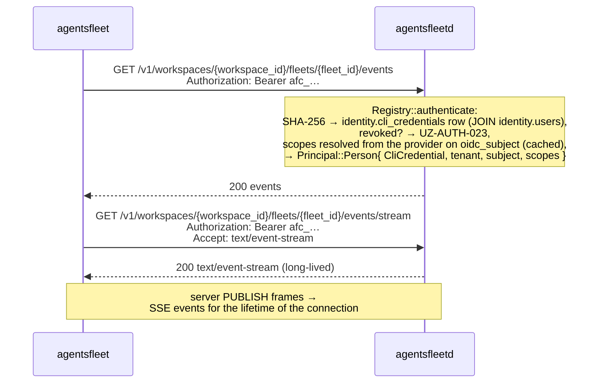

# CLI device login — security model (Flow 1)

| Question | Answer |
|---|---|
| Browser on the terminal's computer? | Default login displays a matching code, asks for Authorize or Deny, and receives approval through a local callback. |
| Browser on another computer? | `--no-open`, or configured no-open, retains the six-digit manual flow for Secure Shell (SSH) and other remote terminals. |
| What gets saved? | A durable `afc_` credential in `credentials.json`; the browser session token never reaches that file. |
| What bounds a pending login? | The local listener waits at most five minutes; the API owns its separate session expiry. |

This page owns device-login transport and threat boundaries. [Authentication](./AUTH.md) owns credential validation and capability resolution.

The manual flow originated in M74_002. The local callback adds same-computer delivery while retaining the existing encrypted approval and verification endpoints.

Acronyms used throughout: command-line interface (CLI), JSON Web Token (JWT), Hash-based Message Authentication Code (HMAC), HMAC-based Key Derivation Function (HKDF), Advanced Encryption Standard in Galois/Counter Mode (AES-GCM), Clerk's Frontend API (FAPI), Transport Layer Security (TLS), Web Application Firewall (WAF), man-in-the-middle (MITM), time-to-live (TTL), cryptographically secure random number generator (CSPRNG).

Both modes use Elliptic-Curve Diffie-Hellman (ECDH) P-256 transport encryption and the existing random six-digit verification secret.
Default login delivers that secret to a bound local listener after browser approval. Manual login asks the person to copy it into the terminal.

The CLI spends the decrypted session token on `POST /v1/cli-credentials`.
It saves the returned durable credential in `credentials.json`, with mode `0o600`, for subsequent requests.

## Non-interactive token seeding (no device flow)

**Removed in M160_002 §3.** `agentsfleet login` used to accept an already-held bearer token directly — `--token <pat>`, falling back to piped stdin on a non-TTY — validate it against `/v1/me`, and write it to `credentials.json`. Both sources are gone, and `login` now has no non-interactive path at all.

The reason is that it never had a job of its own. `AGENTSFLEET_API_KEY` already carries an `agt_t` tenant key on every request and **outranks the stored credential**, so an unattended caller was always served by the environment variable; the flag only added a second way to reach the same place, by way of a file the caller then had to manage. It was also the one path that could write a value the credential loader would later refuse: the write checked only whether the token *authenticated*, while every subsequent read checks whether it is *well-formed* (`isPersistable`, `cli/src/services/credentials.ts`, accepting a well-formed `afc_` credential or an `agt_t` key, nothing else). Seeding a Clerk session token therefore reported success and then read back as logged-out on the next command — a failure that surfaced one command after the mistake.

Unattended callers use `AGENTSFLEET_API_KEY`. Login still requires an interactive terminal and a person authorizing the browser request (`cli/src/commands/login.ts`).

A non-interactive shell fails before creating a session. The existing-credential overwrite check runs first, unless `--force` bypasses that check.

## Where the JWT lives in plaintext (data lifecycle)

This view points in the *opposite* direction from the temporal sequence below, because the JWT is *born* in the dashboard's browser process (immediately after Clerk mints it) and *consumed* in the `agentsfleet` process (after ECDH decryption). The CLI initiates the flow; the secret flows the other way.

```
┌────────────────────────────────────────────────────────────────────┐
│                                                                    │
│  Dashboard browser tab                                             │
│   ┌─────────────────────────────────────────────────────────────┐  │
│   │   Clerk mints user-JWT  ─►  AES-256-GCM encrypt(JWT)        │  │
│   │   (via FAPI /tokens)         under HKDF-SHA256-derived key  │  │
│   │                              from ECDH(dash_priv, cli_pub)  │  │
│   └─────────────────────────────────────────────────────────────┘  │
│                              │                                     │
│              PATCH /v1/auth/sessions/{id}/approve                  │
│              { dashboard_public_key, ciphertext, nonce,            │
│                verification_code }   (plaintext code over TLS;     │
│                                       API computes HMAC and        │
│                                       discards plaintext)          │
│                              │                                     │
│                              ▼                                     │
│  API process (agentsfleetd) + Dragonfly                            │
│   ┌─────────────────────────────────────────────────────────────┐  │
│   │   The session key stores:                                   │  │
│   │     status, cli_public_key, dashboard_public_key,           │  │
│   │     ciphertext, nonce,                                      │  │
│   │     verification_code_hmac_hex  ◄── HMAC-SHA256(            │  │
│   │     verification_attempts (≤5)        AUTH_SESSION_CODE_    │  │
│   │     created_at_ms, expires_at_ms      PEPPER,               │  │
│   │   ────────────────────────────         session_id ‖ code)   │  │
│   │   Nothing in this row decrypts the JWT.                     │  │
│   │   Pepper lives in agentsfleetd memory only — never disk.    │  │
│   └─────────────────────────────────────────────────────────────┘  │
│                              │                                     │
│              POST /v1/auth/sessions/{id}/verify { code }           │
│              (only after CLI presents the matching code; atomic    │
│               verification_pending → consumed in a single Lua-EVAL │
│               write that also returns the ciphertext payload)      │
│                              │                                     │
│                              ▼                                     │
│  CLI process (agentsfleet)                                         │
│   ┌─────────────────────────────────────────────────────────────┐  │
│   │   shared = ECDH(cli_priv, dashboard_public_key)             │  │
│   │   key    = HKDF-SHA256(shared, info="m74-002-v1")           │  │
│   │   JWT    = AES-256-GCM-decrypt(ciphertext, key, nonce)      │  │
│   │   POST /v1/cli-credentials (Bearer JWT) → afc_ credential   │  │
│   │   write { token, credential_id } → credentials.json (0o600) │  │
│   │      ↑ the afc_ credential, never the decrypted JWT         │  │
│   │   GET /v1/users/me (validation ping; clears it on failure)  │  │
│   └─────────────────────────────────────────────────────────────┘  │
│                                                                    │
└────────────────────────────────────────────────────────────────────┘
```

**Trust assumption.** The dashboard and terminal processes must remain trusted. Default login checks the API-returned public key against the original key carried in the fragment.

Manual login still trusts the API-returned key. Neither mode provides a general guarantee against a hostile dashboard or API; see *Threats this flow does NOT close*.

## Sequence — one-time login

```mermaid
sequenceDiagram
    actor User
    participant CLI as agentsfleet
    participant Browser as Dashboard browser
    participant API as agentsfleetd
    participant Clerk

    User->>CLI: login, or login --no-open
    CLI->>CLI: Check overwrite consent and interactive terminal
    CLI->>CLI: Generate ephemeral keypair
    CLI->>API: POST /v1/auth/sessions with public key
    API-->>CLI: session_id and login_url
    alt Default, same computer
        CLI->>CLI: Validate dashboard URL; bind 127.0.0.1 on an assigned port
        CLI->>Browser: Open marked URL with fragment metadata
        CLI-->>User: Matching code; waiting, Esc to cancel
        Browser->>Browser: Capture and strip fragment; restore after sign-in
        Browser->>API: GET session
        Browser->>Browser: Check full key, pending state and expiry
        Browser-->>User: Account, matching code, Authorize and Deny
    else Explicit manual mode
        CLI-->>User: Open URL; enter six-digit code when approved
        User->>Browser: Open URL on this or another computer
        Browser->>API: GET session
        Browser-->>User: Authorize
    end
    User->>Browser: Authorize
    Browser->>Clerk: Get browser session token and api-template token
    Clerk-->>Browser: Tokens
    Browser->>Browser: Encrypt api-template token; generate verification code
    Browser->>API: PATCH approve with encrypted payload and code
    API-->>Browser: Approval accepted
    alt Default, same computer
        Browser->>CLI: Top-level form POST with state, session, approval and code
        CLI->>CLI: Validate callback; claim FINALIZING
    else Explicit manual mode
        Browser-->>User: Six-digit verification code
        User->>CLI: Type code
    end
    CLI->>API: POST verify with code
    API-->>CLI: Encrypted payload
    CLI->>CLI: Decrypt session token
    CLI->>API: POST /v1/cli-credentials with session token
    API-->>CLI: Durable credential and identifier
    CLI->>CLI: Save durable credential
    CLI->>API: GET /v1/users/me with durable credential
    API-->>CLI: Identity
    CLI-->>User: Signed-in account and tenant
    opt Default, same computer
        CLI-->>Browser: Static completion page after actual completion
    end
```

The diagram shows successful approval. Denial, cancellation and uncertain replies follow the rules below.

Both modes share `completeLogin` in [`login.ts`](../cli/src/commands/login.ts).
That function exchanges the session token, saves the credential, validates identity and loads workspaces.

## Local browser binding

The CLI validates the API-provided login URL against its configured dashboard origin and exact session route before opening a listener.
The URL must contain no query, fragment or user information at that boundary.
[`login-callback-protocol.ts`](../cli/src/commands/login-callback-protocol.ts) owns those checks and the wire fields.

The outgoing URL adds the nonsecret marker `?flow=loopback`. Its fragment carries only these handoff fields:

| Field | Value |
|---|---|
| `v` | Protocol version `1` |
| `session_id` | The session created by this CLI |
| `cli_public_key` | Original canonical base64url-encoded P-256 public key, in the existing 91-byte encoded format |
| `callback` | `http://127.0.0.1:<PORT>/cli-auth/callback`, using the listener's assigned port |
| `state` | 32 random bytes encoded as unpadded base64url |

The browser requires the complete API-returned public key to match the fragment key before enabling approval.
The comparison code is the first eight uppercase hexadecimal digits of SHA-256 over this UTF-8 transcript, grouped four-four:

```text
agentsfleet.cli.login.loopback.v1
{session_id}
{cli_public_key}
```

Join these three fields with newline characters, without a trailing newline.

The short code helps the person compare screens; the complete public-key check supplies the cryptographic binding.
The browser displays the signed-in identity and requires stable user and session identifiers while acquiring both tokens.
A synchronous decision guard allows one Authorize or Deny action per page instance.

### Fragment and browser storage

Fragments are absent from HTTP request URLs, but browser scripts can read them.
[`instrumentation-client.ts`](../ui/packages/app/instrumentation-client.ts) captures recognized handoffs before starting analytics and removes the fragment through browser history.
Sign-in and sign-up capture require a same-origin return route marked for the same session.

[`cli-loopback-store.ts`](../ui/packages/app/lib/auth/cli-loopback-store.ts) retains validated metadata in per-tab `sessionStorage` across sign-in.

The store allows two records, each at most 2 KiB, for five minutes from first capture. Reloading a record does not renew its deadline.
Stored records contain no session token, durable credential, verification code or private key.

Restore revalidates each record. Unknown fields, conflicting records, unavailable storage or missing automatic-mode state produce a restart message without manual fallback.

Failed handoffs, decision handling and explicit cleanup remove the relevant record; expired records are removed when read.
The terminal and API enforce authorization and expiry independently of browser storage.

Analytics initialization, application events and library delivery filters exclude authentication routes and sensitive navigation targets.
The approval page and callback form carry replay-blocking classes before their contents enter the document.
These controls supplement the trusted-browser assumption; scripts already controlling that origin can access browser tokens.

### Callback request and response

The browser submits a top-level form POST after confirmed approval, without a cross-origin fetch.
The form carries `state`, `session_id`, `status=approved` and `verification_code`. Deny sends `status=denied` without a verification code, token mint or approval request.

The approval route sets `Referrer-Policy: origin` so HTTPS-to-HTTP form submission retains the dashboard's Origin header.
The local listener rejects missing, null or unexpected Origin values.
The local response uses `Referrer-Policy: no-referrer`, no-store caching and static content without credentials or external assets.

[`login-callback.ts`](../cli/src/commands/login-callback.ts) binds only literal `127.0.0.1`, using an operating-system-assigned port.
It accepts the fixed callback path and form content type, with the exact listener Host and configured dashboard Origin.
Session and state must match; state comparison uses a constant-time primitive.

| Limit | Enforcement |
|---|---|
| Local wait | At most five minutes, measured from before session creation |
| Request body | 1,024 bytes, checked while reading and through the server body limit |
| Application header budget | 4,096 bytes across parsed header names and values |
| Body read | Five seconds; invalid or incomplete bodies cannot claim approval |
| Idle connection | Five seconds before accepted approval enters finalization |
| Concurrent body readers | Eight; additional readers receive refusal |
| Accepted decision | One; later callbacks receive refusal without another exchange |

Unknown or duplicate form fields are refused. Invalid requests leave the waiting slot available for a valid request.
The first valid decision claims that slot after body validation, preventing concurrent readers from both succeeding.

### Cancellation and delivery failures

While WAITING, Esc, Ctrl-C, expiry or browser Deny ends the local attempt before credential exchange.
Existing saved credentials remain unchanged. Denial leaves the unapproved API session to expire.

An accepted approval changes the listener to FINALIZING before verification and exchange. The terminal shows “Finalizing sign-in…” and stops accepting cancellation.

The interrupt handler remains installed until completion. Listener shutdown restores terminal input state and releases signal handlers and timers.

The browser success page waits for credential exchange, saving and identity validation to finish.
A lost browser reply does not repeat verification or credential exchange. The terminal's reported outcome remains authoritative.

Browser-open failure leaves the same-computer URL available. For another computer, restart explicitly with `--no-open`.
Uncertain automatic approval requires a fresh login; the browser does not retry approval, reveal its verification code or switch to manual entry.

Credential mint replaces the previous same-machine credential in one backend transaction.
After that transaction commits, canceling a process or losing a response cannot restore the previous credential.
Identity-validation failure clears the newly saved local credential; cleanup does not restore the old server row or guarantee revocation of the new row.

Stopping the process or losing a mint response can interrupt finalization. A failed local write can leave a server credential whose value the terminal no longer holds.
See [`login-exchange.ts`](../cli/src/commands/login-exchange.ts), [`login-identity-rollback.ts`](../cli/src/commands/login-identity-rollback.ts) and the [backend mint](../rustd/crates/afd_tenant/src/cli_credential/mod.rs).

### Explicit manual mode

`--no-open` and configured no-open use the original URL without loopback metadata or a local listener.
The browser may run on another computer. After approval, the person enters its six-digit code into the waiting terminal.

Malformed codes prompt again locally. The CLI allows two wrong-code submissions; the server retains its separate five-attempt session limit.

Ctrl-C or end-of-input cancels the prompt. `--no-input` refuses manual code entry.

The manual browser still displays its generated code when the approval reply is lost, with an uncertainty notice.
This recovery behavior remains specific to manual mode. The encrypted approval, verification and durable-credential exchange otherwise match default login.

### Browser assumptions

The implementation requires a trusted browser that supports same-origin history replacement, session storage and top-level form submission to literal IPv4 loopback.
The supported address is `127.0.0.1`; no IPv6 or hostname fallback exists.
A browser on another computer cannot reach the initiating terminal through this callback.

Local Chromium [checks](../ui/packages/app/tests/e2e/acceptance/cli-loopback-login.spec.ts) cover approval, signed-out sign-in return and Deny with HTTP and HTTPS dashboard origins.

The HTTPS checks assert the exact non-null dashboard Origin on the actual form POST to HTTP loopback.
These checks do not establish compatibility with every browser or enterprise policy.
History replacement failure records a failed handoff, but cannot guarantee removal of the fragment from the browser address.

## Session state machine

```
┌─────────┐     PATCH /approve    ┌───────────────────────┐    POST /verify (correct,    ┌──────────┐
│ pending ├──────────────────────►│ verification_pending  ├──── one atomic Lua script ──►│ consumed │
└────┬────┘                       └───────────┬───────────┘    write; payload returned)  └──────────┘
     │                                        │                                            (terminal,
     │  5 min TTL                              │  5 failed verify attempts                  60s same-
     │  (key evicted;                          │  OR explicit DELETE by                     fingerprint
     │   no state written)                     │     the approver                           replay
     ▼                                        ▼  (5 min TTL evicts it too)                  window)
┌─────────┐                       ┌───────────────────────┐
│ expired │                       │ aborted               │  (terminal)
└─────────┘                       └───────────────────────┘
```

| State | Enters from | Exits to |
|---|---|---|
| `pending` | initial (POST /sessions) | `verification_pending` · `expired` |
| `verification_pending` | `pending` | `consumed` · `expired` · `aborted` |
| `consumed` | `verification_pending` | (terminal — single-read, with 60s same-fingerprint idempotency window) |
| `expired` | `pending` · `verification_pending` | (terminal) |
| `aborted` | `verification_pending` | (terminal) |

**Invariants.** The state machine is monotonic — no backward transitions. There is no codepath from `pending` directly to `consumed`; verification code presentation is mandatory. `verified` is not a stored state; the successful POST /verify writes `consumed` atomically.

**`expired` is eviction, not a stored transition.** It is an enum variant with a
branch in `verify_consume.lua`, and nothing in the tree ever writes it. What
actually happens at the five-minute mark is that Dragonfly drops the key: the
next script run finds no blob and returns `{"missing"}`. Read the `expired` row
above as the shape the wire keeps room for, not as a state a session is ever
found in.

### How a session is stored

One key, one string, one time-to-live.

| Fact | Value | Source |
|---|---|---|
| Key | `auth:session:{session_id}` | `SESSION_KEY_PREFIX`, `rustd/crates/afd_dragonfly/src/session/mod.rs` |
| Value | the whole `SessionState` as one JSON blob | `put` serialises the struct |
| Write | `SET <key> <blob> EX 300` | same function |
| Time-to-live | five minutes, re-stamped on every transition | `SESSION_TTL`; `session/approve.lua` re-stamps `expires_at_ms` beside the `SET` |

The five-minute time-to-live is the garbage collection. Nothing sweeps, nothing
reaps, and an abandoned session is gone before anyone finds it. Every
transition rewrites the key with a fresh time-to-live. Only the approval also
re-stamps `expires_at_ms`, so the expiry a poll reports matches the key's reset
time-to-live; the redemption and the abort leave the field as it was.

### The three atomic transitions

Each state change is one Lua script over exactly one key, which is what keeps
them cluster-safe: a script that touched two keys could not route by slot. The
crate's only two-key script went when acceptance became a Postgres row.

| Script | Endpoint | Transition |
|---|---|---|
| `session/approve.lua` | `PATCH /v1/auth/sessions/{id}/approve` | `pending` → `verification_pending` |
| `session/verify_consume.lua` | `POST /v1/auth/sessions/{id}/verify` | `verification_pending` → `consumed` |
| `session/abort.lua` | `DELETE /v1/auth/sessions/{id}` and `DELETE /v1/auth/sessions` | `verification_pending` → `aborted`, for the approver only; a `pending` session has no owner yet, so it answers `not_owner` |

They dispatch through `redis::Script`, which sends the 40-byte digest with
`EVALSHA` and loads the body only when the server has never seen it — after the
first call of a deployment, never. Raw `EVAL` would ship the whole program on
every call, and these are the flow's hot path: one approval and one redemption
per attempt, per user.

## Endpoint trust boundaries

| Endpoint | Trusted actor | Auth |
|---|---|---|
| `POST /v1/auth/sessions` | unauthenticated CLI | rate-limited at edge — Cloudflare WAF, 10 / IP / min (L2) |
| `GET /v1/auth/sessions/{id}` | dashboard fetch for the approval page | Neither CLI mode polls. Default browser mode checks pending status, the complete public key and expiry; manual mode loads the existing session view. |
| `PATCH /v1/auth/sessions/{id}/approve` | dashboard JS process | Clerk customized session token (the `api`-template JWT travels only inside the encrypted payload) · per-Clerk-user backstop deferred post-launch — Clerk-edge per-IP on sign-in / sign-up (L1) bounds upstream identity supply |
| `POST /v1/auth/sessions/{id}/verify` | CLI with the verification code | the code IS the auth · ≤5 attempts per session (Lua-internal, L3) |
| `DELETE /v1/auth/sessions/{id}` | the person who approved it | Bearer, browser session token only (`DashboardIdentity`, `rustd/crates/afd_http/src/auth/person.rs`) · must match session's `clerk_user_id` |
| `DELETE /v1/auth/sessions` | the signed-in person, for their own sessions only | Bearer: a browser session token or the person's own `afc_` credential (`HumanIdentity`); a tenant `agt_t` key is refused with 403. `agentsfleet logout` calls it (`cli/src/commands/auth-logout.ts`) to abort the logins its person approved and never redeemed |

## Security properties by layer

The rules. Every line of code in Flow 1 must trace to one of these properties. Any claim of "auth hardening" in the abstract should be re-read against this table.

| Layer | Property | Out of scope |
|---|---|---|
| TLS | server authenticity (cert chain to a trusted CA) + transport encryption | endpoint compromise on either side |
| Clerk session | browser-user authentication (the human at the keyboard owns the Clerk identity) | hijacked browser session · shared workstation |
| **Verification code and local callback** | Default mode delivers the six-digit secret only to the state-bound local listener after full-key comparison and explicit approval. Manual mode retains human code transfer. | malicious browser or terminal; a user approving an unfamiliar request |
| `HMAC-SHA256(AUTH_SESSION_CODE_PEPPER, session_id ‖ code)` | disclosure-resistance of the verification code against passive server-side compromise. The pepper lives in agentsfleetd process memory only (Vault-loaded at boot, never on disk) — a Dragonfly dump alone cannot recover the code via offline brute-force | compromise of the dashboard JS process where the code is displayed · compromise of the CLI process where it is typed · compromise of agentsfleetd process memory |
| ECDH P-256 | The approval and verification payloads contain encrypted JWT bytes; the auth-session row cannot decrypt them. | Endpoint compromise; Clerk token delivery and final credential exchange still rely on TLS. |
| AES-256-GCM | tamper detection — any ciphertext modification produces a hard `DecryptError`, not silent corruption | — |
| Atomic `verification_pending → consumed` | single-read ciphertext — captured response cannot be replayed against the same session | replay using a fresh session (closed by `verification_code` + rate limits) |
| Verify-attempt rate limit (≤5/session, L3 — Lua-internal) | brute-force resistance on the 6-digit code | distributed brute force across many sessions (closed by L1 Clerk-edge per-IP on sign-in / sign-up + L2 Cloudflare WAF per-IP on session creation — see *Rate-limit layers* below) |
| `token_name` | auditability only — operator can list active sessions by label | trust signal of any kind |

## Rate-limit layers

Rate limiting decomposes across three layers. Only L3 lives inside agentsfleetd.

| Layer | Owner | Surface | Limit |
|---|---|---|---|
| **L1** | Clerk edge | Sign-in / sign-up | 3 attempts / 10 s, 5 creates / 10 s per IP — bounds upstream Clerk-identity supply |
| **L2** | Cloudflare WAF in front of `api.agentsfleet.net` | `POST /v1/auth/sessions` | 10 / IP / minute — request never reaches origin on block |
| **L3** | agentsfleetd — `session/verify_consume.lua` | `POST /v1/auth/sessions/{id}/verify` | 5 attempts per session → session aborted with reason `rate_limit_exceeded` |

No in-app rate-limit middleware in agentsfleetd. The per-IP and per-Clerk-user counters that an earlier revision of the M74_002 spec described inside agentsfleetd are not authored — per-IP belongs at edge (L2), per-Clerk-user backstop is deferred post-launch (L1 already throttles the upstream Clerk identity supply). See `docs/v2/done/M74_002_P1_API_CLI_UI_CLI_BROWSER_AUTHORIZATION_FLOW.md` Captain decision Q10 for the full rationale and the dead-code sweep that landed alongside this decision.

## Threats this flow closes

Each line is paired: the attack in one sentence, the mechanism that thwarts it in the next.

| # | Threat | How it's thwarted |
|---|---|---|
| 1 | **Auth-session datastore disclosure** | The session row holds ciphertext, nonce, public keys and the verification-code HMAC. Those values alone cannot decrypt the JWT. |
| 2 | **Passive observation of approval and verification payloads** | Those payloads carry ECDH-encrypted JWT bytes. Clerk token delivery and the final bearer-authenticated credential exchange still depend on TLS and trusted intermediaries. |
| 3 | **Session-identifier phishing without terminal access** | Default delivery requires the matching local listener, callback state and session. The original private key is still required for decryption. Manual mode requires the browser-displayed code. |
| 4 | **Verification-code disclosure via passive server compromise** — attacker reads the session row but only sees the keyed HMAC; tries to offline-brute-force the 1M-entry 6-digit space. | `HMAC-SHA256(AUTH_SESSION_CODE_PEPPER, …)` storage. The pepper lives in agentsfleetd process memory only — without it the attacker cannot compute candidate HMACs even if they own the Dragonfly blob. |
| 5 | **Verification-code online brute force** — attacker with `session_id` tries the 1,000,000 6-digit code space against POST /verify. | ≤5 verify attempts per session, then the session transitions to `aborted` with `reason="rate_limit_exceeded"`. Attacker exhausts 0.0005% of the space before being locked out. |
| 6 | **Ciphertext replay** — attacker captures a single POST /verify response and retries the same `session_id`. | Atomic transition `verification_pending → consumed` in the same Lua-EVAL write that returns the ciphertext. Subsequent verify calls return 410 `UZ-AUTH-012` (with a 60-second same-fingerprint idempotency window for the legitimate "consume succeeded, response lost, client retried" failure mode). |
| 7 | **Distributed brute force across many sessions** — attacker scripts 200,000 sessions × 5 codes each = 1M attempts. | Per-IP session-creation limit at the edge (L2, 10/min) and Clerk's per-IP sign-in limits (L1), which bound how many approved sessions an attacker can produce. The per-Clerk-user approve limit is deferred (see *Rate-limit layers*). |

## Threats this flow does NOT close

Each line names the attack and points at where its closure lives (or why it cannot be closed by any flow this spec could produce).

| # | Threat | Why not — and where closure lives |
|---|---|---|
| 1 | **Compromised browser session** — XSS on the dashboard, malicious browser extension, session-cookie theft, injected analytics, compromised NPM dependency in the dashboard bundle. | The plaintext JWT lives momentarily in the dashboard JS process before encryption. Anything with execution access to that process sees the JWT; ECDH does not help. Future hardening: SRI + CSP + dependency supply-chain pinning (separate spec). |
| 2 | **Malware on the CLI host** — compromised `agentsfleet` machine, malicious user-space process, memory scraping. | `cli_priv` and the decrypted session JWT live in CLI process memory during the flow; the durable `afc_` credential lives in `credentials.json` after. Local malware reads either. Durability raises the stakes here: the stolen JWT expired in about a minute, whereas a stolen credential works until it is revoked — `DELETE /v1/cli-credentials/{id}` is the response, and it is what makes theft recoverable at all. No future milestone closes the read itself without hardware-backed key storage (TPM / Secure Enclave) — a separate downstream spec. |
| 3 | **Attacker with simultaneous browser + terminal access** — user runs attacker-supplied software ("paste this curl into your terminal"). | The verification code cannot defend against the user actively typing the code into the attacker's tool. The human-led-only invariant is the only defense, and it is documentation, not code. |
| 4 | **Device impersonation / fake `agentsfleet` binaries** — any actor can generate a valid ECDH keypair using publicly known math; any actor can ship a binary called `agentsfleet`. | Possessing a valid public key proves nothing about identity. Closure: an Agent Identity spec (persistent device keypair) or a binary-signing spec — neither authored yet. |
| 5 | **Autonomous-agent authentication** | The person must initiate login and deliberately approve it. Default automatic delivery does not turn this into an unattended credential interface. Use `AGENTSFLEET_API_KEY` for existing unattended access. |
| 6 | **Hostile API, dashboard or active intermediary** | Default mode refuses a session key differing from the original fragment key and validates the dashboard URL before attaching metadata. Manual mode still trusts the returned key. The existing HKDF context does not bind both keys and the session. Neither mode promises general protection against a hostile API or dashboard. |

## Replay semantics

Six invariants. All are tested explicitly.

1. **Verification code is single-use, with a bounded same-fingerprint idempotency window.** A successful POST /verify atomically transitions to `consumed` in the same Lua-EVAL write that returns the ciphertext. Subsequent POST /verify calls within 60 seconds **from the same client fingerprint** (sha256 of `derived_client_ip ‖ user_agent ‖ session_id`) return the same payload (handles "consume succeeded, response lost, client retried"). Outside 60 seconds, or from a different fingerprint → HTTP 410 `UZ-AUTH-012`. Once the key's five-minute time-to-live evicts the session → HTTP 404 `UZ-AUTH-005`.
2. **Ciphertext is single-read per client fingerprint.** Item 1's mechanism: only the originating fingerprint can replay during the window; any other source gets 410. This narrows the replay surface to "captured-network-packet-within-60s-from-same-source", which is dominated by existing TLS + network-perimeter assumptions.
3. **Verified sessions cannot revert.** The state machine is monotonic; no path from `consumed` / `expired` / `aborted` back to any active state.
4. **PATCH /approve is single-write.** Calling it against a session already in `verification_pending` returns HTTP 409 `UZ-AUTH-015`. The dashboard MUST NOT retry PATCH /approve if it has previously succeeded for the same session.
5. **`session_id` is high-entropy.** A UUIDv7: a millisecond timestamp plus random bits drawn from the operating system's random source (`Entropy::uuid7`, `rustd/crates/afd_crypto/src/entropy.rs`). Not enumerable.
6. **`session_id` is capability-bearing.** Combined with the verification code, it authorizes ciphertext release.
   Approved surfaces include the login URL, consuming API paths, the bound callback body and transient browser handoff storage.
   Logs, analytics, telemetry, metrics labels and diagnostic bundles must exclude the complete identifier and callback state.

The auth audit log remains unbuilt; M196_001 recorded no audit table or writer.
Its future events must use a keyed HMAC and an eight-character prefix instead of the complete session identifier.

## Cryptographic primitives (pinned)

| Primitive | Value | Why pinned |
|---|---|---|
| Curve | P-256 (NIST) | `crypto.subtle` supports it natively in both Bun (the CLI's runtime, `bun >=1.4.0` in `cli/package.json`) and modern browsers. |
| Key derivation | HKDF-SHA-256, output 32 bytes, `info = "m74-002-v1"`, empty salt | Versioned `info` lets a future protocol change rev without colliding. The ECDH shared secret is already high-entropy, so the salt adds nothing. |
| Authenticated encryption | AES-256-GCM, 256-bit key, 96-bit random nonce per encryption, 128-bit auth tag | — |
| Verification code | 6 random digits (CSPRNG) | Existing secret required by `POST /verify`; delivered through the local callback or typed in manual mode. |
| Comparison code | Eight uppercase hexadecimal digits of SHA-256, grouped four-four | Human comparison of the domain-separated session/public-key transcript; never accepted as the verification secret. |
| Callback state | 32 random bytes, unpadded base64url | Binds one local listener to the browser handoff; never substitutes for the CLI private key. |
| Verification-code storage | `HMAC-SHA256(AUTH_SESSION_CODE_PEPPER, session_id ‖ code)`; pepper Vault-loaded at boot, process-memory-only | Defeats offline brute force from a Dragonfly dump (attacker needs the pepper too). The comparison runs inside `session/verify_consume.lua` as an accumulator over every byte, with no early exit. |
| Crypto library | `crypto.subtle` on both sides (Bun's `node:crypto` `webcrypto` + browser Web Crypto) | Zero extra dependencies; identical API surface; avoids `tweetnacl` / `@noble/curves` drift. |

## Log and audit redaction — `session_id` is sensitive

| Surface | What can appear | What must NOT appear |
|---|---|---|
| auth log target — info/warn/error | `request_id`, status names, error categories, sanitized error messages | full `session_id`, full verification code, ciphertext bytes, public keys (informational risk only, redact anyway) |
| auth log target — debug/trace | `session_id` redacted to first 8 hex chars + length suffix (`abcd1234…(len=36)`) | full `session_id` |
| auth audit log target — **NOT BUILT** (no table, no writer, M196_001); this row is the requirement for whoever builds it | a keyed HMAC of the `session_id` (`session_id_hash`) + `session_id_prefix` (first 8 hex chars), the pepper provisioned alongside the code that reads it. Plus per-event client-IP attribution: raw `X-Forwarded-For` (`xff`), raw `Fly-Client-IP` (`fly_client_ip`), derived `client_ip_source` enum (`xff` / `fly_client_ip` / `tcp_peer`), and `client_ip_divergent` bool flagging XFF/Fly disagreement (forgery signal). | plaintext verification code (always redact; not even hashed), `verification_code_hmac` value, ciphertext bytes, raw `session_id` (no env override exists) |
| HTTP response error bodies | `request_id`, error code (`UZ-AUTH-XXX`), generic message | `session_id` (the client already knows it; echoing it back in errors routed to log-aggregators is forbidden) |
| Metrics / traces | high-cardinality labels avoided | `session_id` as a tag (cardinality explosion + capability leakage into observability surfaces) |

The auth audit log target MUST be routed to a destination distinct from customer-visible logs (separate ACL, separate destination, tighter access controls than the auth target). This is deploy-side discipline, not enforced by code; documented in the deploy README.

## Every subsequent CLI call

Once `credentials.json` exists, the CLI carries the `afc_` credential on every request. This is where Flow 1 stops resembling a Flow 2 browser call: the dashboard rides a Clerk-refreshed session token, while the terminal rides a credential the API itself minted and can revoke.



The credential does not expire, so a 401 here means the row was revoked (`UZ-AUTH-023`) or never existed. Capabilities are resolved per request rather than frozen at mint: [`AUTH.md`](./AUTH.md) §"CLI credential — resolved, not granted" carries the model and its failure modes.

`agentsfleet logout` revokes the credential server-side with `DELETE /v1/cli-credentials/{id}` and clears local state (`cli/src/commands/auth-logout.ts`). A new login from the same machine revokes that machine's previous credential in the mint transaction, so a machine holds one live credential (`rustd/crates/afd_tenant/src/cli_credential/mod.rs`).

---

## Deployment requirements

Flow 1's protocol assumes the following deploy rules. Diverging from these turns the flow's security claims into wishes.

| Requirement | Detail |
|---|---|
| **HTTPS-only** for `/v1/auth/*` | Load balancer / reverse proxy enforces. HTTP requests promoted via HTTP 308 to HTTPS. `api.agentsfleet.net` already enforces this in prod. |
| **HSTS** header on every API response | `Strict-Transport-Security: max-age=31536000; includeSubDomains; preload`. The load balancer is the only source; `agentsfleetd` sets no security headers of its own. |
| **TLS ≥ 1.2** (1.3 preferred) | Load balancer config. |
| **Dragonfly cluster required** | `DRAGONFLY_URL` (`rustd/crates/afd_dragonfly/src/config.rs`) must name a seed in a Dragonfly **cluster**. There is no standalone path, no topology selector, and no Sentinel option: every connection is a redis-rs `ClusterConnection` over RESP3, routing each command by its key's slot. A seed that answers as a single server refuses boot — `afd_dragonfly::preflight::refuse_unsuitable_datastore` runs before the daemon serves anything (`rustd/crates/agentsfleetd/src/serve/runtime.rs`). In-memory session storage is not acceptable under any multi-pod topology. |
| **No eviction** | `maxmemory_policy` must be `noeviction` and `cache_mode` must be off. This is enforced, not advised: `preflight::refuse_eviction` (`rustd/crates/afd_dragonfly/src/preflight/mod.rs`) refuses a primary that evicts, and the daemon does not serve. A node that drops keys under pressure would discard accepted work silently, so it fails loud instead. Size the node for its working set; a stream that stops draining is refused at the admission budget, where a person can see it. |
| Client-IP attribution | `rustd/crates/afd_http/src/client.rs` derives the client IP from two header signals — `X-Forwarded-For` (industry-standard, default attribution source) and `Fly-Client-IP` (Fly's authoritative single-value header, the trust anchor since Fly's proxy is the only path to agentsfleetd in any non-dev deploy and Fly strips client-supplied copies of its own header). When both are present we compare; agree → use XFF, disagree → flip to `Fly-Client-IP` and mark the address divergent (`ClientAddress::is_divergent`, the forgery signal). No audit event carries that flag yet, because the auth audit log is not built. Local-dev / direct-internet → neither header → fall back to raw TCP peer. **No env / no allowlist** (Captain decision May 18 2026 — Q8 in spec). The consume-idempotency fingerprint and the credential mint's recorded address consume the derived IP; there are no in-app per-IP rate-limit buckets (see *Rate-limit layers*). |
| **NTP-synced pod clocks** within ≤1s drift | The daemon stamps `expires_at_ms`; datastore expiry remains authoritative. An evicted session answers `POST /verify` with 404 `UZ-AUTH-005`. Neither CLI mode polls. Default mode also enforces its own five-minute waiting deadline. |
| **One pepper in Vault** | `AUTH_SESSION_CODE_PEPPER` (defeats offline brute-force of the verification code), at `op://ZMB_CD_{DEV,PROD}/auth-session-code-pepper/credential`. Boot fails fast if it is missing — preflight reads it as a required knob (`SESSION_CODE_PEPPER_KNOB`, `rustd/crates/agentsfleetd/src/preflight/knobs.rs`). A second item, `audit-log-pepper`, was provisioned for an audit log that was never built and no code ever read; it was retired in M196_001 and comes back with the audit log, not before. Provisioning is documented in `playbooks/founding/01_bootstrap/001_playbook.md`, step "Human populates 1Password". |
| **Auth audit sink isolation** | The auth audit log target MUST route to a destination distinct from customer-visible logs — separate ACL, separate destination (e.g., security-team-only S3 bucket, separate Loki tenant, separate syslog facility). Deploy-side discipline, not enforced by code. |

---

## Human-led-only invariant

**Flow 1 requires a person to start login and approve the intended terminal.**

Default mode asks that person to compare the displayed code and account before clicking Authorize.
The callback then delivers the verification secret without another terminal prompt.

Explicit manual mode keeps the original browser-to-terminal code transfer. The human-led requirement survives automatic local delivery.

**Unattended use of `agentsfleet login` is a spec violation, not a supported deployment shape.**

Examples that are NOT supported and MUST NOT be retrofitted as "agent auth":

- CI runners (GitHub Actions, GitLab CI, CircleCI, Jenkins, …).
- Cron jobs, systemd timers, scheduled background execution.
- Kubernetes workloads, deployments, jobs.
- Hosted agent platforms calling the API on behalf of a human.
- Headless containers running `agentsfleet login` against a pre-supplied verification code.
- "Local agent" frames where the agent runs in the background without a human present at flow time.

For any of the above, the answer is an Agent Identity spec, not yet authored: persistent agent keypair → signed challenges → scoped credentials → server-side agent inventory → revocation.

The interactive-terminal check and browser confirmation constrain the supported flow. They cannot prove that a real person performed those actions.
Unattended use remains outside this authentication model.

Local coding agents, such as Cursor or Claude Code, can run the interactive command. A person must check the matching code and select Authorize. The same-computer terminal then finishes automatically; a browser on another computer requires explicit manual verification.
