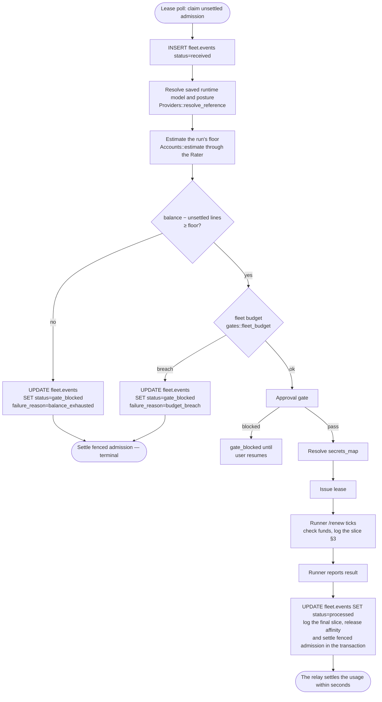

# Billing and self-managed provider key

> Parent: [`README.md`](./README.md) · User-facing: [docs.agentsfleet.net/billing/budgets](https://docs.agentsfleet.net/billing/budgets) (spend caps) and [docs.agentsfleet.net/fleets/model-providers](https://docs.agentsfleet.net/fleets/model-providers) (bringing your own key).

How users pay for what they run. The runtime stays neutral between two cost realities: us paying the language-model provider, or the user paying that provider directly.

This is a cross-cutting topic. The data model lives in the tenant provider records. The runtime hooks live in the control plane's lease path (`agentsfleetd`) and the runner's supervisor.

The setup-time path lives in workspace chat, the reviewed setup and Save.

The end-to-end walkthroughs are in [`scenarios/`](./scenarios/). This file is the canonical concept reference: it describes shape and behaviour.

The billing model is **credit-based, Amp-style**. Every tenant has a single credit balance in nanos (1 USD = 1,000,000,000 nanos). A run deducts credits for the usage it logs, and the gate trips when the balance hits zero.

There are no plan tiers in the cost function and no "included events" tier ladder. Credits flow in (one-time starter grant in v2.0; Stripe purchase in v2.1+) and credits flow out per run.

The **run** charge depends on the posture. The platform default subsidises inference; a self-managed run costs less because the user pays their own provider for tokens.

> **Where the live values are.** The authenticated billing surface reports the current runtime rate. The public early-access page does not publish launch pricing. This doc and the scenarios in this directory deliberately quote no dollar amounts, because they go stale when a rate moves.

Server-authoritative constants are declared once, in `afd_billing`'s `nanos` module; no client recomputes a fee it is served. Public documentation mirrors belong in `~/Projects/docs/snippets/rates.mdx` and require a coordinated docs Pull Request when used.

---

## Facts

Every row is extracted from the numbered sections below; the owner column names the section that carries the full story.

| Invariant | Value | Mechanism | Owner section |
|---|---|---|---|
| Currency unit | nanos; 1 USD = 1,000,000,000 | `billing.wallets.balance_nanos BIGINT`, signed; i64 caps one tenant at ~$9.2B | §2 |
| Postures | exactly 2, selected by the saved runtime reference | `platform-default` uses `platform`; an owner's model registration uses `self_managed`; both debit the owner's wallet | §1 |
| Debit point | usage only | each renewal's and the report's slice is one usage line; the billing relay settles it through the `Biller` within seconds; admission charges nothing | §3 |
| Line charge | `⌈runtime⌉ + Σ ⌈tokens × rate⌉` | the `Rater`: run fee under both postures, each token category under platform, each rounded up on its own | §4.1 |
| Short balance | `balance − charged`, below zero if it must | a settlement takes its whole charge; the debt refuses every funds check until a grant repays it | §3, §5, §11 |
| Lease writes per slice | fence, cursors, one usage line | `METER_LEASE` moves no money; the line is logged in the same transaction and the relay settles it | §3 |
| Line keying | `UNIQUE (work_type, work_id, seq)` | a retried renewal, report or relay pass settles each line once, even with two relays | §3, §11 |
| Free usage | the starter grant only | a balance that drains, bounded by `exhausted_at`; no promotional window and no mechanism for one | §2.3 |
| Mid-run exhaustion | next `/renew` refused | `UZ-RUN-012`; the run ends at its current deadline, never extended | §3, §5 |
| Money set aside | none | a funds check reads the balance less the payer's unsettled lines; parallel runs can overdraw by at most one slice each before their next check refuses | §5, §11 |
| Statement bounds | the API login role's | 2 s lock wait, 5 s statement; no billing statement sets its own; a bound reached is a biller with no answer | §11 |
| Budget gate | per-fleet, independent of the balance gate | `daily_nanos` rolling 24 h · `monthly_nanos` Coordinated Universal Time (UTC) calendar month; mid-run refusal `UZ-RUN-015` | §5.1 |
| Budget no-verdict posture | asymmetric | database failure → admit; no budget declared → admit; unparseable budget → refuse | §5.1 |
| `api_key` boundary | process-internal vs user-facing | never in responses, logs, fleet context, or saved rows; the runner lease is the machine-plane exception | §8.2 |
| Credential list | metadata projection | `kind` ∈ {`provider_key`, `custom_endpoint`, `custom_secret`}; `api_key` structurally absent (no field to leak) | §8.3 |
| Model registry | one row per `(model_name, secret_ref)` | `model.tenant_models`, `UNIQUE (tenant_id, model_name, secret_ref)`; entries reference keys, never own material | §8.4 |
| Rate lookup | one fresh read per lease pass | `PriceBook::load` reads one model's dated tiers before the lease's transaction; there is no rate cache | §4.1, §10 |
| Unknown model on platform | runtime charged, tokens unpriced | never a default token rate: the line counts its tokens in `unpriced_token_count`; the lease-estimate gate admits, because an estimate is not a charge | §2.3, §4.1 |
| Catalogue read | `GET /v1/models`, bearer-authed | the public `cap.json` route is retired: `404`, no alias | §10 |
| Plan tiers | none in the cost function | future paid plans manifest as grants or top-ups, never a branch in the charge functions | §2.4 |
| Posture switch | claim-time snapshot wins | posture resolved once, at gate time, and stored on the lease | §7 |
| Blocked rows | terminal | no automatic replay after top-up; re-trigger the source (§6); continuation applies only to approval gates | §6 |
| Live dollar values | never in this doc | served by the authenticated billing surface; the run fee is declared once, in `afd_billing` | preamble, §4.1 |

## Traps

Each trap is enforced in its owner section; this list is the index.

- Never quote dollar amounts in docs; they go stale the moment a rate moves (preamble).
- Metering never stops, and nothing zeroes the money column: every slice is a usage line priced at what the catalogue publishes (§2.3).
- Never fold a catalogue read fault into "this model is not in the catalogue". The second is a value, the first is an error the pass logs as `lease_tokens_unpriced`. Both count the tokens as unpriced on the line, visibly (§4.1).
- A re-sent request line is stored once on `(work, seq)`. A re-sent renewal measures about zero run time against the lease's cursor, so retries never charge twice (§3).
- The budget gate counts each usage line in the window it was written in. A line is one renewal interval of usage, so a long run's spend lands where it was used (§5.1).
- No plan branch inside the charge functions, ever (§2.4).
- The provider `api_key` never joins `secrets_map`; it rides `ExecutionPolicy` on a different path entirely (§8.2).
- Model-registry entries reference vault keys; they never own credential material (§8.4).
- Absence of a `tenant_model_selection` row means a platform account default; it does not replace a fleet's saved model reference (§1).
- No silent auto-fallback from self-managed to platform on provider error; it would charge without consent (§13).
- `tenant provider create` never test-calls the provider; a bad key surfaces at the first event, when the provider refuses it (§7).
- Budget overshoot is bounded, not zero: at most one renewal window past the cap (§5.1).

## Topology

The diagrams live with their flows: the per-slice metering picture (§3) and the balance-gate mermaid flowchart (§5).

## Decisions

| Decision | Reason | Where |
|---|---|---|
| Credit-based Amp-style billing, no tier ladder | one number that drains; refills are grants or purchases | preamble, §2 |
| Platform default routes through the admin tenant's own credential | no separate platform vault, no env-var fallback, one vault code path | §1 |
| Administrator-selected platform default | model and credential are saved configuration, independent of deployment | §1, §9 |
| Saved model settings select the endpoint and API | the curation allowlist supplies prices; it does not route inference | §9, §10 |
| A provider is priced, or records why it never will be | "not yet priced" read as a queue nobody was working; 87 providers sat in it | §10 |
| Free usage is a balance, not a promotional window | a number that drains cannot silently stay open; the timestamp-gated version priced every tenant at zero for its whole life | §2.3 |
| Usage is logged per renewal and settled by one relay | a run and its usage commit together, only the relay moves money through the biller, and a crash loses or doubles nothing | §3, §11 |
| Budget gate fails open on database failure | a metering outage must not halt every fleet on the platform | §5.1 |
| One billing lifecycle behind `Arc<dyn Biller>` | fleet runs and setup chat disagreed on rounding, pricing and outages; a billing service or third party must be able to bill | §11 |
| No holds: check funds, accept bounded debt | holds reserved too little to stop parallel overspend and kept a second balance in sync; one source of truth is the balance less unsettled lines (Indy, Nov 05, 2026) | §5, §11 |
| Billing outages fail open, flippable at one construction site | early adoption favours the optimistic path; closing it is one line | §11 |
| Statement bounds live on the login role, not on billing statements | one `ALTER ROLE` covers every daemon statement; per-statement overrides drifted from it | §11; M242_001 |
| Catalogue read moved behind auth | per-token margins are no longer world-readable | §10 |
| Registry consistency via activation-time upsert, not read-time self-heal | a read handler must not mutate rows to paper over a write-path violation | §8.4; M121 |
| `fleet:` vault-name prefix removed repo-wide | it discriminated nothing; dead convention | §8.4 |
| No rate cache | one indexed read of one model's price book per lease pass, so a cache would save one read and add an eviction path | §4.1, §10 |
| Stripe purchase flow deferred | v2.1; schema anticipates it | §13 |

---

## Authoring admission and settlement

Setup chat bills through the shared `Biller` lifecycle (§11), on the same `Arc<dyn Biller>` fleet leases use. `agentsfleetd` builds it once at boot and hands the same biller to the authoring path.

Resolve models and billing from `Owned.tenant`, the workspace owner's account, rather than the joined member's account. Send captures the selected reference; admission pins provider/model/inference settings/context/prices. Idle version-guarded draft PATCH can replace a disabled selection; earlier turns keep their pins.

Model disable, wallet absence, membership removal, and policy-marker drift fail closed. Queue acceptance can precede admission; refusal records the durable bounded Message failure/action from the resource reference.

**Admission**. Bound the attempt by the selected model's total output allowance, upward rounding for eight physical calls, and 300 seconds of runtime fees. `authoring.attempts.reserved_nanos` records that initial ceiling (`afd_authoring`'s budget `bound`); it is a bound each check asks for, not money set aside.

**Measured input.** Before each physical send, add its measured input cost and all known prior dispatch costs to the admission bound. Check that the payer can still fund that bound before sending, with checked arithmetic and no independent 32,768-token input allowance. Summaries use this same funding path; [conversation compaction](context_lifecycle.md) owns window selection.

**Claim.** The gate reads the owner's balance less the lines the relay has not yet charged (`afd_billing::ledger::balance`). It reads on the claim's own transaction and refuses an attempt whose bound it cannot cover. A tenant with no wallet is refused, and nothing is set aside.

**Renewal** checks the stored ceiling again. Each model call measures its request in a guarded transaction, then releases the connection and checks funds for the whole bound. The attempt logs its lines only when it reports, so its own spend is not yet unsettled.

A second guarded transaction checks the request digest and funding ceiling before recording dispatch intent.

A biller call runs outside these transactions because the biller may take another connection or make a remote request. `Short` returns the wallet failure; `OutagePolicy::Open` admits an unanswered biller as `Unconfirmed`.

**Report.** When the daemon knows the attempt's usage, the report's transaction logs its lines with `log_lines`. Each dispatch with known usage gets one line at its dispatch instant, and the runtime gets one line (`seq` 0). The `Rater` prices each line by its whole-request tier.

The settled outcome is stamped on the attempt, and every later replay reads it there after private text is gone. The report then returns, and the billing relay settles the lines on its next pass. An attempt whose usage is still unknown logs nothing until the replay that learns it.

**Locks.** Authoring renewal takes draft → attempt → runner, then refreshes database time after the runner lock.
Claim holds the runner first and takes the draft `NOWAIT`.
[Concurrency](concurrency.md#runner-capacity-and-authoring-lock-order) owns the complete lock order and exceptions.

The relay moves money in separate transactions, locking wallet → lines.

Charge cumulative known usage once, with monotone counters and exact replay identity. Provider timeout/crash without trusted usage records `knowledge:"unknown"`, never an estimated zero; its lines are logged once accounting resolves, including after Stop.

Current chat blocking considers attempts whose message sequence exceeds the draft's `cancelled_through_sequence`. Discovery and admission under the draft lock use that same rule. Stop releases publication authority for covered sequences, while their content-free attempts keep accounting liability.

A later message can claim only through normal runner capacity and balance checks. Kept liability can still consume either limit. Fence expiry alone never authorizes replacement or proves that provider billing stopped.

Fresh Send refuses while an uncancelled attempt has unknown provider usage. Exact accepted replay is checked first and returns its original sequence. Explicit Stop permits later work without discarding the old obligation.

Parse inference-key header syntax before saving dispatch intent. A definite HTTP 401 authentication rejection records a failed call with known usage. Keep reported usage when supplied; otherwise authentication rejection has no generated tokens.

Other failed responses without trusted usage stay unknown. The terminal report logs earlier calls and runtime fees once, and the relay charges them.

### Stop and terminal races

Stop carries the last accepted sequence and atomically raises `cancelled_through`. Queue entries at or below it become cancelled. A later send receives a greater sequence and is not cancelled by a delayed old Stop.

Stop, report, and candidate proposal share the guarded attempt/subject rows. If completion commits first it stays completed; otherwise cancellation fences later text/proposal writes. Repeated lower cutoffs return the standing watermark.

A terminal report can settle already-incurred usage after Stop without displaying a late answer. Replayed reports never charge twice. A late key rejection keeps attempt evidence, but emits a message finish only if its guarded update changes a running message.

This also prevents duplicate finishes when model revocation wins first. Timeout, cancellation, and provider errors are separate visible states. Stop does not claim it can undo provider work already started.

Save uses the reviewed candidate after queued/running messages have stopped. Closing the draft does not remove its accounting attempts or restore old publication authority.

Cancelling installing setup returns the linked draft to editing and keeps its Stop watermark. A late old report stays accounting-only in both cases.

## Detail

Everything below is the full reference. Headings are stable because specs cite them by §-number and text; insert new sections, never rename or renumber existing ones.

## 1. The two postures

One persona carries the worked examples: **John Doe** first saves a fleet with the platform default, then selects his own Fireworks model. The second setup uses his credential, so he pays Fireworks directly for tokens. Both setups debit the same tenant wallet for runtime.

There are two billing postures. A fleet's saved `runtime_model_ref` selects its posture when a runtime lease is admitted. Different fleets in one tenant can use different postures:

- **Platform-managed.** `platform-default` selects the administrator's enabled default model and its credential. The `agentsfleet-admin` account stores that credential in its workspace vault. `PUT /v1/admin/platform-keys` saves the default pointer in `model.platform_defaults`, without key material.
  - At lease time, `agentsfleetd` follows that pointer and reads the model's saved inference settings. The user pays runtime fees and the model's token rates.
- **Self-managed provider keys.** An owner model reference selects a `model.tenant_models` registration and its named vault credential. The runner supervisor uses the resolved key outside the sandbox. The user pays the provider for tokens; `agentsfleet` charges runtime fees without token markup.

The platform administrator selects the default model and its credential. Its saved catalogue row supplies the endpoint, API format, physical context window and maximum output length (§9). Neither the provider name nor this document selects a model or route.

The default is a **pointer, not a constant**.
`model.platform_defaults.platform_model_id` references `model.platform_models.id` with `ON DELETE RESTRICT`; the catalogue row supplies model identity, context and inference settings.
`source_workspace_id` identifies the admin workspace holding the credential (slot 1320).

Changing the default is an admin write, not a deployment.
Both postures dial their selected model's saved endpoint (§9); platform uses the admin's key, and self-managed uses the owner's key.

`model.tenant_selections` holds the separate account default. The tenant provider commands update that default; a missing row means `platform`.

Runtime resolution in `afd_credential` uses the fleet's saved reference and never consults this default. Changing the account default therefore does not rewrite saved fleets.

---

## 2. Pure credits, one-time starter grant

Every tenant has exactly one balance: `billing.wallets.balance_nanos` (`BIGINT NOT NULL`, negative while the tenant owes a debt). It holds 9 decimal places of USD precision.

The i64 range caps a single tenant at ~$9.2B, headroom for sub-cent rates without another unit change. The gate compares this column against the estimated event cost.

Deductions are SQL `UPDATE … SET balance_nanos = balance_nanos - <nanos>`, never clamped. A grant adds to whatever is there, so it repays a debt before any of it is spendable.

There is no second column for "free vs paid," no replenishing bucket, no included-events quota. One number drains over time and refills only when the user buys credits.

### 2.1 The starter grant

Each new tenant receives a **one-time starter credit** at tenant-create time: `STARTER_CREDIT_NANOS` in `afd_tenant`'s signup module. The credit is written to `billing.wallets.balance_nanos` in the same signup transaction that creates the tenant. There is no replenish; it is a one-time onboarding allowance.

Read the source for the current dollar amount.

The grant drains at the run fee (`RUN_NANOS_PER_SEC` × runtime) under self-managed. Under platform it drains at the run fee plus the per-token rates.

A quiet long run therefore stretches the grant further than a token-heavy one. Platform spend depends on the model (see §4.2).

### 2.2 What happens when the starter grant runs out

When `balance_nanos` cannot cover the next event's estimated cost, the gate trips. The event is blocked at the gate (`status='gate_blocked'`, `failure_label='balance_exhausted'`). The CLI prints a one-line pointer at the dashboard billing page; the dashboard shows the empty-balance state.

**Stripe-backed Purchase Credits is deferred to v2.1**. In v2.0, a user whose grant runs out contacts us for a manual top-up, or stops using the platform. The pricing model and the schema both anticipate Stripe; they just don't ship the integration in v2.0.

### 2.3 Free usage is a balance, never a window

**There is no promotional window, and no mechanism for one.** A tenant's free usage is the starter grant and nothing else.

The grant drains, and `exhausted_at` marks when it reaches zero. Pricing consults the model catalogue and the posture.

The clock enters pricing in one way only. The price row is chosen by the instant of the request (`model.platform_model_prices` is effective-dated, §4.1), clamped to the work's window. No price is waived by date.

This replaced a timestamp-gated window, and the reason is worth keeping. The cutoff was a per-tenant wallet column (`free_trial_ends_at`) that was nullable with no default, and null read as "open". Its only writer in the repository was a test fixture.

**So every tenant held null.** Stage billing never charged anyone. The gate sat ahead of the catalogue lookup and masked an uncatalogued model too. A pair with no rate row resolved to zero instead of refusing.

Three properties fall out of the removal, all load-bearing:

- **The balance gate can refuse.** While the window was open, run charge was `0` for every posture. The balance gate could never refuse anyone, so both money checkpoints were effectively open for all tenants.

  They now bite. Lease-issue blocks an exhausted tenant (`balance_exhausted`), and renewal refuses one (`UZ-RUN-012`; the run ends at its current deadline, never extended).
- **An unpriceable model is charged its runtime only.** Platform posture with no price covering the request charges the run fee. The line counts its tokens in `unpriced_token_count`, so nothing reads as free by accident. The lease-estimate gate admits, because an estimate is not a charge.
- **A catalogue fault logs tokens unpriced.** A renewal or report that cannot read the catalogue still charges the run fee. It logs each request's tokens as unpriced, visible on the line and never charged (`lease_tokens_unpriced` in `afd_fleet`'s lease usage module). Each request is its own line, so no later slice can charge them.

Every slice is logged with its posture and token counts whatever it is charged, and its `charged_nanos` carries the catalogue's number.

How free usage is presented is canonical on [`agentsfleet.net/#pricing`](https://agentsfleet.net/#pricing). The balance read carries no `free_trial` member (API reference › Tenant balance).

### 2.4 Plan tiers

There are no plan tiers in the cost function, and the `Rater` in §4 takes no plan parameter. Paid plans may arrive later (v2.1+). If so, they will be larger one-time grants, recurring Stripe top-ups of `balance_nanos`, or volume discounts on per-event rates.

They will never be a branch inside the charge functions.

---

## 3. One debit point: usage, settled through the biller

A fleet run is charged for what it uses, and only that: no event costs anything to receive. The run's usage is logged inside the lease's own transactions and the money moves afterwards, through the `Biller` every product path holds (§11).

```text
 ONE event → the fleet runs in a sandbox, renewing as it works:
   issue ─renew─ renew ─renew─ … ─report─►   each step carries the runner's request lines:
     request line = one provider request, numbered by the runner (seq < 2^31)
     runtime line = run time since the lease's cursor (2^31 <= seq < 3 * 2^30)
     native decisions reserve the upper quarter (seq >= 3 * 2^30)
     each line priced by the Rater: run fee (both postures) + tokens (platform), rounded UP

   inside the lease's transaction (fenced; a lost or capped pass writes nothing):
     ① move the deadlines or flip the lease to reported, advance the lease's cursor
     ② log every line in billing.usage_lines (work = the lease), once per (work, seq)
   on the lease path, through Arc<dyn Biller>:
     issue  → nothing                      the admission gate already checked the floor
     renew  → check(floor)                 before the transaction; the spending check
     report → nothing
   sweeper:billing, the relay, every 2 s: settle(lines)
```

`afd_fleet`'s task decision intent module assigns the native decision range before dispatch.
Lease-scoped reservation and PATCH routes fund one send and record its receipt under the original payer and frozen prices.
The runner reserves and records intent and goal calls through these routes; the [native decision billing design](goal_evaluation.md#native-billing-integration) describes their accounting.

| Step | What moves | Where in `afd_fleet` |
|---|---|---|
| Admit | nothing; the balance and budget gates read (§5) | the lease admit module |
| Renew | the payer must fund one more floor after its unsettled lines; the slice is logged | the lease renew and coverage modules |
| Report | the final slice is logged in the report's transaction; nothing else | the lease report and settle modules |
| Relay | every unsettled line, and the last slice of a lease that ended unreported | the lease billing sweep, with `afd_billing::ledger::resettle` |

**Request lines.** The runner reports one line per provider request, `{seq, at, input, cached input, three cache-write classes, output}`, in each renewal and in its report (`af_wire::usage::RequestUsage`). It numbers them from zero and keeps every line the daemon has not recorded.

A renewal's answer names `recorded_through`, the highest line it recorded, and the runner forgets only those. A lost answer or an unreadable body therefore re-sends its lines instead of losing them.

One body carries at most 512 lines (`af_wire::usage::LINES_MAX`), a cap a renewal and the report share. The runner sends its oldest 512 unrecorded lines in each. Before its report, a runner holding more than 512 renews them away in full bodies (`afr_supervisor`'s renew flush).

If a renewal fails mid-flush, the lines past the report's 512 are logged as `usage_lines_unflushed` and never billed. The two paths answer a broken body differently:

| Body | Renewal | Report |
|---|---|---|
| Will not parse, more than 512 lines, or a line numbered in the daemon's range | 200, the lease extended and no line recorded; logged `renew_body_parse_failed` under `UZ-RUN-013`, and the runner sends the lines again | 400 `UZ-REQ-001`; `detail` names the bound (`requests must carry at most 512 lines`, `requests[].seq must be at most 2147483647`) or says `Malformed report body` |
| Carries the retired cumulative totals `input_tokens`, `cached_input_tokens` or `output_tokens` | 400 `UZ-RUN-013`, the lease not extended; `detail` names the field | 400 `UZ-REQ-001`; `detail` names the field |

A runner still sending cumulative totals can never have a line recorded, so its renewal is refused rather than extended. Renewing would only run it unbilled to a report refused for the same field.

**Measuring run time.** `METER_LEASE` (`meter_lease.sql` in `afd_fleet`) keeps its fence, its two deadlines and its lifetime tally, and moves no money.

`METER_LEASE` answers the run time since the lease's own `last_metered_at`, on the database's clock and never past the granted deadline. It then advances that cursor.

Run time is the daemon's to measure, not the runner's. `FOR UPDATE OF l, a` serialises every pass on one lease.

**Logging the lines.** The lease path prices every request line and the runtime line through the `Rater`.

The lease path logs them with `afd_billing::ledger::log_lines` in the same transaction, so the run and what it cost commit together. A pass with no request and no run time logs nothing.

Runtime lines take numbers from `af_wire::usage::DAEMON_SEQ_BASE`, after the runtime lines the lease already logged, read under its row lock. A runner line and a daemon line never share a number, and two passes never take one (`afd_fleet`'s lease billing races suite).

**Settling.** The lease path never settles. The relay, `sweeper:billing`, settles each committed line on its next pass, about 2 s later. After a restart, its first pass settles what the crash left.

`settle` keys on `(work, seq)`, so a retry never charges twice. A balance that cannot cover a line takes it anyway and goes below zero (§11).

**Charges history.** `GET /v1/tenants/me/billing/charges` reads `billing.usage_lines`, newest first, one row per line, whether a fleet run (`charge_type: stage`) or a setup chat (`charge_type: authoring`) logged it.

The page is cut by the `(tenant_id, created_at, id)` index before any join, under one descending `(created_at, id)` cursor. Reading history never changes the wallet.

Setup rows have `charge_type: authoring` and `authoring_attempt_id`; `event_id` is null. A retained private draft supplies only its public saved-fleet link and current public fleet name. No draft title, instructions, messages, answers, or credential metadata enters the billing response.

Setup costs stay visible after private chat deletion because a setup line names its content-free attempt. Without a kept public fleet link, `fleet_id` and `fleet_name` are null.

A fleet line keeps the fleet's identifier and the name it had when the line was written, through the fleet's deletion. A line for a fleet already purged names it by its identifier.

The dashboard labels setup records **Setup chat**, using **Fleet setup** when no fleet link exists. The command-line interface requests a bounded raw charge page and keeps every returned record before forwarding its cursor.

---

Delayed settlement reconstructs separate provider/model/posture groups under the original work identity.
The sweeper selects its oldest bounded batch before grouping; sequence numbers stay unique across the whole work, including different providers.
Its recovery counters count settlement groups, so one lease can contribute several successful settlements.

`afd_billing::ledger::unsettled` sorts borrowed keys in place and moves owned headers into the resulting groups.
This avoids cloned map keys; no measured latency or allocation result follows from that source change.
The [decision design](goal_evaluation.md#native-billing-integration) describes native call reservations, frozen rates and receipt accounting.

Renew/report usage records fresh coding deltas, and native report settlement commits the task outcome with its lease report.
Unresolved physical decision calls keep their reserved funds. Live end-to-end verification stays pending.

## 4. The run charge

### 4.0 Worked examples up front

Two events for John, taken at different points in his use of the product, drive the examples below. Both run against Kimi K3; only the posture differs:

- **John on platform-managed.** A webhook event under `mode=platform`: 800 input tokens and 1040 output tokens against `accounts/fireworks/models/kimi-k3`. `agentsfleet` holds the Fireworks key; we pay Fireworks for the tokens and bill John at the catalogue's rate plus the run fee.
- **John on self-managed.** The same workload under `mode=self_managed`. John holds the Fireworks key and pays Fireworks directly. `agentsfleet` bills the run fee only.

### 4.1 The Rater

`afd_billing::price::Rater` prices every usage line, whichever product logged it:

```rust
let book = PriceBook::load(executor, provider, model).await?;   // every dated tier of one model
let rated: RatedLine = Rater::new(&book, posture, window).rate(&line)?;
// RatedLine { usage, price: Option<Uuid7>, charged: Nanos, unpriced_tokens: u64 }
```

- **Runtime** is charged under both postures at `RUN_NANOS_PER_SEC` (`afd_billing`'s `nanos` module), from the line's `runtime_ms`.
- **Tokens** are charged under platform only, each category (input, cache read, the three cache-write classes, output) at its rate per million. Each category is **rounded up on its own** (Indy, 2026-10-19). The platform therefore never under-bills, and over-bills by at most one nano per category per line.
- **The price row** is chosen by the line's instant and, for context tiers, by the request's whole prompt. The instant is clamped to the work's window, so a runner cannot backdate a request into a cheaper range. Every request is its own line, so each is priced at its own tier.
- **Nothing is ever free by accident**. A category with an unpublished rate, or a request no range covers, counts in `unpriced_tokens` and charges nothing, visibly.

The issue-time floor (`Accounts::estimate`) prices `ESTIMATE_FLOOR_INPUT_TOKENS` and `ESTIMATE_FLOOR_OUTPUT_TOKENS` through the same Rater at the issue instant, with no runtime. A self-managed run costs nothing at issue and reads no catalogue.

A model with no price covering the instant is `Estimate::Unpriceable`. The gate admits against a floor of zero, because an estimate is not a charge.

**There is no rate cache.** One `PriceBook::load` is one indexed read on the model's `(provider, model_name)` and its price rows.

The lease path reads it once per pass, before the transaction opens, so no catalogue read waits while the lease is locked. A cache would add a version check and an eviction path to save that one read.

**A catalogue that cannot be read** still logs every request line, with its tokens counted as unpriced and the run fee charged (`lease_tokens_unpriced`). Nothing is held for a later pass, because each request is priced on its own line.

### 4.2 What an event costs: by shape, not by number

A worked example with hardcoded dollar amounts goes stale the moment a rate moves. The cost shape a caller can reason about instead, summed over the run's lines:

**Platform posture:**

```
total_nanos = Σ_lines [ ⌈runtime_ms × RUN_NANOS_PER_SEC / 1000⌉
                      + Σ_priced_categories ⌈tokens_category × rate_category / 1_000_000⌉ ]
```

Token categories are input, cache read, unspecified-lifetime cache write, five-minute cache write, one-hour cache write, and output.
Each category rounds separately per line; an unpublished rate leaves its tokens visibly unpriced (§11).

**Self-managed posture:**

```
total_nanos = Σ_lines ⌈runtime_ms × RUN_NANOS_PER_SEC / 1000⌉        // run fee only
```

The token component dominates a token-heavy run; the run fee dominates a long, quiet one. `rate` is the `model.platform_model_prices` row in effect at the line's instant (§10). Live dollar amounts are served, never written here.

---

## 5. The balance gate: code path

`money_gates` in `afd_fleet`'s lease admit module runs the payer, balance and fleet-budget gates and charges nothing. Nothing is set aside; the run's usage is logged as it runs and the relay charges it (§3).



Properties:

- **The balance is what the biller says is available**. The gate reads `Biller::balance` and covers the floor from `Balance::left`: the balance less the unsettled lines. What runs in flight spent therefore counts against it.
- **A tenant with no wallet row is admitted**, as an operator gap rather than a refusal. Its usage still settles, with nothing debited and `billing_settled_without_wallet` logged.
- **A tenant in debt is refused**. What it has left is below zero, so it covers no floor, even a zero one (`afd_fleet`'s money-gates debt suite).
- **The floor is small on purpose**. The runner does not know its token counts at lease time, so the floor is `ESTIMATE_FLOOR_INPUT_TOKENS` and `ESTIMATE_FLOOR_OUTPUT_TOKENS` at the issue instant.
- **A balance crossing zero mid-run ends the run.** Each renewal checks that `Balance::left` covers one more floor. When it cannot, the biller answers `Short` and the renewal is refused with `UZ-RUN-012`.
- **Concurrent events on a near-zero balance.** Nothing is set aside, so runs that start together all pass against the same balance. Each spends about one slice before its next renewal check sees their lines and refuses.
- **That spend still settles**, so the balance can end below zero by about one slice per run. The debt refuses new work until a grant repays it (`parallel_runs_overdraw_by_at_most_a_slice_each_then_stop`).
- **An outage admits.** Under `OutagePolicy::Open`, a funds check the biller cannot answer comes back `Unconfirmed` and the run continues. Its lines settle when the biller is back (§11).

### 5.1 The per-fleet budget gate: a second, independent ceiling

The balance gate above bounds what a **tenant** may spend: one credit pool, one `balance_nanos`. It says nothing about how that pool is divided. A single misbehaving fleet in a tool-call loop can drain the whole pool while every other fleet in the tenant starves.

`daily_nanos` / `monthly_nanos` in a fleet's reviewed setup are the **fleet-scoped** ceiling, the blast-radius guard. Both are positive integer nanos, written as decimal strings. The two gates are independent and both must pass:

| | Balance gate | Budget gate |
|---|---|---|
| Scope | tenant (`billing.wallets.balance_nanos` less unsettled lines) | one fleet (the selected revision's `config` → `x-agentsfleet.budget`) |
| Question | "can this tenant afford one more run?" | "has this fleet spent its own allowance?" |
| Pre-run refusal | `gate_blocked` + `balance_exhausted` | `gate_blocked` + `budget_breach` |
| Mid-run refusal | `/renew` → `UZ-RUN-012` → `renewal_terminate` | `/renew` → `UZ-RUN-015` → `budget_breach` |
| Source of truth | `Biller::balance` | the fleet's `billing.usage_lines`, summed by `afd_billing::limits::fleet_spend` |

**Where it fires.** `money_gates` runs `gates::fleet_budget` after `gates::balance`, before the lease is issued.

Mid-run, the renewal re-reads the ceiling live from the fleet's selected setup revision on every tick. The renewal ignores the fleet's status (`afd_fleet`'s lease coverage module). Applying a revision that lowers a runaway fleet's `daily_nanos` therefore bites at its next tick, not only at its next run.

**Windows.** `daily_nanos` is a **rolling 24 hours** and `monthly_nanos` the **UTC calendar month**. Both open from one `now()` in the same statement (`select_fleet_spend.sql` in `afd_billing`), so the two windows can never straddle a tick.

A line counts in a window when it was written inside it. Each line is one slice of at most one renewal interval. A long run's spend therefore lands in the window it was used in.

The read is served by `idx_usage_lines_fleet_id_created_at`, and a planner probe in `afd_fleet`'s ledger-reads suite pins that. `monthly_nanos` is optional; absent means no monthly ceiling.

**Spend means what the fleet's usage cost.** A line that took the balance below zero counts at its price like any other.

The ceiling bounds what a fleet uses; the debt is the balance gate's concern. The setup chat that authored a fleet does not count against its budget; whether it should is open (§11).

**Overshoot is bounded, not zero.** The ceiling is a floor-check: a run is admitted while `spend < cap`. An already-running run may exceed its cap by at most one renewal window's worth of usage before its next `/renew` refuses it. Enforcing a *predicted* end-of-run cost would refuse runs that would have finished under budget.

**Failure posture, deliberately asymmetric.** Three distinct "no verdict" causes, three different answers:

| Cause | Answer | Why |
|---|---|---|
| Database unreachable / query failed | **admit** (fail open) | mirrors `gates::balance`: a metering outage must not halt every fleet on the platform |
| Fleet declares **no** `budget` | **admit** | undeclared is unbounded, exactly as before this gate existed. The tenant credit pool still bounds it. Refusing would enforce a ceiling nobody wrote |
| `budget` declared but unparseable | **refuse** (fail closed) | a ceiling we cannot read is not a ceiling we may ignore |

The same `FleetConfig` parser that accepted the budget at ingest parses the stored one (`af_fleet_runtime::config::budget::Budget`). The ceiling that admits a run and the ceiling that kills it are therefore one number.

**The fleet list reads a counter, not a sum.** A trigger on `billing.usage_lines` (slot 2040) keeps `fleet.activity_counters.budget_used_nanos`. The fleet list therefore stays one indexed counter read per fleet, with no per-row aggregate.

---

## 6. The credit-exhausted user experience

When the gate blocks, the user's surfaces show:

- **`agentsfleet events <fleet_id>`** shows the gate-blocked row with `status='gate_blocked'`, `failure_label='balance_exhausted'`.
- **`agentsfleet billing show`** reads `$0.00`, or a negative amount while the tenant owes a debt. The CLI prints *⚠ Out of credits. See https://app.agentsfleet.net/settings/billing*, and below it the most recent charge rows showing where the credits went.
- **Dashboard events list** (`/w/{workspaceId}/events`) renders the row with an amber `gate_blocked` status.
- **Dashboard `/settings/billing`** shows settled spending in **Activity** and **Spending** tabs. **Add credits** opens a support email; the shared dashboard header shows the balance. Pending or unavailable usage is excluded and explained; [Billing reporting](billing_reporting.md) owns filters, detail reads and unavailable states.

The blocked row is **terminal** (admission settled, immutable narrative). When the user's balance is later topped up (manually by us in v2.0, or via Stripe in v2.1+), there is **no automatic replay**. If they want the missed events processed, they re-trigger from the source (push another commit, send another steer).

The `actor=continuation:<original>` resume belongs to the approval gate (`afd_approval`'s inbox resolve); a balance-blocked row has no resume.

The reasoning is that a balance-exhausted event is usually evidence the user was already off the rails (runaway loop, mis-configured cron). Auto-replay would compound the bill.

---

## 7. Switching posture mid-stream

A saved setup can select either the platform default or an owner's configured model. Effects on subsequent billing:

- **Platform → self-managed.** Save the owner's model reference in the fleet setup. New leases use its credential and charge runtime fees without token markup.
- **Self-managed → platform.** Save `platform-default` in the fleet setup. New leases use the enabled platform default and its token rates. The balance gate still applies.
- **Mid-event change.** The claim-time model and posture snapshot governs that running lease. A later setup change does not reprice it.

Changing the tenant's account default alone does not change either saved selection. The current reference, credential and settings must stay eligible at admission (§9).

The `tenant provider create` PUT validates eagerly on structure (body shape, credential presence, JSON shape, model-library catalogue membership). It does **not** make a synthetic call to the large language model (LLM) provider to verify the key works.

A bad key surfaces at the first event, when the provider refuses it. The CLI prints a one-line *"Tip: run a test event to verify the key works"* hint after a successful set.

---

## 8. The self-managed credential and the api_key visibility boundary

### 8.1 The credential body: user-named, opaque

Vault credentials are opaque JSON objects keyed by name (the M45 vault design). The self-managed record uses a **user-chosen name**: John picks `account-fireworks-key`, another user might pick `anthropic-prod` or `openai-team-shared`. The name is whatever makes sense to the user; the schema does not impose a convention.

```json
{
  "provider": "fireworks",
  "api_key":  "fw_LIVE_xxxxxxxxxxxxxxxx",
  "model":    "accounts/fireworks/models/kimi-k3"
}
```

`provider` identifies the model's catalogue provider. `model` is the provider's model identifier, and `api_key` is the user's credential. Routing comes from that model's saved inference settings; a credential's optional `base_url` restricts the endpoint it authorizes (§9).

The `model.tenant_selections` row points at a `model.tenant_models` row, which names the credential through `secret_ref`. Multi-credential tenants are supported: a user can store `anthropic-prod` AND `fireworks-staging` in vault and flip between them with `agentsfleet tenant provider create --secret <other>`. Only one is *active* at a time per tenant.

**Vault scope: workspace-keyed; tenant→workspace bridge:** `vault.secrets` is keyed by `(workspace_id, key_name)` per the M45 schema. Tenant-scoped lookups (the self-managed resolver, the `agentsfleet secret create` write path) bridge through `afd_credential`'s `Providers::primary_workspace`. The bridge picks the earliest-named workspace owned by the tenant.

Single-workspace tenants (the v2.0 default) work transparently. Multi-workspace tenants implicitly pin **all** self-managed credentials to the earliest-named workspace. Per-workspace credential isolation, and a fully tenant-keyed vault, are post-v2.0 work; until then, the bridge is the rule.

**`context_cap_tokens` is not in the credential body.** Each model resolution reads the cap from the catalogue (`model.platform_models`, §10). It matches by provider and model name. Splitting the two lets a catalogue edit change the cap without touching the vault.

### 8.2 The api_key visibility boundary

The api_key, platform OR self-managed, crosses one boundary cleanly. It exists only in places that need to call the provider's API; it never appears in any user-facing surface.

**The api_key MAY exist in:**

- `vault.secrets` rows as envelope ciphertext.
- Server-side process memory. For runtime, `Providers::resolve_reference` opens the selected key in `agentsfleetd` and delivers it on `ExecutionPolicy.api_key` to the trusted runner supervisor. The key stays outside the sandbox and `secrets_map` ([`runner_execution.md`](./runner_execution.md#crates)).
- Authoring instead opens the selected inference key inside the daemon for each scoped dispatch; the authoring runner receives only its capability. [`AUTH.md`](../AUTH.md#fleet-setup-and-credential-boundary) owns that distinction. Resolved keys use `SecretString` in `afd_credential`.
- Outbound HTTPS request headers to the provider (e.g. `Authorization: Bearer …`).

**The api_key MUST NEVER appear in:**

- User-facing HTTP response bodies: `agentsfleet doctor --json` output, `GET /v1/tenants/me/provider`, the `GET /v1/workspaces/{ws}/secrets` metadata list (§8.3), and any other JSON a user sees. The authenticated runner lease is the machine-plane exception described above.
- Logs: `agentsfleetd`, runner, structured logs, request logs.
- The fleet's tool context. The runner's egress guard substitutes placeholders at send time, outside the sandbox.

  The provider key takes a different path entirely. The runner's provider client uses it for the inference call only, never via `secrets_map`.
- Saved event rows: `fleet.events`, `billing.usage_lines`, anything else under `core.*` or `billing.*`.
- User-facing surfaces: fleet setup and reviews, the dashboard, CLI table output, status-page bodies.

The boundary is process-internal against user-facing, not in-memory against not-in-memory. Within `agentsfleetd`, the resolved provider key and connector tokens are held as `af_crypto::secret::SecretString`, whose owned buffer is wiped on drop. The decrypted `secrets_map` a lease carries, authorization-header storage, and plaintext during active use stay outside this guarantee.

After a self-managed run, a grep for the api_key bytes must find nothing. The grep covers the event log, daemon logs, runner logs and user-facing HTTP responses. That check is a Continuous Integration (CI) invariant (M48 acceptance criteria).

### 8.3 The credential metadata list and whole-body replace

`GET /v1/workspaces/{ws}/secrets` projects each stored credential's **non-secret** descriptor so the dashboard classifies and labels without guessing from the user-chosen name. Each row carries a server-derived `kind` ∈ {`provider_key`, `custom_endpoint`, `custom_secret`} plus the non-secret `provider` / `base_url`, and **never** `api_key`. Key presence (`has_key`) is the tenant model registry's question (§8.4), not this list's.

The list reads the four `meta_*` projection columns and decrypts nothing (`afd_vault`). `model` is not projected, because answering it would mean decrypting every row. The projection type has no `api_key` field, so a leak is a compile error rather than a review catch.

`kind` is derived from the `provider` field, never from the name: `openai-compatible` → `custom_endpoint`, any other provider string → `provider_key`, missing/non-string → `custom_secret`. A row with NULL or unknown metadata lists as `custom_secret` and the list still returns 200. Nothing fills such rows today: `agentsfleetd` has no backfill verb (`serve`, `migrate` and `openapi` only).

The list sits behind the workspace ownership layer (`afd_http::auth::ownership`) and needs the `secret:read` scope; writes and deletes need `secret:write`.

A replace swaps the whole body and never claims a name. The envelope and its `meta_*` projection are rewritten in one statement (API reference › Secrets).

Both endpoints honour §8.2. The metadata lives in non-secret `meta_*` columns beside the envelope, so the opaque body (§8.1) is unchanged. `api_key` is structurally absent from the list response, and the replace body is never returned or logged.

**Nav placement history:** M87 (`docs/v2/done/M87_001_P1_UI_MODELS_CREDENTIALS_REDESIGN.md`) deliberately collapsed Models and Credentials into one dashboard nav entry. M113 reverses that: Secrets & ENVs gets its own nav entry and route again.

M87's spec is left as-written (a historical record of the reasoning at the time). This note is the pointer for anyone reading it cold.

### 8.4 The tenant model registry: many entries, one shared key (M121)

The 4-fixed-slot Models page (Default / Anthropic / Other provider / Custom) could not represent a real tenant's model set. Every Anthropic key past the first was hidden, and every non-Anthropic provider piled into one bucket row. The same model on two hosts (for example GLM 5.2 on `fireworks.ai` vs `wafers.ai`) had nowhere to live.

`model.tenant_models` (slot 1330) adds the missing noun: one row per configured `(model_name, secret_ref)` pair, so N model rows can reference the same vault credential.

```sql
model.tenant_models (id, tenant_id, model_name, secret_ref, created_at, updated_at)
  UNIQUE (tenant_id, model_name, secret_ref)
```

**Entries reference keys. They never own credential material.** `secret_ref` names a `vault.secrets` row (§8.1); the entry table carries no `provider` / `base_url` / `api_key` columns.

`GET /v1/tenants/me/models` joins each entry to its secret's §8.2-safe metadata projection (provider, kind, `base_url`, `has_key`) at read time. That projection is the one §8.3's credential list already uses. `api_key` is structurally absent from the join, not filtered out.

A keyless endpoint stores an empty `api_key` in the secret body. The activate/resolve chain in §9 therefore stays uniform whether or not a key exists. Runner auth behaviour is unchanged.

**Activation upserts the entry, so the registry is always representable by construction.** The tenant's *active* selection still lives on `model.tenant_selections`.

The selection write in `afd_credential` upserts the matching entry row and writes the selection inside one `BEGIN`/`COMMIT` transaction. The entry upsert is `INSERT … ON CONFLICT DO NOTHING`, a clean no-op on the common re-activation case.

So "every active selection has a matching entry" holds for every caller, and a partial failure leaves nothing behind. Repeat PUTs converge (PUT stays idempotent).

`GET /v1/tenants/me/models` is a **pure read** and never writes. It computes each entry's `active` flag by checking whether the selection's `tenant_model_id` is that entry's `id` (`is_active` in `afd_credential`).

A secret activated via bare `PUT /provider` is immediately referenced by an entry. The referenced-secret delete guard (**Guards**, below) therefore protects the credential backing the active selection.

The original M121 shape was a synthesize-on-read self-heal inside GET. It was reworked pre-merge, because a read handler mutating rows papered over an invariant the write path was allowed to violate. Pre-2.0, no legacy backfill: an old selection with no entry simply shows no Active row until the next activation.

**Guards.** Entry writes refuse an unknown secret, a duplicate pair and the active entry. Deleting a still-referenced secret is refused (codes: API reference › Tenant models).

**Vault key names.** A secret is stored under the raw name the user chose. There is no prefix convention, so a reader looks up exactly what the writer wrote.

---

## 9. Provider routing: saved model settings

`model.platform_models.inference` owns the non-secret provider settings: `api`, `base_url`, optional `dialect`, and `max_output_tokens`.
The column is nullable; catalogue seeding fills missing settings and preserves existing settings.

An unconfigured row stays visible to administrators and cannot drive chat or runtime inference.
Configure its real endpoint and token limits before enabling it.

`af_inference::Configured` validates these settings and builds rig's Chat Completions, Responses, Messages, native Gemini `GenerateContent`, or native Ollama chat codec. Provider names and model names identify rows; neither chooses a URL or API format. The runner's JSON routing table is deleted.

Curation input for prices stays an operator tool and does not decide runtime routes.

Workspace choices join the owner's model registrations to credentials and the exact `(provider, model_id)` catalogue row. The active platform default uses its own configured model and credential. Both choices require credentials, valid settings, nonnegative prices, and a usable context window.

Authoring additionally requires that the selected SDK wire supports proposal tools; runtime eligibility is checked separately. A credential carrying an endpoint restriction authorizes only that saved endpoint. Catalogue changes advance the revision pinned into the model identity; stale admitted work cannot silently acquire different routing or limits.

The native Ollama API does not authorize local network access. A saved base URL must be HTTPS on a public host, as for every other API, until customer-host ownership is decided.

The daemon resolves the exact selected reference for runtime leases and includes non-secret settings in `ExecutionPolicy.inference`. The supervisor uses the resolved key outside the sandbox and sends inference through its guarded transport. An absent configuration refuses the lease.

Authoring keeps credentials in the daemon and sends only its scoped capability to the runner. Neither path follows redirects; outbound address guards stay in force.

The fleet's operating context cap can trigger earlier [conversation compaction](context_lifecycle.md). A valid checkpoint lets the same run continue with tools.

The selected model still supplies the physical window. Each request bounds output by the saved maximum and remaining physical headroom after complete encoded input.
Pinned input that cannot fit refuses dispatch.

`rig-core` is pinned to 0.46.0. The shared `af_inference::log_filter` filters rig's request/reply traces in both daemon and runner logging.

It also filters the warning containing a provider's private error text. Model keys and private prompts never become log fields.

---

## 10. The model library: catalogue table + authenticated read

`model.platform_models` holds each exact provider/model identity, display name, context evidence, advanced flag and inference settings. `model.platform_model_prices` holds its prompt-size tiers, effective date ranges, token rates and price evidence. Platform admins manage both through `POST/PATCH/DELETE /v1/admin/models`; authenticated tenants read them through **`GET /v1/models`**.

Workspace chat lists only eligible owner registrations and the enabled platform default (§9), rather than every catalogue row. The setup and trigger resolution flow is documented in [`user_flow.md` §8.7](./user_flow.md#87-model-and-context-cap-origin-platform-vs-self-managed).

Read shape: API reference › Model Library (keyset-paged; `version` moves on every catalogue change).

The curated identities and prices are declared in `scripts/model-library-allowlist.json`.
The Bun validator checks the exact curated set, official sources, exact decimal rates, date ranges and context evidence.
Zero rates require an explicitly free model.

The [operator playbook](../../playbooks/operations/model_catalogue/001_playbook.md) reviews a diff before an explicitly approved apply.
The seeder writes identities, dated prices, deletions and one generation increment in one transaction.
A repeated unchanged apply writes nothing.

**The provider is explicit.** `model.platform_models` keys on `(provider, model_name)`. Native Google uses provider `gemini`; OpenRouter's Gemini uses `openrouter`.

Their identifiers, credentials, prices and runner wires stay separate. Display names never replace API identifiers.

**Exact provider evidence is required.** A context integer comes from that provider's models API.

Where that API needs a key or omits the limit, OpenRouter's public endpoints list supplies it. The provider's standard endpoint is named by its exact tag.

Either carries its source and verification time. An unreadable limit produces a `NOT SEEDED` report, never an assumed integer from a marketing label.

Removed identities are deleted. `gpt-5.6-terra` is the sole advanced entry. Ollama has no curated tags or published token price; its tags must come from the configured server.

Local endpoint assignment and refusal checks stay required work in [the handover](../reviews/model-catalogue/handover.md).

Properties:

- **Reading the catalogue requires an authenticated tenant.** The dashboard fetches through a token-minting Server Action. The command-line interface resolves context caps server-side through provider selection.
- **The response carries no global rate block**. The run fee is declared once, in `afd_billing`'s `nanos` module. The daemon charges, and a client renders what it is served.
- **Consumed per-session, not cached at the edge**. The dashboard fetches the library once per session. The payload is small and the read is no longer a Content Delivery Network (CDN) concern.
- **Runtime admission resolves the saved model reference**. Its catalogue row supplies the physical context and inference settings; `ExecutionPolicy.model_context_tokens` carries that window separately from the fleet's operating cap. Token rates are read once per lease pass, as one price book (§4.1).

---

## 11. One billing lifecycle behind a `Biller` trait

Decided 2026-10-18/19 (M229 §9; Discovery "Billing revamp"). It replaces two money paths that disagreed.

Fleet runs used `afd_billing::Accounts` plus one SQL statement that priced, debited and recorded together. Setup chat kept its own reservation maths, debit and settlement SQL inside `afd_authoring`.

They rounded differently, priced cached tokens differently, failed differently during an outage, and wrote two charge tables. Fleet runs (§3) and setup chat both bill through it, and runners report one line per provider request.

```
 work happens ─► usage lines        ─► Rater (pure)              ─► UsageLog (ours, inside the work's transaction)
 (runner, per     {seq, at, prompt,     tier by whole-request         billing.usage_lines, one row per request,
  request;         cached_read,         prompt size, price by `at`,   unique (work, seq); the charges page reads it
  setup chat       cache_write,         posture, one rounding rule              │ the relay, every 2 s
  makes its own)   cache_write_5m,                                              ▼
                   cache_write_1h,                               Arc<dyn Biller>   check / settle / balance
                   output, runtime}                              ├─ LedgerBiller: billing.wallets + billing.usage_lines (built in)
                                                                 ├─ a billing service in its own process (later)
                                                                 └─ a third-party metering API (later)
```

**Two layers, on purpose.** The usage log records what happened and what it costs. It is ours, written in the work's own transaction, so a run and its usage commit or roll back together. The `Biller` checks funds before work and charges after it, and sets no money aside.

The lease path calls the biller only to check. Every charge goes through one relay, `sweeper:billing`, which reads the committed lines and hands them to the biller. The usage log is therefore the outbox.

A biller in another process never joins or delays our transaction, and the lease code does not change when the biller moves. `settle` is idempotent on `(work, seq)`, so a crash or a second relay never doubles a charge. A check counts the payer's unsettled lines, so the gap never hides spend.

**The trait.** `afd_billing::biller::Biller` is an `#[async_trait] Send + Sync + Debug` trait held as `Arc<dyn Biller>`, the shape `afd_authoring`'s provider `Transport` already uses.

| Method | When | Idempotent on |
|---|---|---|
| `check(&Ask) -> Funds` | each fleet renewal, each setup-chat renewal and model call | writes nothing |
| `settle(&Settlement) -> Receipt` | the relay, and the relay's expired-lease pass | `(work, seq)` |
| `balance(&Account) -> Balance` | the tenant billing page | read only |

`WorkKey` is `FleetLease(id)` or `AuthoringAttempt(id)`, so the two products share one vocabulary. `check` answers `Funds::Covered`, `Short { available, asked }` or `Unconfirmed`, the outage policy's admission.

A `Settlement` carries each line's raw usage and the daemon's price. A biller that prices for itself may ignore our price, and `LedgerBiller` charges it.

**Pricing.** One `Rater` prices a line from the catalogue's `model.platform_model_prices`.

The tier comes from the request's whole prompt (uncached input, cache reads and cache writes together). The date range comes from the request's `at`. The daemon clamps it to the work's own window so a runner cannot backdate.

Self-managed work charges runtime only.

Cache writes reach the line apart from uncached input. The runner takes them out of rig's prompt total and splits them by the lifetime the provider reports (`af_providers::usage`). A write therefore bills at its class's rate and never also as input.

A write the provider names no lifetime for bills at the tier's unspecified-lifetime rate. A tier that publishes none leaves such a write unpriced, never free.

Each token category rounds **up** per line. The platform therefore never under-bills, and over-bills by at most one nano per category per request.

**Outage policy.** `WithOutagePolicy<B>` wraps any biller.

Under `OutagePolicy::Open`, a `check` the biller cannot answer comes back `Unconfirmed`, and the work runs. Only `check` reads the policy; a failed `settle` leaves the lines for the relay's next pass.

A biller with no answer (`Error::is_unanswered`) is either an outage or contention. An outage is a pool with no connection to hand out, or a connection lost mid-statement, as `afd_db::error::is_connection_lost` decides.

Contention is a statement that reached the API login role's bounds: 2 s for a lock, 5 s for the statement. `afd_db::error::is_bound_reached` recognises both (`55P03`, `57014`).

No billing statement sets a bound of its own. The wait for a pool connection comes before the statement and is not bounded by the role.

A constraint, syntax or decode failure is a defect and is refused under either policy. The policy is chosen once, where `agentsfleetd` builds the biller, and starts open (Indy, 2026-10-19).

**The built-in biller.** `LedgerBiller` answers `check` with one read and no lock: `Balance::left`, the balance less the payer's unsettled lines. Every gate and check compares that one number with what the work asks for. A payer in debt is short even of nothing.

The read sums only unsettled lines, through the partial index `idx_usage_lines_tenant_id_unsettled`. Its cost grows with the relay's backlog alone (`the_funds_read_scans_only_unsettled_lines_however_long_the_history`).

`settle` locks the payer's wallet row, then charges only lines still unsettled, so repeated passes are idempotent. A settlement takes its whole charge, past zero if it must, and the tenant owes the rest (Indy, 2026-10-19).

A grant adds to the balance as it stands, so it repays a debt first. The debit sets `exhausted_at` when a charge leaves the balance at or below zero. A tenant with no wallet row settles with nothing taken, and `billing_settled_without_wallet` is logged.

**No holds (Indy, Nov 05, 2026).** Holds once reserved money per work. A fleet's hold covered only 200 tokens at issue, too little to stop parallel overspend, and it kept a second balance in sync.

A check against `Balance::left` is the one source of truth. The cost is bounded debt: runs that start together all pass, and each spends about one slice before its next check refuses. Slot 2210 dropped the holds table.

**An expired lease's last slice.** A lease that ends unreported still owes the run time between its last renewal and its deadline. Each pass, the relay finds every unreported lease whose deadline passed more than the 120 s grace ago with that time unbilled.

For each, one transaction moves the lease's cursor to its deadline and logs the time as a runtime line. The relay then settles it (`afd_fleet::lease::billing_sweep`). A late report racing it finds the cursor at the deadline and bills nothing twice.

**Pricing in code.** `afd_billing::price::PriceBook::load` reads one model's tiers; `Rater::new(&book, posture, window).rate(&line)` answers a `RatedLine { usage, price, charged, unpriced_tokens }`. A category whose rate is unpublished, or a request no range covers, counts in `unpriced_tokens` and charges nothing for those tokens, visibly rather than silently.

**Tests every biller runs.** `afd_billing::biller::conformance::every_check` (test-util) runs against `LedgerBiller` on a live database and against `RecordingBiller`, the in-memory double domain tests use.

**Budgets** are a separate `afd_billing::limits::fleet_spend` reader over `billing.usage_lines`, so a budget holds whichever biller moves the money. It counts the fleet's own lines. Setup-chat lines name no fleet; whether a fleet's budget should count the setup chat that authored it is Indy's call.

**The relay and metrics.** `sweeper:billing` runs every 2 seconds, and up to ten passes back to back while a pass fills its batch.

The sweeper bills expired leases' last slices, then settles every unsettled line (`afd_billing::ledger::resettle`). A balance trails the charges a person reads by about one pass.

Each pass resumes after the last line the previous one read, across ticks, so a refused backlog never blocks newer charges. Every 30 ticks the read restarts at the oldest line, so a refused line is retried.

`Observed<B>` wraps the biller where `agentsfleetd` builds it, outside the outage policy. It records the `agentsfleet_billing_*` families and `agentsfleet.billing.credit.consumed` (`docs/metrics.census.tsv`). The relay publishes the unsettled gauges.

**Removed from the fleet path:** `Accounts`' money statements, the receive charge, and the pricing and debit inside the lease metering statement. The base-tier-only price read, `slice_charge` and its round-down rule went too.

Fleet runs write only usage lines. The event-history reads sum an event's cost from its usage lines through `idx_usage_lines_fleet_id_event_id`. That covering index took the read from 183 ms to 5 ms in the design audit.

The lease `metered_*` token cursors and the slot's runtime cursor are gone. Runners report each request, and each lease meters its own run time. The fleet charges table, its trigger and schema slot 2010 are gone.

**Removed from setup chat:** the coverage rule (`balance >= (running + 1) * worst_case_turn_cost`), the report's own wallet debit and the per-attempt settlement table (slot 2020). Every authoring-side wallet row lock and the two-source union behind the charges page went with them.

## 13. Open questions deferred to v2.1+ and v3

- **Stripe Purchase Credits flow.** v2.1. Adds a credit-purchases table, a Stripe webhook handler, the dashboard button, and a command-line subcommand if one is warranted.
- **Auto Top Up.** v2.1, alongside Stripe. Adds threshold + reload-amount config on the tenant.
- **Plan tiers as recurring grants.** v2.1+ if onboarding metrics suggest it. Encoded as recurring Stripe charges that top up `balance_nanos`, not as branches in the charge functions.
- **Refund-on-actual-tokens.** **Superseded by M80_010** (incremental per-renewal metering). The run debit follows the real run via per-`/renew` deltas plus a settle at report. The credit drained equals actual runtime × rate plus actual tokens, so there is nothing to reconcile or refund after the fact.
- **Per-workspace soft caps inside a tenant** ("the staging workspace can spend at most $10/day even if the tenant balance is $100"). This is v3 and needs a new gate at the workspace level.
- **Volume discounts beyond a threshold.** v3, sales-led.
- **Metering self-managed spend for cost reporting.** Users check their provider's dashboard today.
- **Auto-fallback from self-managed to platform on provider error.** Errors surface to the user. There is no silent fallback, because it would charge them without consent.
