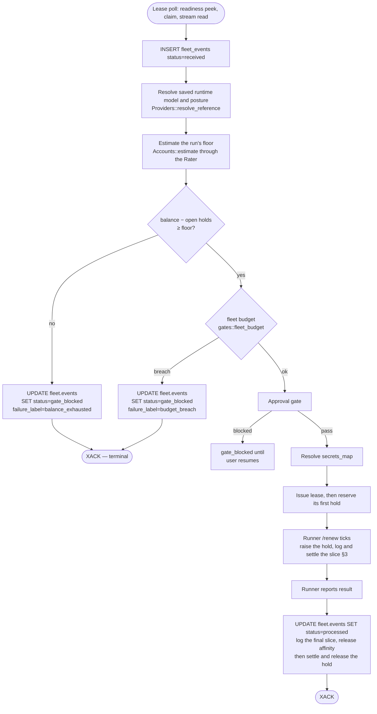

# Billing and self-managed provider key

> Parent: [`README.md`](./README.md) · User-facing: [docs.agentsfleet.net/billing/budgets](https://docs.agentsfleet.net/billing/budgets) (spend caps) and [docs.agentsfleet.net/fleets/model-providers](https://docs.agentsfleet.net/fleets/model-providers) (bringing your own key).

How users pay for what they run, and how the runtime stays neutral between two cost realities: us paying the language-model provider, or the user paying the language-model provider directly.

This is a cross-cutting topic. The data model lives in the tenant provider records, the runtime hooks live in the control plane's lease path (`agentsfleetd`) and the runner's supervisor, and the setup-time path lives in workspace chat, the reviewed setup and Save. The end-to-end walkthroughs are in [`scenarios/`](./scenarios/). This file is the canonical concept reference.

The billing model is **credit-based, Amp-style**: every tenant has a single credit balance in nanos (1 USD = 1,000,000,000 nanos); a run deducts credits for the usage it logs; when the balance hits zero the gate trips. There are no plan tiers in the cost function and no "included events" tier ladder — credits flow in (one-time starter grant in v2.0; Stripe purchase in v2.1+) and credits flow out per run. The **run** charge is posture-dispatched and reflects the cost difference (platform default subsidises inference; self-managed runs cheaper because the user is paying their own provider for tokens). This file is the **concept reference** — it describes shape and behaviour.

> **Where the live values are.** The authenticated billing surface reports the current runtime rate; the public early-access page does not publish launch pricing. This doc and the scenarios in this directory deliberately do not quote dollar amounts because they go stale when a rate moves. For implementers: server-authoritative constants are declared once, in `rustd/crates/afd_billing/src/nanos.rs`; no client recomputes a fee it is served. Public documentation mirrors belong in `~/Projects/docs/snippets/rates.mdx` and require a coordinated docs Pull Request when used.

---

## Facts

Every row is extracted from the numbered sections below; the owner column names the section that carries the full story.

| Invariant | Value | Mechanism | Owner section |
|---|---|---|---|
| Currency unit | nanos — 1 USD = 1,000,000,000 | `billing.wallets.balance_nanos BIGINT CHECK (>= 0)`; i64 caps one tenant at ~$9.2B | §2 |
| Postures | exactly 2, selected by the saved runtime reference | `platform-default` uses `platform`; an owner's model registration uses `self_managed`; both debit the owner's wallet | §1 |
| Debit point | usage only | each renewal's and the report's slice is one usage line, settled through the `Biller` after commit; admission charges nothing | §3 |
| Line charge | `⌈runtime⌉ + Σ ⌈tokens × rate⌉` | the `Rater`: run fee under both postures, each token category under platform, each rounded up on its own | §4.1 |
| Short balance | `taken = LEAST(charged, balance)` | the rest is written off and logged (`billing_charge_written_off`); the wallet never goes negative | §3, §11 |
| Lease writes per slice | fence, cursors, one usage line | `METER_LEASE` moves no money; the line is logged in the same transaction and settled after commit | §3 |
| Line keying | `UNIQUE (work_type, work_id, seq)` | a retried renewal, report or sweeper pass settles each line once | §3, §11 |
| Free usage | the starter grant only | a balance that drains, bounded by `balance_exhausted_at`; no promotional window and no mechanism for one | §2.3 |
| Mid-run exhaustion | next `/renew` refused | `UZ-RUN-012`; the run ends at its current deadline, never extended | §3, §5 |
| Budget gate | per-fleet, independent of the balance gate | `daily_nanos` rolling 24 h · `monthly_nanos` Coordinated Universal Time (UTC) calendar month; mid-run refusal `UZ-RUN-015` | §5.1 |
| Budget no-verdict posture | asymmetric | database failure → admit; no budget declared → admit; unparseable budget → refuse | §5.1 |
| `api_key` boundary | process-internal vs user-facing | never in responses, logs, fleet context, or persisted rows; the runner lease is the machine-plane exception | §8.2 |
| Credential list | metadata projection | `kind` ∈ {`provider_key`, `custom_endpoint`, `custom_secret`}; `api_key` structurally absent (no field to leak) | §8.3 |
| Model registry | one row per `(model_name, secret_ref)` | `model.tenant_models`, `UNIQUE (tenant_id, model_name, secret_ref)`; entries reference keys, never own material | §8.4 |
| Rate lookup | one fresh read per lease pass | `PriceBook::load` reads one model's dated tiers before the lease's transaction; there is no rate cache | §4.1, §10 |
| Unknown model on platform | runtime charged, tokens unpriced | never a default token rate: the line counts its tokens in `unpriced_token_count`; the lease-estimate gate admits, because an estimate is not a charge | §2.3, §4.1 |
| Catalogue read | `GET /v1/models`, bearer-authed | the public `cap.json` route is retired — `404`, no alias | §10 |
| Plan tiers | none in the cost function | future paid plans manifest as grants or top-ups, never a branch in the charge functions | §2.4 |
| Posture switch | claim-time snapshot wins | posture resolved once, at gate time, and stored on the lease | §7 |
| Blocked rows | terminal | no automatic replay after top-up; resume writes a continuation event | §6 |
| Live dollar values | never in this doc | served by the authenticated billing surface; the run fee is declared once, in `afd_billing` | preamble, §4.1 |

## Traps

Each trap is enforced in its owner section; this list is the index.

- Never quote dollar amounts in docs — they go stale the moment a rate moves (preamble).
- Metering never stops, and nothing zeroes the money column — every slice is a usage line priced at what the catalogue publishes (§2.3).
- Never fold a catalogue read fault into "this model is not in the catalogue": the second is a value (the line's tokens count as unpriced), the first is an error that holds a renewal's tokens for a later priced slice (§4.1).
- A re-sent renewal measures about zero against the slot cursor, and a re-sent line settles once on `(work, seq)` — retries never charge twice (§3).
- The budget gate counts each usage line in the window it was written in; a line is one renewal interval of usage, so a long run's spend lands where it was used (§5.1).
- No plan branch inside the charge functions, ever (§2.4).
- The provider `api_key` never joins `secrets_map`; it rides `ExecutionPolicy` on a different path entirely (§8.2).
- Model-registry entries reference vault keys — they never own credential material (§8.4).
- Absence of a `tenant_model_selection` row means a platform account default; it does not replace a fleet's saved model reference (§1).
- No silent auto-fallback from self-managed to platform on provider error — it would charge without consent (§13).
- `tenant provider create` never test-calls the provider; a bad key surfaces at the first event, when the provider refuses it (§7).
- Budget overshoot is bounded, not zero — at most one renewal window past the cap (§5.1).

## Topology

The diagrams live with their flows: the per-slice metering picture (§3) and the balance-gate mermaid flowchart (§5).

## Decisions

| Decision | Reason | Where / artifact |
|---|---|---|
| Credit-based Amp-style billing, no tier ladder | one number that drains; refills are grants or purchases | preamble, §2 |
| Platform default routes through the admin tenant's own credential | no separate platform vault, no env-var fallback, one vault code path | §1 |
| Administrator-selected platform default | model and credential are persisted configuration, independent of deployment | §1, §9 |
| Saved model settings select the endpoint and API | the curation allowlist supplies prices; it does not route inference | §9, §10 |
| A provider is priced, or records why it never will be | "not yet priced" read as a queue nobody was working; 87 providers sat in it | §10 |
| Free usage is a balance, not a promotional window | a number that drains cannot silently stay open; the timestamp-gated version priced every tenant at zero for its whole life | §2.3 |
| Usage is logged per renewal and settled after commit | a run and its usage commit together, money moves through the biller, and a crash between the two loses or doubles nothing | §3, §11 |
| Budget gate fails open on database failure | a metering outage must not halt every fleet on the platform | §5.1 |
| One billing lifecycle behind `Arc<dyn Biller>` | fleet runs and setup chat disagreed on rounding, pricing and outages; a queue or third party must be able to bill | §11 |
| Billing outages fail open, flippable at one construction site | early adoption favours the optimistic path; closing it is one line | §11 |
| Catalogue read moved behind auth | per-token margins are no longer world-readable | §10 |
| Registry consistency via activation-time upsert, not read-time self-heal | a read handler must not mutate rows to paper over a write-path violation | §8.4; M121 |
| `fleet:` vault-name prefix removed repo-wide | it discriminated nothing; dead convention | §8.4 |
| No rate cache | one indexed read of one model's price book per lease pass, so a cache would save one read and add an eviction path | §4.1, §10 |
| Stripe purchase flow deferred | v2.1; schema anticipates it | §13 |

---

## Authoring admission and settlement

Setup chat bills through the shared `Biller` lifecycle (§11), on the same `Arc<dyn Biller>` fleet leases use. `agentsfleetd` builds it once in `billing.rs` and hands it to `Drafts`.

Resolve models and billing from `Owned.tenant`, the workspace owner's account, rather than the joined member's account. Send captures the selected reference; admission pins provider/model/inference settings/context/prices. Idle version-guarded draft PATCH can replace a disabled selection; earlier turns retain their pins. Model disable, wallet absence, membership removal, and policy-marker drift fail closed. Queue acceptance can precede admission; refusal records the durable bounded Message failure/action from the resource reference.

**The bound.** An attempt's worst case is its ceiling: 8×32,768 input tokens, the selected model's saved maximum output tokens across the turn, and 300 seconds of runtime fees, rounded upward per token class with checked arithmetic (`afd_authoring::model::budget::bound`). It is stored as `authoring.attempts.reserved_nanos`, and it is what the attempt's hold reserves.

**Claim.** The gate reads the owner's balance less every open hold, `afd_billing::ledger::balance`, on the claim's own transaction, and refuses an attempt whose bound it cannot cover. A tenant with no wallet is refused. After the attempt commits, its hold is placed: `reserve(AuthoringAttempt(id), ceiling = bound)`. A hold that comes back short, or a biller that cannot answer, leaves the attempt running unheld (`setup_chat_hold_unplaced`), and its first model call reserves again.

**Renewal and each model call** raise the hold to that ceiling before their transaction opens. A biller call never runs inside a transaction: a third-party biller may be remote, and the built-in one takes its own pooled connection, so holding one while waiting for another starves the pool under concurrent saves. `Short` or `Closed` refuses as the wallet failure; under `OutagePolicy::Open` an unanswered biller admits (`Unconfirmed`).

**Report.** When the daemon knows the attempt's usage, the report's transaction logs its lines with `log_lines`: one per dispatch with known usage (completed, or failed with usage the provider still billed), at the instant it was dispatched, and one runtime line (`seq` 0; dispatch sequences start at 1). The `Rater` prices each line by its whole-request tier. The settled outcome is stamped on the attempt, and every later replay reads it there after private text is gone. After commit the report settles the lines and releases the hold (`Completed`, or `Failed` for any other outcome). A failure is logged (`setup_chat_settle_deferred`, `setup_chat_release_deferred`) and repaired by the sweeper. An attempt whose usage is still unknown logs nothing and keeps its hold until the replay that learns its usage settles it.

**Locks.** Authoring transactions take subject → attempt; no authoring path locks the wallet row. Money moves in the biller's own transactions, which lock wallet → holds → lines, so the two orders never meet. Claim and renewal first take the runner guard. A renewal reads the clock after its attempt lock, so an attempt that expired while it waited is refused.

Charge cumulative known usage once, with monotone counters and exact replay identity. Provider timeout/crash without trusted usage records `knowledge:"unknown"`, not a fabricated zero. Keep its full bound counted until the attempt is safely stopped and accounted for; it may block later admission. Fence expiry prevents candidate writes but does not prove the provider stopped billing. A replacement attempt cannot silently overlap uncertain work; explicit recovery must retain both obligations until resolved. Content-free usage records include tenant, model, prices, attempt identity, known charges, and unknown liability, never prompts or answers.

### Stop and terminal races

Stop carries the last accepted sequence and atomically raises `cancelled_through`. Queue entries at or below it become cancelled. A later send receives a greater sequence and is not cancelled by a delayed old Stop. Stop, report, and candidate proposal share the guarded attempt/subject rows. If completion commits first it stays completed; otherwise cancellation fences later text/proposal writes. Repeated lower cutoffs return the standing watermark.

A terminal report can settle already-incurred usage after Stop without displaying a late answer. Replayed reports never charge twice. Timeout, cancellation, and provider errors are separate visible states. Stop does not claim it can undo provider work already started.

## Detail

Everything below is the full reference. Headings are stable — specs cite them by §-number and text; insert new sections, never rename or renumber existing ones.

## 1. The two postures

One persona carries the worked examples: **John Doe** first saves a fleet with the platform default, then selects his own Fireworks model. The second setup uses his credential, so he pays Fireworks directly for tokens. Both setups debit the same tenant wallet for runtime.

There are two billing postures. A fleet's saved `runtime_model_ref` selects its posture when a runtime lease is admitted. Different fleets in one tenant can use different postures:

- **Platform-managed.** `platform-default` selects the administrator's enabled default model and its credential. The `agentsfleet-admin` account stores that credential in its workspace vault. `PUT /v1/admin/platform-keys` saves the default pointer in `model.platform_defaults`, without key material. At lease time, `agentsfleetd` follows that pointer and reads the model's saved inference settings. The user pays runtime fees and the model's token rates.
- **Self-managed provider keys.** An owner model reference selects a `model.tenant_models` registration and its named vault credential. The runner supervisor uses the resolved key outside the sandbox. The user pays the provider for tokens; `agentsfleet` charges runtime fees without token markup.

The platform administrator selects the default model and its credential. Its saved catalogue row supplies the endpoint, API format, physical context window and maximum output length (§9). Neither the provider name nor this document selects a model or route.

The default is a **pointer, not a constant**: `model.platform_defaults` names `(provider, source_workspace_id)` and carries the model and its context cap; the admin credential supplies only the key. Changing it is an admin write, not a deploy. `(provider, model)` is a foreign key into `model.platform_models` with `ON DELETE RESTRICT` (`schema/1320_model_platform_defaults.sql`), so the default can never name an uncatalogued model. Naming a superseded model here left platform slices unpriced until M168. Both postures dial the selected model's saved endpoint (§9). Platform uses the admin workspace's key; self-managed uses the user's key. The runtime is uniform; only which workspace's vault holds the key (and the cost-function-vs-flat-fee distinction) differs.

`model.tenant_selections` holds the separate account default. The tenant provider commands update that default; a missing row means `platform`. Runtime resolution uses the fleet's saved reference without consulting this default (`afd_credential/src/provider/runtime/resolve.rs`). Changing the account default does not rewrite saved fleets.

---

## 2. Pure credits, one-time starter grant

Every tenant has exactly one balance: `billing.wallets.balance_nanos` (`BIGINT NOT NULL CHECK (balance_nanos >= 0)`, holds 9 decimal places of USD precision; i64 caps a single tenant at ~$9.2B, headroom for sub-cent rates without another unit change). The gate compares this column against the estimated event cost. Deductions are SQL `UPDATE … SET balance_nanos = balance_nanos - <nanos>`. There is no second column for "free vs paid," no replenishing bucket, no included-events quota. One number, drains over time, refills only when the user buys credits.

### 2.1 The starter grant

Each new tenant receives a **one-time starter credit** at tenant-create time: `STARTER_CREDIT_NANOS` in `rustd/crates/afd_tenant/src/signup/mod.rs`. The credit is written to `billing.wallets.balance_nanos` in the same signup transaction that creates the tenant. There is no replenish; it is a one-time onboarding allowance. Read the source for the current dollar amount.

Under M80_010's metering the grant drains at the run fee (`RUN_NANOS_PER_SEC` × runtime) under self-managed, and at the run fee plus the three-tier per-token cost under platform. A quiet long run therefore stretches the grant further than a token-heavy one, and platform spend depends on the model (see §4.2). The grant is sized so a new user comfortably covers a few thousand runs on either posture without thinking about top-ups.

### 2.2 What happens when the starter grant runs out

When `balance_nanos` cannot cover the next event's estimated cost, the gate trips. The event is blocked at the gate (`status='gate_blocked'`, `failure_label='balance_exhausted'`). The CLI prints a one-line pointer at the dashboard billing page; the dashboard shows the empty-balance state. **Stripe-backed Purchase Credits is deferred to v2.1.** In v2.0, a user whose grant runs out either contacts us (manual top-up via support) or stops using the platform. The pricing model and the schema both anticipate Stripe — they just don't ship the integration in v2.0.

### 2.3 Free usage is a balance, never a window

**There is no promotional window, and there is no mechanism for one.** A tenant's free usage is the starter grant and nothing else: a number that drains, bounded by `exhausted_at` when it reaches zero. Pricing consults the model catalogue and the posture. The clock enters pricing in one way only: the price row is chosen by the instant of the request it prices (`model.platform_model_prices` is effective-dated, §4.1), clamped to the work's own window. No price is waived by date.

This replaced a timestamp-gated window, and the reason is worth keeping. The cutoff was a per-tenant wallet column (`free_trial_ends_at`) that was nullable with no default, and null read as "open". Its only writer in the repository was a test fixture, so **every tenant held null and every metered stage priced to zero — stage billing never charged anyone.** The gate sat ahead of the catalogue lookup, so it also masked an uncatalogued model: a pair with no rate row resolved to zero instead of refusing.

Three properties fall out of the removal, all load-bearing:

- **The balance gate can refuse.** While the window was open, run charge was `0` for every posture, so the balance gate could never refuse anyone — `0 balance ≥ 0 charge` always covers. Both money checkpoints were effectively open for all tenants. They now bite: lease-issue blocks an exhausted tenant (`balance_exhausted`), and renewal refuses one (`UZ-RUN-012`; the run ends at its current deadline, never extended).
- **An unpriceable model is charged its runtime only.** Platform posture with no price covering the request charges the run fee, and the line counts its tokens in `unpriced_token_count`, so nothing reads as free by accident. The lease-estimate gate admits, because an estimate is not a charge.
- **A catalogue fault holds tokens at renewal.** A renewal that cannot read the catalogue meters no tokens, so the slot's token cursor stays put and the next priced renewal charges them (`lease_tokens_held_for_pricing`, `rustd/crates/afd_fleet/src/lease/usage.rs`). A report that cannot read it logs the final slice's tokens as unpriced, since no later slice can charge them.

Every slice is logged with its posture and token counts whatever it is charged, and its `charged_nanos` carries the catalogue's number.

How free usage is presented is canonical on [`agentsfleet.net/#pricing`](https://agentsfleet.net/#pricing). The balance read carries no `free_trial` member (API reference › Tenant balance).

### 2.4 Plan tiers

There are no plan tiers in the cost function. The `Rater` in §4 takes no plan parameter. If we ever introduce paid plans (v2.1+), they will manifest as larger one-time grants, recurring Stripe charges that top up `balance_nanos`, or volume discounts on per-event rates — but not as a branch inside the charge functions.

---

## 3. One debit point: usage, settled through the biller

A fleet run is charged for what it uses, and only that: no event costs anything to receive. The run's usage is logged inside the lease's own transactions and the money moves afterwards, through the `Biller` every product path holds (§11).

> ```
>  ONE event → the fleet runs in a sandbox, renewing as it works:
>    issue ─renew─ renew ─renew─ … ─report─►   each step measures the slice since the last:
>      slice = runtime since the slot cursor + token deltas since the cursor
>      line  = Rater(slice)   run fee (both postures) + tokens (platform), each category rounded UP
>
>    inside the lease's transaction (fenced; a lost or capped pass writes nothing):
>      ① move the deadlines or flip the lease to reported, advance the slot cursor
>      ② log the slice as one billing.usage_lines row (work = the lease, seq = its next number)
>    after commit, through Arc<dyn Biller>:
>      issue  → reserve(floor)               the lease's first hold
>      renew  → reserve(spent + floor), settle(line)
>      report → settle(line), release(Completed | Failed)
>    sweeper:billing settles any line left unsettled and releases holds of leases that ended
> ```

| Step | What moves | Where |
|---|---|---|
| Admit | nothing; the balance and budget gates read (§5) | `rustd/crates/afd_fleet/src/lease/admit/mod.rs` |
| Issue | the lease's first hold, at the floor the balance gate admitted against | `rustd/crates/afd_fleet/src/lease/money.rs` |
| Renew | the hold is raised to the lease's spend so far plus one floor; the slice is logged, then settled | `rustd/crates/afd_fleet/src/lease/renew/mod.rs`, `coverage.rs` |
| Report | the final slice is logged in the report's transaction, settled after commit, and the hold released | `rustd/crates/afd_fleet/src/lease/report/mod.rs`, `settle.rs` |
| Sweep | lines that committed without a settlement, and holds of leases that ended | `rustd/crates/afd_fleet/src/lease/billing_sweep.rs`, `afd_billing::ledger::resettle` |

**Measuring a slice.** `METER_LEASE` (`rustd/crates/afd_fleet/src/lease/sql/meter_lease.sql`) keeps its fence, its two deadlines, its slot cursor and its lifetime tally, and moves no money. It answers the slice: the runtime since the slot's `last_metered_at`, the token deltas against the slot's `metered_*` cursors, the instant, who pays and what the line names. The runner still reports cumulative counts, so a re-sent renewal diffs to about zero, and `FOR UPDATE OF l, a` serialises every pass on one lease. The cursors stay until runners report each provider request (billing run 4).

**Logging the line.** The lease path prices the slice through the `Rater` and logs it with `afd_billing::ledger::log_lines` in the same transaction, so the run and what it cost commit together. A slice that measured nothing logs nothing. Its line number is the count of lines the lease has logged, read under the lease's row lock, so two passes never take one number (`rustd/crates/afd_fleet/tests/integration_lease_billing_races.rs`).

**Settling.** After commit the lease path calls `settle`; a failure is logged (`lease_settle_deferred`) and the sweeper settles the line within its grace of two minutes. `settle` keys on `(work, seq)`, so a retry never charges twice. A balance that cannot cover a line gives what it has and writes off the rest (§11).

**Charges history.** `GET /v1/tenants/me/billing/charges` reads `billing.usage_lines`, newest first, one row per line, whether a fleet run (`charge_type: stage`) or a setup chat (`charge_type: authoring`) logged it. The page is cut by the `(tenant_id, created_at, id)` index before any join, under one descending `(created_at, id)` cursor. Reading history never changes the wallet.

Setup rows have `charge_type: authoring` and `authoring_attempt_id`; `event_id` is null. A retained private draft supplies only its public saved-fleet link and current public fleet name. No draft title, instructions, messages, answers, or credential metadata enters the billing response. Setup costs remain visible after private chat deletion because a setup line names its content-free attempt; without a retained public fleet link, `fleet_id` and `fleet_name` are null. A fleet line keeps the fleet's identifier and the name it had when the line was written, through the fleet's deletion; a line for a fleet already purged names it by its identifier.

The dashboard labels setup records **Setup chat**, using **Fleet setup** when no fleet link exists. The command-line interface requests a bounded raw charge page and keeps every returned record before forwarding its cursor.

---

## 4. The run charge

### 4.0 Worked examples up front

Two events for John, taken at different points in his journey, drive the examples below. Both run against Kimi K3; only the posture differs:

- **John on platform-managed.** A webhook event under `mode=platform`: 800 input tokens and 1040 output tokens against `accounts/fireworks/models/kimi-k3`. agentsfleet holds the Fireworks key; we pay Fireworks for the tokens and bill John at the catalogue's rate plus the run fee.
- **John on self-managed.** The same workload under `mode=self_managed`. John holds the Fireworks key and pays Fireworks directly. agentsfleet bills the run fee only.

### 4.1 The Rater

`afd_billing::price::Rater` prices every usage line, whichever product logged it:

```rust
let book = PriceBook::load(executor, provider, model).await?;   // every dated tier of one model
let rated: RatedLine = Rater::new(&book, posture, window).rate(&line)?;
// RatedLine { usage, price: Option<Uuid7>, charged: Nanos, unpriced_tokens: u64 }
```

- **Runtime** is charged under both postures at `RUN_NANOS_PER_SEC` (`rustd/crates/afd_billing/src/nanos.rs`), from the line's `runtime_ms`.
- **Tokens** are charged under platform only, each category (input, cache read, the three cache-write classes, output) at its rate per million and **rounded up on its own** (Indy, 2026-10-19), so the platform never under-bills and over-bills by at most one nano per category per line.
- **The price row** is chosen by the line's instant, clamped to the work's window so a runner cannot backdate a request into a cheaper range, and by the request's whole prompt for context tiers. A fleet slice sums every request since the last renewal, so the lease path prices it at the **base tier** (`PriceBook::into_base_tiers`): a tier chosen from a sum would overcharge. Per-request tiers arrive with per-request lines (billing run 4).
- **Nothing is ever free by accident.** A category whose rate is unpublished, or a request no range covers, counts in `unpriced_tokens` and charges nothing, visibly.

The issue-time floor (`Accounts::estimate`) prices `ESTIMATE_FLOOR_INPUT_TOKENS` and `ESTIMATE_FLOOR_OUTPUT_TOKENS` through the same Rater at the issue instant, with no runtime. A self-managed run costs nothing at issue and reads no catalogue. A model with no price covering the instant is `Estimate::Unpriceable`, and the gate admits against a floor of zero, because an estimate is not a charge.

**There is no rate cache.** One `PriceBook::load` is one indexed read on the model's `(provider, model_name)` and its price rows; the lease path reads it once per pass, before the transaction opens, so no catalogue read waits while the lease is locked. A cache would add a version check and an eviction path to save that one read.

**A catalogue that cannot be read** holds a renewal's tokens: the pass meters zero token counts, so the slot cursor stays where the last priced slice left it and a later priced slice charges them (`lease_tokens_held_for_pricing`, `rustd/crates/afd_fleet/src/lease/usage.rs`). A report has no later slice, so it logs the run's tokens as unpriced on its final line.

### 4.2 What an event costs — by shape, not by number

A worked example with hardcoded dollar amounts goes stale the moment a rate moves. The cost shape a caller can reason about instead, summed over the run's lines:

**Platform posture:**

```
total_nanos = Σ_lines [ ⌈runtime_ms × RUN_NANOS_PER_SEC / 1000⌉
                      + ⌈Δinput  × rate.input_nanos_per_mtok        / 1_000_000⌉
                      + ⌈Δcached × rate.cached_input_nanos_per_mtok / 1_000_000⌉
                      + ⌈Δoutput × rate.output_nanos_per_mtok       / 1_000_000⌉ ]
```

**Self-managed posture:**

```
total_nanos = Σ_lines ⌈runtime_ms × RUN_NANOS_PER_SEC / 1000⌉        // run fee only
```

The token component dominates a token-heavy run; the run fee dominates a long, quiet one. `rate` is the `model.platform_model_prices` row in effect at the line's instant (§10). Live dollar amounts are served, never written here.

---

## 5. The balance gate — code path

`money_gates` (`rustd/crates/afd_fleet/src/lease/admit/mod.rs`) runs the payer, balance and fleet-budget gates and charges nothing. The lease's hold is placed once it is issued, and its usage is charged as it runs (§3).



Properties:

- **The balance is what the biller says is available.** The gate reads `Biller::balance` and covers the floor from the balance less every other open hold, so runs already in flight count against it. A tenant with no wallet row is admitted, as an operator gap rather than a refusal; its usage still settles, with the whole charge written off and logged.
- **The floor is small on purpose.** The runner does not know its token counts at lease time, so the floor is `ESTIMATE_FLOOR_INPUT_TOKENS` and `ESTIMATE_FLOOR_OUTPUT_TOKENS` at the issue instant.
- **A balance crossing zero mid-run ends the run.** Each renewal raises the hold to the lease's spend so far plus one floor; the biller answers `Short` when the balance less other holds cannot cover it, and the renewal is refused with `UZ-RUN-012`.
- **Concurrent events on a near-zero balance.** The gate reads without a lock, so two events can pass it together on a balance that covers one. Their holds are placed under the tenant's wallet row lock, so they never promise more than the balance; the second one placed answers `Short`, its lease runs unheld, and its first renewal refuses it. The wallet never goes negative (`schema/2000_billing_wallets.sql` checks `balance_nanos >= 0`).
- **An outage admits.** Under `OutagePolicy::Open` a reservation the biller cannot answer comes back `Unconfirmed` and the run continues; its lines settle when the biller is back (§11).

### 5.1 The per-fleet budget gate — a second, independent ceiling

The balance gate above bounds what a **tenant** may spend: one credit pool, one `balance_nanos`. It says nothing about how that pool is divided. A single misbehaving fleet in a tool-call loop can drain the whole pool while every other fleet in the tenant starves.

`daily_nanos` / `monthly_nanos` in a fleet's reviewed setup are the **fleet-scoped** ceiling — the blast-radius guard. Both are positive integer nanos, written as decimal strings. The two gates are independent and both must pass:

| | Balance gate | Budget gate |
|---|---|---|
| Scope | tenant (`billing.wallets.balance_nanos` less open holds) | one fleet (the selected revision's `config` → `x-agentsfleet.budget`) |
| Question | "can this tenant afford one more run?" | "has this fleet spent its own allowance?" |
| Pre-run refusal | `gate_blocked` + `balance_exhausted` | `gate_blocked` + `budget_breach` |
| Mid-run refusal | `/renew` → `UZ-RUN-012` → `renewal_terminate` | `/renew` → `UZ-RUN-015` → `budget_breach` |
| Source of truth | `Biller::balance` | the fleet's `billing.usage_lines`, summed by `afd_billing::limits::fleet_spend` |

**Where it fires.** `money_gates` runs `gates::fleet_budget` after `gates::balance`, before the lease is issued (`rustd/crates/afd_fleet/src/lease/admit/mod.rs`). Mid-run, the renewal re-reads the ceiling live from the fleet's selected setup revision on every tick, whatever the fleet's status (`rustd/crates/afd_fleet/src/lease/coverage.rs`) — applying a revision that lowers a runaway fleet's `daily_nanos` bites at its next tick, not only at its next run.

**Windows.** `daily_nanos` is a **rolling 24 hours** and `monthly_nanos` the **UTC calendar month**, both opened from one `now()` in the same statement (`rustd/crates/afd_billing/src/limits/select_fleet_spend.sql`), so the two windows can never straddle a tick. A line counts in a window when it was written inside it; each line is one slice of at most one renewal interval, so a long run's spend lands in the window it was used in. The read is served by `idx_usage_lines_fleet_id_created_at`, and a planner probe pins that (`rustd/crates/afd_fleet/tests/integration_ledger_reads.rs`). `monthly_nanos` is optional — absent means no monthly ceiling.

**Spend means what the fleet's usage cost.** A line the balance could not fully cover still counts at its price: the ceiling bounds what a fleet uses, and the write-off is the balance gate's concern. The setup chat that authored a fleet does not count against its budget; whether it should is open (§11).

**Overshoot is bounded, not zero.** The ceiling is a floor-check: a run is admitted while `spend < cap`. An already-running run may exceed its cap by at most one renewal window's worth of usage before its next `/renew` refuses it. Enforcing a *predicted* end-of-run cost would refuse runs that would have finished under budget.

**Failure posture, deliberately asymmetric.** Three distinct "no verdict" causes, three different answers:

| Cause | Answer | Why |
|---|---|---|
| Database unreachable / query failed | **admit** (fail open) | mirrors `gates::balance` — a metering outage must not halt every fleet on the platform |
| Fleet declares **no** `budget` | **admit** | undeclared is unbounded, exactly as before this gate existed. The tenant credit pool still bounds it. Refusing would enforce a ceiling nobody wrote |
| `budget` declared but unparseable | **refuse** (fail closed) | a ceiling we cannot read is not a ceiling we may ignore |

The stored budget is parsed by the same `FleetConfig` parser that accepted it at ingest (`afd_fleet_runtime::config::policy::Budget`), so the ceiling that admits a run and the ceiling that kills it are one number.

**The fleet list reads a counter, not a sum.** `fleet.activity_counters.budget_used_nanos` is kept by a trigger on `billing.usage_lines` (`schema/2040_billing_usage_lines.sql`), so the fleet list stays one indexed counter read per fleet with no per-row aggregate.

---

## 6. The credit-exhausted user experience

When the gate blocks, the user's surfaces show:

- **`agentsfleet events <fleet_id>`** — the gate-blocked row appears with `status='gate_blocked'`, `failure_label='balance_exhausted'`.
- **`agentsfleet billing show`** — balance reads `$0.00` and the CLI prints *⚠ Out of credits. See https://app.agentsfleet.net/settings/billing* (`cli/src/commands/billing.ts`); below it, the most recent charge rows showing where the credits went.
- **Dashboard events list** (`/w/{workspaceId}/events`) — the row renders with an amber `gate_blocked` status (`ui/packages/app/components/domain/EventsList.tsx`).
- **Dashboard `/settings/billing`** — a *Balance exhausted* alert says new fleet events are gate-blocked until a top-up. The *Buy credits* button is a mail link to support, with a tooltip saying so (`BillingBalanceCard.tsx`). The Usage tab still shows the historical drain.

The blocked row is **terminal** (XACKed, immutable narrative). When the user's balance is later topped up (manually by us in v2.0, or via Stripe in v2.1+), there is **no automatic replay**. If they want the missed events processed, they re-trigger from the source (push another commit, send another steer). The `actor=continuation:<original>` resume belongs to the approval gate (`rustd/crates/afd_approval/src/inbox/resolve/mod.rs`); a balance-blocked row has no resume.

The reasoning is that a balance-exhausted event is usually evidence the user was already off the rails (runaway loop, mis-configured cron). Auto-replay would compound the bill.

---

## 7. Switching posture mid-stream

A saved setup can select either the platform default or an owner's configured model. Effects on subsequent billing:

- **Platform → self-managed.** Save the owner's model reference in the fleet setup. New leases use its credential and charge runtime fees without token markup.
- **Self-managed → platform.** Save `platform-default` in the fleet setup. New leases use the enabled platform default and its token rates. The balance gate still applies.
- **Mid-event change.** The claim-time model and posture snapshot governs that running lease. A later setup change does not reprice it.

Changing the tenant's account default alone does not change either saved selection. The current reference, credential and settings must remain eligible at admission (§9).

The `tenant provider create` PUT validates eagerly on structure (body shape, credential presence, JSON shape, model-library catalogue membership). It does **not** make a synthetic call to the large language model (LLM) provider to verify the key works — a bad key surfaces at the first event, when the provider refuses it. The CLI prints a one-line *"Tip: run a test event to verify the key works"* hint after a successful set.

---

## 8. The self-managed credential and the api_key visibility boundary

### 8.1 The credential body — user-named, opaque

Vault credentials are opaque JSON objects keyed by name (the M45 vault design). The self-managed record uses an **user-chosen name**: John picks `account-fireworks-key`, another user might pick `anthropic-prod` or `openai-team-shared`. The name is whatever makes sense to the user; the schema does not impose a convention.

```json
{
  "provider": "fireworks",
  "api_key":  "fw_LIVE_xxxxxxxxxxxxxxxx",
  "model":    "accounts/fireworks/models/kimi-k3"
}
```

`provider` identifies the model's catalogue provider. `model` is the provider's model identifier, and `api_key` is the user's credential. Routing comes from that model's saved inference settings; a credential's optional `base_url` restricts the endpoint it authorizes (§9).

The `model.tenant_selections` row points at a `model.tenant_models` row, which names the credential through `secret_ref`. Multi-credential tenants are supported (a user can store `anthropic-prod` AND `fireworks-staging` in vault and flip between them with `agentsfleet tenant provider create --secret <other>`); only one is *active* at a time per tenant.

**Vault scope: workspace-keyed; tenant→workspace bridge.** `vault.secrets` is keyed by `(workspace_id, key_name)` per the M45 schema. Tenant-scoped lookups (the self-managed resolver, the `agentsfleet secret create` write path) bridge through `Providers::primary_workspace` (`rustd/crates/afd_credential/src/provider/selection/mod.rs`), which picks the earliest-named workspace owned by the tenant. Single-workspace tenants (the v2.0 default) work transparently. Multi-workspace tenants implicitly pin **all** self-managed credentials to the earliest-named workspace; per-workspace credential isolation — and a fully tenant-keyed vault — is post-v2.0 work. Until then, the bridge is the rule.

**`context_cap_tokens` is not in the credential body.** The cap is read from the catalogue (`model.platform_models`, §10) with each model resolution, matched by provider and model name. Splitting the two lets a catalogue edit change the cap without touching the vault.

### 8.2 The api_key visibility boundary

The api_key — platform OR self-managed — crosses one boundary cleanly. It exists only in places that need to call the provider's API; it never appears in any user-facing surface.

**The api_key MAY exist in:**

- `vault.secrets` rows as envelope ciphertext.
- Server-side process memory. For runtime, `Providers::resolve_reference` opens the selected key in `agentsfleetd` and delivers it on `ExecutionPolicy.api_key` to the trusted runner supervisor. The key stays outside the sandbox and `secrets_map` ([`runner_execution.md`](./runner_execution.md#crates)). Authoring instead opens the selected inference key inside the daemon for each scoped dispatch; the authoring runner receives only its capability. [`AUTH.md`](../AUTH.md#fleet-setup-and-credential-boundary) owns that distinction. Resolved keys use `SecretString` (`rustd/crates/afd_credential/src/provider/resolved.rs`).
- Outbound HTTPS request headers to the provider (e.g. `Authorization: Bearer …`).

**The api_key MUST NEVER appear in:**

- User-facing HTTP response bodies — `agentsfleet doctor --json` output, `GET /v1/tenants/me/provider`, the `GET /v1/workspaces/{ws}/secrets` metadata list (§8.3), and any other JSON a user sees. The authenticated runner lease is the machine-plane exception described above.
- Logs — `agentsfleetd`, runner, structured logs, request logs.
- The fleet's tool context — placeholders are substituted at send time by the runner's egress guard, outside the sandbox; the provider key is on a different path entirely (the runner's provider client uses it for the inference call only, never via `secrets_map`).
- Persisted event rows — `fleet.events`, `billing.usage_lines`, anything else under `core.*` or `billing.*`.
- User-facing artefacts — fleet setup and reviews, the dashboard, CLI table output, status-page bodies.

The boundary is "process-internal vs user-facing," not "in memory vs not in memory." Within `agentsfleetd`, the resolved provider key and connector tokens are held as `afd_crypto::secret::SecretString`, whose owned buffer is wiped on drop (`rustd/crates/afd_crypto/src/secret/string.rs`). The decrypted `secrets_map` a lease carries, authorization-header storage, and plaintext during active use remain outside this guarantee. A grep across the event log, `agentsfleetd` logs, runner logs, and user-facing HTTP responses for the api_key bytes after a self-managed run is a Continuous Integration (CI) invariant (M48 acceptance criteria).

### 8.3 The credential metadata list and whole-body replace

`GET /v1/workspaces/{ws}/secrets` projects each stored credential's **non-secret** descriptor so the dashboard classifies and labels without guessing from the user-chosen name. Each row carries a server-derived `kind` ∈ {`provider_key`, `custom_endpoint`, `custom_secret`} plus the non-secret `provider` / `base_url`, and **never** `api_key`. Key presence (`has_key`) is the tenant model registry's question (§8.4), not this list's. The list reads the four `meta_*` projection columns and decrypts nothing (`rustd/crates/afd_vault/src/read.rs`). `model` is not projected, because answering it would mean decrypting every row (`rustd/crates/afd_vault/src/projection/mod.rs`). The projection type has no `api_key` field, so a leak is a compile error rather than a review catch. `kind` is derived from the `provider` field — `openai-compatible` → `custom_endpoint`, any other provider string → `provider_key`, missing/non-string → `custom_secret` — never from the name. A row with NULL or unknown metadata lists as `custom_secret` and the list still returns 200. Nothing fills such rows today: `agentsfleetd` has no backfill verb (`serve`, `migrate` and `openapi` only, `rustd/crates/agentsfleetd/src/cli.rs`). The list sits behind the workspace ownership layer (`afd_http::auth::ownership`) and needs the `secret:read` scope; writes and deletes need `secret:write` (`rustd/crates/afd_http/src/route/workspace.rs`).

A replace swaps the whole body and never claims a name; the envelope and its `meta_*` projection are rewritten in one statement (API reference › Secrets).

Both endpoints honour §8.2: the metadata lives in non-secret `meta_*` columns beside the envelope, so the opaque body (§8.1) is unchanged; `api_key` is structurally absent from the list response, and the replace body is never returned or logged.

**Nav placement history:** M87 (`docs/v2/done/M87_001_P1_UI_MODELS_CREDENTIALS_REDESIGN.md`) deliberately collapsed Models and Credentials into one dashboard nav entry. M113 reverses that — Secrets & ENVs gets its own nav entry and route again. M87's spec is left as-written (a historical record of the reasoning at the time); this note is the pointer for anyone reading it cold.

### 8.4 The tenant model registry — many entries, one shared key (M121)

The 4-fixed-slot Models page (Default / Anthropic / Other provider / Custom) could not represent a real tenant's model set: every Anthropic key past the first was hidden, every non-Anthropic provider piled into one bucket row, and the same model on two hosts (e.g. GLM 5.2 on `fireworks.ai` vs `wafers.ai`) had nowhere to live. `model.tenant_models` (`schema/1330_model_tenant_models.sql`) adds the missing noun: one row per configured `(model_name, secret_ref)` pair, so N model rows can reference the same vault credential.

```sql
model.tenant_models (id, tenant_id, model_name, secret_ref, created_at, updated_at)
  UNIQUE (tenant_id, model_name, secret_ref)
```

**Entries reference keys — they never own credential material.** `secret_ref` names a `vault.secrets` row (§8.1); the entry table carries no `provider` / `base_url` / `api_key` columns. `GET /v1/tenants/me/models` joins each entry to its secret's §8.2-safe metadata projection (provider, kind, `base_url`, `has_key`) at read time, the same projection §8.3's credential list already uses — `api_key` is structurally absent from the join, not filtered out. A keyless endpoint (Out of Scope: runner auth behaviour is unchanged) stores an empty `api_key` in the secret body so the activate/resolve chain in §9 stays uniform whether or not a key exists.

**Activation upserts the entry — the registry is always representable by construction.** The tenant's *active* selection still lives on `model.tenant_selections`. The selection write (`rustd/crates/afd_credential/src/provider/activate/mod.rs`) upserts the matching entry row and writes the selection inside one `BEGIN`/`COMMIT` transaction. The entry upsert is `INSERT … ON CONFLICT DO NOTHING`, a clean no-op on the common re-activation case. So "every active selection has a matching entry" holds for every caller, and a partial failure leaves nothing behind. Repeat PUTs converge (PUT stays idempotent). `GET /v1/tenants/me/models` is a **pure read**: it computes each entry's `active` flag by checking whether the selection's `tenant_model_id` is that entry's `id` (`is_active`, `rustd/crates/afd_credential/src/provider/entries/mod.rs`) and never writes. Side effect worth knowing: a secret activated via bare `PUT /provider` is immediately referenced by an entry, so the referenced-secret delete guard (**Guards**, below) protects the credential backing the active selection. (The original M121 shape was a synthesize-on-read self-heal inside GET; it was reworked pre-merge — a read handler mutating rows papered over an invariant the write path was allowed to violate. Pre-2.0, no legacy backfill: an old selection with no entry simply shows no Active row until the next activation.)

**Guards.** Entry writes refuse an unknown secret, a duplicate pair and the active entry, and deleting a still-referenced secret is refused (codes: API reference › Tenant models).

**Vault key names.** A secret is stored under the raw name the user chose. There is no prefix convention, so a reader looks up exactly what the writer wrote.

---

## 9. Provider routing — saved model settings

`model.platform_models.inference` owns the non-secret provider settings: `api`, `base_url`, optional `dialect`, and `max_output_tokens`. The column is nullable and never seeded. An unconfigured row remains visible to administrators and cannot drive chat or runtime inference. Configure its real endpoint and token limits before enabling it.

`afd_inference::Configured` validates these settings and builds rig's Chat Completions, Responses, Messages, native Gemini `GenerateContent`, or native Ollama chat codec. Provider names and model names identify rows; neither chooses a URL or API format. The runner's JSON routing table is deleted. Curation input for prices remains an operator tool and does not decide runtime routes.

Workspace choices join the owner's model registrations to credentials and the exact `(provider, model_id)` catalogue row. The active platform default uses its own configured model and credential. Both choices require credentials, valid settings, nonnegative prices, and a usable context window. Authoring additionally requires that the selected SDK wire supports proposal tools; runtime eligibility is checked separately. A credential carrying an endpoint restriction authorizes only that saved endpoint. Catalogue changes advance the revision pinned into the model identity; stale admitted work cannot silently acquire different routing or limits.

The native Ollama API does not authorize local network access: a saved base URL must be HTTPS on a public host, as for every other API, until customer-host ownership is decided.

The daemon resolves the exact selected reference for runtime leases and includes non-secret settings in `ExecutionPolicy.inference`. The supervisor uses the resolved key outside the sandbox and sends inference through its guarded transport. An absent configuration refuses the lease. Authoring keeps credentials in the daemon and sends only its scoped capability to the runner. Neither path follows redirects; outbound address guards remain in force.

The fleet's operating context cap stops tool use and requests a final answer. It does not replace the model's physical window. Every provider request bounds output by both the saved maximum output length and the physical space remaining after the complete encoded input; exhausted physical context refuses dispatch.

`rig-core` and `rig-http` are pinned to 0.44.0. The shared `afd_inference::log_filter` filters rig's request/reply traces and the warning containing a provider's private error text in both daemon and runner logging. Model keys and private prompts never become log fields.

---

## 10. The model library — catalogue table + authenticated read

`model.platform_models` holds each exact provider/model identity, display name, context evidence, advanced flag and inference settings. `model.platform_model_prices` holds its prompt-size tiers, effective date ranges, token rates and price evidence. Platform admins manage both through `POST/PATCH/DELETE /v1/admin/models`; authenticated tenants read them through **`GET /v1/models`**. Workspace chat lists only eligible owner registrations and the enabled platform default (§9), rather than every catalogue row. The setup and trigger resolution flow is documented in [`user_flow.md` §8.7](./user_flow.md#87-model-and-context-cap-origin-platform-vs-self-managed).

Section 8 of M229 remains in progress. Per-request billing, cache-write accounting and the HTTP representations still require integration. [The integration handover](../reviews/model-catalogue/handover.md) records those gaps; this table split does not prove settlement uses the new rates.

Read shape: API reference › Model Library (keyset-paged; `version` moves on every catalogue change).

The curated identities and prices are declared in `scripts/model-library-allowlist.json`. The Bun validator checks the exact curated set, official sources, positive exact decimal rates, date ranges and context evidence. The [operator playbook](../../playbooks/operations/model_catalogue/001_playbook.md) reviews a diff before an explicitly approved apply. The seeder writes identities, dated prices, deletions and one generation increment in one transaction. A repeated unchanged apply writes nothing.

**The provider is explicit.** `model.platform_models` keys on `(provider, model_name)`. Native Google uses provider `gemini`; OpenRouter's Gemini uses `openrouter`. Their identifiers, credentials, prices and runner wires remain separate. Display names never replace API identifiers.

**Exact provider evidence is required.** A context integer comes from that provider's models API and carries its source and verification time. An unreadable limit produces a `NOT SEEDED` report. It never becomes an assumed integer from a marketing label. Removed identities are deleted. `gpt-5.6-terra` is the sole advanced entry. Ollama has no curated tags or published token price; its tags must come from the configured server. Local endpoint assignment and refusal checks remain required work in [the handover](../reviews/model-catalogue/handover.md).

Properties:

- **Reading the catalogue requires an authenticated tenant.** The dashboard fetches through a token-minting Server Action. The command-line interface resolves context caps server-side through provider selection.
- **The response carries no global rate block.** The run fee is declared once, in `rustd/crates/afd_billing/src/nanos.rs`; the daemon charges, and a client renders what it is served.
- **Consumed per-session, not cached at the edge.** The dashboard fetches the library once per session; the payload is small and the read is no longer a Content Delivery Network (CDN) concern.
- **Runtime admission resolves the saved model reference.** Its catalogue row supplies the physical context and inference settings; `ExecutionPolicy.model_context_tokens` carries that window separately from the fleet's operating cap. Token rates are read once per lease pass, as one price book (§4.1).

---

## 11. One billing lifecycle behind a `Biller` trait

Decided 2026-10-18/19 (M229 §9; Discovery "Billing revamp"). It replaces two money paths that disagreed: fleet runs (`afd_billing::Accounts` plus one SQL statement that priced, debited and recorded together) and setup chat (its own reservation maths, debit and settlement SQL inside `afd_authoring`). They rounded differently, priced cached tokens differently, failed differently during an outage, and wrote two charge tables. Fleet runs bill through it now (§3); setup chat moves onto it in billing run 3, and runners report one line per provider request in billing run 4.

```
 work happens ─► usage lines        ─► Rater (pure)              ─► UsageLog (ours, inside the work's transaction)
 (runner, per     {seq, at, prompt,     tier by whole-request         billing.usage_lines, one row per request,
  request;         cached_read,         prompt size, price by `at`,   unique (work, seq); the charges page reads it
  setup chat       cache_write,         posture, one rounding rule              │ after commit, and the sweeper's retry
  makes its own)   cache_write_5m,                                              ▼
                   cache_write_1h,                               Arc<dyn Biller>   reserve / settle / release / balance
                   output, runtime}                              ├─ LedgerBiller: billing.wallets + billing.holds (built in)
                                                                 ├─ a queue biller (later)
                                                                 └─ a third-party metering API (later)
```

**Two layers, on purpose.** The usage log records what happened and what it costs. It is always ours and always written in the same transaction as the work it describes, so a run and its usage commit or roll back together. The `Biller` moves money: holds before work, charges after it. It runs after commit because a queue or a third party can never join our transaction. `settle` is idempotent on `(work, seq)`, and a sweeper re-sends lines that committed without a settlement, so a crash between the two layers neither loses nor doubles a charge. Holds cover the gap between the two.

**The trait.** `afd_billing::biller::Biller` is an `#[async_trait] Send + Sync + Debug` trait held as `Arc<dyn Biller>`, the shape `afd_authoring`'s provider `Transport` already uses.

| Method | When | Idempotent on |
|---|---|---|
| `reserve(&Reservation) -> Hold` | admission, each renewal, each setup-chat model call; raises an existing hold | the work |
| `settle(&Settlement) -> Receipt` | renewal, report, and the sweeper | `(work, seq)` |
| `release(&WorkKey, Release)` | report, failure, and the sweeper for a lease that ended unreported | the work |
| `balance(&Account) -> Balance` | the tenant billing page | read only |

`WorkKey` is `FleetLease(id)` or `AuthoringAttempt(id)`, so the two products share one vocabulary. `reserve` answers in its type: `Hold::Held { ceiling, captured }`, `Short { available, asked }`, `Closed` (the work was already released) or `Unconfirmed` (the biller could not answer and the outage policy admitted the work). A `Settlement` carries each line's raw usage and the daemon's price for it: a biller that prices for itself may ignore our price; `LedgerBiller` charges it. Wrapping is composition: a biller that also copies every call to a queue is one more implementation holding two.

**Pricing.** One `Rater` prices a line from the catalogue's `model.platform_model_prices`: the tier from the request's whole prompt (uncached input, cache reads and cache writes together), the date range from the request's `at`, clamped by the daemon to the work's own window so a runner cannot backdate. Self-managed work charges runtime only. Each token category rounds **up** per line, so the platform never under-bills and over-bills by at most one nano per category per request.

**Outage policy.** `WithOutagePolicy<B>` wraps any biller; under `OutagePolicy::Open`, a `reserve` the biller cannot answer comes back `Unconfirmed`, the work is admitted, and its lines settle when the biller is back. Only `reserve` reads the policy: a failed `settle` or `release` leaves the lines logged and unsettled for the sweeper under either policy. An outage is a pool that cannot hand out a connection or a statement whose connection was lost mid-flight (a reset socket, a failover, a `08xxx` or `57P01`–`57P03` answer), as `afd_db::error::is_connection_lost` decides. Contention is decided the same way: every `LedgerBiller` transaction sets `lock_timeout` (2 s) and `statement_timeout` (5 s) with `set_config(.., true)`, per transaction rather than as connection startup options a transaction-pooling bouncer refuses, and a wait past them (`55P03`, `57014`) is the datastore answering "not now" — not a lost connection, but a biller with no answer (`Error::is_unanswered`). A constraint, syntax or decode failure is a defect and is refused under either policy. It is chosen once, where `agentsfleetd` constructs the biller, so flipping to `Closed` is a one-line change there. We start open because early adoption favours the optimistic path (Indy, 2026-10-19). Revisit when unpaid outage exposure is measurable, or before any third-party biller goes live; a remote biller should carry an exposure cap.

**The built-in biller.** `afd_billing::ledger::LedgerBiller` locks the payer's wallet row first in every operation (wallet, then holds, then lines), so concurrent holds can never promise more than the balance it reads. `reserve` raises a hold only if the balance, less every other open hold's uncaptured remainder, covers what the work has not yet captured. `settle` writes the settlement's lines itself (`ON CONFLICT (work_type, work_id, seq) DO NOTHING`) and charges only lines still unsettled, so it and the sweeper are idempotent whether or not the work's transaction logged them first. A balance that cannot cover a settlement is clamped at zero: the `Receipt` carries `charged` (what the lines cost), `taken` (what the balance gave, the amount the hold captures) and `written_off` (the difference), and a positive write-off logs `billing_charge_written_off`. Whether a short balance should instead go negative is an open decision for Indy. The debit is the only writer of `exhausted_at` on the money path: it sets it when a charge empties the balance and clears it when a charge leaves credit, so a tenant topped up after running dry reads as exhausted only until its next charge. A tenant with no wallet row settles with nothing taken and the whole charge written off, so its lines never sit unsettled. `release` charges whatever the work left unsettled, then closes the hold. The work's own transaction writes its lines with `afd_billing::ledger::log_lines`.

**Known ceiling.** `reserve` sums every other open hold of the tenant under its wallet lock. The design audit measured 2,432 open holds for its hottest tenant at 3–6 ms per reservation; that stands until tests show worse. A running `held_nanos` column on the wallet is the later move, if it is ever needed.

**An expired lease's last slice.** A lease that ends unreported has its hold released by the sweeper (`Expired`), and the runtime since its last renewal is measured by the next lease on the same fleet, from the slot's cursor. A fleet that is never leased again does not bill that last slice; billing it at expiry needs the per-request lines of billing run 4.

**Pricing in code.** `afd_billing::price::PriceBook::load` reads one model's tiers; `Rater::new(&book, posture, window).rate(&line)` answers a `RatedLine { usage, price, charged, unpriced_tokens }`. A category whose rate is unpublished, or a request no range covers, counts in `unpriced_tokens` and charges nothing for those tokens, visibly rather than silently.

**Tests every biller runs.** `afd_billing::biller::conformance::every_check` (test-util) runs against `LedgerBiller` on a live database and against `RecordingBiller`, the in-memory double domain tests use.

**Budgets** are a separate `afd_billing::limits::fleet_spend` reader over `billing.usage_lines`, so a budget holds whichever biller moves the money. It counts the fleet's own lines; setup-chat lines name no fleet, and whether a fleet's budget should count the setup chat that authored it is Indy's call.

**Sweeper and metrics.** `sweeper:billing` runs every 30 seconds: it settles every line older than two minutes that never settled (`afd_billing::ledger::resettle`), and releases the hold of every lease that ended at least that long ago (`afd_fleet::lease::billing_sweep`) and of every setup chat attempt that settled at least that long ago, or whose row is gone (`afd_authoring::billing_sweep`). `Observed<B>` wraps the biller where `agentsfleetd` builds it, outside the outage policy, and is the one place the `agentsfleet_billing_*` families and `agentsfleet.billing.credit.consumed` are recorded (`docs/metrics.census.tsv`); the sweeper publishes the unsettled and held gauges.

**Removed from the fleet path:** `Accounts`' money statements, the receive charge, the pricing and debit inside the lease metering statement, the base-tier-only price read, `slice_charge` and its round-down rule. Fleet runs write no `billing.fleet_charges` row, and the event-history reads sum an event's cost from its usage lines through `idx_usage_lines_fleet_id_event_id`, a covering index (183 ms down to 5 ms in the design audit). The table and its trigger go with billing run 4, which retires the lease `metered_*` cursors once runners report each request.

**Removed from setup chat:** the coverage rule (`balance >= (running + 1) * worst_case_turn_cost`), the report's own wallet debit, the per-attempt settlement table (slot 2020), every authoring-side wallet row lock, and the two-source union behind the charges page.

## 13. Open questions deferred to v2.1+ and v3

- **Stripe Purchase Credits flow.** v2.1. Adds a credit-purchases table, a Stripe webhook handler, the dashboard button, and a command-line subcommand if one is warranted.
- **Auto Top Up.** v2.1, alongside Stripe. Adds threshold + reload-amount config on the tenant.
- **Plan tiers as recurring grants.** v2.1+ if onboarding metrics suggest it. Encoded as recurring Stripe charges that top up `balance_nanos`, not as branches in the charge functions.
- **Refund-on-actual-tokens.** **Superseded by M80_010** (incremental per-renewal metering). The run debit follows the real run via per-`/renew` deltas + a settle at report, so the credit drained equals actual runtime × rate + actual tokens — there is nothing to reconcile or refund after the fact.
- **Per-workspace soft caps inside a tenant** ("the staging workspace can spend at most $10/day even if the tenant balance is $100"). v3 — needs a new gate at the workspace level.
- **Volume discounts beyond a threshold.** v3, sales-led.
- **Metering self-managed spend for cost reporting.** Users check their provider's dashboard today.
- **Auto-fallback from self-managed to platform on provider error.** Errors surface to the user; no silent fallback (it would charge them without consent).
