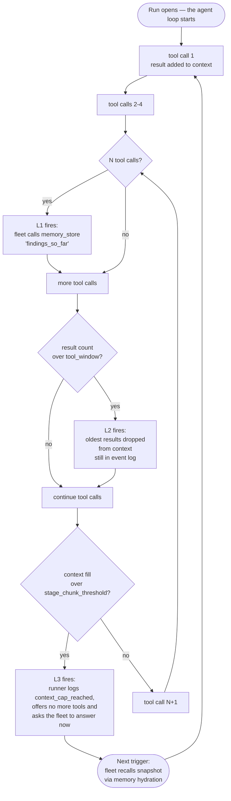

# Capabilities — what the fleet has, what the platform guarantees

> Parent: [`README.md`](./README.md) · User-facing: [docs.agentsfleet.net/fleets/tools](https://docs.agentsfleet.net/fleets/tools) (the tool inventory) and [docs.agentsfleet.net/concepts/context-lifecycle](https://docs.agentsfleet.net/concepts/context-lifecycle) (§4 as a user reads it).
>
> **Scope:** the platform *guarantees* below are binding and unchanged by the M80_002 cutover. The *mechanism* now runs on the split — `agentsfleetd` (control plane) assigns work + resolves policy on `lease`; the host-resident `agentsfleet-runner` enforces the hard layer in its supervisor and the lease's sandbox ([`runner_execution.md`](./runner_execution.md#process-model)). See [`runner_fleet.md`](./runner_fleet.md) and [`data_flow.md`](./data_flow.md).

A Fleet's capabilities split into two layers: what the language model is told it can do (a soft layer the model can ignore or get wrong), and what the platform actually enforces (a hard layer the model cannot escape from inside the sandbox). Both matter; the second is what makes the first safe.

---

## Facts

Every row is extracted from the numbered sections below; the owner column names the section that carries the full story.

| Invariant | Value | Mechanism | Owner section |
|---|---|---|---|
| Capability layers | 2 | the Definition's `instructions_md` is advisory; its reviewed `config` plus approved grants are binding, enforced by the runner | §1 |
| `trigger.type` vs `event_type` | orthogonal fields | different homes (the setup's `config` vs `core.fleet_events`), never the same value | §1.1 |
| Tool primitives | the runner's published catalog, e.g. `http_request` · the `file_*` tools · `git` · the four `memory_*` tools · `shell` (gated) | reachable only through the fleet's `tools:` allowlist | [`runner_execution.md`](./runner_execution.md) §"Tool catalog" |
| Mintable integrations | short-lived tokens, minted per lease | GitHub App: daemon-signed RS256 JSON Web Token (JWT) exchanged for a ≤ 1 h installation token; the App private key never leaves the daemon | §3 |
| Vault secret shapes | 2 | static (stores the value, resolved at lease) vs mintable (stores a handle, never a token) | §3 |
| Context lifecycle | 3 layers | `memory_checkpoint_every: 5` · `tool_window: auto` (30 / 20 / 10 by context cap, resolved per lease) · `stage_chunk_threshold: 0.75` | §4 |
| Layer 3 authority | enforced | past the threshold the runner logs `context_cap_reached`, offers no more tools and asks for the answer; the fleet's prose owns the snapshot | §4 |
| Runaway bound | `budget` caps + lease runtime deadline | there is no enforced continuation-chain counter | §4 |
| Memory hygiene | `core` pinned; `daily` expires | `daily` rows older than 72 h are deleted on the next capture push; re-storing a key is an upsert | §4 |
| Cap resolution | pinned at provider-set time, read per lease | the revision's `runtime_model_ref` names the model; `""` / `0` in the setup's `config` inherit that model and its cap | §4 |

## Traps

Each trap is enforced in its owner section; this list is the index — §5 (What the platform never does) is the binding never-list.

- Instructions are advisory and `config` is binding; never treat prose as enforcement (§1).
- `trigger.type` and `event_type` are never the same value and never the same table (§1.1).
- A fleet's own schedules go through a runner verb onto `agentsfleetd`'s schedule plane — Upstash QStash, the hosted scheduler, still owns the clock, and the runner receives only the resulting event ([`runner_execution.md`](./runner_execution.md) §"Tool catalog").
- The runtime cannot force a chunk; do not design as if a mid-loop interrupt exists (§4).
- A fleet that hoards everything as `core` defeats the pinning — an over-cap all-`core` set evicts the coldest `core` (§4).
- The GitHub App private key never rides the lease envelope, the `secrets_map`, or the runner (§3, §5).

## 1. Reasoning + tool inventory (declared in the fleet's own files)

A fleet's setup is one reviewed Definition (`rustd/crates/afd_fleet_runtime/src/definition/mod.rs`). Its parts carry different weight:

| Part | What it carries | Enforced by |
|---|---|---|
| `instructions_md` | Natural-language reasoning prompt: how to think, what's safe, what to gather, when to ask for approval. Free-form prose, required before Save. | The language model reading its own prompt, which is soft enforcement only. The model can drift; the platform-level guarantees below contain the consequences. |
| `config` | The policy document. Under `x-agentsfleet` it carries `triggers` (`webhook` / `api` / `cron` / `mention`), `tools`, `credentials`, `network`, `budget` caps, `gates`, `repositories`, `context`, and `model`. One parser validates it into `FleetConfig`. | Code-enforced by the runner, outside the model's reach. The language model cannot escape these. |
| `description` | One required line of display text saying what the fleet does. The fleet's name is `config.name`. | Nothing. Display text grants nothing and places nothing. |

The split matters. The instructions are *advisory*: the model reads them and tries to comply. The reviewed `config` and the grants a person approved are *binding*: the runner offers the model only the policy's tools and refuses any call outside them, regardless of what the model wants ([`runner_execution.md`](./runner_execution.md#tool-catalog)).

### 1.1 `trigger.type` vs `event_type` — orthogonal fields, common confusion

These are two different fields on two different tables. Mixing them up is the most common source of new-contributor confusion in this area:

| Field | Where it lives | Values | What it tags |
|---|---|---|---|
| `trigger.type` | the setup's `config` (static, reviewed) | `webhook` / `cron` / `mention` | **How a Fleet gets triggered**: the wiring fixed at Save or a later reviewed revision. |
| `event_type` | `core.fleet_events` column (per delivery) | `chat` / `webhook` / `cron` / `continuation` | **What an individual event on the stream is** — the runtime label per delivery. |

A fleet that declares no trigger receives only `event_type: chat` events from the steer/chat API. A `trigger.type: webhook` fleet receives `event_type: webhook`. A continuation event, which `agentsfleetd` writes when an approval gate resolves (`rustd/crates/afd_approval/src/inbox/resolve/mod.rs`), carries `event_type: continuation` regardless of the original `trigger.type`. The two fields are orthogonal — never the same value, never the same table.

Source of truth: `rustd/crates/afd_fleet_runtime/src/config/trigger/mod.rs` (`Trigger`) for `trigger.type`; `rustd/crates/afd_wire/src/event/mod.rs` (`EventType`) for `event_type`.

---

## 2. The platform tools the fleet can call

The runner hosts every published tool; `tools:` selects which the model is offered ([`runner_execution.md`](./runner_execution.md) §"Tool catalog"). Placeholders resolve at send time in two places only: the `Authorization` header's value and the URL's whole host (`${secrets.NAME.host}`) (`rustd/crates/afr_egress/src/admission/mod.rs`).

---

## 3. Platform-level guarantees (the substrate that wraps every tool call)

| Capability | What it does | Primary owner |
|---|---|---|
| Work assignment + kill | `agentsfleetd` assigns the next event on `lease` (atomic affinity claim + monotonic fencing token; status/config resolved fresh from Postgres per lease). Kill stops new leases; a lease already running runs to its end or to its fleet's stored budget ceiling ([`runner_fleet.md`](./runner_fleet.md) §"Steer, kill, pause"). | agentsfleetd control plane |
| Per-lease policy | Each `lease` reply carries an `ExecutionPolicy` (tools, secrets, allowed hosts, context knobs) that the runner's supervisor enforces outside the sandbox. The sandbox's network posture is the runner's assigned `allow_all`, `deny_all_egress` or `allow_list_egress` ([`runner_fleet.md`](./runner_fleet.md) §"Egress model — outbound is the only network surface"). | Lease ExecutionPolicy |
| Event stream + history | Every steer / webhook / cron event lands on `fleet:{id}:events` with actor provenance. `core.fleet_events` rows are opened at receive and closed at completion. | Event ingest + history path |
| Webhook ingest (GitHub App + manual) | Both receivers verify the signature, bind the delivery to subscribed fleets and refuse replays before queueing. The App records actor `github-app`; the manual receiver records `webhook:<source>` ([`connectors.md`](./connectors.md) §"GitHub App: platform setup to fleet execution"). | App ingress + webhook receiver |
| Secret vault (`vault.secrets`) | Stores opaque-JSON-object secrets. Each row is encrypted with its own data encryption key (DEK), which is sealed by the daemon's key encryption key (KEK), the `ENCRYPTION_MASTER_KEY` boot setting (`rustd/crates/afd_crypto/src/lib.rs`). Two shapes: a **static** secret stores the value itself (resolved at lease, shipped inline); a **mintable integration** stores only a *handle* (e.g. `{integration:"github", installation_id}`) — never a token — which the credential broker exchanges for a short-lived token on demand. The runner's supervisor substitutes it at send time. | Vault + secret resolution |
| Integration credential broker | `agentsfleetd` mints a short-lived, workspace-scoped token per mintable integration on demand; the App private key never leaves the daemon ([`connectors.md`](./connectors.md) §"Credential use remains separate from event receipt"). | Credential broker (daemon-side) |
| Provider config (self-managed) | A tenant chooses platform-managed inference or its own provider key. The api_key crosses vault → lease `ExecutionPolicy` → runner's supervisor → outbound HTTPS and never reaches a user-facing surface ([`billing_and_provider_keys.md`](./billing_and_provider_keys.md) §"8.2 The api_key visibility boundary"). | Provider resolution path |
| Approval gating | A gated event parks at lease until a workspace member approves it in the dashboard, through the API, or with `agentsfleet approvals approve`; gates judge whole events, never individual tool calls, and nothing is sent to Slack today (`rustd/crates/afd_gate/src/gate/park.rs`, "No pending summary, no staged notification"). The state machine survives control-plane and runner restarts (it is durable in Postgres, gated at `lease`). | Approval workflow |
| Budget caps | Daily and monthly hard caps in integer nanos (`daily_nanos`, `monthly_nanos`), configured per fleet in the reviewed `config`, block further runs at the first trip ([`billing_and_provider_keys.md`](./billing_and_provider_keys.md) §"5.1 The per-fleet budget gate — a second, independent ceiling"). | Billing gate |
| Per-run context lifecycle | Rolling tool-result window, memory-store nudge, and the context-cap wrap-up. See §4. | Context lifecycle |

---

## 4. Context lifecycle — keeping a long incident reasoning past the model's working-memory limit

Every fleet reasoning loop lives inside one run of the runner's agent loop ([`runner_execution.md`](./runner_execution.md#process-model)). As the fleet makes tool calls, each result lands in the language model's context window. On a long-running incident (thirty-plus tool calls), this can exhaust the window. The platform layers three independent mechanisms — defence in depth, not override — to keep the fleet reasoning past the limit.

### The three knobs

```json
{
  "x-agentsfleet": {
    "model": "accounts/fireworks/models/kimi-k3",
    "context": {
      "tool_window": "auto",
      "memory_checkpoint_every": 5,
      "stage_chunk_threshold": 0.75,
      "context_cap_tokens": 200000
    }
  }
}
```

The block sits in the fleet's `config`:

- `model` is an opaque pass-through that the control plane forwards into the lease `ExecutionPolicy` (the engine's `ContextBudget.model`). An empty string or an absent key inherits the model the revision's `runtime_model_ref` resolves to at lease time.
- `tool_window` is the rolling tool-result window size. `"auto"` and `0` are equivalent: both let the runtime pick.
- `memory_checkpoint_every` calls `memory_store` every N tool calls.
- `stage_chunk_threshold` is the fraction (0 to 1) of the context window at which a stage chunks.
- `context_cap_tokens` is the active model's context window. `0` or absent inherits the resolved model's cap at lease time, the same shape as an empty `model`.

**Wire-shape parser status.** Both `x-agentsfleet.model` and the four
`x-agentsfleet.context.*` knobs are parsed into `FleetConfig`, carried in the
lease `ExecutionPolicy`, and applied by the engine's `ContextBudget` on every
run. Operator overrides take effect; absent or zero fields fall through to
the runtime defaults below, resolved per lease (`rustd/crates/afd_gate/src/policy/context.rs`).

### How the three layers compose (defence-in-depth, not override)



### What each layer catches

- **Layer 1 — `memory_checkpoint_every`.** Runs periodically as the fleet works. Forces the fleet to write a durable snapshot of "what I've learned so far" via `memory_store` every N tool calls. Cheap and always safe — even if subsequent layers drop context, the snapshot survives.
- **Layer 2 — `tool_window`.** Runs continuously. Bounds context growth by dropping the oldest tool results once the count exceeds the cap. Old results stay in `core.fleet_events`; they just leave the active language-model context.
- **Layer 3 — `stage_chunk_threshold`.** The failsafe. After every model turn the runner compares the prompt's tokens with that fraction of `context_cap_tokens`. Past it, the runner logs `context_cap_reached` and offers no more tools. It tells the model to answer with what it has and say what was not done (`rustd/crates/afr_agent/src/context/mod.rs`, `loop/mod.rs`). A cap of 0, which the daemon could not resolve, never trips. The fleet's instructions tell it to write a durable snapshot (`memory_store`) before then, as its context fills. A subsequent run picks up where it left off, possibly on a different runner. The runner's supervisor loads that fleet's prior memory from `agentsfleetd` over the runner's authenticated API, category-pinned so `core` entries hydrate before any recency windowing (see [*Memory continuity*](./runner_fleet.md); the fleet holds no datastore credential). The fleet then recalls the snapshot from its in-run store.

The order is failure-mode escalation: Layer 1 keeps your work safe, Layer 2 keeps your context bounded, Layer 3 saves the chain from collapse. They never conflict.

### Bounding a runaway run

Layer 3 ends a run's tool calls once its context fills (above), but there is no enforced continuation-chain counter. A chain of runs that will not wrap up is bounded by the guards that *are* enforced: the fleet's `budget` caps (`daily_nanos` / `monthly_nanos`) and the lease's runtime kill-deadline. Those stop a runaway run regardless of whether the fleet chooses to snapshot.

`context_cap_reached` tells an operator a run hit its cap, and the answer that follows says what was not done. Resume a wrapped-up incident by steering a fresh message that calls `memory_recall` against whatever snapshot key the fleet's own instructions chose (the runtime never invents the key shape).

### Defaults — the user shouldn't have to do token math

The runtime ships with model-tier-aware defaults the user inherits without any configuration:

- `memory_checkpoint_every: 5` and `stage_chunk_threshold: 0.75` for every model — checkpoint cadence and chunk-trigger fraction don't meaningfully change with context size.
- `tool_window: auto` resolves per lease from the active model's context cap: **30** when the cap is at least one million tokens, **10** when it is at or below two hundred thousand, and **20** for every cap in between or an unknown cap (`rustd/crates/afd_gate/src/policy/context.rs`).

The model's context cap is **not** baked into the runtime. Unless the setup's `config` sets one, each lease takes it from the model the revision's `runtime_model_ref` names: an owner-registered entry in `core.tenant_model_entries`, whose cap comes from the model library, or `platform-default`, read from `core.platform_provider_defaults` (`rustd/crates/afd_credential/src/provider/runtime/sql.rs`). See [`user_flow.md`](./user_flow.md) §"§8.7 Model and context-cap origin (platform vs. self-managed)" and [`billing_and_provider_keys.md`](./billing_and_provider_keys.md) §"10. The model library — catalogue table + authenticated read".

### When a user does want to override (rare)

| Goal | What to change | How to think about it |
|---|---|---|
| "My fleet loses important findings mid-incident" | `memory_checkpoint_every: 3` | Checkpoint more often. Cheap. Always safe. |
| "My fleet hits context limits and chunks too aggressively" | `tool_window: 10` | Drop old results sooner so newer stuff fits. Loses older tool results earlier. |
| "My fleet chunks too late and produces partial diagnoses" | `stage_chunk_threshold: 0.6` | Chunk earlier. More handoffs but less risk of being cut off mid-thought. |
| "I'm on Kimi K2.7 Code (256k) and incidents are big" | `tool_window: 8` + `memory_checkpoint_every: 3` | Smaller windows + more checkpoints. Standard tight-context discipline. |

### The 80/20 rule

Eighty percent of users use the defaults forever and never see context errors. Twenty percent who run very deep incidents tweak `tool_window` once and forget. Almost nobody touches `stage_chunk_threshold`.

### Memory hygiene — what to store so it survives

Durable memory is selected, not searched: hydration pins the `core` category first (newest-first, within the byte budget), fills the remaining budget with the newest non-core entries, and cap eviction takes non-core rows before any `core` row (see [`runner_fleet.md`](./runner_fleet.md) §"Memory continuity — durable fleet memory rides the trusted plane"). Four habits make that selection work for the fleet instead of against it:

- **Store load-bearing facts as `core`.** Owner, deploy target, customer plan, standing constraints — anything the fleet must still know at entry 1001 belongs in `core`. `daily`, `conversation`, and any custom category are windowed by recency and are the first to age out of hydration. `daily` additionally expires outright: rows older than the 72-hour retention window are deleted on the fleet's next capture push (only `daily` — every other category persists until cap eviction; `memory_forget` hides a key for the current run only, `rustd/crates/afr_memory/src/hydrated.rs`).
- **Reuse stable keys.** Re-storing a key is an upsert — it refreshes the entry instead of duplicating it. `deploy_target` beats a dated `deploy_target_jun12`.
- **Replace what's stale.** A store under the same key replaces the stored copy; `memory_forget` only hides a key for the rest of the run. A Fleet that hoards everything as `core` defeats the pinning: an all-`core` set over the entry cap evicts the coldest `core` as last resort.
- **Keep entries small.** The hydration budget is bytes, not entries — one bloated entry crowds out many small ones. Snapshot conclusions, not transcripts.

The selection is deterministic and documented so a confused "why does my fleet remember X but not Y?" has a checkable answer: Y was windowed (or oversized), X was `core`.

---

## 5. What the platform never does

- Never logs raw secret bytes
- Never echoes secrets in the fleet's context
- Never persists secrets in `core.fleet_events`
- Never lets the GitHub App private key leave the daemon — it is platform-side; the lease envelope, the `secrets_map`, and the runner never carry it
- Never lets the fleet reach a host outside its `network.allow` list
- Never lets the fleet exceed its `budget` caps without trip-blocking
