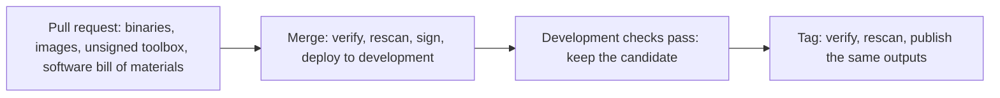

# Release candidates: build once, promote the same bytes

> Read this when you change a build, deploy or release workflow, or a promotion stops. Parent: [`README.md`](./README.md).

## What it is

A pull request builds every shipping native binary and image once, as a candidate.
Merging promotes that candidate to development, and a release tag promotes the same outputs to production.
Nothing that ships is compiled again after the pull request.

| Fact | Value | Where |
|---|---|---|
| Entry points | `make` targets | `make/release-candidate.mk` |
| Candidate builds | daemon amd64 and arm64, runner amd64, macOS arm64 daemon, the toolbox image | `.github/workflows/build-candidate.yml` |
| Toolbox size limit | 262,848,512 bytes, checked on cache hits too | `.github/actions/build-toolbox/action.yml` |
| Candidate retention | 90 days; intermediate uploads 3 days | `build-candidate.yml`, `deploy-dev-build.yml` |
| Offline proofs | `make check-release-candidate`, inside `make check-gh-actions-valid` | `make/check-safety-gates.mk` |

## Why it exists

Rebuilding at merge or tag would ship bytes nobody tested.
Promoting the exact candidate means production runs what the pull request built and development proved.
Pull requests pay for optimized builds on every shipped platform in exchange.

## How it behaves

### The jobs

| Workflow | Job | What it does |
|---|---|---|
| `test.yml` | `build-daemon-musl` | calls `build-candidate.yml`; the `test` aggregate requires it |
| `build-candidate.yml` | `linux`, `macos`, `toolbox`, `assemble` | builds the native binaries and the unsigned toolbox, then checks the whole payload and records source identity and checksums |
| `deploy-dev-build.yml` | `promote`, `result` | picks the matching pull request candidate, verifies, rescans, signs and publishes its images |
| `deploy-dev.yml` | `qualify-candidate` and the deploy jobs | deploys, runs acceptance, then records the passing results and keeps the candidate |
| `deploy-dev-fly.yml` | deploy | deploys the immutable image digest promotion passed it |
| `deploy-dev-metal.yml` | deploy | installs the runner binary and toolbox uploads, recording the original build revision |
| `deploy-dev-verify.yml` | verify | requires health to report the candidate's version and build revision |
| `release.yml` | `prepare-artifacts`, `push-ghcr` and the publish jobs | verifies the development candidate, signature and a fresh scan, then publishes the same outputs |

All native builds use the pinned musl builder or the native macOS toolchain, with the `dist` profile.
Runtime images are built and exercised on each Linux architecture, saved in the candidate, then pushed after merge.
Production tags the same image digest that development ran.

The composite actions `build-toolbox`, `toolbox-tools`, `scan-toolbox` and `sign-toolbox` under `.github/actions/` build, scan and sign the toolbox.
Scanning fails on a fixable critical vulnerability (`--only-fixed --fail-on critical`).
Signing loads credentials only in trusted development and checks the key matches the one embedded in the runner.

### Identity and credentials

Pull request jobs get read-only repository permissions, no registry writes and no signing credentials.
A candidate records the source-tree hash, the compiled commit, the version, the profile, the originating run, the platforms, file sizes and SHA-256 checksums.

Promotion selects a candidate by exact source tree.
A pull request's test merge commit can differ from the final merge commit while the tree is identical.

Health and the runner keep the original build stamp, and receipts link it to the merged tree.
Every development check, including a real bare-metal deploy, must pass before a candidate qualifies.
`DEV_RUNNER_READY=false` lets the control plane deploy without a runner, but produces no release-qualified candidate.

A tag verifies the successful `deploy-dev.yml` run, the exact tree and version, the checksums, the embedded signing key and the signature.
GitHub Release assets hold the native archives, the signed toolbox, the public key, both receipts, the image digest and the fresh scan.

### When promotion stops

Promotion never falls back to a rebuild.
Each of these stops it:

- a missing or expired candidate, or a fork-owned run;
- a failed workflow, or a skipped development check;
- a wrong tree, version or profile, or a changed file;
- an invalid signature;
- a new fixable critical vulnerability found by the rescan.

To recover:

1. Run `test.yml` on the intended trusted branch or tag to build a fresh candidate.
2. Run `deploy-dev.yml` on that same tree to qualify it.
3. If `main`'s merge tree differs from the tested tree, update the pull request against `main` and rerun its checks before merging.

Rerunning only the failed jobs can leave an older candidate attempt, which promotion refuses, so rerun the whole workflow.
A fork's change needs a passing candidate on a trusted branch before promotion.

## Limits

- **Pull requests are slower.** Optimized builds for every shipped platform take longer than a single debug build.
- **Candidates expire.** After 90 days a candidate must be rebuilt and requalified.
- **Unit, coverage and kernel tests compile on their own.** Only shipping outputs are built once.

## Related pages

- [`docs/development.md`](../development.md): local builds and deploys
- [Testing](./testing.md): the lanes a candidate must pass
