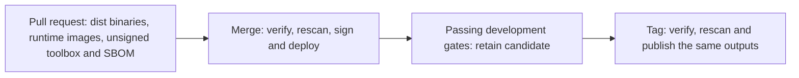

# Native release candidates

`agentsfleet` builds shipping native outputs during pull requests. Development
and production tags promote those exact outputs. The entry points are Make
targets in `make/release-candidate.mk`; GitHub Actions owns scheduling, caches,
artifact transport and credentials.

The approved scope is recorded in
[M224_001](../v2/active/M224_001_P0_DOCS_INFRA_FIRST_PRODUCTION_LAUNCH.md).

## YAML changes and jobs

No existing YAML file is deleted. One workflow and three composite actions are
added; seven existing workflows and one existing action are updated. Across
these workflow graphs, 7 job definitions are added, 9 are removed and 32 are
retained, for a net reduction of 2 definitions. Matrix executions are counted
separately below; a reusable workflow call does not allocate another runner.

| YAML file | Definitions before → after | Resulting behavior |
| --- | --- | --- |
| [`test.yml`](../../.github/workflows/test.yml) | 8 → 8 | `build-daemon-musl` calls the candidate workflow instead of compiling `fast-profile`. The existing `test` aggregate requires that call to succeed, alongside its existing lanes. `merge_group` can exercise the same candidate gate. |
| [`build-candidate.yml`](../../.github/workflows/build-candidate.yml), new | 0 → 4 | `linux` expands to three native jobs: daemon amd64, daemon arm64 and runner amd64. `macos` builds the arm64 daemon download. `toolbox` builds/scans the unsigned toolbox. `assemble` checks the complete payload and records source/run identities and checksums. Six runner jobs in total. |
| [`deploy-dev-build.yml`](../../.github/workflows/deploy-dev-build.yml) | 5 → 2 | `promote` replaces `compile-runner`, `compile-daemon`, `build-toolbox` and `push-ghcr`: select a successful matching PR candidate, verify it, rescan, sign, package existing bytes and publish prebuilt container images. `result` retains per-stage outputs for the caller. |
| [`deploy-dev.yml`](../../.github/workflows/deploy-dev.yml) | 8 → 9 | Existing deployment/acceptance calls remain. `qualify-candidate` records their actual passing results and retains a development artifact. Notifications report promotion/qualification results. |
| [`deploy-dev-fly.yml`](../../.github/workflows/deploy-dev-fly.yml) | 2 → 2 | Deploy the immutable image passed by promotion. The mutable `dev-latest` lookup is removed. |
| [`deploy-dev-metal.yml`](../../.github/workflows/deploy-dev-metal.yml) | 2 → 2 | Consume the existing `runner-binary` and `runner-toolbox` artifacts. Record the runner's original compiled revision rather than the later merge revision. Readiness and result reporting remain. |
| [`deploy-dev-verify.yml`](../../.github/workflows/deploy-dev-verify.yml) | 1 → 1 | Health must return the selected candidate's version and original build revision; readiness must pass too. A healthy older daemon cannot satisfy this check. |
| [`release.yml`](../../.github/workflows/release.yml) | 15 → 11 | `prepare-artifacts` replaces five native build/toolbox/runtime-check definitions, including the two-entry Linux daemon matrix. It verifies the retained development artifact, signature and a fresh vulnerability scan. `push-ghcr` promotes its immutable image. Existing npm, Release, readiness, Fly, runner and approval jobs remain; npm waits for artifact verification. Fly receives the selected digest directly. |
| [`build-toolbox/action.yml`](../../.github/actions/build-toolbox/action.yml) | composite action | Build/cache unsigned image, manifest and Software Bill of Materials (SBOM); always scan. Cache identity includes manifest/scripts, `VERSION`, scanner pins and installed builder-tool versions. Content digest and the 262,848,512-byte limit are checked on cache hits too. |
| [`toolbox-tools/action.yml`](../../.github/actions/toolbox-tools/action.yml), new | composite action | Share the existing checksum-verified Syft, Grype and cosign installation and version pins. |
| [`scan-toolbox/action.yml`](../../.github/actions/scan-toolbox/action.yml), new | composite action | Update vulnerability data, then apply the existing `--only-fixed --fail-on critical` gate to an existing SBOM. Promotion reports preserve the PR's original report. |
| [`sign-toolbox/action.yml`](../../.github/actions/sign-toolbox/action.yml), new | composite action | Load release credentials only in trusted development, compare the signing key with the key embedded in the runner, sign and verify the existing manifest. |

## What gets reused

All native builds use the existing pinned musl builder or native macOS toolchain,
the `dist` profile and separate Cargo invocations per binary. Existing Cargo
cache paths remain, with component/toolchain/source keys and compatible prefix
restoration. Runtime containers are built and exercised on each native Linux
architecture, saved in the PR artifact, then loaded/pushed after merge.
Production assigns tags to the same development image digest.

Unit tests, instrumented coverage and kernel tests retain their own compilation.
Dashboard builds retain environment-specific settings; npm retains its TypeScript
build and publishing lifecycle. This change removes repeated **shipping native**
compilation and runtime/toolbox image construction from merge and tag workflows.
Pull requests now pay for optimized builds on every shipped native platform;
they can take longer than the old amd64-only `fast-profile` check.

## Identity and credential boundaries

PR jobs receive read-only repository permissions, no registry writes and no
toolbox signing credentials. Their candidate records the full source-tree hash,
actual compiled commit, version, `dist` profile, originating workflow/attempt,
required platforms, file sizes and SHA-256 checksums.

Promotion selects an artifact by exact source tree, then verifies its successful
same-repository `test.yml` run and GitHub commit relationship. A PR's synthetic
merge commit can differ from the final merge commit while its tree is identical.
Health and runner deployment keep the original build stamp; receipts link that
stamp to the final merged tree. Binaries are never relabeled as freshly compiled.

All development gates, including an actual successful metal deployment, must
pass before qualification. The documented `DEV_RUNNER_READY=false` bootstrap
skip can deploy the control plane but produces no release-qualified artifact.
Tags verify the successful `deploy-dev.yml` run, exact tagged tree/version,
retained checksums, embedded signing key and existing signature. Existing
production approvals and provider/readiness gates remain.

## Retention and failures

PR and qualified development artifacts are retained for **90 days**, subject to
the repository's artifact-retention policy. Short-lived intermediate artifacts
keep the existing three-day retention. GitHub Release assets retain the native
archives, signed toolbox, public key, original PR receipt, development receipt,
image digest and fresh production scan. Scan evidence is uploaded on failures
as well; a failed scan still fails its job.

There is no automatic rebuild fallback. A missing/expired candidate, fork-owned
run, failed workflow, wrong tree/version/profile, changed file, invalid signature
or skipped development gate stops promotion. A newly published fixable Critical
vulnerability can stop a later rescan without rebuilding the image.

To recover an expired candidate, explicitly run `test.yml` on the intended
trusted branch/tag and then run `deploy-dev.yml` on that same tree to qualify
new evidence. If main's merge tree differs from the tested tree, update the PR
against main and rerun its checks before merging. Workflow reruns must refresh
the full candidate: rerunning only failed jobs can leave an older candidate
attempt, which promotion rejects. Fork contributions need a passing candidate
on a trusted repository branch before promotion.

Run `make check-release-candidate` for the offline source, workflow, checksum,
archive and promotion failure proofs. `make check-gh-actions-valid` includes
that suite alongside the existing actionlint, pin and workflow safety checks.
