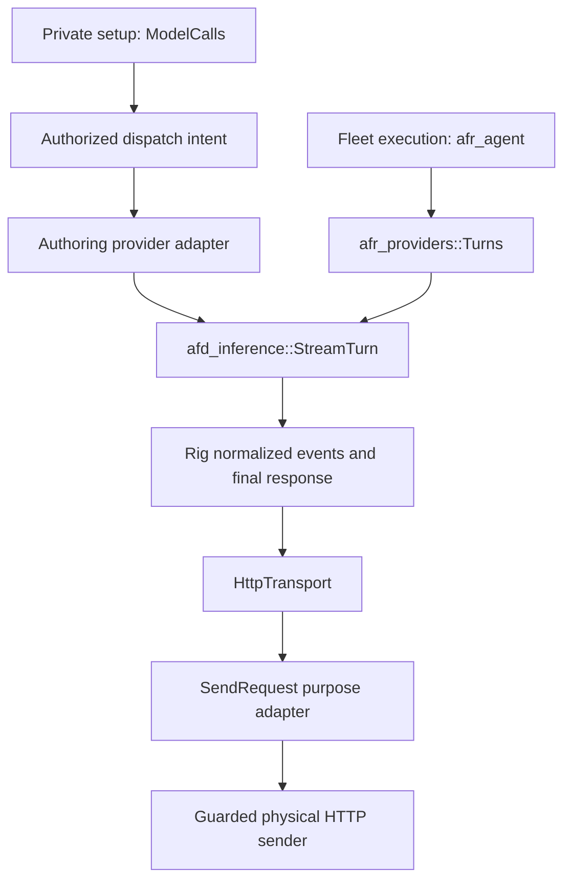
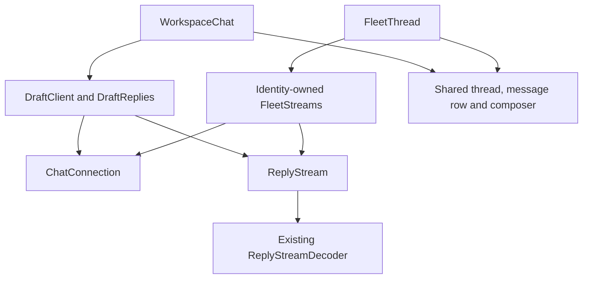

# Shared chat implementation and verification

| Question | Answer |
|---|---|
| Where is provider streaming implemented? | `afd_inference::stream::StreamTurn`, used by setup and fleet execution |
| Who parses provider events? | Rig, through its native HTTP adapter and provider codecs |
| Where is browser connection recovery implemented? | `ChatConnection`, used by both chat adapters |
| Where are reply ordering and rendering shared? | `ReplyStream`, `ReplyStreamDecoder`, `ChatThread`, `ChatMessageRow` and `ChatComposerFrame` |
| What still differs by purpose? | Authorization, tools, durable records, admission and explicit setup saves |
| What is provisional? | Live answer text; durable receipts and message reads decide completion |

Read this page to review the shared code and its evidence.
The [API reference](api_resources.md) owns endpoint behavior.
The [web architecture](web_app.md) owns routing and user flows.

## Backend ownership



[`StreamTurn`](../../rustd/crates/afd_inference/src/stream.rs) owns one Rig stream.
It handles cancellation, inactivity, finalization and partial usage.
Neither caller owns another provider event parser.

| Symbol | Inputs and result | Responsibility |
|---|---|---|
| `Configured::model` | Saved inference settings, model, credential and transport → Rig model | Select the native provider wire |
| `SendRequest::send` | `Request<Bytes>` → `BoxFuture<rig_http::Result<StreamingResponse>>` | Supply guarded physical I/O without collecting the response |
| `HttpTransport` | `Arc<dyn SendRequest>` | Adapt Rig's `HttpClientExt`; bound received bytes and retain HTTP status |
| `StreamTurn::open` | Configuration, model, `CompletionRequest`, `TurnControl` → reader | Open one SDK attempt |
| `StreamTurn::next` | Mutable reader → optional normalized event or `FailureCause` | Apply cancellation, inactivity and absolute deadline |
| `StreamTurn::finish` | Owned reader → `TurnResult` | Preserve the final or partial response and original typed failure |
| `TurnResult::into_response` | Owned result → completed response or boxed provider error | Refuse to treat partial output as success |
| `decode_failed_response` | Received HTTP error document and configured codec → decoded response | Recover reported usage without sending another request |

The shared connection timeout is 10 seconds.
The inactivity bound is 300 seconds after the last received event.
`TurnControl.deadline` can end an attempt earlier.

`TurnControl.cancellation` ends pending reads without another send.

The physical sender remains a purpose boundary.
Runtime retains its egress guard and existing retry policy.
Authoring's adapter sends once after committing durable dispatch intent.

The shared reader itself never retries.

Runtime may reopen an eligible failure before visible output or reported usage.
Known usage disables that reopening.
The guard uses Rig's `Usage::is_reported`, including reasoning counts and cost metadata.

On failure, `afr_providers` emits known usage before its error and omits `Chunk::End`.
`afr_agent` records that usage without running an incomplete result.

Authoring records a dispatch deadline of at most 300 seconds before the external call.
The runner's 310-second HTTP wait allows receipt settlement after that bound.
Replayed dispatches read their durable result and never send the provider request again.

### Message admission under contention

Cloned draft services share a Tokio mutex per cached chat before acquiring a database connection.
Moka's configured capacity is 1,024 gate entries.
These contain no text, authorization or receipts.

Eviction can split a local queue, so the database row lock remains authoritative.
Independent services also take that row lock.
The receipt statement runs after the lock with a fresh database snapshot.

Cancelling a waiter removes it from the mutex queue.
Cancelling a holder before admission drops its guard and uncommitted transaction.
A response lost after commit recovers through the existing idempotent receipt.

Different chats have separate gates and can use spare database connections.
The pool's existing five-second acquisition deadline remains unchanged.

### Private setup delivery

[`Publisher`](../../rustd/crates/afd_authoring/src/model/progress/publish.rs) consumes a bounded preview queue.
The first answer text is flushed immediately.
Later text is coalesced on a 50-millisecond interval.

Reasoning and tool arguments never enter this queue.

The queue holds at most 32 pieces, each containing at most 4,096 UTF-8 bytes.
A full queue drops the preview piece without delaying inference or billing.
Sequence numbers expose that loss to the browser.

The browser then relies on durable recovery.

Every publication checks current creator membership, lease, generation and Stop watermark.
The transaction commits and releases its connection before the bus write.
Publication and final drain each have a two-second bound.

Cancellation drops the task and queued private buffers.

The private SSE handler rechecks access before emitting each frame.
It also checks while the channel is quiet.
An authorized quiet stream emits the shared named heartbeat every 15 seconds.

The browser recognizes this event and keeps the connection open.
The private subject is `draft:<draft_id>:events`; fleet activity never receives setup text.

### API changes

Existing paths and explicit save operations remain.
The draft event stream adds provisional `message.delta` events and `draft.resync` recovery hints.

| Delta field | Meaning |
|---|---|
| `draft_id` | Authorized private draft |
| `sequence` | Durable message position, encoded as a decimal string |
| `stream_id` | Physical provider dispatch identity |
| `stream_seq` | Position starting at one within that dispatch |
| `stream_start` | First preview frame of the dispatch |
| `text_kind` | `answer` only |
| `text` | Bounded answer text |

Durable message responses also expose a bounded failure cause.
They distinguish deadline, interrupted transport and unverified completion.
Provider bodies and credentials never become public failure messages.

Unknown usage remains unknown until reconciliation provides authoritative facts.
Recovery owns a copy of the already validated route through `Configured::owned`.
It fills missing usage fields and preserves reported cost, cache and reasoning counters.

The received document is decoded locally through Rig without a physical send.

## Browser ownership



| Symbol | Caller and responsibility |
|---|---|
| `ChatConnection.start/retry/close` | Setup and fleet adapters supply events, readers and callbacks; the connection owns EventSource, deadlines, reconnects and cleanup |
| `ReplyStream.write/markGap/finish/dispose` | Both adapters enforce stream order and recover authoritative final text after gaps |
| `DraftReplies.accept/reconcile/clear` | Validate private frame identity and bounds; reject late frames and clear previews after durable completion |
| `DraftClient` | Own admission, optimistic messages, private reads, setup changes and explicit saves |
| `FleetStreams` | Own runtime streams within the mounted account, workspace and signed-in subject |
| `ChatThread` | Own the shared scroll viewport and reachable composer footer |
| `ChatMessageRow` | Share assistant logo alignment, operator bubble and text spacing |
| `ChatComposerFrame` | Share input sizing, quiet focus appearance and focus restoration |

The setup adapter normalizes its one-based preview sequence before calling `ReplyStream`.
Runtime frames already use the shared zero-based sequence.
A gap stops provisional concatenation instead of displaying a corrupted answer.

Each adapter repairs from its own durable reader.

React creates owned resource objects without starting I/O during render.
Effects start subscriptions and dispose them on identity changes or unmount.
`useSyncExternalStore` reads stable immutable snapshots.

Components use JSX and static top-level Hooks.
Next.js server loading remains outside the interactive client boundary.

Selected setup history loads independently of model and sidebar requests.
`DraftCache` retains at most five chats and 1 MiB for 120 seconds.
The mounted private identity owns the cache and clears it after lost access.

The private transcript stays out of browser storage.

The sidebar reads saved fleets only. Creator-private drafts remain in **Unfinished setups** on **New fleet**.
Both lists remain scoped to the account, workspace, and signed-in person.

Draft projection indexes original requests by sequence once per snapshot.
A conversation-owned weak cache preserves unchanged message objects while the latest reply streams.
Settled rows receive message data without scanning the transcript again.

Setup retry reads current client state, stops uncertain work when required, then submits the original request.
Saved-chat retry uses the normal delivery queue and requires the original request's actor to match the signed-in person.
Partial answers and unknown usage remain visible after failure.

### Setup and runtime stay together

New fleet supports multiple setup messages before explicit **Save fleet**.
Saving opens that fleet's Chat.
**Edit setup** opens a private chat panel beside the mounted runtime conversation.

Manual instructions are optional. While editing, **Save changes** replaces **Edit setup** in the fleet header.
Unapplied manual edits disable Save. Folding or hiding the editor retains local text while its subject remains mounted; reload or subject disposal loses unsent changes.

A newer candidate preserves dirty text but blocks Update instructions until the conflict is resolved. Copy changes you want to keep, choose **Discard manual changes and load latest**, then reapply and review. Pristine fields follow the latest candidate without a discard step.

Model edits follow the separate [exact-text correction path](fleet_definitions.md#small-atomic-edits); manual text is never silently merged with them.

`DraftClient.apply` sends the reviewed candidate with its setup ETag and idempotency key.
A conflict retains the proposed changes for review.
A successful save closes the panel and refreshes server data.

The mounted runtime composer retains its unsent text.
New runs use the saved revision; existing runs keep their pinned version.

Fleet Activity keeps server rendering through `FleetActivity` while its table loads at the selected-view boundary.
Setup constants and schedule-status checks do not initialize setup schemas.

### Retaining long acceptance evidence

The final continuity checks send 181 messages through one fleet and repeat those steps across ten concurrent fleets.
A failed check or evidence read preserves every related fleet and private draft.
The shared teardown also preserves the `continuity-` fleet prefix.

Identifier attachments record the workspace, fleet, and private draft identifiers before history reads.
Successful runs clean up only after every history and isolation check and every evidence capture succeeds.
These retention tests do not establish that the full live acceptance checks passed.

Cleanup deletes the supplied fleet and drafts, including their saved messages.
Use the identifier attachment against the same development backend with a current fixture session:

```sh
cd ui/packages/app
bun tests/e2e/acceptance/fixtures/continuity-cleanup.ts /path/to/single-identifiers.json
```

Successful cleanup exits with status 0 and no output.
The command refuses production hosts and invalid attachments.

It checks the live fleet name and deletes only the supplied fleet and drafts.
Failed deletions remain errors; they never count as successful cleanup.

## Tracing and memory

`model_turn_started` pairs with exactly one `model_turn_completed` or `model_turn_failed`.
Dropping a turn emits its cancellation outcome.
The records carry correlation identity, duration and answer byte count.

`model_turn_first_text` records first-text timing at debug level.

Private publication uses `draft_preview_started`, then exactly one completed or failed event.
These debug records carry dispatch identity, elapsed time and published frame count.
Construction happens before spawning, so cancellation before the first poll still has a terminal record.

Both use registered error codes and bounded failure words.
Log fields are hoisted before tracing macros.
Rig body logging is filtered at the shared logging boundary.

Tests inspect captured records for private text and credential leaks.

`SendRequest` erases the physical sender once per shared transport.
`Bytes` shares immutable request storage; the adapter does not clone whole conversations for possible retries.
Large SDK failures are boxed on internal paths to keep async state smaller.

Fixed foreign trait signatures retain their required SDK error type.
Runtime allocates its active reader once per opening and retains that allocation across chunks.
Its two terminal chunks share a separate fixed-size allocation.

Owned preview buffers, serialized private payloads, secret strings and retained scrub tails use `zeroize`.
Unchanged safe scrub output moves without another string copy.

This does not erase Rig's buffers, HTTP library storage or Aho-Corasick's compiled matcher.
Those libraries provide no complete erasure guarantee through these interfaces.

## Runner dependency audit

The workspace has ten crates named `afr_*`.
The audit covers all ten, the runner binary and five shared dependencies: sixteen crates total.
The table records the inspected boundary and reused implementation.

It does not claim that every unchanged operation has a new tracing span.

| Crate | Inspected ownership and library reuse | Result |
|---|---|---|
| `afr_agent` | Lease and tool boundaries; typed provider chunks and usage ledger | Known partial usage survives failure; completion remains refused |
| `afr_egress` | `vault` and guarded HTTP; reqwest, injected `Mint` and shared `Scrub` | Credential mint records contain identity and expiry, never token values |
| `afr_executor` | `server/process` lifecycle and `edges` buffers; Tokio, `Bytes`, `Buf`, `VecDeque` and UTF-8 helpers | Existing process records use process identity; no new byte-buffer parser |
| `afr_memory` | Borrowed memory adapter and cause-preserving refusals | Backend owns I/O; no added accessor logging |
| `afr_providers` | `Turns`, guarded transport and native Rig request construction | Shared reader; retry warnings now include a registry code |
| `afr_sandbox` | Descriptor admission, mount ownership and release errors; rustix and digest-io | Existing admission start/end pair and typed failures retained |
| `afr_secrets` | `Secret`, `Scrub` and `Carry`; zeroize and Aho-Corasick | Retained secret copies and unprocessed stream tails now erase their owned strings |
| `afr_supervisor` | Central daemon client and bounded HTTP waits; reqwest and backon | Existing paired debug events retained; verb fields hoisted once |
| `afr_telemetry` | OTLP installation, filtering, sampling and bounded shutdown | Shutdown timeout now names its registry code |
| `afr_tools` | `Handler` and `Typed<H>`; serde and schemars | Shared argument parsing and cached schema; execution logs remain with the agent boundary |
| `agentsfleet_runner` | Boot, shutdown and failure rendering | Existing terminal errors carry registry codes |
| `afd_inference` | Shared provider stream, transport, failure recovery and log filtering | Paired content-free lifecycle and timing records |
| `afd_authoring` | Dispatch, receipt, private publisher and lease guards | Paired private preview traces; no connection held during provider or bus waits |
| `afd_crypto` | Secret ownership and hex decoding | Existing zeroize and hex implementations; no secret accessor logging |
| `afd_sse` | Subscription tail and gap handling | Existing bounded hub subscription and coded close record retained |
| `afd_dragonfly` | Stream publication and outbound acknowledgement | Actual acknowledgement error code is preserved; no payload logging |

The error hull remains `afd_core::error_shell!` with typed causes.
The [Rust error standard](../RUST_ERROR_STANDARD.md) owns the crate exceptions and registry mapping.

## Historical verification evidence

The table preserves results recorded before the later compaction and Billing changes. Its counts describe those earlier runs.
The [closed M230 verification record](../v2/done/M230_003_P1_API_CLI_UI_LOADING_TERMINAL_LOGIN.md#verification-record) carries results, owner deferrals and open checks.

Whole local acceptance, owner review and current Continuous Integration (CI) results remain required. A narrower test selection does not satisfy those gates.

| Proof | Observed result |
|---|---|
| `first_text_arrives_before_the_provider_closes_its_response` | Shared reader yields text while the external response remains open |
| `fragmented_unicode_and_framing_are_decoded_by_the_sdk` | Native Rig decoding handles byte fragmentation and Unicode |
| `reasoning_usage_without_text_prevents_reopening_a_truncated_turn` | A real HTTP provider reporting only reasoning usage caused a second send before the fix; the SDK guard now keeps one send and a typed transport failure |
| Runtime privacy tests | Both reject a controlled deletion of the lease correlation field; SDK warnings remain filtered at trace level |
| Private progress integration tests | Real Postgres and Dragonfly; Stop, deletion and membership revocation block later private frames |
| `idle_private_stream_sends_an_observable_heartbeat_and_still_rechecks_access` | Real HTTP stream received only a comment before the fix; all three stream privacy tests now pass with a named heartbeat and revocation checks |
| `dispatch_deadline_upgrade_preserves_old_rows_and_old_writers` | Isolated Postgres migrates populated dispatches, preserves bounded deadlines and accepts the previous daemon's column list after upgrade |
| Admission waiting regressions | Before the fix, the delayed 100-send case and independent-chat pool probe failed; all seven focused cases pass after the fix, including queued and current-sender cancellation |
| `OutboundReader::drop_undeliverable` mutation | Deleting the whole method is caught by the existing real Dragonfly malformed-entry regression; one selected mutation, one caught |
| `hundred_pending_model_calls_release_the_pool_and_replay_without_resending` | All 100 physical sends entered before release; a fresh database query succeeded while they waited |
| Same concurrency sample | 100 known receipts; replay kept physical sends at 100; p50 546.448 ms, p95 576.749 ms, p99 582.978 ms |
| Editor UI tests | Save v2 closes the editor, preserves unsent runtime text and refreshes server data; conflicts retain edits |
| Recent UI tests | Authorized union, stop/delete conflict behavior and unmount cancellation |
| `make test-unit-all` | Rust runner 1,316, daemon 137 and daemon libraries 3,293; Python 25; app 3,973, website 133, command line 1,887 and design system 499 passed. The command-line suite retained 16 existing skips; all four package coverage gates passed at 100% |
| `make test-integration-rustd` | 1,400 regular and three exclusive tests passed against isolated real Postgres and Dragonfly |
| tsrs migration | Six existing configurations passed with both compilers; both rejected the temporary type error. All 156 emitted command-line JavaScript files were byte-identical; the built command reports version 0.64.0 |
| `make acceptance-local` | Recorded browser attempt: 103 passed, five failed, one skipped and five not run. Four failures reached provider refusals; the workspace-navigation failure passed its focused rerun after the existing helper awaited navigation |
| `make acceptance-cli` | Deterministic lane: 209 passed. Live lane: 171 passed, three failed. Two turns reached provider refusals; the missing-model setup assertion passed its focused rerun after matching setup's `pending` state |
| Local provider prerequisite | The configured free model was absent from the live catalogue. The replacement free model is available, but a minimal live request returned HTTP 429 with `free-models-per-day`; complete acceptance requires restored account quota |
| Guarded smoke checks | Built version and invalid-command refusal passed; a real browser rendered sign-in and redirected a synthetic private workspace URL back to sign-in without workspace controls. Authenticated exploratory flows remain blocked by the smoke browser's absent session |
| `cargo mutants -p afd_inference --all-features` | 98 mutations: 26 caught, 72 did not compile, no survivors or timeouts |
| Rust coverage: canonical run plus the focused hub-closure regression, graded by `scripts/rustd_coverage.py` | Overall 99.6116%; changed lines 100%; all 51 measured changed source files reach 99% |
| Authoring mutation closure | 18 mutations: ten caught, eight did not compile, no survivors or timeouts |
| Private-stream mutation closure | 26 mutations: eight caught, seventeen did not compile, one equivalent survivor, no timeouts |
| Removing the local admission turn | Six focused cases passed; independent-chat admission failed at the unchanged five-second pool deadline |
| `owned_secret_buffers_are_wiped_before_free` | One test passed on stable and under Miri, checking private preview, daemon and runner allocations before free |
| Removing each secret owner's wipe | All four controlled changes failed the wiping assertion: daemon text, bytes, nested string values and runner tokens |
| Required secret-wiping checks | Stable daemon-library shard and a focused `nightly-2026-10-22` Miri job feed the required aggregate; workflow lint passed; hosted CI has not run |

The private-stream survivor replaces one cancellation-or-closure check with an AND expression.
Its changed behavior requires a running message at or below the cancellation cutoff, or a running message in a closed draft.
Production operations prevent both states under the same draft lock used by observation.

See [`cancel`](../../rustd/crates/afd_authoring/src/message/cancel.rs), [`claim`](../../rustd/crates/afd_authoring/src/lease/claim/selection.rs),
[`idle`](../../rustd/crates/afd_authoring/src/draft/patch.rs) and [`observe`](../../rustd/crates/afd_authoring/src/observe/mod.rs).
The original defensive checks remain.

The Miri run used nightly commit `1a2c4797ef2570bd76ca5dee34449169bc7dc457`, matching the workflow's dated pin.
The observer checks selected owned buffers, including cloned text, unwinding and replaced nested values.
It does not prove erasure of serializer, provider-library or network scratch storage.

The usage-recovery regression checks that complete folded counts cannot gain an inconsistent raw total.
A paused-clock test bounds deadline finalization independently of the provider reader.
Reversing the ended check fails that assertion without hanging the suite.

The concurrency sample measures service calls with a controlled external provider.
It does not measure browser roundtrip or 100 HTTP connections.
The live browser and canonical acceptance lanes provide separate evidence.
