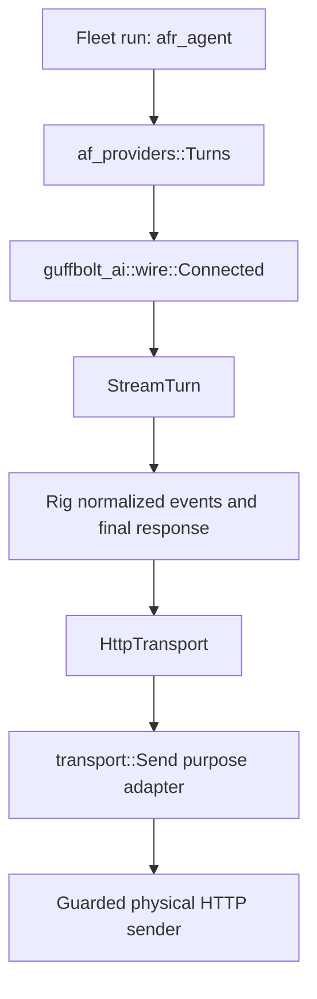
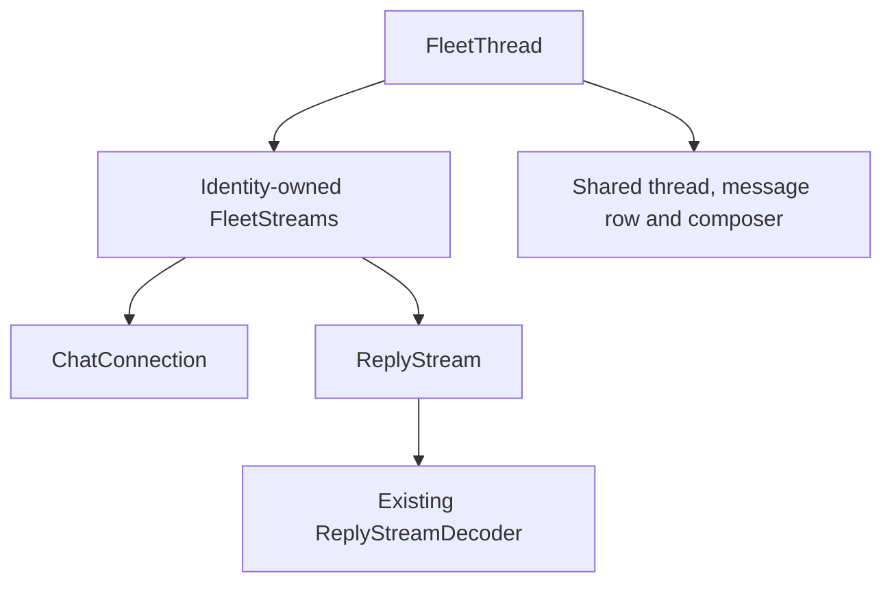

# Shared chat implementation and verification

| Question | Answer |
|---|---|
| Where is provider streaming implemented? | `guffbolt_ai::wire::Connected`, through its private `StreamTurn` (`guffbolt-ai/src/wire/stream/mod.rs`), used by fleet runs |
| Who parses provider events? | Rig, through its native HTTP adapter and provider codecs |
| Where is browser connection recovery implemented? | `ChatConnection`, used by the fleet chat adapter |
| Where are reply ordering and rendering shared? | `ReplyStream`, `ReplyStreamDecoder`, `ChatThread`, `ChatMessageRow` and `ChatComposerFrame` |
| What is preview-only? | Live answer text; the durable turn decides completion |

Read this page to review the fleet chat's code path and its evidence.
Each fleet has one chat, and a person's first message on **New fleet** opens it.
The [API reference](api_resources.md) owns endpoint behavior, and the [web architecture](web_app.md) owns routing and user flows.

## Backend ownership

`guffbolt-ai`'s `StreamTurn` owns one Rig stream. `af_providers::Turns` wraps `Connected` and adds registry codes and log lines.

`af_providers::Turns` handles cancellation, inactivity, finalization and partial usage.
No caller owns another provider event parser.

| Symbol | Inputs and result | Responsibility |
|---|---|---|
| `af_providers::settings::Configured::new` | Saved inference settings and context window → checked `guffbolt_ai::wire::Route` | Prove bounds and endpoint rules, then select the native provider wire |
| `Connected::new` | `Route`, model, key and transport → `guffbolt::Model` | Bind one model to its guarded transport |
| `transport::Send::send` | `Request<Bytes>` → `Sent`, a streamed `http::Response` or a `SendError` | Supply guarded physical I/O without collecting the response |
| `HttpTransport` | `Arc<dyn Send>` | Adapt Rig's `HttpClientExt`; bound received bytes and retain HTTP status |
| `StreamTurn::open_counted` | `Route`, model, `CompletionRequest`, input count, `TurnControl` → reader | Open one SDK attempt |
| `StreamTurn::next` | Mutable reader → optional normalized event or `FailureCause` | Apply cancellation, inactivity and absolute deadline |
| `StreamTurn::finish` | Owned reader → `TurnResult` | Preserve the final or partial response and original typed failure |
| `TurnResult::into_response` | Owned result → completed response or boxed provider error | Refuse to treat partial output as success |
| `decode_failed_response` | Received HTTP error document and configured codec → decoded response | Recover reported usage without sending another request |

The shared connection timeout is 10 seconds.
The inactivity bound is 300 seconds after the last received event.
`TurnControl.deadline` can end an attempt earlier.

`TurnControl.cancellation` ends pending reads without another send.

The physical sender remains a purpose boundary.
Runtime retains its egress guard and existing retry policy.

The shared reader itself never retries.

Runtime may reopen an eligible failure before visible output or reported usage.
Known usage disables that reopening.
The guard uses Rig's `Usage::is_reported`, including reasoning counts and cost metadata.

On failure, `af_providers` emits known usage before its error and omits `Chunk::End`.
`afr_agent` records that usage without running an incomplete result.

A fleet run calls the provider on the runner. The daemon makes no model call.

### Usage recovery

Unknown usage remains unknown until reconciliation provides authoritative facts.
Recovery owns a copy of the already validated route through `Configured::owned`.
It fills missing usage fields and preserves reported cost, cache and reasoning counters.

The received document is decoded locally through Rig without a physical send.
Provider bodies and credentials never become public failure messages.

### History receipts

A history-only turn, such as a memory-sharing, vault-access or schedule change, commits through `afd_turns::activity::commit`.
That call owns the transaction through commit, releases its connection, then announces committed receipts. Rollbacks and exact replays emit no new receipts.

The returned announcement is marked `must_use`. This catches accidental discard; it does not prevent a caller deliberately discarding it or pairing another transaction.

## Browser ownership

| Symbol | Caller and responsibility |
|---|---|
| `ChatConnection.start/retry/close` | The fleet adapter supplies events, readers and callbacks; the connection owns EventSource, deadlines, reconnects and cleanup |
| `ReplyStream.write/markGap/finish/dispose` | The fleet adapter enforces stream order and recovers authoritative final text after gaps |
| `FleetStreams` | Own runtime streams within the mounted account, workspace and signed-in subject |
| `ChatThread` | Own the shared scroll viewport and reachable composer footer |
| `ChatMessageRow` | Share assistant logo alignment, operator bubble and text spacing |
| `ChatComposerFrame` | Share input sizing, quiet focus appearance and focus restoration |

The app pins `@assistant-ui/react` exactly; the root override pins `@assistant-ui/store` exactly. Root `package.json` registers both Bun patches.
They restore reserved scroll space before a fold paints and retain bottom-following when a shorter viewport also shrinks the composer.

Streaming mutations share one scheduled animation-frame update. Container resizes apply immediately; unmount cancels queued work and disconnects observers.
The browser acceptance checks measure folding, viewport resizing, and manual history reading; keep those checks when updating either dependency.

Turn frames use the shared zero-based sequence.
A gap stops preview concatenation instead of displaying a corrupted answer, and the adapter repairs from the durable turns list.

React creates owned resource objects without starting I/O during render.
Effects start subscriptions and dispose them on identity changes or unmount.
`useSyncExternalStore` reads stable immutable snapshots.

Components use JSX and static top-level Hooks.
Next.js server loading remains outside the interactive client boundary.

The sidebar reads the workspace's fleets, scoped to the account, workspace and signed-in person.

Earlier conversation rows and decoded receipts retain their object identities. A stable fleet message renderer avoids rebuilding unchanged rows when surrounding controls change.

A retry uses the normal delivery queue and requires the original request's actor to match the signed-in person.
Partial answers and unknown usage remain visible after failure.

### Retaining long acceptance evidence

The soak acceptance spec sends 181 messages through one fleet, and repeats the lifecycle across ten concurrent fleets.
A failed check or evidence read preserves every related fleet.

Each run attaches its workspace and fleet identifiers, its history snapshot and its pending requests before it ends.
Successful runs clean up only after every history and isolation check and every evidence capture succeeds.
These retention tests do not establish that the full live acceptance checks passed.

## Tracing and memory

`model_turn_started` pairs with exactly one `model_turn_completed` or `model_turn_failed`.
Dropping a turn emits its cancellation outcome.
The records carry correlation identity, duration and answer byte count.

`model_turn_first_text` records first-text timing at debug level.

These records use registered error codes and bounded failure words.
Log fields are hoisted before tracing macros.
Rig body logging is filtered at the shared logging boundary.

Tests inspect captured records for private text and credential leaks.

`SendRequest` erases the physical sender once per shared transport.
`Bytes` shares immutable request storage; the adapter does not clone whole conversations for possible retries.
Large SDK failures are boxed on internal paths to keep async state smaller.

Fixed foreign trait signatures retain their required SDK error type.
Runtime allocates its active reader once per opening and retains that allocation across chunks.
Its two terminal chunks share a separate fixed-size allocation.

Serialized private payloads, secret strings and retained scrub tails use `zeroize`.
Unchanged safe scrub output moves without another string copy.

This does not erase Rig's buffers, HTTP library storage or Aho-Corasick's compiled matcher.
Those libraries provide no complete erasure guarantee through these interfaces.

## Runner dependency audit

The runner has seven `afr_*` crates and shares `af_egress`, `af_providers` and `af_secrets` from the harness layer.
The audit covers those ten, the runner binary and four more crates: fifteen in all.
The table records the inspected boundary and reused implementation.

It does not claim that every unchanged operation has a new tracing span.

| Crate | Inspected ownership and library reuse | Result |
|---|---|---|
| `afr_agent` | Run and tool boundaries; typed provider chunks and usage ledger | Known partial usage survives failure; completion remains refused |
| `af_egress` | `vault` and guarded HTTP; reqwest, injected `Mint` and shared `Scrub` | Credential mint records contain identity and expiry, never token values |
| `afr_executor` | `server/process` lifecycle and `edges` buffers; Tokio, `Bytes`, `Buf`, `VecDeque` and UTF-8 helpers | Existing process records use process identity; no new byte-buffer parser |
| `afr_memory` | Borrowed memory adapter and cause-preserving refusals | Backend owns I/O; no added accessor logging |
| `af_providers` | `Connector`, `Turns`, saved settings and the guarded transport | Shared reader; retry warnings now include a registry code |
| `afr_sandbox` | Descriptor admission, mount ownership and release errors; rustix and digest-io | Existing admission start/end pair and typed failures retained |
| `af_secrets` | `Secret`, `Scrub` and `Carry`; zeroize and Aho-Corasick | Retained secret copies and unprocessed stream tails now erase their owned strings |
| `afr_supervisor` | Central daemon client and bounded HTTP waits; reqwest and backon | Existing paired debug events retained; verb fields hoisted once |
| `afr_telemetry` | OTLP installation, filtering, sampling and bounded shutdown | Shutdown timeout now names its registry code |
| `afr_tools` | `Handler` and `Typed<H>`; serde and schemars | Shared argument parsing and cached schema; tool-run logs remain with the agent boundary |
| `agentsfleet_runner` | Boot, shutdown and failure rendering | Existing terminal errors carry registry codes |
| `guffbolt-ai` | Shared provider stream, Rig request construction, transport, retry, failure recovery and log filtering | Paired content-free lifecycle and timing records |
| `af_crypto` | Secret ownership and hex decoding | Existing zeroize and hex implementations; no secret accessor logging |
| `afd_sse` | Subscription tail and gap handling | Existing bounded hub subscription and coded close record retained |
| `afd_bus` | Signal publication over core NATS, since M244 | A failed publish logs its error code and reason (`tail_frame_dropped`); no payload logging |

The error hull remains `af_core::error_shell!` with typed causes.
The [Rust error standard](../RUST_ERROR_STANDARD.md) owns the crate exceptions and registry mapping.

## Historical verification evidence

The table keeps results recorded before the later compaction and Billing changes. Its counts describe those earlier runs.
It keeps only proofs of code the fleet chat still runs.

The [closed M230 verification record](../v2/done/M230_003_P1_API_CLI_UI_LOADING_TERMINAL_LOGIN.md#verification-record) carries every result, owner deferral and open check.

Whole local acceptance, owner review and current Continuous Integration (CI) results remain required. A narrower test selection does not satisfy those gates.

| Proof | Observed result |
|---|---|
| `first_text_arrives_before_the_provider_closes_its_response` | Shared reader yields text while the external response remains open |
| `fragmented_unicode_and_framing_are_decoded_by_the_sdk` | Native Rig decoding handles byte fragmentation and Unicode |
| `reasoning_usage_without_text_prevents_reopening_a_truncated_turn` | A real HTTP provider reporting only reasoning usage caused a second send before the fix; the SDK guard now keeps one send and a typed transport failure |
| Runtime privacy tests | Both reject a controlled deletion of the run correlation field; SDK warnings remain filtered at trace level |
| `OutboundReader::drop_undeliverable` mutation | Deleting the whole method is caught by the existing real-broker malformed-entry regression; one selected mutation, one caught |
| Recent UI tests | Authorized union, stop/delete conflict behavior and unmount cancellation |
| `make test-unit-all` | Rust runner 1,316, daemon 137 and daemon libraries 3,293; Python 25; app 3,973, website 133, command line 1,887 and design system 499 passed. The command-line suite retained 16 existing skips; all four package coverage gates passed at 100% |
| `make test-integration-rustd` | 1,400 regular and three exclusive tests passed against isolated real Postgres and a real broker |
| tsrs migration | Six existing configurations passed with both compilers; both rejected the temporary type error. All 156 emitted command-line JavaScript files were byte-identical; the built command reports version 0.64.0 |
| `make acceptance-local` | Recorded browser attempt: 103 passed, five failed, one skipped and five not run. Four failures reached provider refusals; the workspace-navigation failure passed its focused rerun after the existing helper awaited navigation |
| `make acceptance-cli` | Deterministic lane: 209 passed. Live lane: 171 passed, three failed. Two turns reached provider refusals; the missing-model setup assertion passed its focused rerun after matching setup's `pending` state |
| Local provider prerequisite | The configured free model was absent from the live catalogue. The replacement free model is available, but a minimal live request returned HTTP 429 with `free-models-per-day`; complete acceptance requires restored account quota |
| Guarded smoke checks | Built version and invalid-command refusal passed; a real browser rendered sign-in and redirected a synthetic private workspace URL back to sign-in without workspace controls. Authenticated exploratory flows remain blocked by the smoke browser's absent session |
| `cargo mutants --all-features` on the provider-stream crate, since folded into `guffbolt-ai` | 98 mutations: 26 caught, 72 did not compile, no survivors or timeouts |
| Rust coverage: canonical run plus the focused hub-closure regression, graded by `scripts/rustd_coverage.py` | Overall 99.6116%; changed lines 100%; all 51 measured changed source files reach 99% |
| `owned_secret_buffers_are_wiped_before_free` | One test passed on stable and under Miri, checking private preview, daemon and runner allocations before free |
| Removing each secret owner's wipe | All four controlled changes failed the wiping assertion: daemon text, bytes, nested string values and runner tokens |
| Required secret-wiping checks | Stable daemon-library shard and a focused `nightly-2026-10-22` Miri job feed the required aggregate; workflow lint passed; hosted CI has not run |

The Miri run used nightly commit `1a2c4797ef2570bd76ca5dee34449169bc7dc457`, matching the workflow's dated pin.
The observer checks selected owned buffers, including cloned text, unwinding and replaced nested values.
It does not prove erasure of serializer, provider-library or network scratch storage.

The usage-recovery regression checks that complete folded counts cannot gain an inconsistent raw total.
A paused-clock test bounds deadline finalization independently of the provider reader.
Reversing the ended check fails that assertion without hanging the suite.
