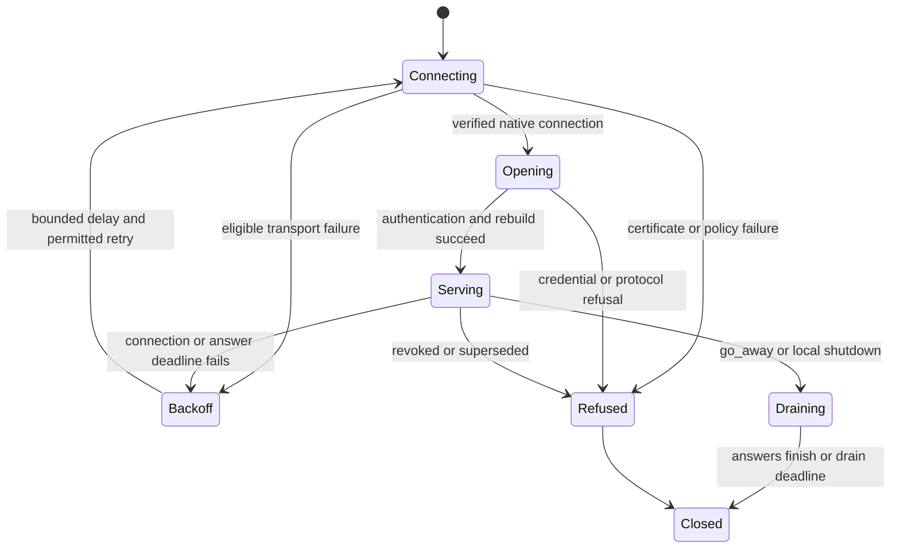

# M243 failure handling and observability proposal

## What it is

This page defines the failure behavior approved in Indy's [implementation sign-off](implementation-signoff.md).
The values below are design limits requiring tests, not measured production guarantees.

The runner prefers HTTP/3 over QUIC and uses HTTP/2 after an eligible network or transport failure.
Both carriers must preserve lease authority, report durability, bounded memory and visible failure reasons.
Neither carrier grants availability when every permitted endpoint is unreachable.

## Why it exists

A connection can stay open while its peer stops answering, its writer blocks or reports consume its queues.
Socket state alone cannot prove the daemon can renew work.
Application answers, lease deadlines, queue pressure and native diagnostics provide different evidence and need separate telemetry.

## How it behaves

### Connection and recovery states

One supervisor owns reconnect history across short-lived sessions.
A stable session resets that history only after 60 seconds of service.
An established healthy HTTP/2 session stays connected rather than disrupting work to probe HTTP/3.

The next normal connection setup tries HTTP/3 again when network policy permits it.
Connection loss, daemon drain or restart, and runner restart each lead to that setup.
If HTTP/2 remains healthy indefinitely, the runner stays on HTTP/2 indefinitely.

M243 adds no periodic upgrade probe, second serving connection or hot carrier switch.
Restarting the runner forces fresh selection, but a normal reconnect also retries HTTP/3 without a runner restart.
Backoff still bounds repeated failed attempts.

| Timing | Proposed behavior |
|---|---|
| Ping interval | 15 seconds, retaining Indy's selected spec timing |
| Answer timeout | 5 seconds from enqueue, including queue and write delay |
| Idle blackhole bound | At most about 20 seconds from an arbitrary fault onset, plus measured scheduler tolerance |
| Heartbeat interval | Existing 10 seconds; missing two intervals closes the session |
| Renewal tick | Existing 5 seconds; each lease retains its last confirmed expiry |
| First reconnect jitter | 0–2 seconds; cancellation interrupts the wait |
| Recovery attempt | 7 seconds total: HTTP/3 attempt 2, HTTP/2 attempt 2, opening/authentication/rebuild 3 |
| Later outage backoff | Exponential, jittered actual wait capped at 30 seconds; clip attempts and waits to remaining useful lease time |
| Replica offer backstop | One admission probe every 5 seconds, independent of connected runner count |
| Shutdown | Existing 15-second overall drain budget; every nested deadline fits inside that absolute deadline |

The recovery deadline includes name resolution, connection, certificate verification, headers, welcome and lane attachment.
The HTTP/2 attempt starts only for a failure class eligible for fallback.
No attempt receives a fresh seven-second allowance after consuming the shared deadline.

The normal busy-lease budget is conditional: 5-second renewal tick + 5-second answer timeout + 2-second jitter + 7-second recovery = 19 seconds.
That fits the existing 20-second recovery allowance only when the deadline starts from the relevant confirmed renewal and operations meet their budgets.
Repeated outages cannot satisfy this bound; the runner stops each lease at its confirmed expiry without a successful renewal.

The native tests measure fault onset separately from the first unanswered request.
A five-second answer timeout must never become a claim that every fault is detected five seconds after it starts.
Transport activity without an application answer does not refresh an answer deadline.

### Failure decisions

| Failure | Required action and evidence |
|---|---|
| UDP blocked, unreachable address or supported transport unavailable | End the HTTP/3 attempt at its deadline, classify the reason, then try HTTP/2 inside the shared recovery deadline |
| Daemon certificate untrusted, expired or wrong name | Refuse the session; no fallback that changes trust policy |
| Unknown TLS/cryptographic failure | Fail closed with its preserved cause; no error-string matching to authorize fallback |
| Invalid runner token, protocol version or permission | Report a refusal and stop that opening attempt; pending reports have no disk copy |
| Required outbound proxy | Honor the proxy policy; use an allowed HTTP/2 path or refuse, without bypassing the proxy over UDP |
| HTTP/2 proxy buffers uploads | Opening/ping deadline fails; record the failed direct-stream prerequisite |
| Read blackhole or blocked write | Absolute answer/write deadline cancels all lanes and pending operations; record the failing stage |
| One lane ends or resets | Close the logical session and recover once; no surviving report lane with stale control authority |
| Lost reply after renewal | Keep the old deadline until a confirmed answer; repeated usage retains `recorded_through` semantics |
| Lost report acknowledgement after commit | Retry the report retained in worker memory; lease-keyed idempotence prevents another charge |
| Full report queue | Keep reports on disk and retry with backpressure; never erase a report after socket send alone |
| Report storage write fails | Expose the storage failure, retain every previously accepted report and avoid claiming the new report reached durable storage |
| Full activity queue | Drop excess live activity, increment its drop counter, preserve task-history writes required by the spec |
| Lost broker ring | The replica's next admission probe runs an offer pass |
| Lost cancellation push | Renewal and reconnect read the committed cancel marker |
| Cancellation overtakes its offer | Remember the cancellation in bounded session state; a delayed offer must never start that lease; exhaustion closes the session |
| Broker `Gap` or `Lagged` | Recheck connection authority and cancellation, or run an offer pass for a wake subject |
| Token rotation or new session wins | Old grants and renewals fail their transactional authority check; old teardown cannot clear the new owner |
| Database unavailable | Issue no new authority, do not extend an unconfirmed lease, expose database failure separately from transport health |
| Daemon drain | Stop offers, finish accepted answers within the shared deadline, send `go_away`, close all lanes |

A timed-out operation may already have committed.
Report retries remain idempotent, while reconnect rebuilds other durable state instead of replaying arbitrary messages.
Request identifiers correlate answers; storage rules determine whether a retry repeats an effect.

### Queue, framing and flow-control limits

| Resource | Proposed limit and ownership |
|---|---|
| Native HTTP requests | Exactly four lanes; fourth succeeds and fifth is refused in boundary tests |
| Message | Four-byte big-endian length plus UTF-8 JSON; payload at most 2 MiB |
| Pending answers | At most 256 per session; counter uses `NonZeroU64` and never repeats |
| Live leases | Existing host worker limit, currently 64 |
| Application control queue | At most 64 messages and 2 MiB per session; reserve service for renewal, ping and cancellation |
| Application work queue | At most 8 messages and 4 MiB per session; offers and folded inputs use this lane |
| Application reports queue | Bounded transport frames; each admitted worker retains one pending report in memory |
| Application activity queue | At most 64 messages and 256 KiB per session; drop excess |
| Replica application frame budgets | 16 MiB reserved for control and 48 MiB for data; permits cover encoded and decoded owned frames |
| Native data chunks | At most 16 KiB per forwarded body chunk |
| Native bidirectional stream receive window | 64 KiB, with automatic growth capped at that value |
| Native connection receive window | 512 KiB, leaving room beyond both data windows and protocol streams |
| Native HTTP/3 protocol streams | Allow required control/QPACK streams; cap their windows and disable dynamic table dependencies |
| Request headers | At most 16 KiB; verify the same limit on both carriers |

These byte budgets complement message counts because eight maximum-sized reports exceed many small reports' memory use.
The reader validates a fixed-size prefix and acquires byte permits before allocating one zeroing payload buffer.
A partial frame also holds its permits and an answer/read deadline.

Budget contention never blocks the native connection's event dispatcher on a data lane.
Bounded per-lane receivers carry body chunks; the dispatcher continues servicing control and closing streams.
The native proof must demonstrate this behavior under continuously ready reports and maximum-sized work payloads.

Control messages sharing one lane still have ordered delivery.
HTTP/3 removes TCP's cross-stream ordering dependency, while HTTP/2 retains that transport dependency.
Bounded application queues and deadlines remain necessary for both.

### Rust cancellation and cleanup

`JoinSet` supervises application reader, writer and operation tasks.
A child cancellation token links each session to its native connection and parent shutdown.
Dropping a session signals cancellation; asynchronous close waits for completion within the remaining drain deadline.

Each pending request owns its answer sender and deadline.
Caller cancellation, timeout, disconnect and refusal remove its entry and release queue permits.
Late or duplicate answers increment a finite outcome counter without reaching a new session's callers.

Answers must match the pending response kind and expected lease identifiers.
Renewal answers must cover the requested lease set without duplicates, and report acknowledgements must match the pending request and lease.
Malformed matches close the session without advancing usage cursors or deleting reports.

Sensitive application buffers retain the existing zeroing ownership rule.
Native stacks can copy bytes; that rule does not prove erasure of every native allocation.

The Quiche driver wrapper checks cancellation in its cancel-safe `wait_for_data` callback and forwards native close diagnostics.
The raw client interface exposes worker shutdown notification; the server wrapper must supply equivalent completion evidence.
Native socket sends and handshake cancellation require explicit deadline tests before this cleanup claim is accepted.

### Metrics and traces

Use `af_observability`'s declared metric families and finite label enums.
Runner, fleet, lease and connection identifiers belong in trace fields rather than new metric labels.
Never record bearer tokens, credential hashes, payload bodies, private keys or TLS session keys.

| Proposed metric family | Kind and labels | What it explains |
|---|---|---|
| `agentsfleet_runner_stream_connections` | Gauge; `transport` | Current serving sessions by HTTP/3 or HTTP/2 |
| `agentsfleet_runner_stream_connect_total` | Counter; `transport,outcome,reason` | Opening success, failed attempts and refused sessions |
| `agentsfleet_runner_stream_fallback_total` | Counter; `reason` | Why HTTP/3 gave way to HTTP/2 |
| `agentsfleet_runner_stream_disconnect_total` | Counter; `transport,reason` | Flapping, drain, supersession and remote loss |
| `agentsfleet_runner_stream_recovery_seconds` | Histogram; `transport,outcome` | Complete recovery time, including authentication and rebuild |
| `agentsfleet_runner_stream_request_seconds` | Histogram; `kind,outcome` | End-to-end answer time including local queueing |
| `agentsfleet_runner_stream_ping_seconds` | Histogram; `transport,outcome` | Application response health, including timed-out probes |
| `agentsfleet_runner_stream_timeouts_total` | Counter; `stage` | Connect, authentication, answer, write or shutdown timeout |
| `agentsfleet_runner_stream_queue_bytes` | Gauge; `lane` | Memory held by queued frames |
| `agentsfleet_runner_stream_dropped_total` | Counter; `lane,reason` | Activity loss, invalid frames and abandoned queued work |
| `agentsfleet_runner_stream_answers_total` | Counter; `kind,outcome` | Accepted, late, duplicate or wrong-kind responses |
| `agentsfleet_runner_stream_report_backlog` | Gauge; pending in-memory reports | Reports awaiting acknowledged reconciliation |
| `agentsfleet_runner_stream_native_rtt_seconds` | Histogram; `transport` | Native path round-trip samples when the adapter exposes them |
| `agentsfleet_runner_stream_native_packets_total` | Counter; `outcome` | HTTP/3 sent, lost and retransmitted packet deltas |
| `agentsfleet_runner_stream_native_pto_total` | Counter; no identifiers | QUIC probe timeout deltas |

The implementation must register every family in declarations, producer helpers, the metric census and descriptor tests.
Use finite reasons such as `udp_unreachable`, `connect_timeout`, `answer_timeout`, `tls_refused`, `superseded`, `drain` and `protocol_error`.
QUIC probe timeout (PTO) values describe transport recovery; application ping still measures whether the daemon answers.

Trace spans cover connect, handshake, opening, rebuild, serving, recovery and drain.
Record elapsed time, attempt, carrier, remaining lease budget, request identifier and finite outcome as appropriate.
Record a failed attempt even when HTTP/2 fallback succeeds, so success cannot hide a flaky UDP path.

Native HTTP/2 diagnostics may differ from QUIC's available statistics.
Omit unsupported native measurements instead of emitting zero values that imply a healthy path.
Application timings and outcomes remain comparable across both carriers.

## Limits

### Required evidence before production wiring

| Test group | Evidence required |
|---|---|
| Native duplex | Verified certificates, open upload, answers in both directions for at least 120 seconds on each carrier |
| Framing | Split prefixes, split payloads, multiple frames per chunk, malformed JSON, invalid types and oversized lengths rejected before payload allocation |
| Isolation between lanes | Continuous reports, large offers/folded inputs and saturated activity do not starve renewal/cancellation; byte budgets remain bounded |
| Security | Invalid CA, name and expiry; foreign session identifier; duplicate lane; token rotation and old-socket fencing; no early-data writes |
| Failure and recovery | UDP blackhole, TCP reset, half-open connection, blocked write, failed handshake, server drain and repeated short sessions |
| Carrier reselection | Restore UDP while HTTP/2 remains healthy: no forced switch; then end the session and verify the next permitted setup selects HTTP/3 |
| Request lifecycle | Lost/duplicate/late answers, full pending map, counter exhaustion, caller cancellation and reconnect while answers arrive |
| Durable behavior | Lost report acknowledgement causes one reconciliation/charge; usage cursors survive renewal retry; marked leases stop after lost push |
| Cleanup | No surviving connection workers or pending callers after timeout, cancellation and drain |
| Observability | Each injected failure emits its expected finite reason and timing; secrets and unbounded identifiers never become metric labels |
| Cost | Idle runner count does not multiply fallback probes; ordinary chat activity avoids target reads; task progress keeps required database writes |

Native certificate and queue tests must use the production adapter, not only an in-memory codec or fake daemon.
The repository gates remain `make lint-all`, `make test-unit-all`, `make test-integration-rustd` and `make check-version`.

Rust coverage also runs through `make test-coverage-rustd`: at least 98% overall line coverage and 97.5% changed-line coverage.
The shard merge includes the Linux kernel report and refuses reports from different commits.
Read issue #813 before each push, then run `orly gate pr` before creating the milestone's one pull request.

## Related pages

- [Implementation and ownership proposal](implementation-signoff.md)
- [Transport and TOON source findings](transport-and-toon-research.md)
- [Runner protocol architecture](../../architecture/runner_protocol.md)
