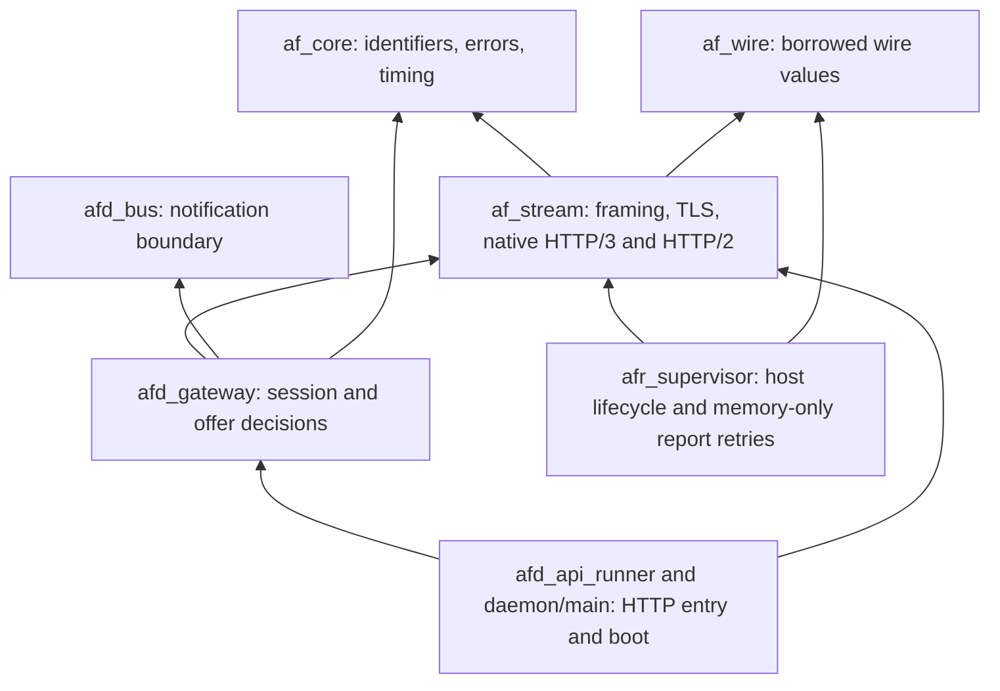

# M243 implementation proposal for Indy's sign-off

## What it is

**Status: implementation approved by Indy on Nov 08, 2026; continue to one pull request.**
The [runner protocol](../../architecture/runner_protocol.md) owns the approved architecture and transport file split.
The [active specification](../../v2/active/M243_001_P1_API_DOCS_INFRA_OBS_RUNNERS_HOLD_ONE_PUSH_STREAM.md) owns the milestone's acceptance criteria.

The runner opens one outbound connection to `agentsfleetd`, preferring HTTP/3 and falling back to HTTP/2 after eligible transport failures.
Both carriers support four duplex request streams: control, work, reports and activity.

Private Fly routing is the supported hosted deployment path.
External operators supply endpoint reachability and permit outbound HTTP/3 over QUIC or HTTP/2.

An external runner needs private network access when its configured endpoint is private to Fly.
Carrier support alone does not provide that route.
The runner opens outbound connections and needs no inbound HTTP service.

The change removes lease polling and six HTTP routes in one release.
Users should see prompt work pickup, faster cancellation and recovery that preserves acknowledged lease deadlines.
Operators get explicit evidence of reconnects, fallback, timeouts and queue pressure.

HTTP/3 can keep loss on the reports stream from blocking the control stream's ordered delivery.
Both streams still share congestion limits, bandwidth and the daemon's capacity.
An unavailable daemon, database or network can still stop work.

## Nov 09 owner correction: reports and billing

Indy rejected completed-report files and all backward-format retries.
His selected answer was: "Remove runner disk storage; retry from memory".
Postgres owns saved completion and billing records; runner memory holds only unacknowledged results.

Task-decision receipts also remain in the calling task until the daemon acknowledges them.
Process loss can lose uncommitted results and usage; no file recovery or trace-based billing is promised.

The [owner feedback audit](owner-feedback-audit.md) records each supplied comment, its source evidence and unfinished work.
Full milestone verification remains incomplete; the handoff records current results.
Historical test results below do not verify the current source.

## Why it exists

M243 moves work delivery, renewal, reports, folded input and progress onto a session with one opening authentication.
Postgres remains the authority for connection ownership, cancellation and lease fencing.
The broker supplies notifications; a lost notification cannot grant authority.

The existing `guffbolt` loop remains independent of network transport and model serialization.
The [reference study](transport-and-toon-research.md) explains the Quiche recommendation and TOON's narrower use for model input.
The [failure design](failure-and-observability.md) defines recovery and verification.

## Nov 09 context save and authoring scope correction

Indy requested authoring jobs on the same runner stream.
The original decision to retain four authoring HTTP calls is superseded.
Model calls, proposals, authoring renewals and final authoring reports now belong to M243's transport migration.

Wire variants, runner commands, daemon dispatch and connection-authority checks are written.
The four authoring HTTP routes are removed; native integration evidence remains due.

Kernel examples now compile through native fixtures.
The handoff records remaining checks; this checkpoint is not ready to undraft.

Read the [current handoff](session-handoff.md) and [resume prompt](resume-prompt.md) before continuing in a new session.
The [owner feedback audit](owner-feedback-audit.md) maps supplied comments to source changes and remaining evidence.

Indy subsequently authorized compilation, formatting, lint and tests. The handoff records actual passing checks and remaining verification.

M246 extends M243's authentication, recheck and revocation interface.
Independent tenant-management work can prepare separately; final integration still requires the completed M243 interface.
The [parallel preparation prompt](m246-parallel-prompt.md) preserves M246's unresolved owner decisions.

### Historical evidence before this context save

The following table records earlier revisions only.
It does not verify this checkpoint or certify the current source.

| Item | Checked state |
|---|---|
| Worktree | `/workspace/agentsfleet-m243`, branch `feat/m243-runner-push-stream` |
| Fetched base | `origin/main` at `61820b66a`, merged normally after #817; #816's native UUIDv7 changes remain included |
| Existing commits | Draft [#819](https://github.com/agentsfleet/agentsfleet/pull/819), published hybrid checkpoint `b1a606840`; main merge `bafef4bbe` |
| Written code | Transport and bus foundations; backend ownership and durable cancellation verified by focused tests; gateway and runner session wiring remain due |
| Package evidence | Earlier `cargo test -p af_wire --all-features`: 78 unit tests and 96 wire-suite tests passed |
| HTTP/3 scratch evidence | Verified CA chain, open upload with duplex replies, byte-identical 2 MiB payload, 120 seconds of pings, raw client worker exit after explicit close |
| HTTP/2 scratch evidence | BoringSSL certificate verification, open upload with duplex replies, byte-identical 2 MiB payload, 120 seconds of pings and client/server task exit |
| Production adapter evidence | Bus migration passed 3,525 daemon-library tests and 158 daemon tests; live integration and final coverage remain due |
| Hybrid key exchange | Real HTTP/3 and HTTP/2 peers negotiated X25519MLKEM768; classical TLS 1.3 peers remain identified; TLS 1.2 is refused |
| Kill and issue ordering | Two new regressions reproduced issuance after Kill; the issue-only parent lock now requires active fleet state after waiting |
| Backend focused live run | `cargo test --workspace --exclude afd_bench --all-features --test '*' -- connections:: lease_renewal::cancellation draft::creation::running_cancellation issue_lifecycle test_every_sql_file_prepares --ignored`: 11 passed, zero failed, after Make reset and migration |
| Reported API failure | `test_admitted_publish_failure_still_accepts` passed against live datastores after restoring fleet context in the dropped-frame observation |
| Dependencies | Indy approved `libc = 0.2.189`; the workspace uses published `tokio-quiche 0.20.1` without a scratch override |
| Current lint checkpoint | `make lint-all` passed, including rustfmt, workspace Clippy with all features and targets, dependency checks and the remaining repository linters |
| Unit checkpoint | Runner checkpoint passed 1,749 tests; backend Make shards passed 3,529 library and 158 daemon tests; complete repository lane remains due |
| Unverified | Complete gateway/runner cancellation and fallback matrix, fault timing, linked static targets, Fly deployment, coverage and remaining repository gates |

The wire draft does not establish a working runner session.
The approval permits the native transport proof first, followed by production wiring when that proof passes.

### Local code review feedback

Every code comment Indy supplied in this chat has been read.
The following changes are written; a row becomes verified only after its matching checks pass.
The gateway, runner integration and remaining milestone gates stay open.

| Feedback | Current change or remaining check |
|---|---|
| Reader complexity and manual cleanup | Direct bounded reads into one zeroing allocation; automatic permit cleanup; partial-frame and cancellation tests |
| Writer complexity | Bounded serializer owns completion; retained capacity stays charged and serialization reserves its temporary allocation peak |
| Framing test complexity | Shared fixture, explicit expected-error patterns and a polled blocked future; the generic `required` helper is removed |
| HTTP/2 client and upload loop | Hyper owns body transfer and native flow control; connection setup and worker supervision have separate owners |
| HTTP/2 server length | Typed session owner, bounded opening and native request count; task lifetime is supervised |
| HTTP/3 client length | Separate socket preparation, connection supervision and typed opening states; duplicate correlation maps are removed |
| HTTP/3 request and response parsing | `RequestHead`, `ResponseHead` and `Encoded` conversions validate pseudo-headers before producing typed HTTP values |
| HTTP/3 server length and failures | Session owns handlers and cancellation; a refused native connection is observed without terminating the listener |
| Body state and Exonum reference | Separate native `Body` implementations and explicit closed state; the source comparison is recorded in the research page |
| Meaning of `Carrier` | Renamed to `Transport`; no compatibility alias |
| Human and agent error handling | Plain outer messages, retained causes, stable error codes and finite outcome fields |
| Tokio Quiche features | Exact pinned feature decisions and native telemetry bridge are recorded in the research page |
| Wake queue ownership and performance | One short mutex protects FIFO and membership together; hash membership replaces the linear duplicate scan; latency benchmark remains due |
| Capacity and configuration | Validated `AGENTSFLEET_RUNNER_WAKE_QUEUE_CAPACITY`; startup now resolves the wake queue and frame-memory settings; runtime verification remains due |
| Wake naming and environment prefix | `WakeQueue`, matching queue metrics and `AGENTSFLEET_` settings replace the newly introduced names; no aliases |
| A thousand fleets and fairness | Buffer pressure test is written; unconditional database discovery and end-to-end fairness proof remain due |
| UUIDv7 main changes | Merged #816 and #817 normally; new data access retains native identifiers and table ownership |
| Traces, logs and coverage | Finite metric declarations, structured operation observations and export/redaction tests are written; final coverage measurement remains due |

### Review checkpoint requested on Nov 09, 2026

This checkpoint publishes reviewed source changes for Indy.
It does not declare M243 complete or claim a new verification result.
Runner wiring, private listener startup, retired routes, integration evidence and final coverage remain open.

| Review item | Source change |
|---|---|
| Cache complexity | `session/cache.rs` loads a validated snapshot and applies it atomically; revision checks protect concurrent reports and renewals |
| Reconnect query | Native UUIDv7 rows, `UNION ALL`, bounded results and runner/status/expiry indexes; execution plans remain unmeasured |
| Stream naming | `StreamKind` replaces the protocol type and reader names; the header is `agentsfleet-runner-kind` |
| Offer complexity | A borrowed encoder separates eligibility, issue, serialization and delivery without optional writer extraction |
| Opening complexity | `ControlOpening`, `SessionOpening` and `ConfirmedSession` carry increasingly strong ownership proofs |
| Bearer authentication | Ordinary guarded routes and initial native control use the existing registry; secondary streams use the physical connection proof |
| Service trait file | `afd_http/src/services/http_services.rs` owns `Services`; its old filename is removed |
| Memory configuration | `AGENTSFLEET_RUNNER_CONTROL_MEMORY_MIB` and `AGENTSFLEET_RUNNER_DATA_MEMORY_MIB` configure validated per-replica totals |
| Event-loop abstraction | `SessionEvent`, `EventHandler`, `EventSource` and `SessionSupervisor` separate selection from decisions |
| Exonum reference | Its event-source and handler pattern informs the new split; Tokio task ownership and cancellation remain current |
| Recovery SQL | `EXISTS` asks whether a pass may help; claim transactions retain all eligibility and capacity decisions |
| Recovery cadence | One independent probe per replica every five seconds; notification retries do not multiply database passes |
| Typed commands | `Cancel` checks the named durable marker; `Recheck`, gaps and overflow reload authority and policy |
| Comments | Module and ownership comments explain deadlines, allocation, cancellation, safe logging and durable boundaries |
| RS-SENTINEL | Publication and subscription failures return `Result`; invalid configuration stays `None`; request and allocation guards release through `Drop` |
| RS-UNWRAP | Production additions use fallible conversions; panic assertions belong to tests or compile-time invariant proofs |
| Stored timestamps | The issue statement returns its saved `created_at`; capacity keeps the full-precision database clock |

Review the gateway in this order: `lib.rs`, `connection.rs`, `stream_headers.rs`, then `session/opening/`.
Continue through `session/runtime.rs`, `streams.rs`, `events.rs`, `supervisor.rs`, `requests.rs`, `cache.rs` and `dispatch/`.
The native carrier and bus source remain separate from these domain decisions.

`LeaseService` replaces `Plane`; `AdmittedFleetWork` replaces `Admission2`.
`GatewayDependencies` names composition inputs, and `StreamLimit` plus `StreamPermit` name shared stream admission.
The injected wall clock serves repeated identifier and cache-expiry decisions; timeouts use monotonic Tokio instants.

The source review applies Orly's Rust and error standards across the PR diff, including existing changed callers.
A source review does not substitute for the later Rust, integration or coverage gates.
The current checkpoint retains the merge hold and the existing coverage floors.

### Early draft requested for M244

Indy asked, “well send the draft PR when you have the check, fmt clippy lints taken care”.
He added, “so the claude agent can start”.
The draft publishes the bus interface for M244 while M243 implementation and final verification continue.

The draft must identify every pending gate and remain unready for merge.
Production publishers now use the bus; runner sessions still need startup wiring.

## How it behaves

### Crates and dependencies



Existing domain crates remain below the gateway.
Runner and daemon crates never depend on one another.
Indy's approval includes the additional shared carrier crate.

| Crate | Responsibility and principal public values |
|---|---|
| `af_wire` | `Up<'a>`, `Down<'a>`, `Answer<'a, T>`, `StreamKind::{Control,Work,Reports,Activity}`, `Renewal`, `RenewalAnswer`; values and validation without Tokio, SQL or native transport |
| **New `af_stream`**, under `protocol/` | `Transport`, `Endpoint`, `Trust`, `Incoming`, `OwnedFrame`, `Connection`, `ConnectionInfo`; native transport and framing, without SQL or authentication decisions |
| **New `afd_bus`**, under `daemon/` | Object-safe `Bus`, cloneable `Handle`, `Subject`, `Command`, `Subscription`, `Received`; Dragonfly adapter and wake notifications |
| **New `afd_gateway`**, under `daemon/` | Concrete `Gateway`, `ConnectionContext`, `Session`, `LiveLease`, `Registry`; consumes the domain's proven authority |
| Existing `afd_runner` | `capacity::authority::{Authority, Decision, Refusal}`; guarded acquisition and grant-time credential checks |
| `afr_supervisor` | `Downlink`, cloneable `StreamHandle`, `Pending`, `Uplink`; offers feed workers; pending reports remain in worker memory |
| Existing domain crates | Host locks, claim, renewal, billing, task activity, authoring and reports retain their owning services |

| Dependency | Proposed use |
|---|---|
| `tokio-quiche = "=0.20.1"`, `default-features = false` | HTTP/3 client/server and Tokio socket driving; use its matching `quiche` re-export |
| Matching `boring` and `tokio-boring` releases | Proposed TLS implementation for both new runner carriers; resolve one compatible BoringSSL version with the native proof |
| Existing Hyper 1.12.0, h2 0.4.20, hyper-util 0.1.21 | HTTP/2 duplex client/server on a dedicated native connection |
| Existing Tokio 1.54.1, tokio-util 0.7.20 | Bounded channels, cancellation, deadlines, `JoinSet`, length-delimited codec |
| Existing Tower 0.5.3, `http`, `bytes` and futures-util 0.3.34 | Carry HTTP requests, poll streams and retain existing service composition |
| `http-body` and `http-body-util`, already transitive | Declare direct dependencies with their first transport caller; adapt streaming bodies into Axum |
| Existing Serde, serde_json, garde, zeroize | Typed messages, validation and application-owned sensitive buffers |
| Existing async-trait 0.1.92 | Object-safe broker methods selected once at boot |
| Existing `tracing`, `af_observability`, backon 1.6.0 | Trace context, declared metric families and bounded reconnect scheduling |
| Existing SQLx and `af_core/sqlx` | Native `Uuid7` rows and parameters after the data-layer follow-up lands |
| Existing rcgen 0.14.10 and tempfile 3.27.0, test dependencies | Create test certificate chains and isolated repository fixtures |

No RustAPI framework, Neqo server or TOON dependency enters the M243 production dependency graph.
No WebSocket carrier or Cloudflare service enters the design.

### Transport callables and generic parameters

The proposed `work` lane carries offers and folded-input exchanges.
This keeps potentially large work payloads out of control's ordered byte stream.
The current protocol declares all four stream kinds.

| Stream kind | Messages |
|---|---|
| `control` | Hello/welcome, credits, heartbeat, ping/pong, renewal batches, authoring renewal, cancel and `go_away` |
| `work` | Offers, folded-input requests/answers, authoring model calls/results and authoring activity/proposal receipts |
| `reports` | Fleet and authoring reports with matching acknowledgements |
| `activity` | Bounded fleet live progress |

These are proposed signatures, not compiled implementation claims.
Each fallible crate uses the repository's generated error shell and local `Result` alias.

```rust,ignore
// af_stream::framing: T carries the caller's real Serde value.
async fn encode<T: serde::Serialize + Sync>(
    value: &T, budget: &Budget, deadline: Instant,
) -> Result<OwnedFrame>;
fn decode<'a, T: serde::Deserialize<'a>>(frame: &'a OwnedFrame) -> Result<T>;

// af_stream::client: open returns headers before upload reaches its end.
async fn connect(endpoint: &Endpoint, deadline: Instant) -> Result<Connection>;
async fn open<B>(&mut self, request: http::Request<B>)
    -> Result<http::Response<Incoming>>
where
    B: http_body::Body<Data = bytes::Bytes> + Send + 'static,
    B::Error: std::error::Error + Send + Sync + 'static;

// af_stream::server: M creates a fresh service for each native connection.
async fn serve<M, S, B>(listeners: Listeners, make: M, stop: CancellationToken)
    -> Result<()>
where
    M: Fn(ConnectionInfo) -> S + Send + Sync + 'static,
    S: tower::Service<http::Request<Incoming>,
        Response = http::Response<B>, Error = std::convert::Infallible>
        + Clone + Send + 'static,
    S::Future: Send + 'static,
    B: http_body::Body<Data = bytes::Bytes> + Send + 'static,
    B::Error: std::error::Error + Send + Sync + 'static;
```

The server factory creates one `ConnectionContext` and attaches it through typed request extensions.
The existing Axum router still applies route metadata, opening authentication, scopes and HTTP error rendering.
Only the runner stream route accepts these direct listeners.

`Connection` and `Incoming` use private carrier enums.
Carrier selection occurs at connection establishment; domain operations never branch on the HTTP version.
The adapter polls each upload and download independently instead of collecting either body.

`Answer<'a, T>` shares one success/refusal shape while retaining each response's concrete type.
`Cow<'a, str>` lets decoding borrow from `OwnedFrame` during validation and dispatch.
Values crossing a task boundary become owned; no task borrows a decoder buffer that another task reuses.

Framing validates the four-byte length before allocating its declared payload.
A byte-budget permit precedes decoder growth and stays with the owned frame.
`garde` proves message bounds before domain parsing; transport framing alone does not prove a message.

### Broker trait and subscription ownership

```rust,ignore
#[async_trait::async_trait]
pub trait Bus: Send + Sync + std::fmt::Debug {
    async fn publish(&self, subject: &Subject, payload: &str) -> Result<()>;
    async fn publish_batch(&self, subject: &Subject, payloads: &[String]) -> Result<()>;
    async fn subscribe(&self, subject: &Subject) -> Result<Subscription>;
    async fn shutdown(&self) -> Result<()>;
}

pub struct Handle(std::sync::Arc<dyn Bus>);

pub enum Subject {
    FleetTail(Uuid7), DraftEvents(Uuid7), Wake(u16), RunnerCommand(Uuid7),
}

pub enum Command { Cancel { lease_id: Uuid7 }, Recheck }

pub struct Subscription {
    inner: std::pin::Pin<Box<dyn futures_util::Stream<Item = Result<Received>>
        + Send + 'static>>,
}
```

`Received` preserves `Message`, `Lagged(u64)` and `Gap` as separate outcomes.
The private adapter translates Dragonfly values into neutral bus values.
Its pinned stream owns the native subscription, so dropping the stream retains last-subscriber unsubscribe behavior.

The Dragonfly hub stays inside `afd_dragonfly`; only its adapter imports it.
That avoids a dependency cycle between the new bus types and their first backend.
All other publishers and subscribers receive `afd_bus::Handle` from boot.

M244 replaces the notification adapter with core NATS and moves durable Dragonfly responsibilities into Postgres before removing Dragonfly.
Typed subjects and neutral subscription outcomes keep backend names and reconnect mechanics inside the adapter.
Publish does not imply durable delivery; gaps remain explicit and Postgres backstops remain authoritative.

Shutdown is asynchronous and idempotent, so M244 can await `async-nats` connection draining behind the same interface.
The daemon owns its absolute shutdown deadline.
Dropping an individual subscription releases only that consumer, rather than closing the shared bus.

### Gateway and runner callables

| Owner | Proposed callables | Purpose |
|---|---|---|
| `Gateway` | `open`, `attach_stream`, `drain` | Claim authority after authentication, bind secondary lanes, stop new offers |
| `ConnectionContext` | `bind`, `attach`, `cancel` | Set one proven binding, reserve each lane once, close sibling requests |
| `Session` | `serve`, `on_up`, `on_command`, `recheck` | Own lease index and state transitions; dispatch bounded domain work |
| `Registry` | `register`, `offer_pass`, `probe` | Find eligible sessions and run one fallback admission probe per replica |
| Existing `LeaseService` | `claim` returning `Claimed`, `rebuild`, cached-target activity publishing | Preserve payload assembly and return the lease's target without another target read |
| Existing host capacity | `lock` with expected authority, ticket propagation | Compare connection ownership and credential digest inside issue and renewal transactions |
| Existing `Runners` | `acquire_connection`, `check_connection` | Acquire a fresh owner or classify refusal; prevent a replaced automatic resume |
| `StreamHandle` | `renew_batch`, `report`, `folds`, `activity`, `credits`, `heartbeat` | Typed runner-facing operations over channels; no raw socket sharing |
| `Downlink` | `run`, `connect`, `rebuild`, `dispatch` | Own carrier recovery, pending requests, offers and cancellation |
| `Uplink` | `run`, `send_control`, `send_work`, `send_report`, `try_activity` | Independent bounded writers; expendable activity drops at its cap |

### Struct fields and ownership

| Value | Owned fields and sharing rule |
|---|---|
| `Endpoint` | URL authority, dial addresses, verified server name, trust policy and permitted proxy path; no bearer token |
| `Trust` | Explicit trust-root and server-name policy; identity files belong to the server listener configuration |
| `Connection` | Client carrier sender, native driver lifecycle and cancellation owner; dropping it signals close |
| `ConnectionInfo` | Server-created carrier metadata and native cancellation handle; service factories receive metadata while the server retains driver ownership |
| `Budget` | Weighted byte permits shared across the replica, with separate control and data capacity |
| `Authority` | Private `runner: Uuid7`, `connection: Uuid7`, `digest: afd_auth::directory::Digest`; database acquisition constructs the proof; debug output omits its digest |
| `ConnectionContext` | `OnceLock<Binding>`, lane-claim bits, cancellation token; one `Arc` per native connection, shared only by its requests |
| `Binding` | `Authority` and bounded session channel handles; written once after the guarded database transaction |
| `Gateway` | Shared existing domain services, bus handle, registry and clock; cloneable handles, no socket ownership |
| `Session` | Authority, `HashMap<Uuid7, LiveLease>`, queue receivers, cancellation tree, session ceiling slot and bounded job set |
| `LiveLease` | Lease identifier, fence, confirmed expiry and typed activity target; actor owns updates and invalidation |
| `StreamHandle` | Bounded command senders and assignment watch sender; cheap clones for worker, usage and report callers |
| `Downlink` | Native connection owner, session identifier, nonzero request counter, bounded pending map and reconnect history |
| `Pending` | Expected response kind, absolute deadline and oneshot answer sender; exactly one completion or failure |
| `OwnedFrame` | Application-owned buffer and byte-budget permit; sensitive decoded lease bodies retain the existing zeroing owner |
| Driver wrapper | Generic native driver `A`, cancellation token and completion signal; forwards native callbacks and samples diagnostics |

`Arc` shares immutable services and cheap channels whose lifetimes cross tasks.
One actor owns each mutable session map; no shared mutex covers socket I/O or a database await.
Small bounded database jobs return generation-tagged completions so a slow operation cannot block ping or cancellation dispatch.

`Box` appears at the runtime-selected bus boundary and once per heterogeneous subscription stream.
The wire draft boxes its large report value so small control variants do not carry that value's full inline size.
Existing engine trait objects remain; no new boxed future is needed for every transport read or write.

The library's boxed foreign errors remain causes inside the repository's typed error shell.

Native worker completion requires an explicit close path and a completion acknowledgement.
Dropping Quiche's metadata handle alone does not stop its worker.
The native proof must establish cleanup before the gateway adopts that adapter.

### Authentication and database authority

Control opens with a bearer token, protocol header and `control` lane header.
The stream guard retains a proof containing the runner and `Digest::of` the same presented credential.
A client cannot supply its own trusted digest or connection context.

The opening transaction locks the host, checks status and digest, and writes a fresh `connection_id`.
The gateway rebuilds live lease targets and answers `welcome` before accepting work, reports and activity lanes.
Those lanes must match the native connection's typed binding and returned session identifier.

The session offers no work until all lanes attach and the runner's initial `ready` confirms its credits.
One session holds one ceiling slot across all four lanes.
Any lane failure closes that session and cancels its pending operations.

The server rejects duplicate lanes, foreign connection identifiers and missing bindings.
Every grant and renewal compares expected connection and credential authority under the host lock.
Session teardown clears ownership only when the row still names that session.

The kill transaction marks affected leases before publishing cancellation.
Reconnect and renewal read that marker when the broker notification disappears.
Repeated reports retain existing lease-keyed billing idempotence and complete usage acknowledgements.

### Exact file inventory and removal

[files.tsv](files.tsv) lists complete repository-relative paths, proposed actions, reasons and their presence on `origin/main`.
`EDIT` and `DELETE` paths were checked against the fetched tree; `CREATE` paths are explicitly new.
`AUDIT` rows name source hits whose dependent callers require review before implementation is complete.

The inventory contains 528 paths: 129 creations, 294 edits, 20 deletions, one move, 80 audit paths and 3 deployment/build proposals.
The two deployment paths and builder-image path require separate approval before edits.
These are scope counts, not completed implementation changes.

The inventory includes test-suite registration because these Cargo manifests disable automatic test discovery.
It also includes shared test helpers, authoring renewal callers and kernel-lane fake daemons.
The old heartbeat, claim, renew, activity, folds and report routes disappear without aliases.

Only `runner.runners` and `runner.leases` gain columns: `connection_id` and `cancel_requested_at`.
Existing table files receive those edits; no new table or ALTER migration file belongs here.
Database identifiers use native `Uuid7`, with `fleet.events.event_id` and lease/tool-call `event_id` after the data-layer rebase.

Any SQL cast that M243 would add or retain in changed data-access statements requires Indy's approval first.
This includes identifier parameter casts, identifier-to-text output casts and schema expressions changed by this milestone.
Present the exact expression, its reason and the typed alternative before requesting an exception.

## Limits

The last fetched `fix/m242-fold-scope` branch at `d8ec02123` lacks the promised native identifier feature and event-key rewrite.
New data access must follow Claude's native `Uuid7` bindings and rows from the start.
If a required dependency remains unavailable, pause the affected data wiring and rebase when it lands.

Do not introduce temporary casts or String identifiers to bridge that gap.
The transport proof can proceed after sign-off without changing the data layer.

Quiche's private trust configuration and native cancellation remain proof gates, described in the reference study.
If the published adapter cannot meet those gates, return the concrete failure to Indy before choosing a fork or another stack.
Source review alone cannot approve a production carrier.

The static Linux builder currently installs CMake without Clang/libclang, as its Dockerfile records.
The native proof must also cover the shipped musl targets on both supported processor architectures.
Any required builder-image or workflow change returns to Indy with its concrete diff before editing or publishing.

Deployment edits remain a separate approval item.
The concrete proposal uses private IPv6 UDP/TCP on port 4443, a configured certificate name and operator-delivered certificate files.
The private listener requires certificate trust and routing that retains native connection ownership across packets.

M243 does not add a hosted public ingress deployment.
External operators permit outbound UDP for HTTP/3 or outbound TCP for HTTP/2 and provide any required private network access.
The [reference study](transport-and-toon-research.md) records BoringSSL for both new carriers while other clients retain their current TLS backends.

No script, workflow or deployment file changes occur under this design-only step.
The public docs repository needs its own branch before the behavior change ships.

### Recorded sign-off

Indy approved implementation with "Other than than the I am sign off / approve the implementation."
Indy then confirmed "Yes keep going to a PR".
Implementation follows the three-crate split, four-lane protocol, scoped BoringSSL choice and native proof gates.

TOON remains a separate, measured model-input experiment requiring a later implementation decision.

## Related pages

- [Failure handling, limits and observability](failure-and-observability.md)
- [Quiche, Neqo, RustAPI and TOON findings](transport-and-toon-research.md)
- [Exact source inventory](files.tsv)
- [Runner protocol architecture](../../architecture/runner_protocol.md)
- [Existing token counting decision](../tokenizer-approach-proposal.md)
