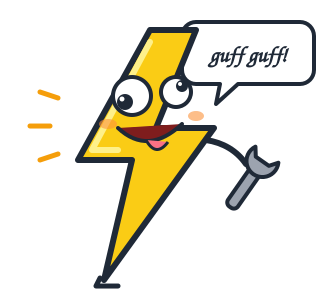

# guffbolt

<p align="center"></p>

<p align="center"><em>Meet Guffy. Guffy talks a lot of guff and fixes what it just broke.</em></p>

`guffbolt` is an agent harness for Rust. It runs the loop an agent lives in: call the model, run the tools it asks for, repeat until it answers.

You supply the model, the conversation and the tools. `guffbolt` decides when each step runs, keeps the transcript, and tells you what happens as it happens. Its sibling crate `guffbolt-ai` connects real providers.

## Install

`guffbolt` is not on crates.io yet, so depend on it from its Git repository.

```toml
[dependencies]
guffbolt = { git = "https://github.com/agentsfleet/agentsfleet" }
guffbolt-ai = { git = "https://github.com/agentsfleet/agentsfleet", features = ["minimax"] }
tokio = { version = "1", features = ["macros", "rt"] }
```

- **Rust** with edition 2024, at or above the `rust-version` in `Cargo.toml`.
- **Your own `Model` or `Conversation`** also needs `futures-util` for the stream type, `tokio-util` for the stop token and `serde_json` for arguments.
- **`Send` futures.** Each async method you write must return a `Send` future. Your conversation is shared with every call it lends, so it must be `Sync` too.
- **Tokio, for a time budget.** `Budget::Within` uses Tokio's timer, so that loop runs inside a Tokio runtime with time enabled.

## Quick start

`Chat` is a ready conversation: one model, its instructions and, optionally, some tools. This program sends one prompt to MiniMax and prints the answer.

```rust,no_run
use guffbolt::{Chat, Ending};
use guffbolt_ai::{Models, providers};

#[tokio::main(flavor = "current_thread")]
async fn main() -> Result<(), guffbolt_ai::Error> {
    // MINIMAX_API_KEY is read from the environment.
    let models = Models::new().with(providers::minimax());
    let model = models.connect("minimax", "MiniMax-M3.1-Flash")?;

    let mut chat = Chat::new(model, "Answer in one sentence.");
    match chat.prompt("Which crate parses TOML in Rust?").await {
        Ending::Answered(text) => println!("{text}"),
        Ending::Failed(why) => eprintln!("the model failed: {why}"),
        Ending::Stopped | Ending::Waiting(_) => {}
    }
    Ok(())
}
```

`Models` holds the providers you register. `connect` finds the model's catalogue row, reads the key from the provider's variable, and answers a `Model`. A missing key fails naming the variable, never its value. `guffbolt-ai`'s README lists every provider, its feature and its key variable.

`examples/minimax_chat.rs` is the same program. Run it with `MINIMAX_API_KEY=… cargo run -p guffbolt --example minimax_chat`.

### The same chat without a network

A `Model` is a trait, so a test can stand in for the provider. This one echoes the prompt back, and the example runs as written.

```rust
use futures_util::StreamExt as _;
use futures_util::stream::{self, BoxStream};
use guffbolt::{Chat, Chunk, Conversation as _, End, Ending, Message, Model, Request, TextKind};

/// A stand-in provider: it answers every prompt by echoing it.
#[derive(Debug)]
struct Echo;

impl Model for Echo {
    type Error = String;

    fn measure(&self, _request: Request<'_>) -> Result<u64, String> {
        Ok(0)
    }

    fn stream<'a>(&'a self, request: Request<'a>) -> BoxStream<'a, Result<Chunk, String>> {
        let text = match request.messages.last() {
            Some(Message::User(said)) => format!("You said: {said}"),
            _ => String::new(),
        };
        let answer = Chunk::Text { kind: TextKind::Answer, text };
        stream::iter([Ok(answer), Ok(Chunk::End(End::default()))]).boxed()
    }

    fn accepts_images(&self) -> bool {
        false
    }
}

#[tokio::main(flavor = "current_thread")]
async fn main() {
    let mut chat = Chat::new(Echo, "Answer in one sentence.");
    match chat.prompt("Hello").await {
        Ending::Answered(text) => assert_eq!(text, "You said: Hello"),
        other => panic!("{other:?}"),
    }

    // The transcript keeps every prompt and answer, so the next prompt follows them.
    let Ending::Answered(text) = chat.prompt("Again").await else { panic!("no answer") };
    assert_eq!(text, "You said: Again");
    assert_eq!(chat.transcript().messages().len(), 4);
}
```

A chat fails with `ChatFailure`: the model's own error, or `Silent` when the first step said nothing. `Chat::stop` hands you its `CancellationToken`. Cancel it from another task to stop the chat; every later prompt then ends `Stopped`.

## How a loop runs

```text
drive(conversation, extension, state) ──► Ending: Answered | Failed | Stopped | Waiting

every step:  take input ─► before_model ─► window ─► model call ─► after_step
no calls:    on_answer ─► remember ─► take input again; new input runs one more step
calls:       run them, in order ─► remember ─► after_group
a question:  run the step's calls ─► remember ─► quiet ─► Waiting
```

`Chat` is one implementation of the pieces below. When you need more control, you implement them yourself.

| Piece | What it is | Who writes it |
|---|---|---|
| `Model` | One model call: a `Request` in, a stream of `Chunk`s out | `guffbolt-ai`, or you |
| `Conversation` | Where input comes from, what each call sends, how tools are dispatched, the stop | you, or `Chat` |
| `drive` | The loop itself | `guffbolt` |
| `Extension` | What a run of one kind adds: a time budget, a goal check | you, or `Plain`, which adds nothing |
| `Transcript` | Every message the loop kept, in order | `guffbolt` fills it; you hold it |
| `DriveState` | The loop's progress: accepted answers, completed steps, a pending question | `guffbolt` fills it; you save it |
| `Observe` | Hears each model call and tool call start and end | you, or `Unobserved` |

`drive` answers an `Ending`:

| Ending | Meaning |
|---|---|
| `Answered(text)` | The model answered without calling a tool, and no input was waiting |
| `Failed(failure)` | The model call, or fitting the window, failed with your failure type |
| `Stopped` | The stop token was cancelled, or the time budget ran out |
| `Waiting(waiting)` | A tool asked the person a question; resume with the answer later |

`Answered` joins every answer the `DriveState` holds with `ANSWER_JOIN`. Pass a fresh state to read one run's answer alone.

A message that arrives while the model works joins the next model call. `guffbolt` never cuts a model call short for new input.

## Your own conversation

Implement `Conversation` when `Chat` is not enough. This chat lends its tool a shared list, and reads new messages from a channel while it runs. It drives the loop with `Plain`.

```rust
use std::sync::Mutex;
use std::sync::mpsc::{Receiver, channel};

use futures_util::StreamExt as _;
use futures_util::stream::{self, BoxStream};
use guffbolt::{
    Call, CallRef, Chunk, Conversation, Describe, DriveState, End, Ending, Input, Message, Model,
    Plain, Request, TextKind, Tool, ToolFuture, ToolOutput, ToolSpec, Tools, Transcript, Unobserved,
    Window, drive,
};
use serde_json::{Value, json};
use tokio_util::sync::CancellationToken;

/// The lines a chat keeps, lent to the tool that writes them.
type Notes = Mutex<Vec<String>>;

/// Writes down the line the model gives it.
#[derive(Debug)]
struct Note {
    parameters: Value,
}

impl Describe for Note {
    fn spec(&self) -> ToolSpec<'_> {
        ToolSpec { name: "note", description: "Writes a line down.", parameters: &self.parameters }
    }
}

impl<'n> Tool<&'n Notes> for Note {
    fn call<'a>(&'a self, arguments: &'a Value, cx: &'n Notes) -> ToolFuture<'a>
    where
        &'n Notes: 'a,
    {
        // The work runs when the loop polls the call, inside its span.
        Box::pin(async move {
            let line = arguments["line"].as_str().unwrap_or_default().to_owned();
            cx.lock().unwrap().push(line.clone());
            ToolOutput::succeeded(format!("Noted: {line}"))
        })
    }
}

/// A model that notes down what it is told, then says what it noted.
#[derive(Debug)]
struct Notetaker;

impl Model for Notetaker {
    type Error = String;

    fn measure(&self, _request: Request<'_>) -> Result<u64, String> {
        // Count the request's tokens the way your provider does here.
        Ok(0)
    }

    fn stream<'a>(&'a self, request: Request<'a>) -> BoxStream<'a, Result<Chunk, String>> {
        // Send the request to your provider here, and map its stream.
        let chunk = match request.messages.last() {
            Some(Message::User(said)) => Chunk::Call(Call {
                id: "call-1".to_owned(),
                name: "note".to_owned(),
                arguments: json!({ "line": said }),
            }),
            Some(Message::ToolResult { output, .. }) => {
                Chunk::Text { kind: TextKind::Answer, text: output.clone() }
            }
            _ => Chunk::Text { kind: TextKind::Answer, text: String::new() },
        };
        stream::iter([Ok(chunk), Ok(Chunk::End(End::default()))]).boxed()
    }

    fn accepts_images(&self) -> bool {
        false
    }
}

/// A chat: its model and its tool, the lines the tool wrote, its transcript,
/// the messages people send while it runs, and its stop.
struct Chat {
    model: Notetaker,
    tools: Tools<dyn for<'n> Tool<&'n Notes>>,
    notes: Notes,
    transcript: Transcript,
    inbox: Mutex<Receiver<String>>,
    stop: CancellationToken,
}

impl Conversation for Chat {
    type Failure = String;
    type Model = Notetaker;
    // Watch the loop's work here; `Unobserved` hears nothing.
    type Observer = Unobserved;

    fn transcript(&mut self) -> &mut Transcript {
        &mut self.transcript
    }

    async fn take_input(&mut self) -> Vec<Input> {
        let inbox = self.inbox.get_mut();
        inbox.map(|inbox| inbox.try_iter().map(Input::from).collect()).unwrap_or_default()
    }

    // `window` keeps its default, which sends the whole transcript.

    fn model(&self) -> &Notetaker {
        &self.model
    }

    fn observer(&self) -> &Unobserved {
        &Unobserved
    }

    fn offered(&self) -> Vec<ToolSpec<'_>> {
        self.tools.specs().collect()
    }

    fn request<'a>(&'a self, window: &'a Window, tools: &'a [ToolSpec<'a>]) -> Request<'a> {
        Request {
            model: "notetaker-1",
            instructions: "Note down what you are told.",
            messages: &window.messages,
            tools,
            hosted: &[],
            cache_key: "chat-1",
            max_output_tokens: window.max_output_tokens,
            single_attempt: false,
        }
    }

    fn dispatch<'a>(&'a self, call: &'a Call, _call_ref: &'a CallRef) -> ToolFuture<'a> {
        // Each call is lent the chat's notes; a name `tools` holds no tool for is refused.
        self.tools.dispatch(&call.name, &call.arguments, &self.notes)
    }

    fn stop(&self) -> &CancellationToken {
        &self.stop
    }

    fn silent(&self, _cut: bool) -> String {
        "the model answered nothing".to_owned()
    }
}

#[tokio::main(flavor = "current_thread")]
async fn main() {
    let note = Note {
        parameters: json!({
            "type": "object",
            "properties": { "line": { "type": "string" } },
            "required": ["line"]
        }),
    };
    let (send, inbox) = channel();
    let mut chat = Chat {
        model: Notetaker,
        tools: Tools::new(vec![Box::new(note)]),
        notes: Mutex::default(),
        transcript: Transcript::new(vec![Message::User("Deploy the fix.".to_owned())]),
        inbox: Mutex::new(inbox),
        stop: CancellationToken::new(),
    };
    send.send("Use staging.".to_owned()).unwrap();

    match drive(&mut chat, &mut Plain, &mut DriveState::default()).await {
        // The model read both messages, joined into one, and noted them.
        Ending::Answered(text) => assert_eq!(text, "Noted: Deploy the fix.\n\nUse staging."),
        Ending::Failed(why) => panic!("{why}"),
        Ending::Stopped => panic!("nothing stopped this loop"),
        Ending::Waiting(waiting) => panic!("no call asked: {waiting:?}"),
    }
    assert_eq!(chat.notes.into_inner().unwrap(), ["Deploy the fix.\n\nUse staging."]);
}
```

Each method has one job:

| Method | When the loop calls it | What you answer |
|---|---|---|
| `transcript` | whenever it reads or extends the conversation | the `Transcript` you hold |
| `take_input` | before every model call, and once after an answer | the messages that arrived since |
| `window` | before every model call | what that call sends; defaults to the whole transcript |
| `model`, `observer` | per call | your model and your observer |
| `offered` | before every model call | the tools the model may call, in order |
| `request` | per model call | the `Request`: model id, instructions, window, tools, cache key |
| `dispatch` | per tool call | the call's future, lent whatever your tools need |
| `scrub` | before a step enters the transcript | edits that hide what must not reach a model again |
| `stop` | throughout | the token that stops the loop |
| `silent` | when the first step says nothing | your failure for that case |
| `called` | after each tool call that answered | nothing; defaults to doing nothing |

### Input while the loop runs

`take_input` runs before every model call and once after an answer. A message sent while a tool runs reaches the next call. One sent while the model writes its answer runs one more step.

A piece of input may carry a `Mark`, your name for where it came from, such as a message id: `Input::marked(text, Mark::new(id))`. The loop never reads a mark. It keeps the newest one and hands it to your observer with each call it ends.

### Fitting the window

Before every model call, `guffbolt` asks your conversation for that call's `Window`. A window holds the messages the call sends and the most the call may write.

Override `window` to keep a long conversation inside the model's context. Measure a request with `Model::measure`, then summarize or drop the oldest messages. Keep each tool call with its results.

`window` answers `Fitted::Ready` with the window, `Fitted::Failed` to fail the run, or `Fitted::Stopped` when the stop cut the fit short. A window lives for one call. The `Transcript` keeps every message, so nothing is lost.

## Events

Your observer hears the loop's work while it happens. Here is what one prompt that calls one tool sounds like:

```text
drive(...)
├─ step_started(1)             before the first model call builds its request
├─ text, usage, …              the stream, chunk by chunk (Listen)
├─ end                         the stream ended whole
├─ step_ended(StepEnd)         StepOutcome::Read(step): its text and its calls
├─ call_started(call)          each call, one after another, in the model's order
├─ call_ended(kept, CallEnd)   once per call, however it ended
├─ step_started(2)             the model reads the tool's result
├─ text, usage, end
├─ step_ended(StepEnd)
└─ loop_ended(2, &ending)
```

`Observe` extends `Listen`, which hears the stream. Every method but the two call methods defaults to doing nothing.

```rust
use std::sync::Mutex;

use guffbolt::{Call, CallEnd, Listen, Observe, TextKind};
use tracing::Span;

/// Shows what the model writes, and notes how each tool call ended.
#[derive(Default)]
struct Watch {
    ended: Mutex<Vec<String>>,
}

impl Listen for Watch {
    fn text(&self, _kind: TextKind, text: &str) {
        print!("{text}");
    }
}

impl<F> Observe<F> for Watch {
    type Call = ();

    fn call_started(&self, _call: &Call) -> ((), Span) {
        ((), tracing::info_span!("tool_call"))
    }

    fn call_ended(&self, _kept: (), end: CallEnd<'_>) {
        let line = format!("{} {:?} after {:?}", end.call.name, end.outcome(), end.duration);
        self.ended.lock().unwrap().push(line);
    }
}
```

| Event | When it runs | What you do there |
|---|---|---|
| `step_started` | before each model call builds its request | log it, and open the span its stream is read in |
| `text` and `usage` | as each chunk of the stream arrives | stream the text live and meter the spend |
| `end` | when the stream ended whole | flush what you showed |
| `step_ended` | once the step is read, fails or is stopped | count it, and record what it spent |
| `call_started` | before each tool call runs or is refused | number it, and open the span it runs in |
| `call_ended` | once per call, however it ended | record how it ended, and mask what the model must not read |
| `loop_ended` | when `drive` returns | read how the loop ended |

Each event takes `&self`, and `guffbolt` waits on none of them. `call_started` returns what you keep until the call ends, and the span the call runs in.

`CallEnd::outcome` is `Succeeded`, `Failed` or `Interrupted`. A call the stop cuts short, or whose loop is dropped, ends `Interrupted`. The model reads a call's output only after `call_ended` returns, so mask a secret there.

## Tools

A tool implements two traits. `Describe` gives the model its name, description and parameters' JSON Schema. `Tool<Cx>` runs one call with the context `Cx` your loop lends it.

`Tools` holds one loop's tools, offers them in order and dispatches a call by name. A call to a name it holds no tool for answers `[tool_not_offered]`. `Tools::hold` keeps a tool callable without offering it.

A tool answers a `ToolOutput`: the text the model reads, an exit code, an `ErrorCode`, an `Image` and a question for the person. `ToolOutput::failed(code, detail)` reads as `[code] detail` to the model, and the loop goes on.

A call from a step cut at the output limit never runs. Its arguments may be incomplete, so it is answered `[output_limit_reached]`.

`dispatch` gets each call's `CallRef`: its step, its index in that step and the provider's call id. A backend that acts outside your process derives its idempotency key from it.

### A tool of your own

`Chat` lends its tools nothing, so a tool for `Chat` implements `Tool<()>`. The tool holds whatever its calls share.

```rust
use futures_util::StreamExt as _;
use futures_util::stream::{self, BoxStream};
use guffbolt::{
    Call, Chat, Chunk, Describe, End, Ending, Message, Model, Request, TextKind, Tool, ToolFuture,
    ToolOutput, ToolSpec, Tools,
};
use serde_json::{Value, json};

/// Says the time in a city; always nine o'clock, so the example's answer is known.
#[derive(Debug)]
struct Clock {
    parameters: Value,
}

impl Describe for Clock {
    fn spec(&self) -> ToolSpec<'_> {
        ToolSpec { name: "clock", description: "Says the time in a city.", parameters: &self.parameters }
    }
}

impl Tool<()> for Clock {
    fn call<'a>(&'a self, arguments: &'a Value, _cx: ()) -> ToolFuture<'a>
    where
        (): 'a,
    {
        let city = arguments["city"].as_str().unwrap_or("nowhere").to_owned();
        Box::pin(async move { ToolOutput::succeeded(format!("It is 09:00 in {city}.")) })
    }
}

/// A model that asks the clock, then repeats what it said.
#[derive(Debug)]
struct Asker;

impl Model for Asker {
    type Error = String;

    fn measure(&self, _request: Request<'_>) -> Result<u64, String> {
        Ok(0)
    }

    fn stream<'a>(&'a self, request: Request<'a>) -> BoxStream<'a, Result<Chunk, String>> {
        let chunk = match request.messages.last() {
            Some(Message::ToolResult { output, .. }) => {
                Chunk::Text { kind: TextKind::Answer, text: output.clone() }
            }
            _ => Chunk::Call(Call {
                id: "call-1".to_owned(),
                name: "clock".to_owned(),
                arguments: json!({ "city": "Lisbon" }),
            }),
        };
        stream::iter([Ok(chunk), Ok(Chunk::End(End::default()))]).boxed()
    }

    fn accepts_images(&self) -> bool {
        false
    }
}

#[tokio::main(flavor = "current_thread")]
async fn main() {
    let clock = Clock {
        parameters: json!({
            "type": "object",
            "properties": { "city": { "type": "string" } },
            "required": ["city"]
        }),
    };
    let tools: Tools<dyn Tool<()>> = Tools::new(vec![Box::new(clock)]);
    let mut chat = Chat::new(Asker, "Use the clock.").with_tools(tools);

    match chat.prompt("What time is it in Lisbon?").await {
        Ending::Answered(text) => assert_eq!(text, "It is 09:00 in Lisbon."),
        other => panic!("{other:?}"),
    }
}
```

### The built-in tools

The `tools` feature adds tools that work on a machine, on the network, with memory, with schedules, and with the people a run works for.

```toml
[dependencies]
guffbolt = { git = "https://github.com/agentsfleet/agentsfleet", features = ["tools"] }
```

A backend is what a tool calls to do its work. Each tool takes its backend when it is built. `Tools::builder()` builds a loop's set: give each backend a `with_*` setter, then `build` the tools a `ToolsConfig` names.

| Backend | Setter | Tools | Local default |
|---|---|---|---|
| `Env` | `with_env` | `shell`, `git`, `file_read`, `file_write`, `file_edit`, `apply_patch`, `image`, `ls`, `find`, `grep`, `browser_open`, `browser`, `screenshot` | `LocalEnv`: this host's processes, the files under one directory |
| `Env` and `Sessions` | `with_env`, `with_sessions` | `exec_command`, `write_stdin` | `Sessions`: the processes a run keeps open |
| `Outbound` | `with_outbound` | `http_request`, `web_fetch`, MCP servers over HTTP | `LocalOutbound`: HTTPS only, to the public hosts an `Allowlist` names |
| `MemoryStore` | `with_memory` | `memory_store`, `memory_recall`, `memory_list`, `memory_forget` | `LocalMemory`: one process's map |
| `Scheduler` | `with_scheduler` | `cron_add`, `cron_list`, `cron_update`, `cron_remove`, `cron_run`, `cron_runs`, `schedule` | `LocalScheduler`: a file under a directory you name |
| `Channel` | `with_channel` | `message` | `LocalChannel`: each line handed to your callback |
| `Notifier` | `with_notifier` | `notify` | none: every notifier is a vendor's |
| `Agents` | `with_agents` | `spawn_agent`, `send_input`, `followup_task`, `wait_agent`, `list_agents`, `close_agent`, `interrupt_agent` | `Agents`: a run's children, under its `Caps` |
| none | | `update_plan`, `ask_user`, `current_time`, `sleep` | |

A `ToolsConfig` lists tool names, and a single `*` matches a family, such as `memory_*` or `mcp__docs__*`. A name whose backend you did not give fails `build` with `MissingBackend`, naming both, before any step runs. A pattern offers only what the builder can build.

Two sets come named. `ToolsConfig::coding()` offers `file_read`, `file_write`, `file_edit`, `apply_patch`, `shell`, `ls`, `find` and `grep`. `ToolsConfig::read_only()` offers `file_read`, `ls`, `find` and `grep`, and changes nothing. Both run over the environment alone, so a builder given `with_env` builds either whole.

`file_edit` takes a `path` and `edits`, each an `old_text` and its `new_text`. Each `old_text` must match the file exactly and once, as it was before the call, and no two edits may overlap. Text the file lacks fails `[text_not_found]`, text it holds more than once fails `[text_not_unique]` with the count, and either leaves the file unwritten.

`with_repository` names the directory `git` runs in. `with_image_input` says whether the model's wire takes the picture `image` reads. `Local` holds a local environment, sessions, network and memory, and `Local::builder` starts a builder over them.

```rust,no_run
use guffbolt::tools::outbound::Allowlist;
use guffbolt::tools::{Local, LocalChannel, LocalScheduler, ToolsConfig};
use guffbolt::CallRef;
use serde_json::json;

#[tokio::main(flavor = "current_thread")]
async fn main() -> Result<(), Box<dyn std::error::Error>> {
    let local = Local::new("run-1", ".", Allowlist::Hosts(vec!["docs.rs".to_owned()]))?;
    let scheduler = LocalScheduler::open(".jobs")?;
    let channel = LocalChannel::new(|line| println!("{line}"));
    let config = ToolsConfig::new(["shell", "memory_*", "cron_add", "message"])?;
    let tools = local
        .builder()
        .with_scheduler(&scheduler)
        .with_channel(&channel)
        .build(&config)?;
    // Where the call sits; your `dispatch` hands you this.
    let at = CallRef { step: 1, index: 0, call_id: "call-1".to_owned() };

    let output = tools.dispatch("shell", &json!({ "command": "echo hi" }), local.context(&at)).await;
    assert_eq!(output.text, "hi\n");
    Ok(())
}
```

### Built-in tools in a loop

A built-in tool is lent a `tools::Context` per call: the call's `CallRef`, the run's id and the wake. `Local::context` builds one. Your conversation holds the tools and lends each call its context.

```rust
use futures_util::StreamExt as _;
use futures_util::stream::{self, BoxStream};
use guffbolt::tools::memory::{LocalMemory, Memory, Reach};
use guffbolt::tools::outbound::Allowlist;
use guffbolt::tools::{ContextTool, Local, ToolsConfig};
use guffbolt::{
    Call, CallRef, Chunk, Conversation, DriveState, End, Ending, Input, Message, Model, Plain,
    Request, TextKind, ToolFuture, ToolSpec, Tools, Transcript, Unobserved, Window, drive,
};
use serde_json::json;
use tokio_util::sync::CancellationToken;

/// A model that recalls what it knows about the deploy, then repeats it.
#[derive(Debug)]
struct Recaller;

impl Model for Recaller {
    type Error = String;

    fn measure(&self, _request: Request<'_>) -> Result<u64, String> {
        Ok(0)
    }

    fn stream<'a>(&'a self, request: Request<'a>) -> BoxStream<'a, Result<Chunk, String>> {
        let chunk = match request.messages.last() {
            Some(Message::ToolResult { output, .. }) => {
                Chunk::Text { kind: TextKind::Answer, text: output.clone() }
            }
            _ => Chunk::Call(Call {
                id: "call-1".to_owned(),
                name: "memory_recall".to_owned(),
                arguments: json!({ "query": "deploy" }),
            }),
        };
        stream::iter([Ok(chunk), Ok(Chunk::End(End::default()))]).boxed()
    }

    fn accepts_images(&self) -> bool {
        false
    }
}

/// One loop over the local tools.
struct Agent<'t> {
    local: &'t Local,
    tools: &'t Tools<ContextTool<'t>>,
    transcript: Transcript,
    stop: CancellationToken,
}

impl Conversation for Agent<'_> {
    type Failure = String;
    type Model = Recaller;
    type Observer = Unobserved;

    fn transcript(&mut self) -> &mut Transcript {
        &mut self.transcript
    }

    async fn take_input(&mut self) -> Vec<Input> {
        Vec::new()
    }

    fn model(&self) -> &Recaller {
        &Recaller
    }

    fn observer(&self) -> &Unobserved {
        &Unobserved
    }

    fn offered(&self) -> Vec<ToolSpec<'_>> {
        self.tools.specs().collect()
    }

    fn request<'a>(&'a self, window: &'a Window, tools: &'a [ToolSpec<'a>]) -> Request<'a> {
        Request {
            model: "recaller-1",
            instructions: "Recall before you answer.",
            messages: &window.messages,
            tools,
            hosted: &[],
            cache_key: "run-1",
            max_output_tokens: window.max_output_tokens,
            single_attempt: false,
        }
    }

    fn dispatch<'a>(&'a self, call: &'a Call, call_ref: &'a CallRef) -> ToolFuture<'a> {
        self.tools.dispatch(&call.name, &call.arguments, self.local.context(call_ref))
    }

    fn stop(&self) -> &CancellationToken {
        &self.stop
    }

    fn silent(&self, _cut: bool) -> String {
        "the model answered nothing".to_owned()
    }
}

#[tokio::main(flavor = "current_thread")]
async fn main() -> Result<(), Box<dyn std::error::Error>> {
    let mut local = Local::new("run-1", ".", Allowlist::Hosts(Vec::new()))?;
    local.memory = LocalMemory::seeded(vec![Memory {
        key: "deploy:target".to_owned(),
        content: "staging first".to_owned(),
        category: "core".to_owned(),
        reach: Reach::Private,
    }]);
    let tools = local.builder().build(&ToolsConfig::new(["memory_*", "file_read"])?)?;
    let mut agent = Agent {
        local: &local,
        tools: &tools,
        transcript: Transcript::new(vec![Message::User("Where do we deploy first?".to_owned())]),
        stop: CancellationToken::new(),
    };

    match drive(&mut agent, &mut Plain, &mut DriveState::default()).await {
        Ending::Answered(text) => assert_eq!(text, "deploy:target (core): staging first"),
        other => panic!("{other:?}"),
    }
    Ok(())
}
```

### A typed tool of your own

A built-in tool is a `Handler`: its arguments are a type, and the model is told that type's JSON Schema. `Typed` makes a handler a tool. A call whose arguments do not parse never reaches `run`; the model reads `[invalid_arguments]` and why.

Your handler needs `serde` and `schemars` with `derive`. Add it to a builder with `with_tool`, and name it in the `ToolsConfig`.

```rust
use guffbolt::tools::{Context, Handler, ToolsConfig, Typed, code};
use guffbolt::{CallRef, ToolOutput, Tools};
use schemars::JsonSchema;
use serde::Deserialize;
use serde_json::json;

/// Counts the words in a line.
#[derive(Debug)]
struct CountWords;

/// What one `count_words` call carries.
#[derive(Debug, Deserialize, JsonSchema)]
#[serde(deny_unknown_fields)]
struct Line {
    /// The line to count.
    line: String,
}

impl Handler for CountWords {
    const NAME: &'static str = "count_words";
    const DESCRIPTION: &'static str = "Counts the words in a line.";
    type Arguments = Line;

    async fn run(&self, arguments: Line, _context: Context<'_>) -> ToolOutput {
        ToolOutput::succeeded(arguments.line.split_whitespace().count().to_string())
    }
}

#[tokio::main(flavor = "current_thread")]
async fn main() -> Result<(), Box<dyn std::error::Error>> {
    let config = ToolsConfig::new(["count_words"])?;
    let tools = Tools::builder().with_tool(Typed::new(CountWords)).build(&config)?;
    let at = CallRef { step: 1, index: 0, call_id: "call-1".to_owned() };
    let context = Context { call_ref: &at, run_id: "run-1", wake: None };

    let counted = tools.dispatch("count_words", &json!({ "line": "ship the fix" }), context).await;
    assert_eq!(counted.text, "3");

    // An argument the type does not name is refused before `run`.
    let refused = tools.dispatch("count_words", &json!({ "text": "ship" }), context).await;
    assert_eq!(refused.error_code, Some(code::INVALID_ARGUMENTS));
    Ok(())
}
```

A tool that needs a backend of its own takes it in its `new`, so it needs no change to `guffbolt`. To share it, publish the backend's trait beside it, as `guffbolt` publishes `Scheduler`.

### Env and LocalEnv

An `Env` runs processes and touches files under one root. It starts a process and streams its events, writes to it and kills it. It reads, writes, appends, deletes and lists files, and searches them.

Every path is relative to `Env::root`. The environment refuses a path that leaves the root, by name or through a link. A process's unread output keeps its first and last 512 KiB, and the middle is counted.

`find` and `grep` make one `Env::search` call, answered where the files are. The search skips `.git` and whatever `.gitignore` names, and follows no link. `LocalEnv` runs it with the `ignore` walker and `grep-searcher` on the host.

```rust
use guffbolt::tools::env::{Env, Hit, LocalEnv, Pattern, Search};

#[tokio::main(flavor = "current_thread")]
async fn main() -> Result<(), Box<dyn std::error::Error>> {
    // The root is this crate's directory, where the example runs.
    let env = LocalEnv::new(".")?;
    let search = Search {
        path: "src".to_owned(),
        glob: Some("**/*.rs".to_owned()),
        pattern: Some(Pattern {
            text: "pub struct Chat<".to_owned(),
            literal: true,
            ignore_case: false,
        }),
        limit: 10,
    };
    let found = env.search(&search).await?;
    let in_chat = |hit: &Hit| matches!(hit, Hit::Line { path, .. } if path == "chat/mod.rs");
    assert!(found.hits.iter().any(in_chat), "{found:?}");
    Ok(())
}
```

`LocalEnv` runs every command as the user that runs the harness, with that user's reach. Run untrusted work in a sandbox, and give its tools an `Env` that sends each call there. Never give them `LocalEnv` on a host that holds a secret, such as a provider key.

`LocalEnv` still limits what a command inherits and leaves behind. A command starts with only the variables its `Spawn` names, and a `PATH` of `/usr/local/bin:/usr/bin:/bin`. A named `PATH` replaces that one.

On a Unix host each command leads its own process group. A stop, a timeout, or a runtime that shuts down kills the whole group. A spawn that asks for a terminal runs on a pseudo-terminal.

`exec_command` and `write_stdin` keep a process open across calls in the run's `Sessions`. Close them with `Sessions::close_all` when the run ends.

### Outbound

Every network request goes through `Outbound`, which admits it, rewrites it or refuses it. It also masks the secrets it placed out of the answer. A refusal is the code and sentence the model reads.

A tool that places a credential itself asks `Outbound::secret`. An MCP client asks `Outbound::connect` before it connects.

No request reaches a private address: loopback, the private ranges, link-local, unique-local, the shared carrier range (CGNAT), unspecified or multicast, in IPv4 and IPv6. `LocalOutbound` refuses a literal one before it sends, and at every redirect.

Every client the tools build looks a name up first, and refuses it if any address is private. The model reads `[egress_denied]` either way. `LocalOutbound::resolving` takes a lookup of your own.

```rust
use std::pin::Pin;

use guffbolt::tools::code;
use guffbolt::tools::outbound::{Admitted, Outbound, OutboundFuture, Refused, Request, Response};

/// A hook for a run that must not reach the network.
#[derive(Debug)]
struct Offline;

impl Outbound for Offline {
    fn max_redirects(&self) -> u8 {
        0
    }

    fn send<'a>(&'a self, tool: &'a str, request: Request) -> OutboundFuture<'a, Response> {
        let why = format!("{tool} may not reach {}: this run is offline", request.url);
        Box::pin(std::future::ready(Err(Refused::new(code::HOST_NOT_ALLOWED, why))))
    }

    fn mask(&self, text: String) -> Pin<Box<dyn Future<Output = String> + Send + '_>> {
        Box::pin(std::future::ready(text))
    }

    fn secret<'a>(&'a self, _tool: &'a str, name: &'a str, _field: &'a str) -> OutboundFuture<'a, String> {
        let why = format!("this run holds no secret {name}");
        Box::pin(std::future::ready(Err(Refused::new(code::SECRET_NOT_FOUND, why))))
    }

    fn connect<'a>(&'a self, _tool: &'a str, url: &'a str) -> OutboundFuture<'a, Admitted> {
        let why = format!("{url}: this run is offline");
        Box::pin(std::future::ready(Err(Refused::new(code::HOST_NOT_ALLOWED, why))))
    }
}
```

### MemoryStore

The memory tools read and write the `MemoryStore` they are built with. A store keeps its own lock, so every method takes `&self`. `LocalMemory` is a map that lives as long as the process.

To keep memories between runs, save `LocalMemory::entries` and seed the next run with `LocalMemory::seeded`.

```rust
use guffbolt::tools::memory::{LocalMemory, Memory, Reach};
use guffbolt::tools::outbound::Allowlist;
use guffbolt::tools::{Local, ToolsConfig};
use guffbolt::CallRef;
use serde_json::json;

#[tokio::main(flavor = "current_thread")]
async fn main() -> Result<(), Box<dyn std::error::Error>> {
    let mut local = Local::new("run-2", ".", Allowlist::Any)?;
    local.memory = LocalMemory::seeded(vec![Memory {
        key: "deploy:target".to_owned(),
        content: "staging first".to_owned(),
        category: "core".to_owned(),
        reach: Reach::Private,
    }]);
    let tools = local.builder().build(&ToolsConfig::new(["memory_recall"])?)?;
    let at = CallRef { step: 1, index: 0, call_id: "call-1".to_owned() };

    let output = tools.dispatch("memory_recall", &json!({ "query": "deploy" }), local.context(&at)).await;
    assert_eq!(output.text, "deploy:target (core): staging first");
    Ok(())
}
```

### Scheduler, Channel and Notifier

The schedule tools ask the `Scheduler` they are built with. `LocalScheduler` keeps its jobs in a file under a directory you name, so they survive a restart.

`LocalScheduler` keeps no clock. Call `LocalScheduler::due` when you like, and it hands over each job whose moment has come, once. A recurring job moves on to its next moment; a one-off job is retired.

`message` posts a line to the conversation through a `Channel`, and `LocalChannel` hands each line to your callback. `notify` sends through a `Notifier`. `guffbolt` ships no local notifier, because every notifier is a vendor's.

### MCP servers

`tools::mcp` is a Model Context Protocol (MCP) client over the official `rmcp` SDK. `Server::stdio` starts a server through your `Env`, so it runs where your commands run. `Server::http` connects over streamable HTTP once your `Outbound` admits the URL.

`Server::tools` offers each of the server's tools as `mcp__<server>__<tool>`. Add them with `with_tool`, and name them in a `ToolsConfig` as `mcp__<server>__*`. `ListMcpResources`, `ListMcpResourceTemplates` and `ReadMcpResource` read its resources.

```rust,no_run
use std::sync::Arc;

use guffbolt::tools::env::{Env, LocalEnv, Spawn};
use guffbolt::tools::mcp::{ReadMcpResource, Server};
use guffbolt::tools::{ContextTool, Typed};

async fn connect() -> Result<Vec<Box<ContextTool<'static>>>, Box<dyn std::error::Error>> {
    let env: Arc<dyn Env> = Arc::new(LocalEnv::new(".")?);
    let spawn = Spawn::program("npx").args(["-y", "@modelcontextprotocol/server-everything"]);
    let server = Arc::new(Server::stdio("everything", env, &spawn).await?);
    let mut tools: Vec<Box<ContextTool<'static>>> = Vec::new();
    for tool in server.tools().await? {
        tools.push(Box::new(tool));
    }
    tools.push(Box::new(Typed::new(ReadMcpResource::new(vec![server]))));
    Ok(tools)
}
```

### Deferred tools

A run with many tools, such as every tool of several MCP servers, can hold most of them unoffered with `Tools::hold`. `tool_search` searches their names and descriptions, and loads the best matches.

Build a `tools::search::Deferred` from `Tools::held_specs`, and offer `Typed::new(ToolSearch::new(deferred))` beside your tools. In your `offered`, add each held tool `Deferred::is_loaded` names.

## Long-running tasks

A task with a goal adds its rules to the same loop through an `Extension`. Every hook defaults to adding nothing, so a task overrides only the hooks it needs.

```rust
use std::sync::mpsc::Receiver;
use std::time::Duration;

use guffbolt::{Answer, Budget, Conversation, DriveState, Ending, Extension, drive};

/// A task: at most a minute of work, what its owner adds while it runs, and
/// no answer until the goal is met.
struct Task {
    goal: &'static str,
    budget: Duration,
    added: Receiver<String>,
}

impl<C: Conversation> Extension<C> for Task {
    fn budget(&self, _conversation: &C) -> Budget {
        Budget::Within(self.budget)
    }

    async fn before_model(
        &mut self,
        conversation: &mut C,
        _number: u64,
        _state: &DriveState,
    ) -> Option<Ending<C::Failure>> {
        // What the owner added since the last call reaches the model with it.
        for added in self.added.try_iter() {
            conversation.transcript().join(added);
        }
        None
    }

    async fn on_answer(&mut self, _conversation: &mut C, answer: &str) -> Answer<C::Failure> {
        if answer.contains(self.goal) {
            Answer::Accept
        } else {
            Answer::Continue(format!("Keep going: the goal is \"{}\".", self.goal))
        }
    }
}

/// Runs any conversation as a task.
async fn run_task<C: Conversation>(conversation: &mut C, added: Receiver<String>) -> Ending<C::Failure> {
    let mut task = Task { goal: "deployed", budget: Duration::from_secs(60), added };
    drive(conversation, &mut task, &mut DriveState::default()).await
}
```

| Hook | When it runs | What a task can do there |
|---|---|---|
| `budget` | once, before the first step | bound the whole run's time |
| `before_model` | before every model call | read the task's new inputs, or end the run |
| `after_step` | when a model step arrives, before its tools run | refuse a step, such as one cut at its output limit |
| `on_answer` | when the model answers without calling a tool | accept, end the run, or send the model back to work |
| `after_group` | after a step's tool calls ran | check the goal after each batch of work |
| `budget_spent` | when the budget runs out | drop what the run can no longer finish |

## Sessions: save and resume

A session is two values. The transcript's messages and the `DriveState` both serialize with `serde`. Save them together, and a later process resumes the loop where it stopped.

```rust
use guffbolt::{DriveState, Message, Transcript};
use serde::{Deserialize, Serialize};

/// What a session file holds: every message, and the loop's progress.
#[derive(Serialize, Deserialize)]
struct Session {
    messages: Vec<Message>,
    state: DriveState,
}

fn save(transcript: &Transcript, state: &DriveState) -> serde_json::Result<String> {
    let session = Session { messages: transcript.messages().to_vec(), state: state.clone() };
    serde_json::to_string(&session)
}

fn load(saved: &str) -> serde_json::Result<(Transcript, DriveState)> {
    let Session { messages, state } = serde_json::from_str(saved)?;
    Ok((Transcript::resumed(messages), state))
}

fn main() -> serde_json::Result<()> {
    let transcript = Transcript::new(vec![Message::User("Deploy the fix.".to_owned())]);
    let saved = save(&transcript, &DriveState::default())?;

    let (resumed, state) = load(&saved)?;
    assert_eq!(resumed.messages(), transcript.messages());
    assert_eq!(state.completed_steps(), 0);
    Ok(())
}
```

Use `Transcript::new` for a conversation that starts now, and `Transcript::resumed` for one read back from storage. Then call `drive` with the loaded state.

`DriveState` carries the accepted answers, the completed steps, a pending question and the run's saved children. A resumed loop numbers its `CallRef`s after the saved steps, so it never reuses an earlier call's reference.

A step's `Replay` is the provider's own record, such as signed reasoning. It rides the transcript, and `guffbolt` hands it back unopened to the provider that wrote it.

### Asking the person

A call that answers `ToolOutput::asks` asks the person a question. The loop runs the rest of that step's calls, then ends `Ending::Waiting` with the asking call's id and its question.

Nothing waits on the person inside the run. Deliver the question however your product reaches people. When the answer arrives, `DriveState::resume` makes it that call's result, and the next `drive` goes on.

A state saved while waiting resumes the same way later, in another process. A second question in the same step is answered `[question_pending]`.

```rust
use guffbolt::{Conversation, DriveState, Ending, Plain, drive};

/// Drives `chat` to its end, putting each question to the person through
/// `ask` and resuming with the answer.
async fn answered<C: Conversation>(
    chat: &mut C,
    state: &mut DriveState,
    ask: impl Fn(&str) -> String,
) -> Ending<C::Failure> {
    loop {
        match drive(chat, &mut Plain, state).await {
            Ending::Waiting(waiting) => {
                let answer = ask(&waiting.question);
                state.resume(chat.transcript(), answer);
            }
            ending => return ending,
        }
    }
}
```

`Chat` does this for you: a prompt sent while it waits is read as the answer.

## Sub-agents

Turn sub-agents on with `ToolsBuilder::with_agents`. The run then offers seven tools: `spawn_agent`, `send_input`, `followup_task`, `wait_agent`, `list_agents`, `close_agent` and `interrupt_agent`.

A child is another loop of the run, with its own transcript. It starts from its parent's history, as `fork_turns` says: `all` by default, `none`, or a number of turns. It holds its parent's tools, or the subset named.

A child at the depth cap holds none of the seven tools. `Caps` bound the depth and how many children are open at once.

`guffbolt` drives every child itself. Implement `Raise`, and its `child` hands back the conversation each of a child's turns runs over. You hear a child through that conversation's observer.

A finished child goes idle and keeps its transcript, so `followup_task` runs it again with its history. It stays open until `close_agent` closes it or the loop ends.

```rust
use futures_util::StreamExt as _;
use futures_util::stream::{self, BoxStream};
use guffbolt::agents::{Agents, Caps, Children, Raise, Seat};
use guffbolt::tools::{Context, ContextTool, ToolsConfig};
use guffbolt::{
    Call, CallRef, Chunk, Conversation, DriveState, End, Ending, Input, Message, Model, Plain,
    Request, TextKind, ToolFuture, ToolSpec, Tools, Transcript, Unobserved, Window, drive,
};
use serde_json::{Value, json};
use tokio_util::sync::CancellationToken;

/// A model that hands its task to a child when it may, waits for it and
/// passes the child's answer on, and does the task when it may not.
#[derive(Debug)]
struct Lead;

impl Model for Lead {
    type Error = String;

    fn measure(&self, _request: Request<'_>) -> Result<u64, String> {
        Ok(0)
    }

    fn stream<'a>(&'a self, request: Request<'a>) -> BoxStream<'a, Result<Chunk, String>> {
        let may_spawn = request.tools.iter().any(|tool| tool.name == "spawn_agent");
        let id = format!("call-{}", request.messages.len());
        let chunk = match request.messages.last() {
            Some(Message::User(task)) if may_spawn => {
                call(id, "spawn_agent", json!({ "message": task, "fork_turns": "none" }))
            }
            Some(Message::User(task)) => answer(format!("Done: {task}")),
            Some(Message::ToolResult { output, .. }) if output.contains("agent_id") => {
                call(id, "wait_agent", json!({ "target": 1 }))
            }
            Some(Message::ToolResult { output, .. }) => answer(output.clone()),
            _ => answer(String::new()),
        };
        stream::iter([Ok(chunk), Ok(Chunk::End(End::default()))]).boxed()
    }

    fn accepts_images(&self) -> bool {
        false
    }
}

fn call(id: String, name: &str, arguments: Value) -> Chunk {
    Chunk::Call(Call { id, name: name.to_owned(), arguments })
}

fn answer(text: String) -> Chunk {
    Chunk::Text { kind: TextKind::Answer, text }
}

/// What every loop of one run shares: its children and its tools.
struct Run<'t> {
    agents: Agents,
    tools: &'t Tools<ContextTool<'t>>,
}

/// One loop of the run: the root, or one of a child's turns.
struct Chat<'r, 't> {
    run: &'r Run<'t>,
    transcript: Transcript,
    stop: CancellationToken,
}

impl Conversation for Chat<'_, '_> {
    type Failure = String;
    type Model = Lead;
    type Observer = Unobserved;

    fn transcript(&mut self) -> &mut Transcript {
        &mut self.transcript
    }

    async fn take_input(&mut self) -> Vec<Input> {
        Vec::new()
    }

    fn model(&self) -> &Lead {
        &Lead
    }

    fn observer(&self) -> &Unobserved {
        &Unobserved
    }

    fn offered(&self) -> Vec<ToolSpec<'_>> {
        self.run.tools.specs().collect()
    }

    fn request<'a>(&'a self, window: &'a Window, tools: &'a [ToolSpec<'a>]) -> Request<'a> {
        Request {
            model: "lead-1",
            instructions: "Delegate what you can.",
            messages: &window.messages,
            tools,
            hosted: &[],
            cache_key: "run-1",
            max_output_tokens: window.max_output_tokens,
            single_attempt: false,
        }
    }

    fn dispatch<'a>(&'a self, call: &'a Call, call_ref: &'a CallRef) -> ToolFuture<'a> {
        let context = Context { call_ref, run_id: "run-1", wake: None };
        self.run.tools.dispatch(&call.name, &call.arguments, context)
    }

    fn stop(&self) -> &CancellationToken {
        &self.stop
    }

    fn silent(&self, _cut: bool) -> String {
        "the model answered nothing".to_owned()
    }
}

impl<'t> Raise for Run<'t> {
    type Child<'s>
        = Chat<'s, 't>
    where
        Self: 's;

    fn agents(&self) -> &Agents {
        &self.agents
    }

    fn child(&self, seat: Seat) -> Chat<'_, 't> {
        Chat { run: self, transcript: seat.transcript, stop: seat.stop }
    }
}

#[tokio::main(flavor = "current_thread")]
async fn main() {
    // A child of the root sits at the depth cap, so it holds none of the seven.
    let (agents, requests) = Agents::new(Caps { depth: 1, open: 2 });
    let config = ToolsConfig::new(["spawn_agent", "wait_agent"]).expect("two names");
    let tools = Tools::builder().with_agents(&agents).build(&config).expect("subagents are on");
    let run = Run { agents: agents.clone(), tools: &tools };
    let mut root = Chat {
        run: &run,
        transcript: Transcript::new(vec![Message::User("Check the build.".to_owned())]),
        stop: CancellationToken::new(),
    };
    let mut children = Children::new(requests);
    let ending =
        children.beside(&run, drive(&mut root, &mut Plain, &mut DriveState::default())).await;
    // Every child still open ends interrupted here, with the root.
    let _quiet = children.end_all(&run.agents);

    match ending {
        // The root handed the task to a child and answered with what it read.
        Ending::Answered(text) => assert!(text.contains("Done: Check the build."), "{text}"),
        Ending::Failed(why) => panic!("{why}"),
        Ending::Stopped => panic!("nothing stopped this run"),
        Ending::Waiting(waiting) => panic!("no call asked: {waiting:?}"),
    }
}
```

`Children::beside` polls the root first, and every child's turn whenever the root waits, all in the root's own future. No child is spawned onto the runtime, so a run that ends takes its children with it.

Each sub-agent tool answers with an `Order`, which the loop runs inside the call, in the calling loop's place. Write your own such tools with `ToolOutput::ordering`.

A `Pause` holds new turns back, granted only while no turn runs. `Agents::save` writes every child, with its transcript, into the root's `DriveState` under a pause. `Agents::restored` brings them back.

When a call asks the person a question, the root waits with `Agents::quiet` until every child's turn has ended. A stop that cuts that wait short ends the loop `Stopped`, and keeps the question.

## Media

`guffbolt::input` types a message as text plus image, audio, video or document parts. Your `MediaReader` turns each part into text the model reads. `Unread` names each part to the model until you read that kind.

## Your own provider

There are three ways in, from the most control to the least work.

### Implement `Model`

`Model` has three methods. `stream` sends one `Request` and answers a stream of `Chunk`s. `measure` counts a request's input tokens, for fitting the window. `accepts_images` says whether a tool's image may reach the model.

A step streams `Chunk::Text`, `Chunk::Call` and `Chunk::Usage` in any order, then one `Chunk::End`. Set `End::cut` when the provider stopped at its output limit. Put whatever the provider needs back on the next step in `End::replay`.

`Echo` in the quick start is a complete `Model`. `guffbolt` re-exports every provider type, so a provider crate can depend on `guffbolt-ai` alone.

### A model the catalogue lacks

`Provider::with_spec` adds a catalogue row to a built-in provider, such as a model released after the catalogue was written. `Provider::with_base_url` sends to a proxy or a regional host.

```rust
use guffbolt::Chat;
use guffbolt_ai::{Models, Spec, providers};

fn main() -> Result<(), guffbolt_ai::Error> {
    let minimax = providers::minimax().with_spec(Spec {
        id: "MiniMax-Next".to_owned(),
        context_tokens: 200_000,
        max_output_tokens: 16_384,
        images: false,
    });
    let models = Models::new().with(minimax);
    assert_eq!(models.get("minimax", "MiniMax-Next")?.max_output_tokens, 16_384);

    // `connect_with_key` takes a key your program already holds.
    let model = models.connect_with_key("minimax", "MiniMax-Next", "your-key")?;
    let _chat = Chat::new(model, "Answer in one sentence.");
    Ok(())
}
```

### Any endpoint: `Route` and `Connected`

A `Route` names one model's API, base URL, dialect and limits. `Connected` puts a key and a transport on it, and is a `Model`. Use it for a server no provider factory names.

```rust
use guffbolt::Chat;
use guffbolt_ai::wire::transport::Reqwest;
use guffbolt_ai::wire::{Api, Connected, Route};

fn main() -> Result<(), Box<dyn std::error::Error>> {
    // An OpenAI-compatible server, writing at most 8,192 tokens of a 131,072-token window.
    let route = Route::new(Api::Chat, "https://llm.example.com/v1", None, 8_192, 131_072)?;
    let model = Connected::new(route, "my-model", "your-key", Reqwest::new()?);
    let _chat = Chat::new(model, "Answer in one sentence.");
    Ok(())
}
```

`Api` is `Chat`, `Responses`, `Messages`, `Gemini` or `Ollama`. The default `Reqwest` transport follows no redirect, so the key reaches only the route's host.

`Connected::with_transport` takes your own `transport::Send`, such as one that routes through an egress proxy. `with_retry`, `with_timeouts`, `with_reply_bound` and `with_observer` tune the rest.

## Features

| Crate | Feature | What it adds |
|---|---|---|
| `guffbolt` | none | the loop, the traits and `Chat`; no model client, HTTP stack or secret store |
| `guffbolt` | `tools` | the built-in tools, their backends and the local defaults |
| `guffbolt-ai` | none | the provider types and the `Model` trait alone |
| `guffbolt-ai` | `wire` | `Route`, `Connected`, retries and the transport seam |
| `guffbolt-ai` | `reqwest` | the default transport, and `Models` |
| `guffbolt-ai` | `anthropic`, `openai`, `gemini`, `ollama`, `openrouter`, `fireworks`, `minimax`, `deepseek`, `groq`, `mistral`, `xai`, `together` | that provider's factory and catalogue rows |
| `guffbolt-ai` | `all` | every provider |
| `guffbolt-ai` | `log-filter` | a filter that keeps the wire library's own log lines quiet |
| `guffbolt-ai` | `test-util` | a fake provider's TLS listener and a client that trusts it |

## Dependencies

`guffbolt` depends on `tokio` for the time budget, the race against the stop and its children's channels. `tokio-util` provides the stop's token. `tracing` carries its `debug` records and your spans.

`futures-util` carries a model's stream of chunks and a run's set of children. `serde` and `serde_json` carry the transcript, the saved progress, a call's arguments and a provider's replay record.

The `tools` feature adds `reqwest` for `LocalOutbound` and MCP over HTTP, and `url` to tell an address literal from a name. It adds `rmcp` for the MCP client and `schemars` for each tool's schema.

For search it adds `ignore`, `grep-searcher` and `grep-regex`, with `globset` for globs. `html2text` serves `web_fetch`, and `bytes` carries what a process, file or server answers.

`image` decodes a picture, and by default scales one longer than 2,048 px on a side down to fit. `jiff` serves `current_time`, `schedule` and a job's zone. `philiprehberger-cron-parser` finds `LocalScheduler`'s next moment.

Tokio's process, file, network and runtime features serve `LocalEnv` and the host's lookup. On Unix, `rustix` kills a process's group and opens its pseudo-terminal.

## License

MIT
